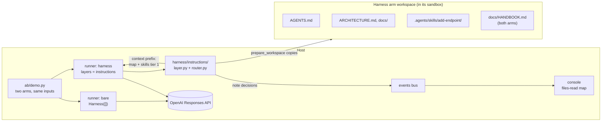
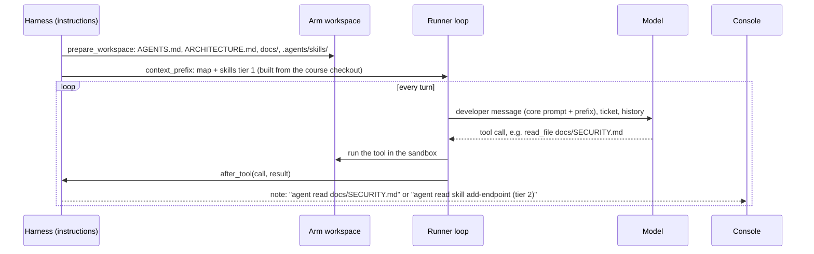

# S1 Instructions: what the agent knows

Reading time: about 15 minutes.

This section follows one order: the problem the task sets, the cause (cited), the harness piece, how
`shipharness` implements it, what the A/B measures, and, last, what the piece assumes about the model
and what the course pilot measured. Source IDs (A1, B1, ...) and finding IDs (F-a-NN, F-b-NN) are
listed in [REFERENCES.md](../../REFERENCES.md), which is generated when the course is released. Code
excerpts come from the walkthrough anchors `S1:agents_md`, `S1:progressive`, and `S1:prefix`; print
one with `uv run python scripts/anchors.py extract S1:prefix`.

A note on labels. "S1", "layer", "trap", "blinded reviewer", and the house rules R1-R7 are course
labels, not source terms. "House rules" is the course's name for what A1 calls "golden principles"
(A1, F-a-99).

---

## 1. The problem the task sets

The S1 demo task is F1, org-wide issue search. `GET /issues` lists every live issue of the caller's
org across its projects, with filters and cursor pagination (`teamtrack/docs/features/f1.md`). Both
arms start from checkpoint `m1-s1-start` and get the same ticket, which ends with: "The full spec
is in docs/features/f1.md. Follow the house rules in docs/HANDBOOK.md and add tests."
(`datasets/teamtrack-features-v1.jsonl`, example `F1-canonical`).

TeamTrack already has an endpoint that looks like most of the answer: the legacy `GET /v1/issues`
(`teamtrack/app/api/legacy_v1.py`) returns issues with offset pagination and no org filter. Its query
sits in the file the agent must edit for F1, a few lines below `list_for_project`, the tenant-scoped
query it should copy:

```python
# teamtrack/app/repositories/issues.py (lines 53-55): the legacy trap
def list_all_legacy(session: Session, offset: int, limit: int) -> list[Issue]:
    """LEGACY (used only by /v1/issues). Not tenant-scoped: do not use or copy this function."""
    return list(session.scalars(select(Issue).order_by(Issue.id).offset(offset).limit(limit)))
```

The legacy handler is a task-design choice of the course, present for both arms. It is there because
A1 reports that "Codex replicates patterns that already exist in the repository—even uneven or
suboptimal ones." (A1, F-a-20).

What the failure looks like: an arm that starts from the legacy query, or forgets the org check on one
filter, ships a `GET /issues` that answers an Acme user with Globex data. The referee's R1 check calls
every endpoint as Acme with Globex IDs and expects 404 (`src/shipharness/checks/r1_tenant.py`). The
existing `/v1/issues` leak is part of the checkpoint baseline; only new violations count.

The bare arm is not missing the rule. It is in the "Legacy /v1 API" section of `docs/HANDBOOK.md`
(line 136 of 150) and in two docstrings inside the legacy code itself. The handbook is the only place
that states it before the agent reaches that code, and only if the agent opens the handbook.

The course pilot did not see this failure in any run, on the canonical ticket or on its trap variant;
section 6 gives the results and what they say about the map.

---

## 2. The cause

### 2.1 What is not in context does not exist for the agent

A1 states the core point: "From the agent’s point of view, anything it can’t access in-context while
running effectively doesn’t exist." (A1, F-a-05).

In the bare arm the tenant rule is in the repository; whether it is in context when the agent writes
`GET /issues` depends on what it read first.

### 2.2 Agents copy the patterns they find

The second part of the cause is the trap: the agent "replicates patterns that already exist in the
repository" (A1, F-a-20). Code the agent opens is in context by definition, so a legacy handler that
already lists all issues competes with a rule the agent may never have loaded.

The course's cause 3 has no single source sentence; its sources stand side by side in S3. S1 uses only
A1's pattern copying (F-a-20), for the trap.

### 2.3 One big instruction file is not the fix

A simple response would be to paste every rule into the prompt. A1 explains why a single large
instruction file fails: "Context is a scarce resource. A giant instruction file crowds out the task,
the code, and the relevant docs" (A1, F-a-23); "Too much guidance becomes non-guidance." (A1,
F-a-24). It also goes stale (F-a-25) and cannot be checked mechanically (F-a-26).

---

## 3. The harness piece

### 3.1 AGENTS.md as a map

"give Codex a map, not a 1,000-page instruction manual." (A1, F-a-22). "So instead of treating
AGENTS.md as the encyclopedia, we treat it as the table of contents." (A1, F-a-27). The file is short
and always present: "A short AGENTS.md (roughly 100 lines) is injected into context and serves
primarily as a map, with pointers to deeper sources of truth elsewhere." (A1, F-a-28).

### 3.2 docs/ as the system of record

The map points into "a structured docs/ directory treated as the system of record." (A1, F-a-29).
A1's layout figure (F-a-30) puts `AGENTS.md` and `ARCHITECTURE.md` at the repository root and the
other documents inside `docs/`. TeamTrack's harness docs follow that layout, and each house rule has
one home:

| File in the harness arm's workspace | Holds |
|---|---|
| `AGENTS.md` (94 lines) | The map: "Where to look" table, house rules R1-R7 at a glance, "Do not copy" note on `/v1/issues` |
| `ARCHITECTURE.md` | Layers `api → services → repositories → db`, R6 |
| `docs/SECURITY.md` | R1 tenant isolation, R2 roles |
| `docs/design-docs/api-conventions.md` | R3 list and error envelopes, status codes |
| `docs/RELIABILITY.md` | R4 idempotent creates, R5 audit, R7 migrations |
| `docs/QUALITY_SCORE.md` | Testing, known gaps, the legacy endpoint |
| `docs/product-specs/`, `docs/references/` | Feature specs; Alembic and import-linter notes |
| `.agents/skills/add-endpoint/` | One Agent Skill: the steps for adding an endpoint |

### 3.3 Progressive disclosure, for docs and for skills

"This enables progressive disclosure: agents start with a small, stable entry point and are taught
where to look next, rather than being overwhelmed up front." (A1, F-a-36).

The Agent Skills specification defines the same idea for skills, in three tiers (B1, F-b-05):

| Tier | What loads | When | Size guidance (B1) |
|---|---|---|---|
| 1 Metadata | `name` and `description` from the frontmatter | At startup, for every skill | "~100 tokens" |
| 2 Instructions | The full `SKILL.md` body | When the skill is activated | "< 5000 tokens recommended" |
| 3 Resources | Files in `scripts/`, `references/`, `assets/` | "only when required" | Small files |

B2 calls the three stages Discovery, Activation, and Execution (B2, F-b-05). A skill's `name` "Must
match the parent directory name" (B1, F-b-02), and its `description` "Should describe both what the
skill does and when to use it" (B1, F-b-03). The description is the only text the agent has when it
decides whether to open the skill. TeamTrack's skill begins:

```yaml
# teamtrack/harness/instructions/.agents/skills/add-endpoint/SKILL.md (lines 1-4)
---
name: add-endpoint
description: Add or change a TeamTrack HTTP endpoint so it follows house rules R1-R7 (tenant scoping, roles, list and error envelopes, idempotent creates, one audit row per write, layering, migrations) and ships with tests. Use when a ticket adds a route, changes a route's behaviour, or adds a field that needs a schema change.
---
```

Its step 0, "Start from the right example", names `/v1/issues` as the wrong one and
`app/api/projects.py` as the right one. Tier 3 is `references/tests.md`, one level deep (B1, F-b-07).

### 3.4 The context prefix (course mechanism)

A1's "injected into context" (F-a-28) needs a concrete place. In `shipharness` it is the context
prefix: one stable block sent as the developer message of every session, holding the core system
prompt (the same for both arms), the map, and the skills catalogue (tier 1). No source names this
block. It is built from the course checkout, not the arm's workspace, so an agent that edits its own
`AGENTS.md` does not change what it is told (`src/shipharness/harness/instructions/router.py`).

### 3.5 Docs that are checked

"Dedicated linters and CI jobs validate that the knowledge base is up to date, cross-linked, and
structured correctly." (A1, F-a-37). Its lint messages also teach: "we write the error messages to
inject remediation instructions into agent context." (A1, F-a-97). Assignment A1 asks you to build
such a checker (broken links and rule coverage) for a restructured instruction set.

---

## 4. How shipharness implements it

### 4.1 Where the layer sits



The layer talks to the runner only through three hooks (`src/shipharness/harness/base.py`; section
4.5 shows them in one run): `prepare_workspace` copies `teamtrack/harness/instructions/` into the
workspace and never touches `docs/HANDBOOK.md` (`layer.py`); `context_prefix` returns the block from
`build_prefix` (`router.py`); `after_tool` emits a `note` decision when the agent reads a placed doc
or skill file. The layer never blocks a tool call and never calls the model; it enforces nothing.
Enforcement is S3 and S4.

### 4.2 The prefix (anchor `S1:prefix`)

```python
# src/shipharness/harness/instructions/router.py (lines 29-47)
def build_prefix(source: Path) -> str:
    """One stable text block: the map, then tier 1 of every skill (name + description).

    A1: "A short AGENTS.md (roughly 100 lines) is injected into context and serves primarily as a
    map, with pointers to deeper sources of truth elsewhere." The documents the map points to are
    not injected; the agent reads them with read_file when its task needs them. Skills follow the
    same progressive disclosure (B1): only the catalogue line is here, never a SKILL.md body.
    """
    source = Path(source)
    agents_md = strip_markers((source / MAP_FILE).read_text(encoding="utf-8")).strip()
    blocks = [
        "Repository map (AGENTS.md at the workspace root). It points to the documents to read "
        "before you change code; open them with read_file when your task needs them.",
        agents_md,
    ]
    catalogue = SkillsLoader(source / SKILLS_DIR, workspace_prefix=SKILLS_DIR).catalogue_block()
    if catalogue:
        blocks.append(catalogue)
    return "\n\n".join(blocks)
```

The runner sends the core system prompt plus this block as each session's developer message
(`base_items` in `src/shipharness/runner/loop.py`); the bare arm gets the core prompt alone.

### 4.3 Progressive disclosure (anchor `S1:progressive`)

`SkillsLoader.catalogue_block` (`src/shipharness/runner/skills_loader.py`) reads only each skill's
frontmatter and writes one line per skill. Tiers 2 and 3 are never pre-loaded: the agent opens them
with `read_file`, and `skill_for_path` reports the tier a read touched, which drives the files-read map
on console screen 3.

### 4.4 The map itself (anchor `S1:agents_md`)

The anchor covers lines 1-38 of the 94-line `teamtrack/harness/instructions/AGENTS.md`: the opening,
the "Where to look" table, and the house rules at a glance. All 94 lines are in the prefix.

### 4.5 The layer's flow in one run



### 4.6 What the bare arm gets

Course rule: the harness may reorganise knowledge, never add facts the bare arm cannot read. Every rule
in the harness docs also appears in `docs/HANDBOOK.md`, which both arms have, and a unit test checks
this (`tests/unit/harness_instructions/test_parity.py`). Both arms get the same ticket, model, effort,
tools, turn budget, cost cap, and sandbox. In demo-1 the harness arm runs the instructions layer alone
(`section_layers` in `src/shipharness/ab/demo.py`).

---

## 5. What the A/B measures

### 5.1 Primary measure (pre-registered)

The course registered one primary measure for S1 before any run: for F1, a run fails if it ships at
least one new R1 violation. The dataset carries it as `primary_measure: r1_new_violations>=1` on every
F1 task (`REGISTERED_PRIMARY` in `src/shipharness/datasets/features_checks.py`). Results are runs
failing out of k, per arm, one dot per run, never a percentage (a course rule). "New" means relative
to the checkpoint baseline.

### 5.2 Secondary measures (reported, not primary)

From each arm's score record (`ScoreRecord` in `src/shipharness/ab/score.py`):

| Field | Why it matters for S1 |
|---|---|
| `r1_leaks` | Violations whose 2xx body contains Globex data: the worst kind of R1 failure |
| `r3_new_failures` | API conventions (list and error envelopes, status codes) |
| `hidden_passed` / `hidden_total` | Did the feature work? `F1-canonical` lists 52 hidden test ids |
| `regression_passed` / `regression_total` | Existing tests keep passing |
| `reviewer_verdict` | The blinded reviewer (course design after A3's separate evaluator, F-a-110): a second model judges each diff with arm labels removed (`src/shipharness/reviewer/blind.py`) |
| `cost_usd`, `turns_total`, `wall_s` | What each arm spent |

The files-read map on console screen 3 is not a score; it only shows what each arm opened with
`read_file`.

### 5.3 Checks on the comparison itself

- Swap test (`make swap-1`): each arm's diff is judged again under the other arm's label, with no
  model calls; every judged measure must come out the same (`src/shipharness/ab/recorded.py`).
- Layer switch (`make demo-1 LAYERS=-instructions`): both arms run bare, so any gap is run-to-run
  variation.
- Ablation: A3 describes "removing one component at a time and reviewing what impact it had on the
  final result." (A3, F-a-125). The course planned an ablation batch that removes `instructions`
  from the full stack; it was not run (section 6.1).

### 5.4 What this A/B cannot tell you

- The A/B compares the same knowledge in two forms (a map in the prefix against a handbook on disk).
  It does not test whether rules help at all.
- The ticket matters as much as the harness. A ticket that points to the handbook puts the rules in
  the bare arm's context too (section 1).
- One feature, one model, one effort setting. The reworded and alternate-checkpoint F1 tasks in the
  `section-1` subset test whether a result depends on one wording or one repository state.

---

## 6. What the map assumes, and what the pilot measured

A3 gives the test every harness piece should face: "every component in a harness encodes an
assumption about what the model can't do on its own, and those assumptions are worth stress testing"
(A3, F-a-124). The map's assumption, in the course's words: the model will not apply a rule it has
not been pointed to. Its basis is A1's point about context (A1, F-a-05, F-a-28).

### 6.1 The primary measure

Measured in the course pilot: gpt-6-luna at the same effort for both arms. Runs failing the primary
measure (one or more new R1 violations), per arm:

| Run | Ticket, effort | Bare | Harness | A/Bs |
|---|---|---|---|---|
| 2, 2026-10-16 | `F1-canonical`, medium | 0 of 3 | 0 of 3 | `ab-20261016-181736-a07558`, `ab-20261016-183644-0036f0`, `ab-20261016-185628-37483b` |
| Live console check, 2026-10-16 | `F1-canonical`, medium | 0 of 1 | 0 of 1 | `ab-20261016-210339-909651` |
| 3, 2026-10-16 | `F1-trap`, medium | 0 of 3 | 0 of 3 | `ab-20261016-211419-07937b`, `ab-20261016-212745-2c14fb`, `ab-20261016-214636-c8b3c4` |
| 4, 2026-10-16 | `F1-trap`, low | 0 of 3 | 0 of 3 | `ab-20261016-232842-b372c2`, `ab-20261016-233807-3f34fa`, `ab-20261016-234639-4a18bd` |
| Class-profile round, 2026-10-17 | `F1-trap`, low, Fast tier | 0 of 1 | 0 of 1 | `ab-20261017-084558-0356a0` |

Every arm passed 52 of 52 hidden tests; run ids are in [demo/README.md](demo/README.md) section 11.
No measurable difference on this task with this model (course pilot, runs 3 and 4 and the
class-profile round). The course planned larger batches (k=10) and a leave-one-out ablation; neither
was run, because the pre-registered pilot gate did not pass.

### 6.2 Why the assumption did not hold here

On the canonical ticket the bare arm was pointed to the rule anyway. The ticket ends "Follow the house
rules in docs/HANDBOOK.md"; every bare arm in run 2 opened the handbook with its third tool call; and
`read_file` returns up to 400 lines (`src/shipharness/runner/tools.py`), so the whole 150-line
handbook was in context before any code was read. The trap ticket `F1-trap` names
`app/api/legacy_v1.py` as the place where "a lot of the query code exists" and does not mention the
handbook (`datasets/teamtrack-features-v1.jsonl`); still, no arm copied the legacy query into a leak. In the
class-profile round the bare arm did not open the handbook in its first nine tool calls and wrote a
scoped query all the same. For this model and these tickets, the map had nothing to fix.

### 6.3 Post hoc: what else the arms did

These measures were chosen after the results were known, so they describe and do not test (10 runs
per arm: runs 2, 3, and 4 and the console check). Harness arms claimed done in 5 runs, bare arms in 9;
no claim was false in either arm. Median cost per arm was $0.0122 against $0.0103, and median arm
wall time 168 s against 177 s; neither arm hit the agent time limit. The map cost little here and
changed nothing the referee measures.

The A/B does not measure everything a map is for: A1's other reasons against one large file, that it
goes stale and cannot be checked mechanically (section 2.3), concern the people who maintain the
rules, not one run.

### 6.4 What class shows instead

With no gap to show, S1 runs no live A/B in class. It runs `make show-1`: the harness arm alone
reading the map, live, with the live checks and the live console; runbook in
[demo/README.md](demo/README.md). The pilot did not measure A1's
own comparison, a map against one giant instruction file (A1, F-a-23, F-a-24): its bare arm has a
handbook on disk (section 5.4).

On your own repository, keep the map where a measure on your model shows it earns its place, or for
the maintenance reasons above; say which.

---

## Check your understanding

1. The bare arm has `docs/HANDBOOK.md` with the same rules. Which A1 sentence explains why the rule can
   still be missing when the query is written?
2. Why does `build_prefix` read from the course checkout and not from the arm's workspace?
3. A skill's description says only "Endpoint helper." Which tier of progressive disclosure fails, and
   what would the agent miss?
4. In the pilot the bare arm passed F1 in every run. Which assumption of the map did that test, and
   why was the canonical ticket a weak test of it?

## Sources

A1, A3, B1, and B2, all accessed 2026-10-16. Titles, links, and every finding ID cited here
are in [REFERENCES.md](../../REFERENCES.md).
