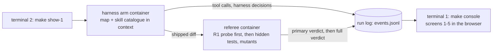
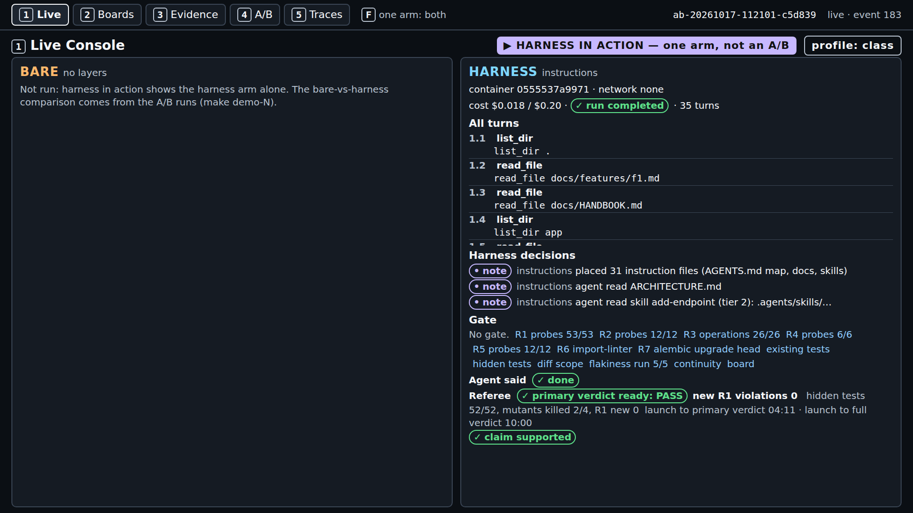
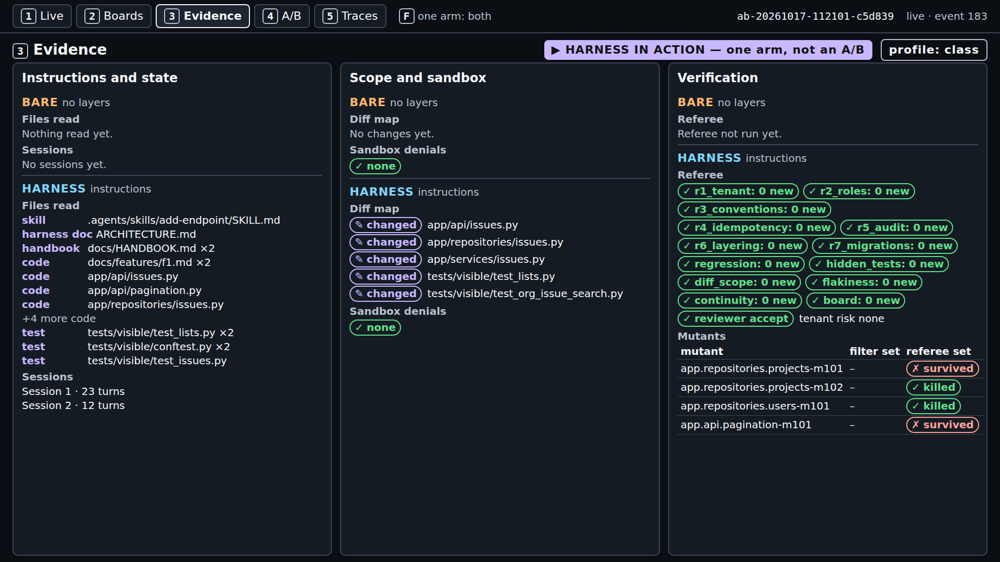
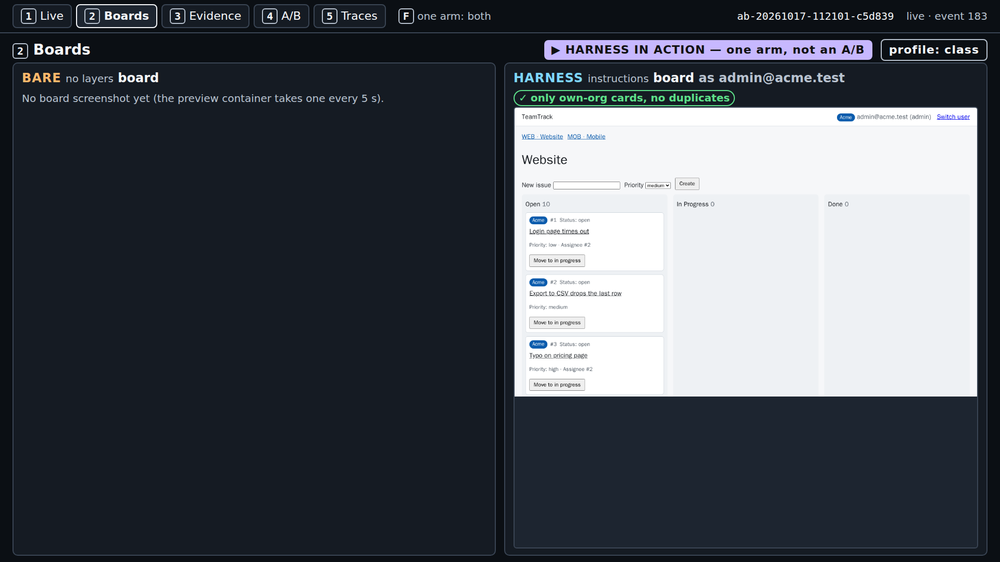
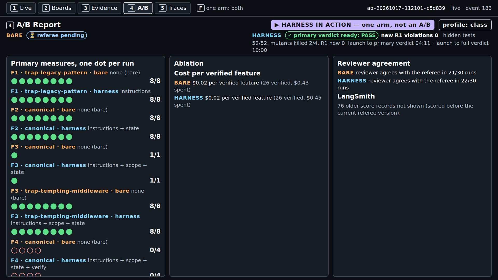

# Demo 1: org-wide issue search (F1), instructions layer

Runbook for the S1 demo, in eight parts: what it shows, what to install, the checks before you
start, the commands, what to watch minute by minute, how to read the result, time and cost, and what
to do when it fails. Reference material (poll, code walkthrough, every pilot result, the emergency
fallback) follows part 8. Concepts: [../concepts.md](../concepts.md). Source and finding IDs are
listed in [docs/REFERENCES.md](../../docs/REFERENCES.md), which is generated when the course is released.
Captured output and screenshots are labelled "captured on <date>, run <id>; your output will
differ".

---

## 1. What this demo shows and why

`make show-1` runs the harness arm alone, live, on F1 (`GET /issues`, org-wide issue search,
`platform/teamtrack/docs/features/f1.md`) with the instructions layer: an `AGENTS.md` map and an Agent Skill
catalogue in its context, the focused docs on disk; the referee then checks tenant isolation (house
rule R1) on what it shipped. It is not an A/B because the course pilot found no gap on F1 (no arm of
either kind added an R1 violation in 10 runs each, section 11), so the section shows the map doing
its job, live, and leaves the comparison to the pilot results on screen 4.

The task starts from checkpoint `m1-s1-start`. The repository holds a trap: the legacy
`GET /v1/issues` handler lists issues with no org filter, and A1 reports that "Codex replicates
patterns that already exist in the repository—even uneven or suboptimal ones." (A1, F-a-20). "Trap",
"layer", R1, and S1 are course labels, not source terms.



---

## 2. Prerequisites and dependencies

The course's tested platform is Ubuntu inside WSL2 on the class host. The setup pages hold every
step and say which ones were tested: [macOS](../../setup/macos.md) (not tested on a Mac),
[Windows with WSL2](../../setup/windows.md), [Linux](../../setup/linux.md).

| OS | Install (from the setup page) |
|---|---|
| macOS | `xcode-select --install` (git, make); `curl -LsSf https://astral.sh/uv/0.13.1/install.sh \| sh`; Docker Desktop, or `brew install colima docker` then `colima start --cpu 2 --memory 4` |
| Windows | In PowerShell as administrator: `wsl --install`; restart; then every command below runs in the Ubuntu terminal, with Docker Engine inside Ubuntu (no Docker Desktop) and the repository under `~`, never `/mnt/c` |
| Linux (Ubuntu) | `sudo apt update && sudo apt install -y git make curl`; `curl -LsSf https://astral.sh/uv/0.13.1/install.sh \| sh`; Docker Engine from Docker's apt repository ([linux.md](../../setup/linux.md), step 3); `sudo usermod -aG docker $USER`, then a new login |

Then, on every OS:

```bash
git clone https://github.com/ANI-IN/harness-engineering-session.git ~/shipharness
cd ~/shipharness
make setup        # uv sync --frozen, both sandbox images, .env from .env.example
```

and put `OPENAI_API_KEY` and `LANGSMITH_API_KEY` in `.env` (never print it on the projector). For
class commands (`--purpose class`, the default) also set `SHIPHARNESS_CLASS_DATE=<YYYY-MM-DD>`.

Versions on the class host (captured on 2026-10-17 from `git --version`, `make --version`,
`uv --version`, `docker --version`; your output will differ):

```text
git version 2.53.0
GNU Make 4.4.1
uv 0.13.1 (x86_64-unknown-linux-gnu)
Docker version 29.9.1, build dfc520d
```

Python: `pyproject.toml` requires `>=3.12`, `.python-version` pins `3.12`, and uv downloads it
(`make doctor` showed `3.12.15` on the class host).

---

## 3. Before you start

Run these from the repository root, in this order.

**`make doctor`** checks Python, git, uv, the container runtime, both keys, the price table, and that
`.env` is not tracked. Captured on 2026-10-17 at commit 182d1a2 in a checkout without `.env` (so
both keys show `x missing`); your output will differ:

```text
$ make doctor
uv run shipharness doctor
shipharness doctor
  + ok          python                 3.12.15
  + ok          git                    /usr/bin/git
  + ok          uv                     /home/ani/.local/bin/uv
  + ok          container runtime      docker at /usr/bin/docker
  x missing     OPENAI_API_KEY         not set
    next step: OPENAI_API_KEY is missing: add it to .env at the repo root
  x missing     LANGSMITH_API_KEY      not set
    next step: LANGSMITH_API_KEY is missing: add it to .env at the repo root
  + ok          prices                 gpt-6-luna, gpt-5.6-luna
  + ok          .env not in git        not tracked
  result: x not ready (fix the items above)
Cost: $0.000000 (no model calls)
make: *** [Makefile:54: doctor] Error 1
```

Ready means: each key line reads `+ ok ... accepted by OpenAI` (or `accepted by LangSmith`), the
`container runtime` line starts with `+ ok`, and the last line is `result: + ready`
(`platform/src/shipharness/doctor.py`). The key check lists models and uses no tokens.

**`make warm`** (no model calls, safe to rerun) runs `uv run shipharness warm --profile class
--images-command "make images RUNTIME=docker"`. From `uv run shipharness warm --help` (captured on
2026-10-17 at commit 182d1a2): "Prepare the class host: images, containers, and baselines. No model
calls." It rebuilds an image only if its source changed, starts each image once, and caches the
referee and gate baselines of the class tasks. The class-profile round measured 407 s for a first run
(images rebuilt in 145 s; 7 referee and 4 gate baselines) and 1.2 s for a second (course pilot,
class-profile round, 2026-10-17). `make -n warm` is now a true dry run: it only prints the command
(fixed in commit 88739f0).

**Keys present.** `make doctor` ends with `result: + ready`. For `--purpose class`, `.env` also has
`SHIPHARNESS_CLASS_DATE` set to the class day; without it the command stops with
`x SHIPHARNESS_CLASS_DATE is not set: ...` and exit 2, before any arm starts.

---

## 4. Run it

Two terminals, both in the repository root inside WSL2 (or your Linux or macOS shell).

1. **Terminal 1, the console** (leave it running):

   ```bash
   make console
   ```

   Captured on 2026-10-17 from the quiet timing runs (`make console`); your output will differ:

   ```text
   uv run shipharness console --port 8765
   Console: http://127.0.0.1:8765/
   INFO:     Uvicorn running on http://127.0.0.1:8765 (Press CTRL+C to quit)
   ```

   Open `http://127.0.0.1:8765/` in the browser (on Windows, the Windows browser works).

2. **Terminal 2, the live run**, right after the poll closes (section minute 3):

   ```bash
   make show-1
   ```

   It runs (from `make -n show-1`, captured on 2026-10-17 at commit 182d1a2):

   ```text
   uv run shipharness ab --section demo-1 --feature F1 --arms harness   --purpose class \
     --profile class
   ```

   One agent run (build and test phases) and one review, at most $0.24 at the caps. The class
   profile is the same one the A/Bs use: effort low, OpenAI's Fast tier for the agent, 2 CPUs per
   container. `--arms harness` makes it "harness in action": its record stays out of every
   bare-against-harness comparison and out of `make swap-1`. The command refuses a missing or
   rejected key, or a stand-in model client, before the arm starts (exit 2).

3. **In the browser**, reload the runs list, open the newest run, and press `1`. Keys: `1` Live
   Console, `2` Boards, `3` Evidence, `4` A/B Report, `5` Traces; `F` shows one arm full screen.

4. **Terminal 2 at the end** prints the record line and the `Cost:` line (part 5 has the captured
   lines). Exit code 0 when the arm completed, 2 when it ended `ABORTED`, 1 on `ERROR`.

Class timing (50 minutes): poll 0-3; launch at minute 3; concepts 5-20 and the code walkthrough
(section 10) 20-30 while the run goes on; demo block 30-45 on the finished run (screens `1`, `3`,
`2`, then `4`); discussion 45-50.

---

## 5. What to watch, minute by minute

From a real `make show-1` on a quiet machine (captured on 2026-10-17, run
`ab-20261017-112101-c5d839`, `make show-1 PURPOSE=pilot`, the class profile; screenshots of screens 1
and 2 every minute and of screens 1-5 after the verdict). Minutes count from the launch; your run
will differ.

| Minute | Screen | What appears |
|---|---|---|
| 0 | `1` | The badges "HARNESS IN ACTION — one arm, not an A/B" and "profile: class"; the bare panel "Not run: harness in action shows the harness arm alone."; the first harness decision, `placed 31 instruction files (AGENTS.md map, docs, skills)`. Within 20 s: `agent read ARCHITECTURE.md` and `agent read skill add-endpoint (tier 2): .agents/skills/add-endpoint/SKILL.md` |
| 1 | `1` | Build turns `1.14`-`1.21`: patches to `app/services/issues.py`, `app/api/issues.py`, and the visible tests, then `run_visible_tests`. "Gate: No gate." (demo-1 has no verification layer, and the instructions layer never blocks a tool call). At 1:20 the agent claimed done for the build phase: "Agent said ✓ done" |
| 2-3 | `1` | The test phase (turns `2.x`, 12 turns): it reads the visible tests, writes `tests/visible/test_org_issue_search.py`, runs it. Referee: "⏳ referee pending" |
| 4 | `1` | The run ended at 3:53 ("✓ run completed · 35 turns"); the R1 probe finished at 4:11: "✓ primary verdict ready: PASS", "new R1 violations 0", "⏳ secondary checks running", "launch to primary verdict 04:11" |
| 4-10 | `1` | Secondary checks (R2-R7, existing tests, hidden tests, diff scope, five flakiness runs, continuity, board) finished at 8:38; the referee mutants and the review until 10:00 |
| 10 | `1` | The full verdict: "hidden tests 52/52, mutants killed 2/4, R1 new 0 · launch to full verdict 10:00" and "✓ claim supported" |


*Console screen 1 (show-1), captured on 2026-10-17, run ab-20261017-112101-c5d839; your output will differ.*


*Console screen 1 (show-1), captured on 2026-10-17, run ab-20261017-112101-c5d839; your output will differ.*



*Console screen 1 (show-1), captured on 2026-10-17, run ab-20261017-112101-c5d839; your output will differ.*

In class, read the pill and both times aloud, then switch screens:

- **Screen `3` (Evidence)**: the files-read map, grouped as skill, harness doc, handbook, code, test
  (only `read_file` calls count; a `cat` through `run` does not appear); the diff map (five changed
  files); and the referee list, where `r1_tenant: 0 new` is the primary measure. The existing
  `GET /v1/issues` leak is a baseline finding and does not count. In this run the agent opened the
  skill, `ARCHITECTURE.md`, and the handbook (twice), and not `docs/SECURITY.md`.

  

  *Console screen 3 (show-1), captured on 2026-10-17, run ab-20261017-112101-c5d839; your output will differ.*

- **Screen `2` (Boards)**: the board as an Acme user with "✓ only own-org cards, no duplicates". A
  card is marked ⚠ when its `data-org` is not the viewer's org (`platform/src/shipharness/console/board_capture.py`);
  no arm of any real run leaked another org's cards, so the ⚠ marks never appeared (course pilot,
  class-profile round, 2026-10-17). F1 changes no board pixels, so there is one frame.

  

  *Console screen 2 (show-1), captured on 2026-10-17, run ab-20261017-112101-c5d839; your output will differ.*

- **Screen `4` (A/B Report)**: the pilot's dots per feature, variant, and arm (F1 trap ticket: 8 of 8
  passed in each arm, from the score records on the class host), and this run's verdict at the top. Say: "Tonight's run is not a
  dot in the comparison."

  

  *Console screen 4 (show-1), captured on 2026-10-17, run ab-20261017-112101-c5d839; your output will differ.*

- **Screen `5` (Traces)**: the live tail of referee events and the LangSmith links for the agent and
  the referee.

  

  *Console screen 5 (show-1), captured on 2026-10-17, run ab-20261017-112101-c5d839; your output will differ.*

Terminal 2 at the end (captured on 2026-10-17, run ab-20261017-112101-c5d839, `time make show-1
PURPOSE=pilot`; your output will differ):

```text
A/B ab-20261017-112101-c5d839 (F1, layers=['instructions'], profile=class, harness in action)
  harness  completed         claim=done     primary={"r1_new_violations": 0} passed=True hidden 52/52 mutants 2/4 reviewer=accept cost=$0.0179
Cost: $0.019744 (this command: gpt-5.6-luna $0.001862, gpt-6-luna $0.017882; session $1.342904 of $2.50; build $2.268653 of $15.00 ($12.731347 left))

real	10m14.019s
```

The `session` figure counts every command run under the same session date (here the pilot's); a
class session starts at $0.

---

## 6. What a result means

**The verdict.** F1's primary measure fails a run when `r1_new_violations >= 1`: the referee calls
every endpoint as an Acme user with Globex ids and expects 404 (`platform/src/shipharness/checks/r1_tenant.py`).
"primary verdict ready: PASS" means the shipped change added no new R1 violation; the existing
`GET /v1/issues` leak is a baseline finding and does not count. The full verdict adds the secondary
checks: hidden tests passed (of 52), referee mutants killed (of 4), the reviewer.

**The three readings.** `make show-1` runs one arm, so it cannot show any of them on its own; they
come from A/Bs (pilot runs, and screen 4):

| Reading | What it would mean on F1 | The pilot |
|---|---|---|
| Harness ahead | The harness arm passes the primary measure (0 new R1 violations) in more runs than the bare arm | Not seen |
| No measurable difference | Both arms pass (or fail) in about the same number of runs | Measured: 0 of 10 failing runs in each arm (runs 2, 3, 4 and the live console check), 0 of 1 each in the class-profile round |
| Bare ahead | The bare arm passes in more runs than the harness arm | Not seen |

What to say: "Tonight's run is not a dot in the comparison. The comparison is the pilot, and it
shows no measurable difference on this task with this model."

---

## 7. Expected time and cost

| Run | Launch to primary verdict | Launch to full verdict | Wall time | Cost |
|---|---|---|---|---|
| `make show-1`, quiet machine, `ab-20261017-112101-c5d839` (2026-10-17) | 4 min 11 s | 10 min 0 s | 10 min 14 s | $0.019744 (agent $0.017882 at the Fast tier, review $0.001862) |
| Class-profile round, F1 harness arm, `ab-20261017-084558-0356a0` (2026-10-17, trap ticket, both arms running) | 114 s | 324 s | - | $0.0151 arm, $0.0028 review |
| `make show-1 PURPOSE=pilot` under load, `ab-20261017-092810-c7fc7c` (2026-10-17, other work on the machine) | - | - | 10 min 30 s | $0.0218 |

In class, a launch at section minute 3 at the quiet-machine pace gives the primary verdict near
minute 7 and the full verdict near minute 13, well before the demo block at minute 30. In the quiet
run the agent took 3 min 53 s (35 turns); the rest is the referee: R1 18 s after the run ended, the
secondary checks 4 min 27 s more, the mutants and the review 1 min 22 s more.

Caps (`.env.example`, `platform/src/shipharness/config/settings.py`): `MAX_RUN_COST_USD` $0.20 per arm,
`MAX_REVIEW_COST_USD` $0.04 per review, `MAX_SESSION_COST_USD` $2.50 for the class session,
`RUN_TIMEOUT_S` 300 s of agent time, `HARNESS_TIMEOUT_S` 120 s of harness work, `TOOL_TIMEOUT_S`
120 s per tool command. Fast-tier calls cost twice the Standard rate per token
(`platform/config/prices.toml`); the class profile changes effort, tier, and CPUs, not the caps.

---

## 8. If it fails

| Symptom | Cause (from the code) | Fix |
|---|---|---|
| `make show-1` exits 2 before the arm starts: `x OpenAI refused the key: ...; no arm was started` | `shipharness ab` refuses a missing or rejected `OPENAI_API_KEY`, or a stand-in client; there is no fallback to a stand-in | Fix the key, rerun `make doctor` until `result: + ready`; if the API is down, section 12 |
| The record line shows `ABORTED: timeout` (or `ABORTED: cap`) and the command exits 2 | The arm hit the 300 s agent time limit (`RUN_TIMEOUT_S`) or a cost cap | Keep it: aborted runs are judged and shown (a course rule). Read the primary verdict as usual |
| The run is slower than part 7 and the ledger shows `"service_tier": "default"` | OpenAI served a Fast request at the Standard tier; each call is priced by the tier the response reports (`platform/src/shipharness/cost/tracker.py`), so it costs less and runs slower | Nothing to fix; start the demo block on the running page: the primary verdict pill comes before the full verdict |
| The arm ends `ERROR` with `docker run failed: ...`, exit 1; or `make doctor` shows `container runtime ! warn` | Docker is not running, or an image is missing (`platform/src/shipharness/sandbox/docker.py`) | `docker info`; `sudo systemctl start docker` inside Ubuntu (Colima: `colima start`); `make warm` rebuilds missing images |
| `make console` fails with `address already in use` | Another console (or program) holds port 8765 | `make console CONSOLE_PORT=8766`, then open `http://127.0.0.1:8766/` |
| `x SHIPHARNESS_CLASS_DATE is not set: ...`, exit 2 | `--purpose class` without the class day | Set it in `.env`; `make show-1 PURPOSE=pilot` traces to `shipharness-pilot` instead |

Older notes said not to run `make -n warm` because it started the warm-up; that no longer applies
after commit 88739f0. Screen 2 empty ("No board screenshot yet") means the board preview did not
start; it is display only, so carry on with screens 1 and 3.

---

## Reference material

## 9. Poll question

> Both arms can open `docs/HANDBOOK.md`, which says "Do not copy" about `GET /v1/issues`. Only the
> harness arm gets the map and the skill catalogue in its context. In how many of 10 runs does each
> arm add at least one new R1 violation while building F1?
> A) both 0-2  B) bare 3-6, harness 0-2  C) bare 7-10, harness 0-2  D) about the same for both

The pilot's answer, from its 10 F1 runs per arm (runs 2, 3, and 4 and the live console check;
section 11): bare 0 of 10, harness 0 of 10, so A and D. The class-profile round added one more run
per arm: 0 of 1 each. In class: read the answer off the pilot slide, then ask the room why the
bare arm did as well (section 11 has the run logs).

## 10. Code walkthrough

Ten minutes, while the run goes on. Print an anchor with
`uv run python platform/scripts/anchors.py extract <id>`:

| Min | Open | Point at |
|---|---|---|
| 2 | `platform/teamtrack/app/api/legacy_v1.py` (28 lines) and `platform/teamtrack/app/repositories/issues.py` lines 19-26 and 53-55 | The legacy handler and its unscoped query, in the same file as the scoped `list_for_project` the agent should copy |
| 3 | Anchor `S1:agents_md` (`platform/teamtrack/harness/instructions/AGENTS.md`, lines 1-38 of 94) | The "Where to look" row for endpoints points to the skill; R1 "404, never 403"; below the anchor, "Do not copy" |
| 2 | Anchor `S1:progressive` (`platform/src/shipharness/runner/skills_loader.py`) | Tier 1 only (`catalogue_block`); tiers 2 and 3 load through `read_file`; `skill_for_path` reports the tier |
| 3 | Anchor `S1:prefix` (`platform/src/shipharness/harness/instructions/router.py`) | `build_prefix`: the map plus the catalogue, built from the course checkout, never from the workspace |

## 11. Pilot results

All from the course pilot: gpt-6-luna, the same settings for both arms, reviewer on. The score
records and run logs behind these tables are kept on the class host and are not part of the public
repository; the run ids identify them. "Existing tests" is the `regression` check: existing tests
keep passing.

### 11.1 What each arm read

The map's job is to put the rule in context before the agent writes the query (A1, F-a-05). The first
eight tool calls of each arm in one run 2 A/B (fields `name` and `target` of the `tool_call` events):

```text
captured on 2026-10-16, run ab-20261016-185628-37483b; your output will differ
bare     r-20261016-185628-8aa524: list_dir . | read_file docs/features/f1.md | read_file docs/HANDBOOK.md |
         list_dir app | read_file app/api/issues.py | read_file app/repositories/issues.py |
         read_file app/services/issues.py | read_file app/db/models.py
harness  r-20261016-185628-758650: list_dir . | read_file docs/features/f1.md | read_file docs/HANDBOOK.md |
         read_file .agents/skills/add-endpoint/SKILL.md | read_file ARCHITECTURE.md |
         read_file docs/SECURITY.md | read_file docs/design-docs/api-conventions.md | list_dir app
```

Across the three F1 A/Bs of pilot run 2 (ticket `F1-canonical`):

| What the run logs show | Bare arm | Harness arm |
|---|---|---|
| Opened `docs/HANDBOOK.md` (third call; the canonical ticket names it) | 3 of 3 | 3 of 3 |
| Opened the skill body (tier 2), on the fourth call | — | 3 of 3 |
| Opened the skill's `references/tests.md` (tier 3) | — | 0 of 3 |
| Opened `ARCHITECTURE.md` / `docs/SECURITY.md` / `docs/design-docs/api-conventions.md` | — | 3 / 2 / 3 of 3 |
| Opened `app/api/legacy_v1.py` or `app/services/legacy.py` | 0 of 3 | 0 of 3 |
| New query filters on `Issue.org_id` and `Project.org_id`, pages with `page` and `split_page` | 3 of 3 | 3 of 3 |

The harness arm read differently but did not ship differently: the canonical ticket handed the bare
arm the handbook, and with it every rule. On the trap ticket, which does not mention the handbook,
the bare arm of the class-profile round did not open it in its first nine calls and still wrote a
scoped query:

```text
captured on 2026-10-17, run ab-20261017-084558-0356a0; your output will differ
bare     list_dir . | read_file docs/features/f1.md | list_dir app | read_file app/api/issues.py |
         read_file app/services/issues.py | read_file app/repositories/issues.py |
         read_file app/repositories/projects.py | read_file app/api/pagination.py | read_file app/db/models.py
harness  list_dir . | read_file docs/features/f1.md | read_file ARCHITECTURE.md |
         read_file .agents/skills/add-endpoint/SKILL.md | list_dir app | read_file app/api/issues.py |
         read_file app/repositories/issues.py | read_file app/services/issues.py | read_file app/api/pagination.py
```

The scoping lines both arms wrote in one run 2 A/B (`app/repositories/issues.py` in each arm's
`diff.patch`, cut):

```text
captured on 2026-10-16, run ab-20261016-181736-a07558; your output will differ
bare (search):
+        .join(Project, Issue.project_id == Project.id)
+        .where(
+            Issue.org_id == org_id,
+            Project.org_id == org_id,
+            Issue.deleted_at.is_(None),
+            Project.archived_at.is_(None),
+        )
harness (list_for_org):
+        .join(Project, Project.id == Issue.project_id)
+        .where(
+            Issue.org_id == org_id,
+            Project.org_id == org_id,
+            Project.archived_at.is_(None),
+            Issue.deleted_at.is_(None),
+        )
```

### 11.2 Per-run results

Run 2 (2026-10-16, `F1-canonical`, effort medium) and the live console check (2026-10-16, one A/B with
board previews on, `make demo-1 PURPOSE=pilot`):

| A/B | Arm | Run id | Primary | R1 new | R1 leaks | R3 new | Hidden | Existing tests | Mutants | Reviewer |
|---|---|---|---|---|---|---|---|---|---|---|
| `ab-20261016-181736-a07558` | bare | `r-20261016-181736-490aa2` | pass | 0 | 0 | 0 | 52/52 | 144/144 | 3/4 | accept |
| | harness | `r-20261016-181736-c00503` | pass | 0 | 0 | 0 | 52/52 | 144/144 | 3/4 | accept |
| `ab-20261016-183644-0036f0` | bare | `r-20261016-183644-7e7ec9` | pass | 0 | 0 | 0 | 52/52 | 144/144 | 3/4 | reject |
| | harness | `r-20261016-183644-ba3b9a` | pass | 0 | 0 | 0 | 52/52 | 144/144 | 3/4 | reject |
| `ab-20261016-185628-37483b` | bare | `r-20261016-185628-8aa524` | pass | 0 | 0 | 0 | 52/52 | 144/144 | 3/4 | accept |
| | harness | `r-20261016-185628-758650` | pass | 0 | 0 | 0 | 52/52 | 144/144 | 3/4 | accept |
| `ab-20261016-210339-909651` (console check) | bare | `r-20261016-210339-bfe8e0` | pass | 0 | 0 | 0 | 52/52 | 144/144 | 2/4 | accept |
| | harness | `r-20261016-210339-817dbf` | pass | 0 | 0 | 0 | 52/52 | 144/144 | 3/4 | reject |

The reviewer rejections are about archived projects passed as `project_id`, not about tenancy (each
of those reviews says `tenant_isolation_risk: none`). The reviewer is a secondary measure.

Runs 3 (2026-10-16, `F1-trap`, effort medium), 4 (2026-10-16, `F1-trap`, effort low), and the
class-profile round (2026-10-17, `F1-trap`, effort low, Fast tier, 2 CPUs per container):

| Run | A/B | Arm | Run id | Primary | R1 new | R1 leaks | Hidden | Mutants | Shipped tests | Turns | Agent time (s) | Cost | Reviewer |
|---|---|---|---|---|---|---|---|---|---|---|---|---|---|
| 3 | `ab-20261016-211419-07937b` | bare | `r-20261016-211419-8fb5f4` | pass | 0 | 0 | 52/52 | 3/4 | 7 | 34 | 142 | $0.0086 | accept |
| | | harness | `r-20261016-211419-741ab3` | pass | 0 | 0 | 52/52 | 2/4 | 7 | 42 | 170 | $0.0124 | accept |
| 3 | `ab-20261016-212745-2c14fb` | bare | `r-20261016-212745-a9900c` | pass | 0 | 0 | 52/52 | 3/4 | 7 | 42 | 194 | $0.0110 | accept |
| | | harness | `r-20261016-212745-8a0bbf` | pass | 0 | 0 | 52/52 | 3/4 | 10 | 42 | 248 | $0.0121 | accept |
| 3 | `ab-20261016-214636-c8b3c4` | bare | `r-20261016-214636-8e13f4` | pass | 0 | 0 | 52/52 | 2/4 | 5 | 41 | 223 | $0.0102 | accept |
| | | harness | `r-20261016-214636-53d21a` | pass | 0 | 0 | 52/52 | 3/4 | 12 | 42 | 197 | $0.0115 | accept |
| 4 | `ab-20261016-232842-b372c2` | bare | `r-20261016-232842-1b27e7` | pass | 0 | 0 | 52/52 | 2/4 | 8 | 26 | 112 | $0.0051 | accept |
| | | harness | `r-20261016-232842-f3515e` | pass | 0 | 0 | 52/52 | 2/4 | 7 | 39 | 165 | $0.0087 | accept |
| 4 | `ab-20261016-233807-3f34fa` | bare | `r-20261016-233807-7f74f1` | pass | 0 | 0 | 52/52 | 3/4 | 9 | 32 | 123 | $0.0068 | accept |
| | | harness | `r-20261016-233807-36c040` | pass | 0 | 0 | 52/52 | 3/4 | 20 | 37 | 176 | $0.0086 | accept |
| 4 | `ab-20261016-234639-4a18bd` | bare | `r-20261016-234639-cd17ac` | pass | 0 | 0 | 52/52 | 2/4 | 6 | 30 | 108 | $0.0058 | accept |
| | | harness | `r-20261016-234639-209fdf` | pass | 0 | 0 | 52/52 | 3/4 | 18 | 37 | 153 | $0.0084 | reject |
| Class-profile round | `ab-20261017-084558-0356a0` | bare | `r-20261017-084558-b3f598` | pass | 0 | 0 | 52/52 | 3/4 | 9 | 29 | 111 | $0.0122 | accept |
| | | harness | `r-20261017-084558-834f03` | pass | 0 | 0 | 52/52 | 3/4 | 6 | 32 | 92 | $0.0151 | accept |

Runs failing the primary measure (`r1_new_violations >= 1`): run 2 bare 0 of 3, harness 0 of 3;
console check 0 of 1 each; run 3 bare 0 of 3, harness 0 of 3; run 4 bare 0 of 3, harness 0 of 3;
class-profile round 0 of 1 each. No measurable difference on this task with this model (course pilot,
runs 3 and 4 and the class-profile round). The course planned batches of 10 runs per arm and a
leave-one-out ablation (all layers minus instructions); neither was run, because the pre-registered
pilot gate (the harness arm ahead in at least three of four sections) did not pass.

Post hoc, chosen after the results and descriptive only (10 F1 runs per arm: runs 2, 3, and 4 and the
console check): claimed done, harness 5 of 10, bare 9 of 10, no false claim in either arm; median
cost per arm $0.0122 against $0.0103; median arm wall time 168 s against 177 s; agent time limit hit
0 of 10 in both arms.

Class-profile round, F1 (A/B `ab-20261017-084558-0356a0`, 2026-10-17, both arms running; times from
the launch): bare 133 s to the primary verdict and 336 s to the full verdict, arm $0.0122, review
$0.0028; harness 114 s and 324 s, arm $0.0151, review $0.0028. The round's agent cost was $0.1689
for 8 arms, every call reported `fast`. The live console check took 9 min 10 s for its whole A/B and
$0.027821 (both arms and both reviews, cost ledger).

## 12. Emergency fallback

Only if `make show-1` fails on stage (API outage, rate limit, Docker failure) and part 8 cannot fix
it in a minute: replay the class-profile round's F1 A/B, which shows the same map reads with a
RECORDING badge on every screen. It needs the run folder on the class host
(`.shipharness/runs/ab-20261017-084558-0356a0`, not part of the public repository) and Docker for the
referee, and makes no model calls:

```bash
make replay RUN=ab-20261017-084558-0356a0
```

Use the replay only when the live run fails, never to replace a run that worked but gave an
unwelcome result (a course rule: every run is a dot). Say that it is a recording.
