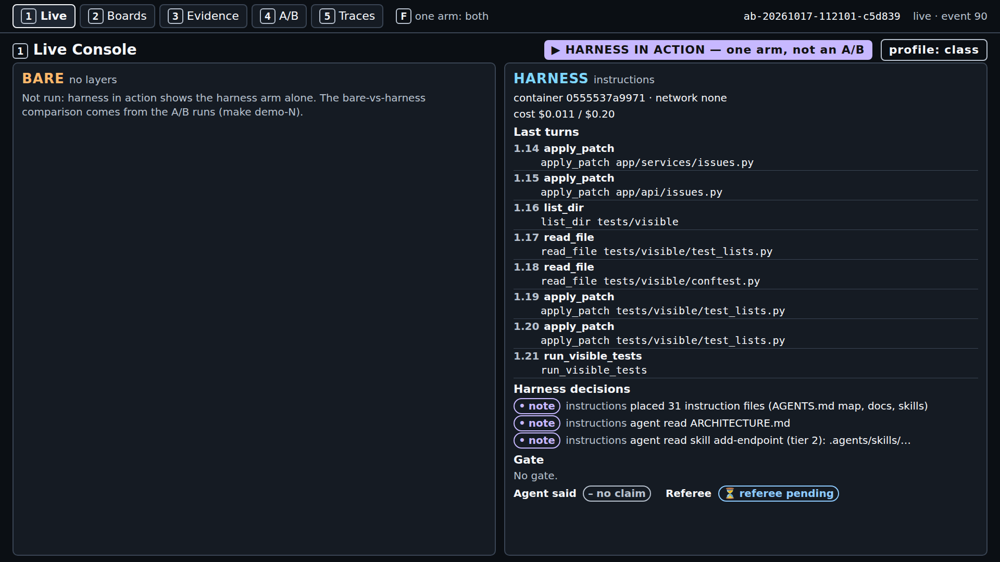
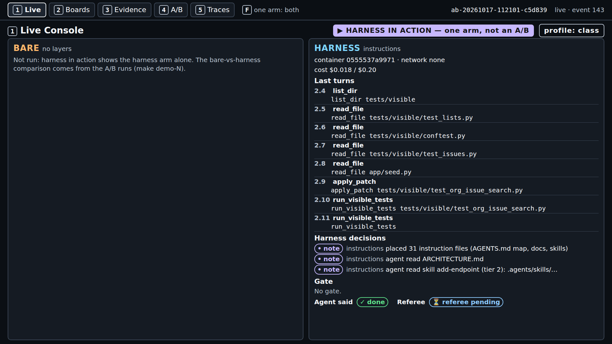
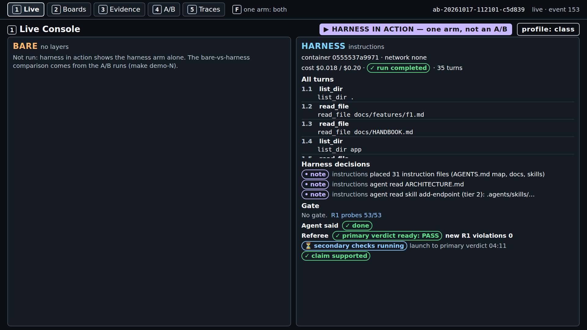
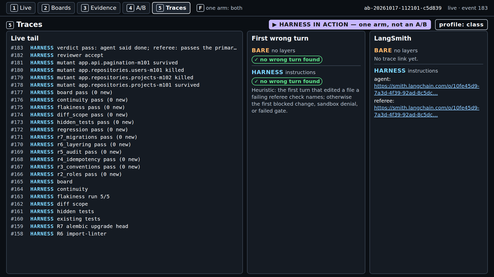

# Module 1: Harness Engineering for Coding Agents - Demo 1: What one real run looked like

This folder holds the output and the screenshots of one real `make show-1` run, on a quiet machine,
with the class settings. Nothing here is staged or edited, except where a line says it was cut. Use it
to check that your run looks roughly like this one, or to follow the demo without running it. When
and how it was captured is on the [evidence page](../../../docs/evidence/s1.md#s1-show-1-capture).

> **Terms on this page**
>
> - **Primary verdict**: The referee's answer to the one question the section asks.
> - **Full verdict**: The primary verdict plus every other check: hidden tests, mutants, review.
> - **Harness note**: A line the instructions layer adds to screen 1, such as "agent read ARCHITECTURE.md".
> - **R1**: House rule 1, tenant isolation: another org's resource answers 404, never 403.

## Terminal output

| File | What it holds |
|---|---|
| `terminal.txt` | Terminal 2: the command, the record line, the cost line, the wall time |

The run id and the running cost totals are cut from `terminal.txt` where it shows `...`.

## Screenshots

> Your output will differ: run times, ids, and the agent's wording change on every run.

*Minute 1: 31 files placed, `ARCHITECTURE.md` read, the skill read (tier 2). No gate; referee pending.*

*Minute 3: the agent has said done and, in its second session, writes and runs its own test.*

*Minute 4: "primary verdict ready: PASS", new R1 violations 0, secondary checks still running.*

*The end: 35 turns, hidden tests 52/52, mutants killed 2/4, primary verdict at 04:11, full at 10:00.*

*Screen 2: only own-org cards, no duplicates.*

*Screen 3: the skill, `ARCHITECTURE.md`, and the handbook read; five files changed; every check 0 new.*

*Screen 4: the test runs before class, one dot per run. This run's verdict is at the top, not a dot.*

*Screen 5: the live tail of referee events and the LangSmith links for the agent and the referee.*
