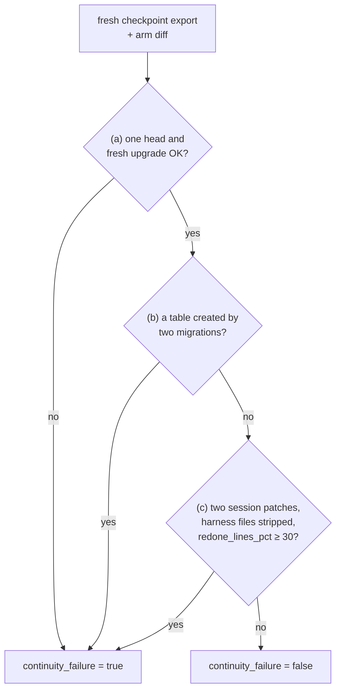

# S2 State and session lifecycle: what the agent remembers

Reading time: about 15 minutes. Source ids (A1-A7) and finding ids (F-a-NN) point to
[REFERENCES.md](../../REFERENCES.md). The section name S2, the word "layer", and the R-numbered house
rules are course labels; the ideas inside them use the sources' own words.

---

## 1. The problem

The S2 task is F2, comments on issues
([teamtrack/docs/features/f2.md](../../teamtrack/docs/features/f2.md)): three endpoints, a new
`comments` table "in exactly one new Alembic migration whose `down_revision` is the current head",
seed comments, and a comments panel on the board's issue page. The ticket ends with "This task runs
over two sessions."

The task file ([teamtrack/reference/f2/task.toml](../../teamtrack/reference/f2/task.toml)) sets
`session_budget = [20, 30]`: the first session stops after 20 turns and a 30-turn session starts with
an empty context (a course mechanism, section 2.3). The pilot's later runs and the class use a
12-turn first session and 38 turns after it (`--session-budget 12,38`). Files and git history
survive; nothing the agent read or decided survives unless it wrote it down.

The failure the course looks for: the second session does not know what the first one did, and
redoes or breaks it. On F2 the referee can check this in three ways:

- **Two migration heads, or a migration that does not upgrade** (house rule R7: exactly one head
  and a clean `alembic upgrade head`). "House rules" is the course's label for what A1 calls "golden
  principles", encoded "directly into the repository" (A1, F-a-99).
- **A second migration that creates the same table**, next to session 1's.
- **Redone work.** Session 2 throws away a large share of what session 1 wrote and writes it again.

Both arms get the same rule: the bare arm reads it in `docs/HANDBOOK.md` ("Never create a second
migration for a change that already has one"), so this is not a knowledge gap. The question is
whether the agent still knows, after the stop, what it already did.

### What the pilot saw on this task

In the course pilot, run 2 (2026-10-16; gpt-6-luna, effort medium, three A/Bs of F2 canonical), the
bare arm did not show this failure: it passed the continuity measure in 3 of 3 runs. In
`ab-20261016-181736-08a9c4` the bare arm wrote the model, repository, service, and
`migrations/versions/0002_comments.py` in session 1 without committing them. Its fourth tool call in
session 2 looked at the working tree (captured on 2026-10-16, run `r-20261016-181736-a05ddb`, the
`tool_call` event's target and the start of its result, cut; your output will differ):

```text
git status --short && git log -3 --oneline && find app -type f | sort && ls migrations/versions
exit=0
 M app/api/issues.py
 M app/api/schemas.py
 M app/db/models.py
?? app/repositories/comments.py
?? app/services/comments.py
?? migrations/versions/0002_comments.py
```

It then read the migration and carried on. A6, about Claude models: "Claude's latest models are
extremely effective at discovering state from the local filesystem." (A6, F-a-76; a living page,
accessed 2026-10-16). The pilot model is not a Claude model: one observation that fits A6, not a test.

In run 3 the bare arm passed again with a 12-turn first session (A/B `ab-20261016-213317-9a0ec1`, run
`r-20261016-213317-97004c`: 3 sessions, `continuity_failure` false, 56 of 56 hidden tests). The
events behind screen 3's session list and two of its referee rows (captured on 2026-10-16, run
`r-20261016-213317-97004c`, `events.jsonl`, cut; your output will differ):

```text
session_stop    {"session_index": 1, "ended_by": "turn_budget", "end_sha": "f34b913...", "handoff_path": null}
session_resume  {"session_index": 2, "start_sha": "f34b913...", "prefix_blocks": ["core"]}
check_result    {"check": "r7_migrations", "passed": true, "new_violations": 0, "total_probes": 2, ...}
check_result    {"check": "continuity", "passed": true, "new_violations": 0, "total_probes": 3, ...}
```

Section 6 has every pilot run on F2 and what the results say about the state files.

---

## 2. Why it happens

### 2.1 Each session starts with no memory

A2 states the core problem of long-running agents: "each new session begins with no memory of what
came before." (A2, F-a-08). A4 reports the same from a different setup: "each agent is dropped into
a fresh container with no context and will spend significant time orienting itself, especially on
large projects." (A4, F-a-10)

Without help, A2's agent left the next session "to guess at what had happened" (A2, F-a-12). F2's
duplicate migration is that guess going wrong; an agent that guesses right still spends turns.

### 2.2 Compaction is not the fix

Keeping the old context alive in compressed form does not solve it: "However, compaction isn’t
sufficient." (A2, F-a-54). A3 adds: "While compaction preserves continuity, it doesn't give the agent
a clean slate, which means context anxiety can still persist." (A3, F-a-66).

### 2.3 The context reset, and how the course produces one

A3 names the alternative: "Context resets—clearing the context window entirely and starting a fresh
agent, combined with a structured handoff that carries the previous agent's state and the next steps"
(A3, F-a-65). A2 does not use the term; the course takes it from A3.

The course needs the reset at a known point, in both arms, every run. The mechanism is the **session
turn budget**, a course mechanism, not a source term: each session has a fixed number of turns, the
first one smaller than the feature, the same for both arms. `shipharness ab --session-budget 12,38`
changes it for one run.

Two cautions from A3 itself. Resets are not free: "This solves the core issue, but adds orchestration
complexity, token overhead, and latency to each harness run." (A3, F-a-68). And they are
model-dependent: "Opus 4.5 largely removed that behavior on its own, so I was able to drop context
resets from this harness entirely." (A3, F-a-69). The course uses the stop to make the problem
visible, and teaches the part that holds for any model: if a session can end before the work is
done, the next one must be able to pick up from files.

---

## 3. The harness piece

The fix is state that survives the session, written where the next session will look. A3 kept two
lessons from earlier harnesses: "decomposing the build into tractable chunks, and using structured
artifacts to hand off context between sessions." (A3, F-a-71). The pieces:

| Piece | What it holds | Source |
|---|---|---|
| Initializer agent | Sets up the files below before the first coding session | "an initializer agent that sets up the environment on the first run" (A2, F-a-49) |
| `init.sh` | How to set up and check the app | "run through a basic end-to-end test before implementing a new feature." (A2, F-a-61) |
| Progress file | A log of what each session did | "a claude-progress.txt file that keeps a log of what agents have done" (A2, F-a-50). The course calls it `progress.md` |
| Git history | The changes, with messages | "the claude-progress.txt file alongside the git history." (A2, F-a-53) |
| Execution plan | The plan, its progress, the decisions | "execution plans with progress and decision logs that are checked into the repository." (A1, F-a-34) |
| Structured handoff | The previous session's state and the next steps | A3's context reset, quoted above (A3, F-a-65) |

A7, the recipe A1 links as "execution plans", sets the bar: "it should always be possible to restart
from _only_ the ExecPlan and no other work." (A7, F-a-47; archived, accessed 2026-10-16), with
`Progress`, `Surprises & Discoveries`, `Decision Log`, and `Outcomes & Retrospective` sections
(A7, F-a-48).

The lifecycle around these files has two routines from A2:

- **Getting up to speed** (A2's heading). At the start of a session: "Read the git logs and progress
  files to get up to speed on what was recently worked on." (A2, F-a-59), then run `init.sh` and a
  basic test, because if the app is already broken, starting a new feature "would likely make the
  problem worse." (A2, F-a-62).
- **Session end.** "End the session by writing a git commit and progress update." (A2, F-a-63).

A2's initializer is a model session with its own first prompt (A2, F-a-52). The course writes the
initial files with deterministic harness code instead, because one ticket fixes them (course design).
The state layer never calls the model.

---

## 4. How shipharness implements it

All code is in `src/shipharness/harness/state/`; the layer class is `StateLayer` in `layer.py`. The
three walkthrough anchors are `S2:init`, `S2:stop_resume`, and `S2:write`
(`uv run python scripts/anchors.py extract S2:init`).

### 4.1 Initializer step (before session 1)

`StateLayer.prepare_workspace` renders four templates from `assets/` and commits them as
`harness: initializer step for F2`: `init.sh`, `progress.md`, `session-handoff.md`, and
`docs/exec-plans/active/F2.md` (`templates.py`, `initial_files`). From demo-3 on, the scope layer adds
`feature_list.json`; in demo-2 it is not there.

`progress.md` has the sections `Current feature`, `Done`, `In progress`, `Next` (the agent's), and
`Session log` (the harness's, one entry per session).

The `init.sh` the agent gets (anchor `S2:init`, `src/shipharness/harness/state/assets/init.sh`,
lines 16-21):

```bash
echo "== migrations (house rule R7: exactly one head)"
python -m alembic heads
python -m alembic upgrade head

echo "== basic end-to-end test: issues, stop at the first failure (full suite: run_visible_tests)"
python -m pytest tests/visible/test_issues.py -x -q --no-header -p no:cacheprovider
```

It prints the migration heads first, so session 2 sees session 1's migration before writing
anything. The basic test is one file: in pilot run 1 the full suite ran twice at every session start,
about 44 s for `init.sh` and 36 s for `run_visible_tests` (course pilot, run 1, 2026-10-16). The exec
plan template (`assets/exec-plan.md`) has A7's sections plus `Purpose` and `Validation`.

### 4.2 Getting up to speed (every session)

`lifecycle.getting_up_to_speed` (`src/shipharness/harness/state/lifecycle.py`) follows A2's list
(F-a-58 to F-a-62): `pwd`; `progress.md` and the git log; the handoff and the exec plan; the
handoff's "Notes from the agent" before any other document; `bash init.sh`. It ends: "Spend the
session on the ticket: update progress.md, the exec plan, and the handoff only when the harness asks
you to wrap up." Both rules answer what pilot run 2 showed (section 6).

### 4.3 Wrap-up and the stop (end of session 1)

With three turns left (`wrapup_turns`), the runner sends both arms "This session is ending soon.
Turns left in this session: 3." (`runner/prompts.py`). Only the harness arm's message continues
(`lifecycle.wrapup_text`): update `progress.md`, the exec plan, and the handoff notes, including "the
house rules and file locations from the documents you read that matter for this ticket"; then commit.

When the session ends, `session_stop` (anchor `S2:stop_resume`,
`src/shipharness/harness/state/lifecycle.py`, lines 96-120) writes the harness's part of the handoff
and a progress log entry, whatever the agent did, and commits both. Print it with
`uv run python scripts/anchors.py extract S2:stop_resume`.

The machine summary (`handoff.py`) lists commits, files changed, visible-test status, open TODO
markers, migration heads (with "house rule R7 needs exactly one" when there is more than one), and
the documents read; it never touches the agent's notes (course design). The progress log line
(anchor `S2:write`) records the session index, start and end commit, how the session ended, turns,
files changed, and visible tests.

### 4.4 Resume and plan completion

Both arms' session 2 gets the same ticket and the sentence "A previous session worked on this ticket
and was stopped." (`runner/prompts.py`). The harness arm's resume text (`lifecycle.resume_text`) adds
the Getting up to speed steps and the first 3,000 characters of the machine summary. The plan moves
to `docs/exec-plans/completed/` only after the scope layer sets `passes`, so in demo-2 it stays in
`active/`.

```mermaid
sequenceDiagram
  participant H as state layer
  participant P1 as session 1
  participant Repo as workspace + git
  participant P2 as session 2
  H->>Repo: initializer step: init.sh, progress.md,<br/>session-handoff.md, exec plan; commit
  P1->>Repo: Getting up to speed, then code and commits<br/>(no bookkeeping yet)
  H->>P1: wrap-up at 3 turns left
  P1->>Repo: progress, exec plan, handoff notes<br/>(rules and files that matter), commit
  Note over P1: turn budget used, session_stop
  H->>Repo: machine summary + session log entry; commit
  Note over P2: empty context, session_resume
  H->>P2: neutral resume sentence + handoff summary
  P2->>Repo: reads handoff notes first, progress.md, git log,<br/>runs init.sh (sees migration heads)
  P2->>Repo: continues the feature
```

*The state layer's flow across one stop (task budget 20 then 30 turns; later pilot runs and the
class: 12 then 38). The bare arm has the same two sessions, wrap-up turns, and resume sentence, with
none of the files.*

---

## 5. What the A/B measures

The S2 primary measure, `continuity_failure`, was registered before any run (course design). A run
fails if any of these holds (`src/shipharness/checks/continuity.py`):

- (a) R7 fails: migration heads are not exactly one, or a fresh `alembic upgrade head` fails;
- (b) a second migration creates a table that another migration already creates;
- (c) 30% or more of the lines added in session 1 are removed in session 2 (`REDONE_THRESHOLD_PCT`).

Results are runs failing out of k, per arm, one dot per run; the components and `redone_lines_pct`
(the share of session 1's added lines that session 2 removes) are secondary (`src/shipharness/ab/score.py`).
Session patches come from each session's working-tree snapshots, so an arm that never commits is
measured like one that does; the referee strips the harness's files from them and runs the check in
its own container (`ab/demo.py`, `ab/referee.py`).



*The referee's decision for one run. The same code judges both arms; the arm label is never an input.*

Read the result with these limits in mind:

- The runner starts the next build session when a session ends by its turn budget or, since a fix
  after pilot run 4, by `finish(claim="not_done")` (`_next_session_runs` in `runner/loop.py`, both
  arms). After `finish(claim="done")` in session 1 there is no stop; (a) and (b) still apply, and (c)
  compares the build session with the test phase's.
- A bare arm that passes S2 on a given model is a result about that model, effort, and budget, not
  evidence that state files are never needed (A3, F-a-69).

---

## 6. What the state files assume, and what the pilot measured

A3: "every component in a harness encodes an assumption about what the model can't do on its own,
and those assumptions are worth stress testing" (A3, F-a-124). The state files' assumption, in the
course's words: a fresh session cannot pick up the work from the repository alone, the problem A2
names (A2, F-a-08). A3 tested its own version of this piece and dropped it when the model changed
(A3, F-a-69, section 2.3).

### 6.1 Run 2: a bug, and a cost

Measured in the course pilot, run 2, 2026-10-16 (F2 canonical, effort medium; A/Bs
`ab-20261016-181736-08a9c4`, `ab-20261016-184318-636e90`, `ab-20261016-190548-ae9abe`): bare 3 of 3,
harness 0 of 3, because of a measurement bug: the check counted session 2's rewrite of the harness's
own state files as removing 50-84% of session 1's lines. The fix, for both arms, strips those files
first; the primary measure is unchanged.

The same run showed the piece's cost: every harness session re-read 3 to 7 instruction documents and
about 15 product files, and the F2 harness arms made 0 to 1 product patches in 50 build turns, A4's
orienting cost (A4, F-a-10) caused by the harness. The change that followed is in sections 4.2-4.3.

### 6.2 Runs 3 and 4: the primary measure

Both runs used `--session-budget 12,38` for both arms. Measured in the course pilot, run 3,
2026-10-16 (effort medium), A/Bs `ab-20261016-211419-dfe06f`, `ab-20261016-213317-9a0ec1`,
`ab-20261016-214959-de790f`; and run 4, effort low, 2026-10-16/17, A/Bs `ab-20261016-232842-ac03b2`,
`ab-20261016-234027-226a76`, `ab-20261016-235211-ea59a9`. Values in A/B order:

| Run | Arm | Primary passed | Agent time limit hit | Hidden tests passed (of 56) | `redone_lines_pct` |
|---|---|---|---|---|---|
| 3 | bare | 3/3 | 0/3 | 56, 56, 56 | 0.0, 5.3, 0.0 |
| 3 | harness | 3/3 | 2/3 | 56, 3, 3 | 0.0, 0.0, 0.0 |
| 4, effort low | bare | 3/3 | 0/3 | 3, 3, 3 | 0.0, 0.0, 0.0 |
| 4, effort low | harness | 3/3 | 1/3 | 56, 3, 56 | 0.0, 0.0, 0.0 |

No measurable difference on this task with this model (course pilot, runs 3 and 4):
`continuity_failure` was false in all 12 arms.

### 6.3 What the result says about the piece

- **The bare arm found its own state** (section 1), and in run 3 it passed all three A/Bs with every
  hidden test. On this task and this model the assumption did not hold.
- **The measure has a blind spot.** Six arms built nothing (3 of 56 hidden tests): the harness arms
  of `ab-20261016-213317-9a0ec1` and `ab-20261016-214959-de790f`, and in run 4 all three bare arms and
  the harness arm of `ab-20261016-234027-226a76`. A pass says nothing was broken or redone, not
  that the feature was built.
- **The runner caused a failure in both arms.** Those six arms called `finish(claim="not_done")`
  after 9 to 12 turns of the first session, and the runner ended the build phase: the 38-turn session
  never ran (in run 3 the harness arm, after its wrap-up message; in run 4 every bare arm too). The
  fix, for both arms: before the last build session, `finish(claim="not_done")` ends only that
  session (section 5).

### 6.4 After the fix: the class-profile round

Measured in the course pilot, class-profile round, 2026-10-17 (effort low, OpenAI's Fast tier, 2 CPUs
per container, `--session-budget 12,38`, A/B `ab-20261017-085139-7c0661`): both arms passed with 56
of 56 hidden tests. The bare arm's sessions ran 12 turns (turn budget) and 33 (claimed done); the
harness arm's 12 and 38, both ended by the turn budget, so neither arm met the new rule. No
measurable difference on this task with this model, now in three rounds.

### 6.5 Post hoc: what else the arms did

Chosen after the results, so descriptive (9 runs per arm, runs 2 to 4): harness arms hit the agent
time limit in 4 runs, bare arms in 0; median arm wall time 361 s against 232 s; every hidden test
passed in 3 harness runs and 4 bare runs; median tests shipped 0 against 8.

The lesson for your own harness: state files cost turns, and an A/B can show it, as A3 found for
resets (A3, F-a-68). A section A/B compares bare against instructions plus state, not the state
layer alone; taking one piece out at a time is A3's method: "removing one component at a time and
reviewing what impact it had on the final result." (A3, F-a-125). The course's planned experiment
batches (10 runs per arm, and that ablation) were not run, because the pre-registered pilot gate did
not pass; the pilot runs above are the data. With no gap to show, the class runs the harness arm
alone with the 12-turn first session ([demo runbook](demo/README.md)).

---

## Further reading

The [post-class reading](post-class-reading/README.md) goes deeper: the sources side by side, the
templates against A7 and A3, and the continuity check line by line. The
[session notes](session-notes.md) summarise the class.
