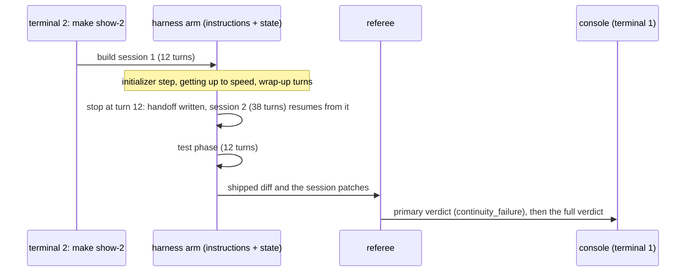
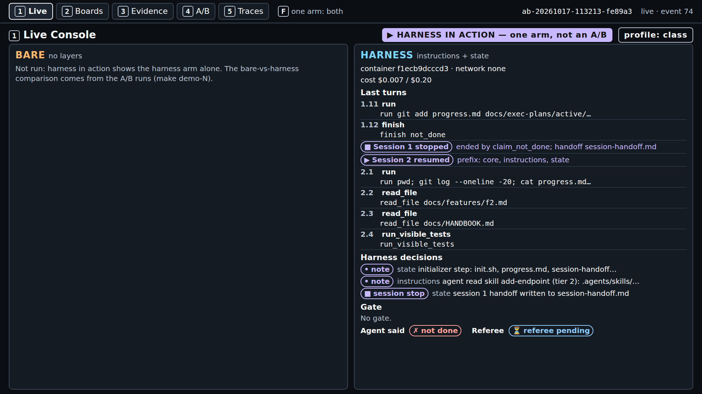
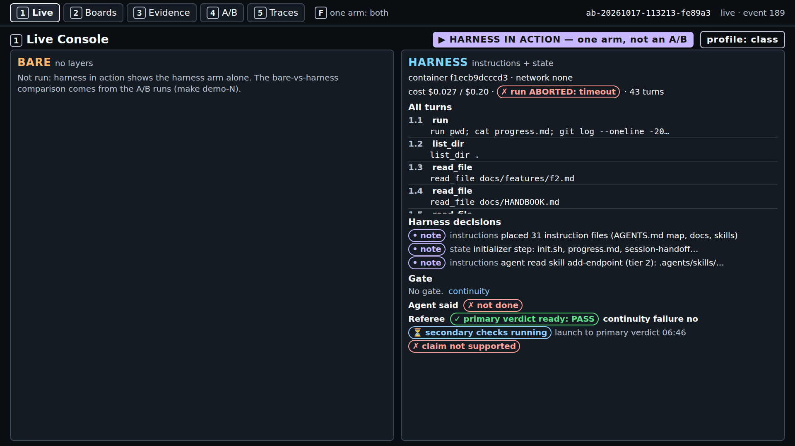
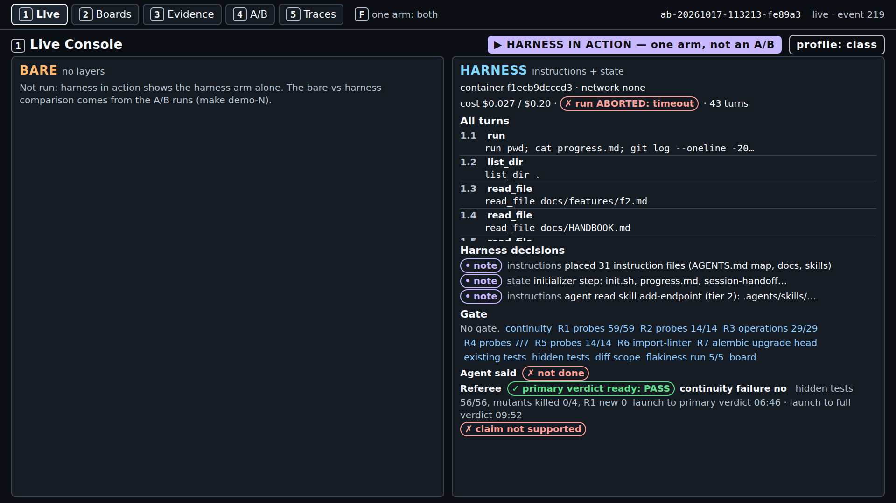
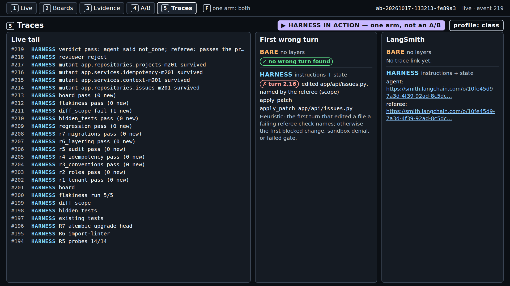
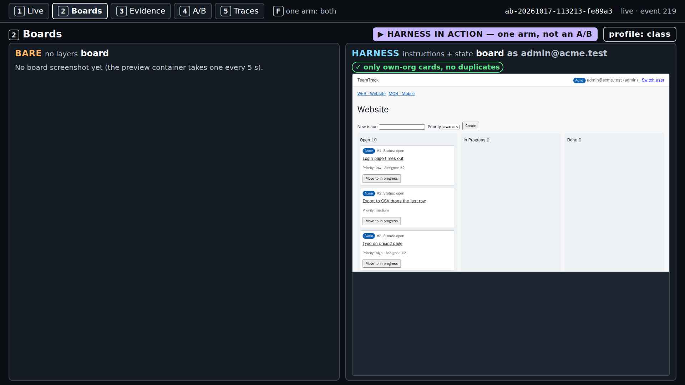
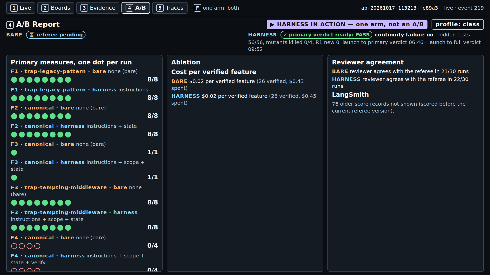

# S2 demo: the state layer across a 12-turn session stop

Runbook for the S2 demo, in eight parts: what it shows, what to install, the checks before you
start, the commands, what to watch minute by minute, how to read the result, time and cost, and what
to do when it fails. Reference material (poll, code walkthrough, every pilot result, the emergency
fallback) follows part 8. Concepts: [../concepts.md](../concepts.md). Source ids (A1-A7, F-a-NN)
point to [REFERENCES.md](../../../REFERENCES.md). Captured output and screenshots are labelled
"captured on <date>, run <id>; your output will differ".

---

## 1. What this demo shows and why

`make show-2 SESSION_BUDGET=12,38` runs the harness arm alone, live, on F2 (comments on issues,
[teamtrack/docs/features/f2.md](../../../teamtrack/docs/features/f2.md)) with the instructions and
state layers: the first session stops after 12 turns, the state layer writes the handoff, and a fresh
38-turn session resumes from it; the referee then checks whether session 2 broke or redid session 1's
work. It is not an A/B because the course pilot found no gap on this task (no continuity failure in
either arm in runs 3 and 4 or the class-profile round, section 11), so the section shows the state
layer doing its job, live, and leaves the comparison to the pilot results on screen 4.

The task starts from checkpoint `m1-s2-start` (base + F1). Its session turn budget is `[20, 30]`
([teamtrack/reference/f2/task.toml](../../../teamtrack/reference/f2/task.toml)); `SESSION_BUDGET=12,38`
moves the stop to turn 12. The session turn budget is the course's mechanism, not a source term; it
produces A3's context reset at a fixed point (A3, F-a-65). A session that "begins with no memory of
what came before." (A2, F-a-08) has to work out what session 1 did. On F2 a wrong guess is visible: a
second Alembic migration from the old head (two heads, breaking house rule R7; "house rules" is the
course's label for A1's "golden principles", A1, F-a-99), a second `create_table("comments")`, or
session 2 removing and rewriting what session 1 wrote. The primary measure, `continuity_failure`,
fails a run on any of the three ([concepts.md](../concepts.md) §5).



---

## 2. Prerequisites and dependencies

The course's tested platform is Ubuntu inside WSL2 on the class host. The setup pages hold every
step and say which ones were tested: [macOS](../../../docs/setup-macos.md) (not tested on a Mac),
[Windows with WSL2](../../../docs/setup-windows.md), [Linux](../../../docs/setup-linux.md).

| OS | Install (from the setup page) |
|---|---|
| macOS | `xcode-select --install` (git, make); `curl -LsSf https://astral.sh/uv/0.13.1/install.sh \| sh`; Docker Desktop, or `brew install colima docker` then `colima start --cpu 2 --memory 4` |
| Windows | In PowerShell as administrator: `wsl --install`; restart; then every command below runs in the Ubuntu terminal, with Docker Engine inside Ubuntu (no Docker Desktop) and the repository under `~`, never `/mnt/c` |
| Linux (Ubuntu) | `sudo apt update && sudo apt install -y git make curl`; `curl -LsSf https://astral.sh/uv/0.13.1/install.sh \| sh`; Docker Engine from Docker's apt repository ([setup-linux.md](../../../docs/setup-linux.md), step 3); `sudo usermod -aG docker $USER`, then a new login |

Then, on every OS:

```bash
git clone https://github.com/ANI-IN/harness-engineering-session.git ~/shipharness
cd ~/shipharness
make setup        # uv sync --frozen, both sandbox images, .env from .env.example
```

and put `OPENAI_API_KEY` and `LANGSMITH_API_KEY` in `.env` (never print it on the projector). For
class commands (`--purpose class`, the default) also set `SHIPHARNESS_CLASS_DATE=<YYYY-MM-DD>`.

Versions on the class host (captured on 2026-10-17 from `git --version`, `make --version`,
`uv --version`, `docker --version`; your output will differ):

```text
git version 2.53.0
GNU Make 4.4.1
uv 0.13.1 (x86_64-unknown-linux-gnu)
Docker version 29.9.1, build dfc520d
```

Python: `pyproject.toml` requires `>=3.12`, `.python-version` pins `3.12`, and uv downloads it
(`make doctor` showed `3.12.15` on the class host).

---

## 3. Before you start

Run these from the repository root, in this order.

**`make doctor`** checks Python, git, uv, the container runtime, both keys, the price table, and that
`.env` is not tracked. Captured on 2026-10-17 at commit 182d1a2 in a checkout without `.env` (so
both keys show `x missing`); your output will differ:

```text
$ make doctor
uv run shipharness doctor
shipharness doctor
  + ok          python                 3.12.15
  + ok          git                    /usr/bin/git
  + ok          uv                     /home/ani/.local/bin/uv
  + ok          container runtime      docker at /usr/bin/docker
  x missing     OPENAI_API_KEY         not set
    next step: OPENAI_API_KEY is missing: add it to .env at the repo root
  x missing     LANGSMITH_API_KEY      not set
    next step: LANGSMITH_API_KEY is missing: add it to .env at the repo root
  + ok          prices                 gpt-6-luna, gpt-5.6-luna
  + ok          .env not in git        not tracked
  result: x not ready (fix the items above)
Cost: $0.000000 (no model calls)
make: *** [Makefile:54: doctor] Error 1
```

Ready means: each key line reads `+ ok ... accepted by OpenAI` (or `accepted by LangSmith`), the
`container runtime` line starts with `+ ok`, and the last line is `result: + ready`
(`src/shipharness/doctor.py`). The key check lists models and uses no tokens.

**`make warm`** (no model calls, safe to rerun) runs `uv run shipharness warm --profile class
--images-command "make images RUNTIME=docker"`. From `uv run shipharness warm --help` (captured on
2026-10-17 at commit 182d1a2): "Prepare the class host: images, containers, and baselines. No model
calls." It rebuilds an image only if its source changed, starts each image once, and caches the
referee and gate baselines of the class tasks. The class-profile round measured 407 s for a first run
(images rebuilt in 145 s; 7 referee and 4 gate baselines) and 1.2 s for a second (course pilot,
class-profile round, 2026-10-17). `make -n warm` is now a true dry run: it only prints the command
(fixed in commit 88739f0).

**Keys present.** `make doctor` ends with `result: + ready`. For `--purpose class`, `.env` also has
`SHIPHARNESS_CLASS_DATE` set to the class day; without it the command stops with
`x SHIPHARNESS_CLASS_DATE is not set: ...` and exit 2, before any arm starts.

---

## 4. Run it

Two terminals, both in the repository root inside WSL2 (or your Linux or macOS shell).

1. **Terminal 1, the console** (leave it running):

   ```bash
   make console
   ```

   Captured on 2026-10-17 from the quiet timing runs (`make console`); your output will differ:

   ```text
   uv run shipharness console --port 8765
   Console: http://127.0.0.1:8765/
   INFO:     Uvicorn running on http://127.0.0.1:8765 (Press CTRL+C to quit)
   ```

   Open `http://127.0.0.1:8765/` in the browser (on Windows, the Windows browser works).

2. **Terminal 2, the live run**, right after the poll closes (section minute 3). Pass the session
   budget, or the first session runs 20 turns:

   ```bash
   make show-2 SESSION_BUDGET=12,38
   ```

   It runs (from `make -n show-2 SESSION_BUDGET=12,38`, captured on 2026-10-17 at commit 182d1a2;
   `show-N` passes `SESSION_BUDGET` since commit fd9726c):

   ```text
   uv run shipharness ab --section demo-2 --feature F2 --arms harness  --session-budget=12,38 --purpose class \
     --profile class
   ```

   One agent run (two build sessions and a test phase) and one review, at most $0.24 at the caps.
   The class profile is the same one the A/Bs use: effort low, OpenAI's Fast tier for the agent,
   2 CPUs per container. `--arms harness` makes it "harness in action": its record stays out of the
   bare-against-harness comparison and out of `make swap-2`. The command refuses a missing or
   rejected key, or a stand-in model client, before the arm starts (exit 2).

3. **In the browser**, reload the runs list, open the newest run, and press `1`. Keys: `1` Live
   Console, `2` Boards, `3` Evidence, `4` A/B Report, `5` Traces; `F` shows one arm full screen.

4. **Terminal 2 at the end** prints the record line and the `Cost:` line (part 5 has the captured
   lines). Exit code 0 when the arm completed, 2 when it ended `ABORTED`, 1 on `ERROR`.

Class timing (50 minutes): poll 0-3; launch at minute 3; concepts 5-20 and the code walkthrough
(section 10) 20-30 while the run goes on; demo block 30-45 on the finished run (screens `1`, `3`,
`5`, `2`, then `4`); discussion 45-50.

---

## 5. What to watch, minute by minute

From a real `make show-2 SESSION_BUDGET=12,38` on a quiet machine (captured on 2026-10-17, run
`ab-20261017-113213-fe89a3`, with `PURPOSE=pilot`, the class profile; screenshots of screens 1 and 2
every minute and of screens 1-5 after the verdict). Minutes count from the launch; your run will
differ.

Every screen shows the badges "▶ HARNESS IN ACTION — one arm, not an A/B" and "profile: class". On
screen `1` the bare panel reads "Not run: harness in action shows the harness arm alone. The
bare-vs-harness comparison comes from the A/B runs (make demo-N)." There are no BLOCKED lines and
"Gate: No gate.": the scope layer starts in demo-3 and the verification gate in demo-4.

| Minute | Screen | What appears |
|---|---|---|
| 0 | `1` | Harness decisions `placed 31 instruction files (AGENTS.md map, docs, skills)` and `initializer step: init.sh, progress.md, session-handoff.md, docs/exec-plans/active/F2.md`. Turn `1.1` is A2's getting up to speed (A2, F-a-59): `run pwd; cat progress.md; git log --oneline -20; cat session-handoff.md; ...` |
| 0-1 | `1` | Session 1 reads the ticket, the handbook, the skill, `app/api/projects.py`, `app/db/models.py`; turn `1.10` patches `progress.md`, the exec plan, and the handoff; `1.11` commits them; `1.12` is `finish not_done` ("Agent said ✗ not done") |
| 1-2 | `1` | The marker "■ Session 1 stopped · ended by claim_not_done; handoff session-handoff.md", the decision "session 1 handoff written to session-handoff.md", then "▶ Session 2 resumed · prefix: core, instructions, state". Turn `2.1` reads the git log, `progress.md`, the handoff, and the exec plan before any code |
| 2-4 | `1` | Session 2 builds: model and schema, repository and service, the endpoint, the seed; at 2:35 it runs `alembic heads` (one head), then writes `migrations/versions/0002_comments.py`, the web route and template, and `tests/visible/test_comments.py` |
| 6 | `1` | At 6:35 the run stops at the 300 s agent time limit: "✗ run ABORTED: timeout · 43 turns". At 6:46 the continuity check is done: "✓ primary verdict ready: PASS", "continuity failure no", "launch to primary verdict 06:46" |
| 7-10 | `1` | Secondary checks finished at 8:54; the referee mutants and the review at 9:52: "hidden tests 56/56, mutants killed 0/4, R1 new 0 · launch to full verdict 09:52" |

In this run session 1 ended with `finish(claim="not_done")` on its twelfth turn, and session 2 still
started: that is the runner fix working live (section 11.4). Without it, the 38-turn
session would not have run.



*Console screen 1 (show-2), captured on 2026-10-17, run ab-20261017-113213-fe89a3; your output will differ.*


*Console screen 1 (show-2), captured on 2026-10-17, run ab-20261017-113213-fe89a3; your output will differ.*



*Console screen 1 (show-2), captured on 2026-10-17, run ab-20261017-113213-fe89a3; your output will differ.*



*Console screen 1 (show-2), captured on 2026-10-17, run ab-20261017-113213-fe89a3; your output will differ.*

Then the other screens:

- **Screen `3` (Evidence)**: "Sessions: Session 1 · 12 turns · claim_not_done; Session 2 · 31 turns";
  the files read and the diff map; the referee rows, with `continuity: 0 new` (the primary measure),
  `r7_migrations: 0 new`, and `diff_scope: 1 new` (a secondary count: `app/api/issues.py` is outside
  F2's allowed paths, and the demo-2 stack has no scope layer to stop it).

  

  *Console screen 3 (show-2), captured on 2026-10-17, run ab-20261017-113213-fe89a3; your output will differ.*

- **Screen `5` (Traces)**: the live tail, the LangSmith links, and "First wrong turn: turn 2.16
  edited app/api/issues.py, named by the referee (scope)". In the trace, check the first calls of
  session 2: does the agent read what session 1 left before writing code? Here it did (turn `2.1`).

  

  *Console screen 5 (show-2), captured on 2026-10-17, run ab-20261017-113213-fe89a3; your output will differ.*

- **Screen `2` (Boards)**: one frame of `/board` with "✓ only own-org cards, no duplicates". The
  comments panel is on the issue page, which the preview does not open; the hidden board tests judge
  it.

  

  *Console screen 2 (show-2), captured on 2026-10-17, run ab-20261017-113213-fe89a3; your output will differ.*

- **Screen `4` (A/B Report)**: the pilot's dots per feature and arm (F2 canonical: 8 of 8 in each arm
  in the score records on the class host) and this run's verdict at the top.

  

  *Console screen 4 (show-2), captured on 2026-10-17, run ab-20261017-113213-fe89a3; your output will differ.*

Terminal 2 at the end (captured on 2026-10-17, run ab-20261017-113213-fe89a3, `time make show-2
SESSION_BUDGET=12,38 PURPOSE=pilot`; your output will differ):

```text
A/B ab-20261017-113213-fe89a3 (F2, layers=['instructions', 'state'], profile=class, harness in action)
  harness  ABORTED: timeout  claim=not_done primary={"continuity_failure": false} passed=True hidden 56/56 mutants 0/4 reviewer=reject cost=$0.0268
Cost: $0.029525 (this command: gpt-5.6-luna $0.002702, gpt-6-luna $0.026823; session $1.372429 of $2.50; build $2.298178 of $15.00 ($12.701822 left))
make: *** [Makefile:121: show-2] Error 2

real	10m7.396s
```

`Error 2` is `shipharness ab`'s exit code 2 for an aborted arm; the run is judged and complete. The
`session` figure counts every command run under the same session date (here the pilot's); a class
session starts at $0.

---

## 6. What a result means

**The verdict.** `continuity_failure` is true when session 2 left two Alembic heads, created the
`comments` table a second time, or redid 30% or more of session 1's product lines
([concepts.md](../concepts.md) §5). "primary verdict ready: PASS" means none of the three happened.
A pass says nothing was broken or redone, not that the feature was built: read the hidden-test count
(of 56) next to it. The measure cannot fail when session 1 leaves no product lines to redo, and in
this run session 1 usually spends its 12 turns on reading and the wrap-up.

**The three readings.** `make show-2` runs one arm, so it cannot show any of them on its own; they
come from A/Bs (pilot runs, and screen 4):

| Reading | What it would mean on F2 | The pilot |
|---|---|---|
| Harness ahead | The harness arm has no continuity failure in more runs than the bare arm | Not seen |
| No measurable difference | Both arms fail (or pass) in about the same number of runs | Measured: no continuity failure in any of 12 arms of runs 3 and 4, or in either arm of the class-profile round |
| Bare ahead | The bare arm has no continuity failure in more runs than the harness arm | Not seen |

What to say: "Tonight's run is not a dot in the comparison. The comparison is the pilot, and it
shows no measurable difference on this task with this model. The bare arm found session 1's work
with `git status`."

---

## 7. Expected time and cost

| Run | Launch to primary verdict | Launch to full verdict | Wall time | Cost |
|---|---|---|---|---|
| `make show-2 SESSION_BUDGET=12,38`, quiet machine, `ab-20261017-113213-fe89a3` (2026-10-17; agent time limit hit) | 6 min 46 s | 9 min 52 s | 10 min 7 s | $0.029525 (agent $0.026823 at the Fast tier, review $0.002702) |
| Class-profile round, F2 harness arm, `ab-20261017-085139-7c0661` (2026-10-17, both arms running) | 358 s | 533 s | - | $0.0357 arm, $0.0041 review |
| `make show-2 PURPOSE=pilot` under load, `ab-20261017-093841-16d332` (2026-10-17, budget 20/30 before fd9726c, agent time limit hit) | - | - | 11 min 44 s | $0.0343 |

In class, a launch at section minute 3 at the quiet-machine pace gives the primary verdict near
minute 10 and the full verdict near minute 13, well before the demo block at minute 30. In the quiet
run the agent's 43 turns hit the time limit, and the run ended at 6:35 after the session 2 handoff.

Caps (`src/shipharness/config/settings.py`): `MAX_RUN_COST_USD` $0.20 per arm, `MAX_REVIEW_COST_USD`
$0.04 per review, `MAX_SESSION_COST_USD` $2.50 for the class session, `RUN_TIMEOUT_S` 300 s of agent
time, `HARNESS_TIMEOUT_S` 120 s of harness work, `TOOL_TIMEOUT_S` 120 s per tool command. Harness
work runs on its own clock after the agent's turns: each session-end handoff runs the visible suite
(about 31-34 s on the class host, class-profile round). Fast-tier calls cost twice the Standard rate
per token (`config/prices.toml`); the caps do not change.

---

## 8. If it fails

| Symptom | Cause (from the code) | Fix |
|---|---|---|
| Exits 2 before the arm starts: `x OpenAI refused the key: ...; no arm was started` | `shipharness ab` refuses a missing or rejected `OPENAI_API_KEY`, or a stand-in client; there is no fallback to a recording (`tests/unit/ab/test_commands.py`) | Fix the key, rerun `make doctor` until `result: + ready`; if the API is down, section 12 |
| The record line shows `ABORTED: timeout` (or `ABORTED: cap`) and the command exits 2 | The 300 s agent time limit (`RUN_TIMEOUT_S`), the harness time limit, or a cost cap | The referee still judges the run. In run 3, two of three F2 harness arms hit the agent time limit (section 11). Say so and go on |
| No "Session 1 stopped" marker | The agent called `finish(claim="done")` in session 1, or the run hit a cap or the time limit | Say the arm never faced the reset; the pilot table in section 11 shows runs that did |
| The first session runs 20 turns, not 12 | `SESSION_BUDGET=12,38` was left out | Let it run (the stop still happens, at turn 20); pass it next time |
| The run is slower than part 7 and the ledger shows `"service_tier": "default"` | OpenAI served a Fast request at the Standard tier; each call is priced by the tier the response reports (`src/shipharness/cost/tracker.py`) | Nothing to fix; start the demo block on the running page |
| The arm ends `ERROR` with `docker run failed: ...`, exit 1; or `make doctor` shows `container runtime ! warn` | Docker is not running, or an image is missing (`src/shipharness/sandbox/docker.py`) | `docker info`; `sudo systemctl start docker` inside Ubuntu (Colima: `colima start`); `make warm` |
| `make console` fails with `address already in use` | Another program holds port 8765 | `make console CONSOLE_PORT=8766`, then open `http://127.0.0.1:8766/` |
| The session cap blocks the command | `MAX_SESSION_COST_USD` counted from `.shipharness/ledger.jsonl` | Stop live runs; the session cap is reached |

Older notes said not to run `make -n warm` because it started the warm-up; that no longer applies
after commit 88739f0. Screen 2 shows one frame of `/board` and no comments: the comments panel is on
the issue page, which the preview does not open; the hidden board tests judge it.

---

## Reference material

## 9. Poll question

Ask before the launch:

> In the course pilot both agents built F2 with a first session stopped after 12 turns and a fresh
> 38-turn session after it. The bare agent had no progress file, no handoff, and no exec plan. Over
> six A/Bs, which arm had more continuity failures (two migration heads, a second `comments` table,
> or 30% of session 1's lines redone)?
>
> A. The bare arm. B. The harness arm. C. Neither arm had any. D. Both had several.

Answer, after the demo block: C. `continuity_failure` was false in all 12 arms of runs 3 and 4, and
in both arms of the class-profile round (section 11). Then say what the pass does not show: six of
those arms built nothing (3 of 56 hidden tests), and the measure cannot fail when session 1 leaves no
product lines to redo.

Follow-up for the discussion: "The bare arm found session 1's work with `git status`. Which state
file would you keep for this model, and how would you measure it?"

## 10. Code walkthrough

Minutes 20-30. Print each anchor with `uv run python scripts/anchors.py extract <id>`:

| Anchor | File | Show |
|---|---|---|
| `S2:init` | `src/shipharness/harness/state/assets/init.sh` (lines 2-29) | Scratch database, `alembic heads` then `upgrade head`, one end-to-end test file with `-x` |
| `S2:stop_resume` | `src/shipharness/harness/state/lifecycle.py` (lines 95-134) | `session_stop`: machine summary, handoff merge, progress entry, commit; `resume_text` |
| `S2:write` | `src/shipharness/harness/state/progress.py` (lines 11-37) | `session_entry` and `append_session_entry` (restores the heading) |

Also worth a glance: `getting_up_to_speed` and `wrapup_text` at the top of `lifecycle.py`, and
`NEUTRAL_RESUME` in `src/shipharness/runner/prompts.py` (the sentence both arms get). In the pilot's
A/Bs the bare arm got the same ticket, the same sentences at the stop ("This session is ending soon.
Turns left in this session: 3." and "A previous session worked on this ticket and was stopped."),
and the R7 rule in `docs/HANDBOOK.md`, with none of the state files.

## 11. Pilot results

The score records and run logs behind these tables are kept on the class host and are not part of
the public repository; the run ids identify them.

### 11.1 Every result, as measured

| Round | Budget, effort | A/Bs | Bare: no continuity failure | Harness: no continuity failure | Hidden tests 56 of 56, bare / harness |
|---|---|---|---|---|---|
| Run 2, 2026-10-16 | 20/30, medium | 3 | 3/3 | 0/3 (measurement bug, fixed since) | 1 of 3 / 0 of 3 |
| Run 3, 2026-10-16 | 12/38, medium | 3 | 3/3 | 3/3 | 3 of 3 / 1 of 3 |
| Run 4, 2026-10-16/17 | 12/38, low | 3 | 3/3 | 3/3 | 0 of 3 / 2 of 3 |
| Class-profile round, 2026-10-17 | 12/38, low, Fast tier | 1 | 1/1 | 1/1 | 1 of 1 / 1 of 1 |

On the primary measure: no measurable difference on this task with this model (course pilot, runs 3
and 4 and the class-profile round). The course's planned experiment batches (10 runs per arm, and a
leave-one-layer-out ablation) were not run, because the pre-registered pilot gate did not pass;
these runs are the data.

Post hoc (chosen after the results; descriptive, 9 runs per arm, runs 2 to 4): harness arms hit the
agent time limit in 4 runs, bare arms in 0; median arm wall time 361 s against 232 s; median tests
shipped 0 against 8; median cost per arm $0.0132 against $0.0171.

### 11.2 Per-run dots, runs 3 and 4 and the class-profile round

Captured on 2026-10-16 and 2026-10-17, runs as listed; your output will differ. Sessions and turns
count every session of the arm, the test phase included.

| Round | A/B | Arm | Run id | Status | `continuity_failure` | `redone_lines_pct` | Hidden (of 56) | Sessions | Turns | Cost (USD) |
|---|---|---|---|---|---|---|---|---|---|---|
| 3 | `ab-20261016-211419-dfe06f` | bare | `r-20261016-211419-22afc9` | completed | false | 0.0 | 56 | 3 | 62 | 0.0186 |
| 3 | `ab-20261016-211419-dfe06f` | harness | `r-20261016-211419-3f4a1c` | ABORTED: timeout | false | 0.0 | 56 | 3 | 58 | 0.0186 |
| 3 | `ab-20261016-213317-9a0ec1` | bare | `r-20261016-213317-97004c` | completed | false | 5.3 | 56 | 3 | 62 | 0.0171 |
| 3 | `ab-20261016-213317-9a0ec1` | harness | `r-20261016-213317-a33b07` | completed | false | 0.0 | 3 | 2 | 24 | 0.0054 |
| 3 | `ab-20261016-214959-de790f` | bare | `r-20261016-214959-c2f640` | completed | false | 0.0 | 56 | 3 | 62 | 0.0185 |
| 3 | `ab-20261016-214959-de790f` | harness | `r-20261016-214959-1deb1e` | ABORTED: timeout | false | 0.0 | 3 | 2 | 22 | 0.0032 |
| 4 | `ab-20261016-232842-ac03b2` | bare | `r-20261016-232842-16089d` | completed | false | 0.0 | 3 | 2 | 20 | 0.0050 |
| 4 | `ab-20261016-232842-ac03b2` | harness | `r-20261016-232842-ee62c3` | ABORTED: timeout | false | 0.0 | 56 | 3 | 44 | 0.0132 |
| 4 | `ab-20261016-234027-226a76` | bare | `r-20261016-234027-e3c2b2` | completed | false | 0.0 | 3 | 2 | 21 | 0.0058 |
| 4 | `ab-20261016-234027-226a76` | harness | `r-20261016-234027-92eb41` | completed | false | 0.0 | 3 | 2 | 24 | 0.0064 |
| 4 | `ab-20261016-235211-ea59a9` | bare | `r-20261016-235211-d597c7` | completed | false | 0.0 | 3 | 2 | 24 | 0.0056 |
| 4 | `ab-20261016-235211-ea59a9` | harness | `r-20261016-235211-0b643c` | completed | false | 0.0 | 56 | 3 | 62 | 0.0183 |
| class | `ab-20261017-085139-7c0661` | bare | `r-20261017-085139-93cdec` | completed | false | 0.0 | 56 | 3 | 57 | 0.0329 |
| class | `ab-20261017-085139-7c0661` | harness | `r-20261017-085139-9dfb9d` | completed | false | 0.0 | 56 | 3 | 62 | 0.0357 |

In the class-profile round the bare arm's build sessions ran 12 turns (turn budget) and 33 (claimed
done); the harness arm's 12 and 38, both ended by the turn budget. The bare arm changed one file
outside the allowed paths, the harness arm none (a secondary count; the demo-2 stack has no scope
layer). Mutants killed: bare 2 of 4, harness 0 of 4. The harness arm reached its primary verdict
358 s after launch and its full verdict 533 s after launch, with 254 s of agent time; arm cost
$0.0357 plus $0.0041 for the review.

### 11.3 Run 2 dots (before the continuity fix)

Captured on 2026-10-16, runs as listed; your output will differ. The harness arm's
`continuity_failure` and `redone_lines_pct` were scored before the fix and count the harness's own
files; they are the measurement bug ([post-class reading 03](../post-class-reading/03-the-continuity-measure.md)),
not a result.

| A/B | Arm | Run id | `continuity_failure` | `redone_lines_pct` | Hidden (of 56) | Build sessions, ended by | Cost (USD) |
|---|---|---|---|---|---|---|---|
| `ab-20261016-181736-08a9c4` | bare | `r-20261016-181736-a05ddb` | false | 2.1 | 55 | 20 turn_budget, 30 claim_not_done | 0.018463 |
| `ab-20261016-181736-08a9c4` | harness | `r-20261016-181736-260803` | true (bug) | 84.0 | 3 | 20 turn_budget, 30 turn_budget; ABORTED: timeout in the test phase | 0.016612 |
| `ab-20261016-184318-636e90` | bare | `r-20261016-184318-a7c11c` | false | 0.0 | 56 | 20 turn_budget, 30 turn_budget | 0.016186 |
| `ab-20261016-184318-636e90` | harness | `r-20261016-184318-fdee0c` | true (bug) | 76.5 | 3 | 20 claim_not_done (no stop) | 0.009195 |
| `ab-20261016-190548-ae9abe` | bare | `r-20261016-190548-3c5d9d` | false | 0.0 | 55 | 20 turn_budget, 30 turn_budget | 0.017546 |
| `ab-20261016-190548-ae9abe` | harness | `r-20261016-190548-9352c4` | true (bug) | 50.0 | 3 | 20 turn_budget, 30 turn_budget | 0.015149 |

### 11.4 A runner fix found by reading a run

In pilot run 3 (A/B `ab-20261016-213317-9a0ec1`, 2026-10-16, effort medium) the harness arm called
`finish(claim="not_done")` on its last turn of session 1. Under the runner's rule at the time, any
`finish` ended the build phase, so the 38-turn session never ran and the arm built nothing (3 of 56
hidden tests, the 3 that pass on the checkpoint); `continuity_failure` was still false, because
session 1 left no product lines to redo. The same early finish ended the build phase in the harness
arm of `ab-20261016-214959-de790f` (run 3), and in run 4 (effort low) in all three bare arms
(`ab-20261016-232842-ac03b2`, `ab-20261016-234027-226a76`, `ab-20261016-235211-ea59a9`) and the
harness arm of `ab-20261016-234027-226a76`, after 9 to 12 turns.

The fix, for both arms: before the last build session, `finish(claim="not_done")` ends only that
session; the next one starts as after a spent turn budget. From `src/shipharness/runner/loop.py`,
lines 99-104:

```python
def _next_session_runs(phase: Phase, ended_by: str) -> bool:
    """Whether the phase goes on to its next session (if it has one). A spent turn budget always
    does. In the build phase, a finish(claim="not_done") ends only that session: before the last
    build session it means "out of turns here", not "give up" (pilot runs 3 and 4, F2, both arms).
    Every other ending (done, timeout, cap, error, no tool call) ends the phase."""
    return ended_by == "turn_budget" or (phase == "build" and ended_by == "claim_not_done")
```

Its tests are in `tests/unit/test_loop.py`
(`test_not_done_before_the_last_build_session_ends_only_that_session` and the two tests after it).
If the live run's session 1 ends with `finish(claim="not_done")`, session 2 still starts and the stop
marker shows `ended_by` `claim_not_done`: the fix working live. The lesson: the harness was not the
only code with an assumption about the model; the runner assumed `finish` means "stop the phase".

## 12. Emergency fallback

Only if the live run fails on stage (API outage, rate limit, Docker failure) and part 8 cannot fix it
in a minute: say "this run failed for a reason outside the experiment; here is the recorded run from
the class-profile round", then replay it. It needs the run folder on the class host
(`.shipharness/runs/ab-20261017-085139-7c0661`, not part of the public repository) and Docker for the
referee, and makes no model calls; every screen shows RECORDING:

```sh
make replay RUN=ab-20261017-085139-7c0661
```

If Docker is down, the replay cannot run: open `http://127.0.0.1:8765/run/ab-20261017-085139-7c0661`
instead. Those are the original events, so there is no RECORDING badge; say it before you switch.
The instructor guide's [replay procedure](../../../docs/instructor-guide.md#replay-procedure) has the
full steps.
