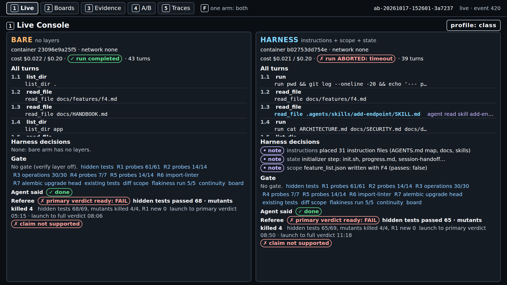
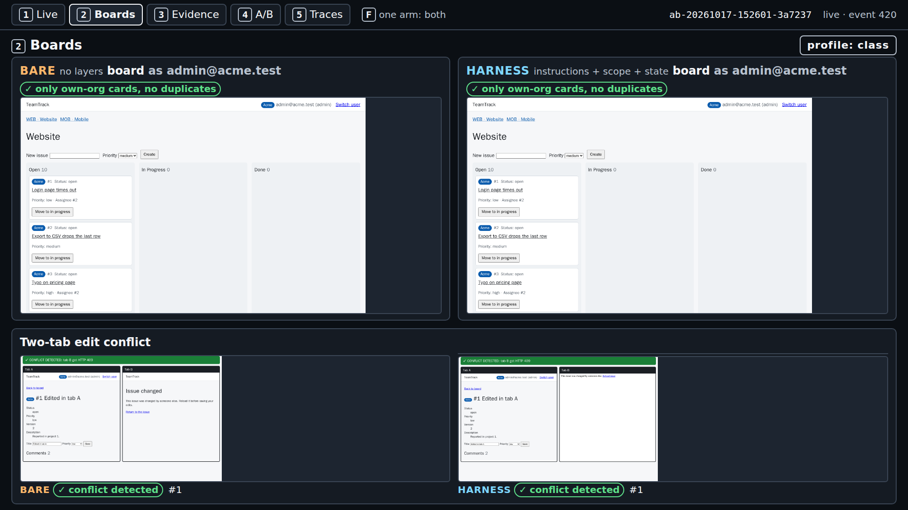
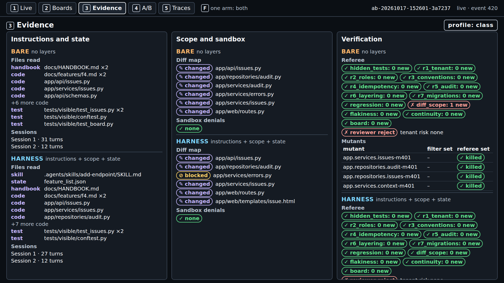
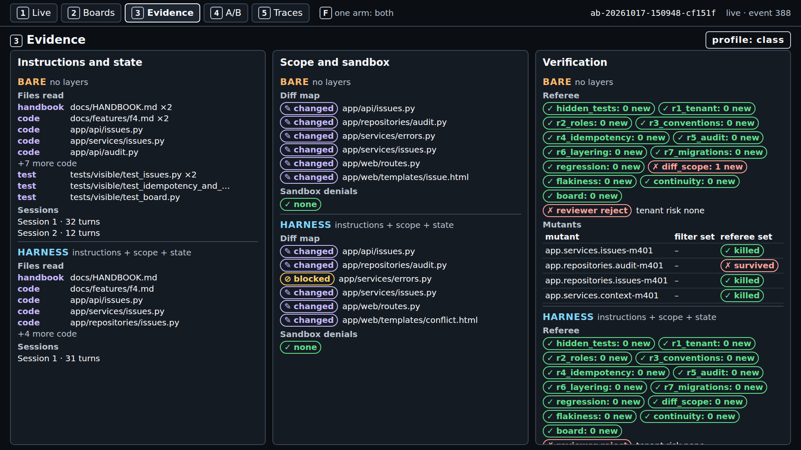
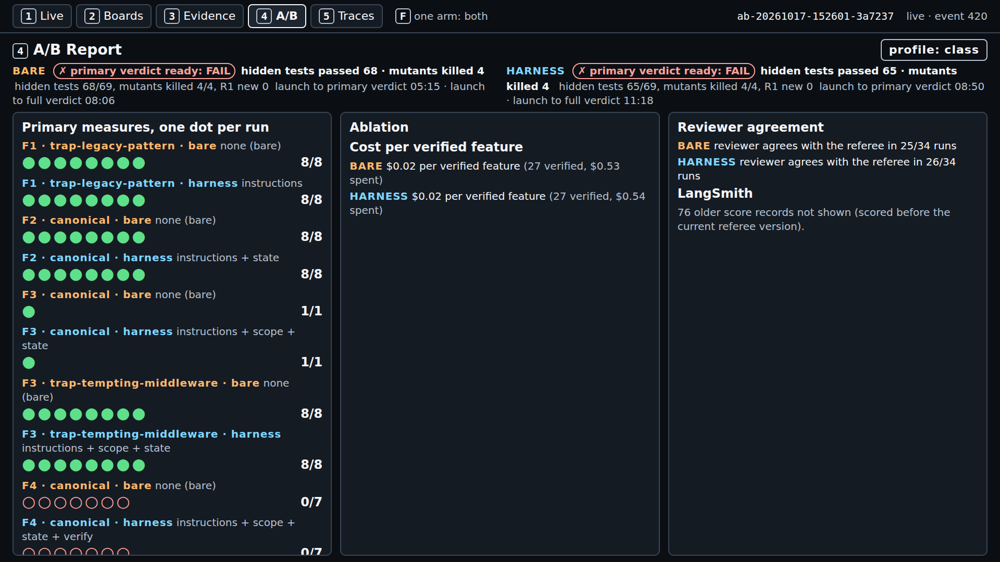
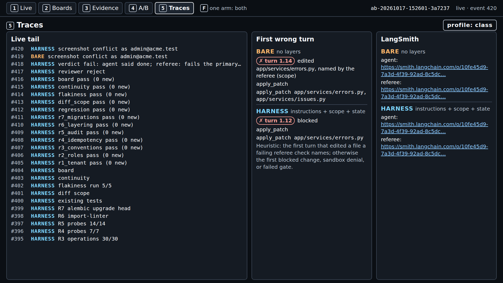
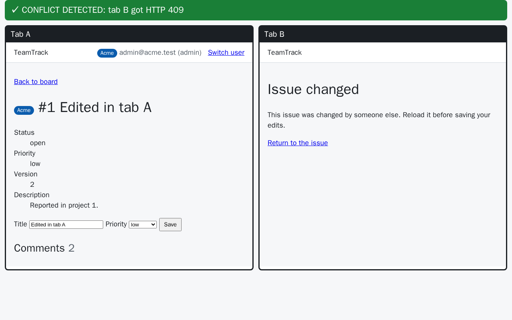

# Module 1: Harness Engineering for Coding Agents - Demo 3: what real runs looked like

This folder holds the output and the screenshots of the real `make demo-3 FEATURE=F4` A/Bs the course
ran before class, with the class settings. Nothing here is staged or edited, except where a line says
it was cut. Use it to check that your run looks roughly like these, or to follow the demo without
running it. When and how each file was captured is in the
[evidence page](../../../docs/evidence.md#s3-demo-capture).

> **Terms on this page**
>
> - **Bare arm**: An agent run with the ticket and the repository, and no harness.
> - **Harness arm**: The same run with the harness turned on.
> - **Primary verdict**: The referee's answer to the one question the section asks.
> - **Out-of-scope file**: A file in the shipped diff that matches none of the allowed paths.
> - **Block**: A patch the scope layer refuses before anything is written; the agent sees `BLOCKED`.

## Terminal output

| File | What it holds |
|---|---|
| `terminal.txt` | Test run 3: the command, both record lines, the cost line |

The run id and the running cost totals are cut from `terminal.txt` where it shows `...`. The command
in it is the one `make demo-3 FEATURE=F4 PURPOSE=pilot` runs.

## Screenshots

Screens 1 to 5 come from test run 3, which ran alone on the machine. The two extra screen 3 captures
come from test runs 1 and 2. All were taken after the runs ended.

> Your output will differ: run times, ids, and the agent's wording change on every run.

*Screen 1: both arms FAIL F4's own measure; the harness arm ended `ABORTED: timeout`; primary verdicts at 05:15 and 08:50.*

*Screen 2: only own-org cards on both boards; both arms detect the two-tab edit conflict.*

*Screen 3: `app/services/errors.py` changed by the bare arm, blocked for the harness arm; `diff_scope` 1 new and 0 new.*

*Test run 1: the same file changed by the bare arm and blocked for the harness arm.*

*Test run 2: the same pattern a third time.*

*Screen 4: one dot per run on each feature's own measure; the F4 rows are hollow for both arms.*

*Screen 5: the bare arm's first wrong turn is its edit of the shared file; the harness arm's is the refused patch.*

## Board frames

The referee captures these itself while it scores each arm.

*The bare arm's board: the Acme user sees only Acme cards.*

*The harness arm's board: the same view.*

*Bare arm: tab B's stale save gets HTTP 409 and the conflict page.*

*Harness arm: the same check passes.*
