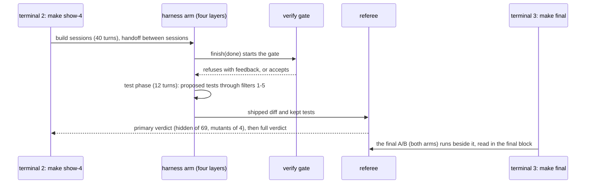
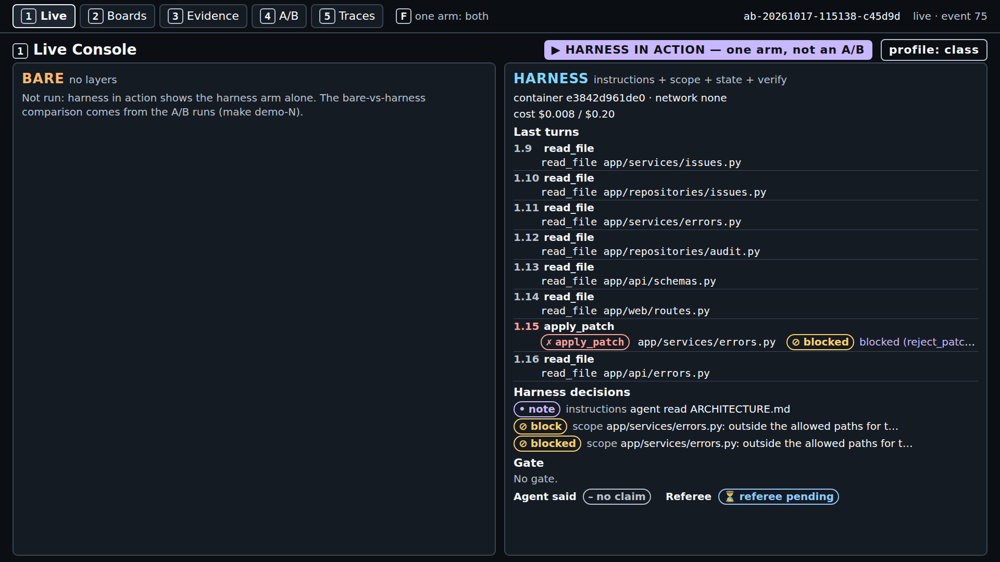
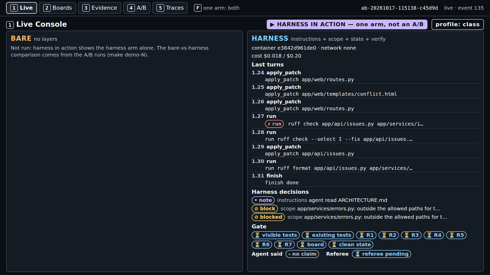
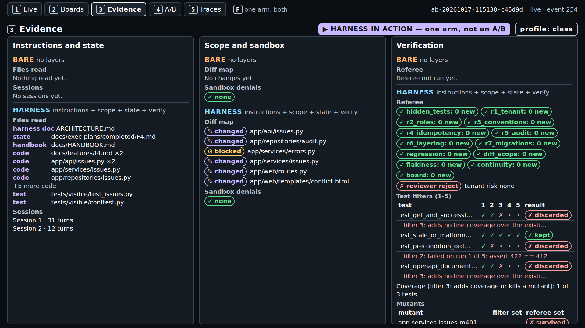
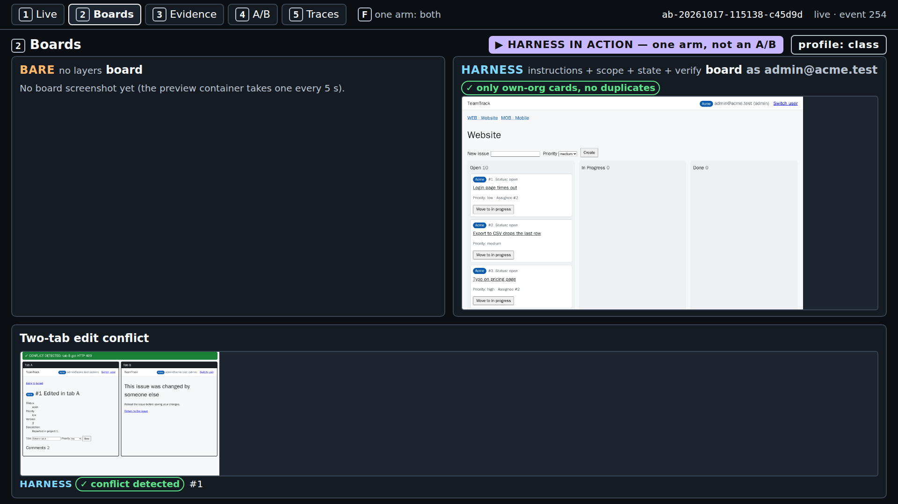
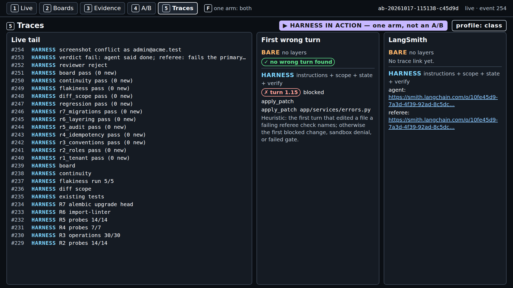
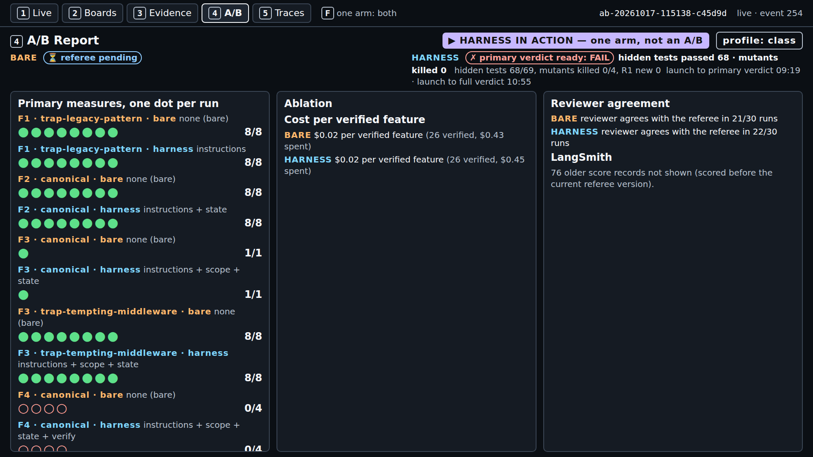

# S4 demo: harness in action (`make show-4`), and the launch of the final A/B

Runbook for the S4 demo, in eight parts: what it shows, what to install, the checks before you
start, the commands, what to watch minute by minute, how to read the result, time and cost, and what
to do when it fails. Reference material (poll, code walkthrough, every F4 result, the emergency
fallback) follows part 8. Concepts: [../concepts.md](../concepts.md). The final A/B launched here is
read in the final block: [final-project/README.md](../../final-project/README.md). Source IDs such
as (A3, F-a-110) resolve in [docs/REFERENCES.md](../../docs/REFERENCES.md). Captured output and screenshots
are labelled "captured on <date>, run <id>; your output will differ".

---

## 1. What this demo shows and why

`make show-4` runs the harness arm alone, live, on F4 (optimistic concurrency with `ETag` and
`If-Match`, and issue history, `platform/teamtrack/docs/features/f4.md`) with all four layers: handoffs between
build sessions, the verify gate on a done claim, a 12-turn test phase whose proposed tests pass
through five filters, and then the referee's two counts the agent never sees: hidden tests passed (of
69) and referee mutants killed by the shipped tests (of 4). It is not an A/B because the course pilot
found no gap on F4 (both arms failed the primary measure in every A/B, section 11); the measurement
lesson goes to the final, `make final`, the class's one live A/B, launched in this section and read
in the final block.

The problem: the `If-Match` header is optional, so every existing test keeps passing whether or not
concurrency works. An agent can test the happy path, call `finish(claim="done")`, and ship a board
where two people editing one issue overwrite each other. The verification layer's assumption, in the
course's words: the agent's "done" and its own tests cannot be trusted (after A3, F-a-124; cause 4:
A3, F-a-15; A4, F-a-17).



---

## 2. Prerequisites and dependencies

The course's tested platform is Ubuntu inside WSL2 on the class host. The setup pages hold every
step and say which ones were tested: [macOS](../../setup/macos.md) (not tested on a Mac),
[Windows with WSL2](../../setup/windows.md), [Linux](../../setup/linux.md).

| OS | Install (from the setup page) |
|---|---|
| macOS | `xcode-select --install` (git, make); `curl -LsSf https://astral.sh/uv/0.13.1/install.sh \| sh`; Docker Desktop, or `brew install colima docker` then `colima start --cpu 2 --memory 4` |
| Windows | In PowerShell as administrator: `wsl --install`; restart; then every command below runs in the Ubuntu terminal, with Docker Engine inside Ubuntu (no Docker Desktop) and the repository under `~`, never `/mnt/c` |
| Linux (Ubuntu) | `sudo apt update && sudo apt install -y git make curl`; `curl -LsSf https://astral.sh/uv/0.13.1/install.sh \| sh`; Docker Engine from Docker's apt repository ([linux.md](../../setup/linux.md), step 3); `sudo usermod -aG docker $USER`, then a new login |

Then, on every OS:

```bash
git clone https://github.com/ANI-IN/harness-engineering-session.git ~/shipharness
cd ~/shipharness
make setup        # uv sync --frozen, both sandbox images, .env from .env.example
```

and put `OPENAI_API_KEY` and `LANGSMITH_API_KEY` in `.env` (never print it on the projector). For
class commands (`--purpose class`, the default) also set `SHIPHARNESS_CLASS_DATE=<YYYY-MM-DD>`.

Versions on the class host (captured on 2026-10-17 from `git --version`, `make --version`,
`uv --version`, `docker --version`; your output will differ):

```text
git version 2.53.0
GNU Make 4.4.1
uv 0.13.1 (x86_64-unknown-linux-gnu)
Docker version 29.9.1, build dfc520d
```

Python: `pyproject.toml` requires `>=3.12`, `.python-version` pins `3.12`, and uv downloads it
(`make doctor` showed `3.12.15` on the class host).

---

## 3. Before you start

Run these from the repository root, in this order.

**`make doctor`** checks Python, git, uv, the container runtime, both keys, the price table, and that
`.env` is not tracked. Captured on 2026-10-17 at commit 182d1a2 in a checkout without `.env` (so
both keys show `x missing`); your output will differ:

```text
$ make doctor
uv run shipharness doctor
shipharness doctor
  + ok          python                 3.12.15
  + ok          git                    /usr/bin/git
  + ok          uv                     /home/ani/.local/bin/uv
  + ok          container runtime      docker at /usr/bin/docker
  x missing     OPENAI_API_KEY         not set
    next step: OPENAI_API_KEY is missing: add it to .env at the repo root
  x missing     LANGSMITH_API_KEY      not set
    next step: LANGSMITH_API_KEY is missing: add it to .env at the repo root
  + ok          prices                 gpt-6-luna, gpt-5.6-luna
  + ok          .env not in git        not tracked
  result: x not ready (fix the items above)
Cost: $0.000000 (no model calls)
make: *** [Makefile:54: doctor] Error 1
```

Ready means: each key line reads `+ ok ... accepted by OpenAI` (or `accepted by LangSmith`), the
`container runtime` line starts with `+ ok`, and the last line is `result: + ready`
(`platform/src/shipharness/doctor.py`). The key check lists models and uses no tokens.

**`make warm`** (no model calls, safe to rerun) runs `uv run shipharness warm --profile class
--images-command "make images RUNTIME=docker"`. From `uv run shipharness warm --help` (captured on
2026-10-17 at commit 182d1a2): "Prepare the class host: images, containers, and baselines. No model
calls." It rebuilds an image only if its source changed, starts each image once, and caches the
referee and gate baselines of the class tasks. The class-profile round measured 407 s for a first run
(images rebuilt in 145 s; 7 referee and 4 gate baselines) and 1.2 s for a second (course pilot,
class-profile round, 2026-10-17). `make -n warm` is now a true dry run: it only prints the command
(fixed in commit 88739f0).

**Keys present.** `make doctor` ends with `result: + ready`. For `--purpose class`, `.env` also has
`SHIPHARNESS_CLASS_DATE` set to the class day; without it every class command stops with
`x SHIPHARNESS_CLASS_DATE is not set: ...` and exit 2, before any arm starts. `SANDBOX_MODE=docker`
must be set (the default in `.env.example`).

---

## 4. Run it

Three terminals, all in the repository root inside WSL2 (or your Linux or macOS shell).

1. **Terminal 1, the console** (leave it running):

   ```bash
   make console
   ```

   Captured on 2026-10-17 from the quiet timing runs (`make console`); your output will differ:

   ```text
   uv run shipharness console --port 8765
   Console: http://127.0.0.1:8765/
   INFO:     Uvicorn running on http://127.0.0.1:8765 (Press CTRL+C to quit)
   ```

   Open `http://127.0.0.1:8765/` in the browser (on Windows, the Windows browser works).

2. **Terminal 2, the live run**, at section minute 4, after the S4 poll and the final feature poll:

   ```bash
   make show-4
   ```

   It runs (from `make -n show-4`, captured on 2026-10-17 at commit 182d1a2):

   ```text
   uv run shipharness ab --section demo-4 --feature F4 --arms harness   --purpose class \
     --profile class
   ```

   One agent run and one review, at most $0.24 at the caps. Open its run on the console right away
   (screen `1`), before `make final` starts, so the two do not get mixed up.

3. **Terminal 3, the final A/B**, at section minute 5, with the poll winner (F5 here as the example):

   ```bash
   make final FEATURES=F5
   ```

   It runs, for each feature (from `make -n final FEATURES=F5`, captured on 2026-10-17 at commit
   182d1a2):

   ```text
   rc=0; for f in $(echo "F5" | tr ',' ' '); do \
     uv run shipharness ab --section final --feature $f  --purpose class \
       --profile class || rc=$?; \
   done; exit $rc
   ```

   Always pass `FEATURES=`: the Makefile default is `F5,F6`. Each arm is capped at
   `MAX_FINAL_RUN_COST_USD` ($0.25) and each review at `MAX_REVIEW_COST_USD` ($0.04), so one feature
   costs at most $0.58. Open it in a second browser tab and leave it for the final block.

4. **In the browser**, keys `1` Live Console, `2` Boards, `3` Evidence, `4` A/B Report, `5` Traces;
   `F` shows one arm full screen. After a run, `http://127.0.0.1:8765/run/<ab_id>` opens it directly.

5. **At the end** each terminal prints its record lines and a `Cost:` line (part 5 has the captured
   lines). Exit codes: 0 when every arm completed, 2 when an arm ended `ABORTED`, 1 on `ERROR`.

Class timing (50 minutes): S4 poll 0-3; final feature poll 3-4; launches at minutes 4 and 5;
concepts 6-20 and the code walkthrough (section 10) 20-30 while both runs proceed; demo block 30-45 on
the finished `make show-4` (screens `1`, `3`, `2`, then the results slide and screen `4`); discussion
45-50. The final A/B is read in the final block.

---

## 5. What to watch, minute by minute

From a real `make show-4` on a quiet machine (captured on 2026-10-17, run `ab-20261017-115138-c45d9d`,
with `PURPOSE=pilot`, the class profile, and no `make final` running beside it; screenshots of
screens 1 and 2 every minute and of screens 1-5 after the verdict). Minutes count from the launch;
your run will differ. In class `make final` runs at the same time, so expect it to be slower.

Every screen shows the badges "▶ HARNESS IN ACTION — one arm, not an A/B" and "profile: class". On
screen `1` the bare panel reads "Not run: harness in action shows the harness arm alone. The
bare-vs-harness comparison comes from the A/B runs (make demo-N)." While the run is live, screen `1`
keeps the last 8 turn rows and the last 3 harness decisions; afterwards it lists all of them.

| Minute | Screen | What appears |
|---|---|---|
| 0 | `1` | Harness decisions: `placed 31 instruction files (AGENTS.md map, docs, skills)`, the initializer step, `feature_list.json written with F4 (passes: false)`, and `gate baseline reused (same checkpoint commit)` (the effect of `make warm`); at 0:18 `agent read ARCHITECTURE.md` |
| 1 | `1` | At 0:55 turn `1.15`, `apply_patch app/services/errors.py`, gets "✗ apply_patch" and "⊘ blocked (reject_patch)": the scope layer refused a write to the shared errors file, outside the build list; decisions `block` and `blocked`. The agent then works inside the list |
| 2-3 | `1` | Turn `1.31` is `finish done` at 2:18. The gate pills appear at once, all ⏳: `visible tests`, `existing tests`, `R1` to `R7`, `board`, `clean state` |
| 3-4 | `1` | At 3:24 every pill turns ✓ (visible tests 190 passed) and the decision `gate ... passed`; then the session 1 handoff, `status_set` "F4 passes: r-20261017-115138-94d8ac-g1 at 19d994d", and the exec plan moved to `completed/`. The test phase starts (turns `2.x`): getting up to speed, `bash init.sh`, the visible tests, one new test file |
| 5-8 | `3` | The test filters run on the 4 proposed tests, each up to 5 times (5:51 to 8:34): the Verification panel fills one row per test with ✓/✗ per filter and `kept` or `discarded`; screen 1 then shows `test filters: kept 1, discarded 3` |
| 8-9 | `1` | At 8:34 the run ends `✗ run ABORTED: timeout · 43 turns`. At 9:19: "✗ primary verdict ready: FAIL", "hidden tests passed 68 · mutants killed 0" |
| 9-11 | `1` | Secondary checks finished at 10:38; the full verdict at 10:55: "hidden tests 68/69, mutants killed 0/4, R1 new 0 · launch to full verdict 10:55" and "✗ claim not supported" |

The point of the section is on one screen: the gate passed every item and the harness set `passes`,
yet the referee fails the run. The gate checks visible tests, existing tests, R1-R7, the board, and
clean state, not the hidden tests or the referee mutants. No F4 harness arm in the pilot runs had
claimed done, so this is the first real run where the gate ran on F4.



*Console screen 1 (show-4), captured on 2026-10-17, run ab-20261017-115138-c45d9d; your output will differ.*



*Console screen 1 (show-4), captured on 2026-10-17, run ab-20261017-115138-c45d9d; your output will differ.*


*Console screen 1 (show-4), captured on 2026-10-17, run ab-20261017-115138-c45d9d; your output will differ.*


*Console screen 1 (show-4), captured on 2026-10-17, run ab-20261017-115138-c45d9d; your output will differ.*

Then the other screens:

- **Screen `3` (Evidence)**: the diff map with `app/services/errors.py` marked "⊘ blocked"; the
  Verification panel's "Test filters (1-5)" table: two tests discarded at filter 3 ("adds no line
  coverage over the existing suite and kills no filter-set mutant that the existing tests miss"),
  one at filter 2 ("failed on run 1 of 5: assert 422 == 412"), one kept after all five; the
  referee mutants below it.

  

  *Console screen 3 (show-4), captured on 2026-10-17, run ab-20261017-115138-c45d9d; your output will differ.*

- **Screen `2` (Boards)**: the board with "✓ only own-org cards, no duplicates" and, after the run,
  the "Two-tab edit conflict" panel: "✓ CONFLICT DETECTED: tab B got HTTP 409", tab B showing "This
  issue was changed by someone else". The board stops the two-tab lost update, yet one hidden test
  fails and no shipped test kills a referee mutant.

  

  *Console screen 2 (show-4), captured on 2026-10-17, run ab-20261017-115138-c45d9d; your output will differ.*

- **Screen `5` (Traces)**: "First wrong turn: turn 1.15 blocked, apply_patch app/services/errors.py",
  the live tail, and the LangSmith links.

  

  *Console screen 5 (show-4), captured on 2026-10-17, run ab-20261017-115138-c45d9d; your output will differ.*

- **Screen `4` (A/B Report)** and the results slide: one dot per run per feature and arm; single-arm
  runs are counted separately and never compared. Say the record is not an A/B, then read section 11.

  

  *Console screen 4 (show-4), captured on 2026-10-17, run ab-20261017-115138-c45d9d; your output will differ.*

Terminal 2 at the end (captured on 2026-10-17, run ab-20261017-115138-c45d9d, `time make show-4
PURPOSE=pilot`; your output will differ):

```text
A/B ab-20261017-115138-c45d9d (F4, layers=['instructions', 'scope', 'state', 'verify'], profile=class, harness in action)
  harness  ABORTED: timeout  claim=done     primary={"hidden_passed": 68, "mutants_killed": 0} passed=False hidden 68/69 mutants 0/4 reviewer=reject cost=$0.0233
Cost: $0.026511 (this command: gpt-5.6-luna $0.003201, gpt-6-luna $0.023310; session $1.416157 of $2.50; build $2.341905 of $15.00 ($12.658095 left))
make: *** [Makefile:129: show-4] Error 2

real	11m5.912s
```

`Error 2` is `shipharness ab`'s exit code 2 for an aborted arm; the run is judged and complete. The
`session` figure counts every command run under the same session date (here the pilot's); a class
session starts at $0.

Terminal 3, the final A/B, at its end (captured on 2026-10-17, run ab-20261017-120323-c97138,
`time make final FEATURES=F5 PURPOSE=pilot` on the quiet machine, after `make show-4` had finished;
your output will differ):

```text
A/B ab-20261017-120323-c97138 (F5, layers=['instructions', 'scope', 'state', 'verify'], profile=class)
  bare     completed         claim=done     primary={} passed=True hidden 46/46 mutants 2/3 reviewer=accept cost=$0.0177
  harness  ABORTED: timeout  claim=none     primary={} passed=True hidden 46/46 mutants 2/3 reviewer=accept cost=$0.0226
Cost: $0.045597 (this command: gpt-5.6-luna $0.005302, gpt-6-luna $0.040295; session $1.461754 of $2.50; build $2.387502 of $15.00 ($12.612498 left))
make: *** [Makefile:163: final] Error 2

real	12m46.782s
```

F5-F7 have no pre-registered primary measure (`primary={}`), so `passed=True` only means nothing was
registered to fail; read the scores (hidden tests, mutants, reviewer) as one dot each. How to read
it is in the final block ([final-project/README.md](../../final-project/README.md)).

---

## 6. What a result means

**The verdict.** F4's primary measure needs both counts: every hidden test passed (69 of 69) and
every referee mutant killed by the shipped tests (4 of 4). "primary verdict ready: FAIL" with
`hidden_passed` and `mutants_killed` tells you which count failed; read both aloud. The gate does not
run hidden tests or mutants (`GATE_CHECKS` in `platform/src/shipharness/harness/verify/gate.py`), so a passed
gate and a failed referee verdict can sit side by side: what separates the claim from the verdict is
the referee's held-out check (B13, F-b-43).

**The three readings.** `make show-4` runs one arm, so it cannot show any of them on its own; they
come from A/Bs (pilot runs, and screen 4):

| Reading | What it would mean on F4 | The pilot |
|---|---|---|
| Harness ahead | The harness arm passes both counts in more runs than the bare arm | Not seen |
| No measurable difference | Both arms pass (or fail) in about the same number of runs | Measured: both arms failed in all 7 F4 A/Bs (pilot runs 2 and 3, class-profile round) |
| Bare ahead | The bare arm passes both counts in more runs than the harness arm | Not seen |

On the counts themselves: the harness arm never killed more referee mutants than the bare arm in
those 7 A/Bs, and passed more hidden tests in one (section 9). What to say: "on this task with this
model, the harness arm did not get ahead".

---

## 7. Expected time and cost

| Run | Launch to primary verdict | Launch to full verdict | Wall time | Cost |
|---|---|---|---|---|
| `make show-4`, quiet machine, `ab-20261017-115138-c45d9d` (2026-10-17, alone on the machine, agent time limit hit) | 9 min 19 s | 10 min 55 s | 11 min 6 s | $0.026511 (agent $0.023310 at the Fast tier, review $0.003201) |
| Class-profile round, F4 harness arm, `ab-20261017-090903-926c02` (2026-10-17, both arms running) | 811 s | 927 s | - | $0.0257 arm, $0.0040 review |
| `make show-4 PURPOSE=pilot` under load, `ab-20261017-100107-4c2be8` (2026-10-17, agent time limit hit) | - | - | 9 min 30 s | $0.0251 |

The final A/B on the quiet machine (`make final FEATURES=F5`, `ab-20261017-120323-c97138`, run
alone): the bare arm's full verdict 6 min 54 s after launch, the harness arm's 12 min 36 s (it hit
the agent time limit at 9:50); wall time 12 min 47 s; cost $0.045597 for both arms and both reviews.

In class, a launch at section minute 4 at the quiet-machine pace gives the primary verdict near
minute 13 and the full verdict near minute 15, before the code walkthrough ends; with `make final`
beside it, allow more. If there is no full verdict at minute 30, open the demo block on the running
arm (screen 1 and the filter table fill in as it goes). In the quiet run the test filters ran from
5:51 to 8:34, each proposed test up to 5 times.

Caps (not measurements; `platform/src/shipharness/config/settings.py`): agent time per arm `RUN_TIMEOUT_S`
300 s, harness work per arm `HARNESS_TIMEOUT_S` 120 s, tool command `TOOL_TIMEOUT_S` 120 s; $0.20
per arm (`MAX_RUN_COST_USD`), $0.25 per final arm (`MAX_FINAL_RUN_COST_USD`), $0.04 per review
(`MAX_REVIEW_COST_USD`), $2.50 per session (`MAX_SESSION_COST_USD`); F4 build session 40 turns
(`platform/teamtrack/reference/f4/task.toml`). By those caps `make show-4` costs at most $0.24 and one
`make final` feature at most $0.58. Fast-tier calls cost twice the Standard rate per token; the caps
do not change.

---

## 8. If it fails

| Symptom | Cause (from the code) | Fix |
|---|---|---|
| `make show-4` exits 2 with `ABORTED: timeout` on the record line | The harness arm hit the 300 s agent time limit (it did in the class-profile round and under load) | Nothing to fix: the referee still judges the shipped diff and the record is complete |
| `x OpenAI refused the key: ...; no arm was started`, exit 2 | Live runs refuse a missing or rejected key and any stand-in client; there is no automatic fallback | Fix the key (`make doctor` until `result: + ready`), or section 12 |
| The run is slower than part 7 and the ledger shows `"service_tier": "default"` | OpenAI served a Fast request at the Standard tier; each call is priced by the tier the response reports (`platform/src/shipharness/cost/tracker.py`) | Nothing to fix; open the demo block on the running arm: screen 1 and the filter table fill in as it goes |
| The arm ends `ERROR` with `docker run failed: ...`, or `make doctor` shows `container runtime ! warn` | Docker is not running, or an image is missing (`platform/src/shipharness/sandbox/docker.py`) | `docker info`; `sudo systemctl start docker` inside Ubuntu (Colima: `colima start`); `make warm` |
| `make console` fails with `address already in use` | Another program holds port 8765 | `make console CONSOLE_PORT=8766`, then open `http://127.0.0.1:8766/` |
| No gate pills by the end of the run | The agent never claimed done; the gate runs only on `finish(claim="done")` | Show the test-phase filter table and the referee counts; the gate's behaviour is in concepts §3.1; no F4 harness arm in the pilot runs reached it, the quiet run in part 5 did |
| `make final` with no `FEATURES` runs F5, then F6 | The Makefile default is `FEATURES ?= F5,F6` | Always pass `FEATURES=`; press Ctrl+C at once if the default started |

Older notes said not to run `make -n warm` because it started the warm-up; that no longer applies
after commit 88739f0. Every gate pill ✗ with `could not write the check inputs in the container` or
`check runner failed (exit <n>)` means the harness time limit ran out (each gate command is capped
by the harness time left): keep the run and say what happened. `reviewer=None` means the review was
incomplete or hit its cap; the primary counts are unaffected.

---

## Reference material

## 9. Poll question and answer pattern

Ask before the launch; the final feature poll follows it:

> Building F4 (ETag, If-Match, issue history), both arms' visible tests pass at the end. The referee
> then runs 69 hidden tests (`platform/teamtrack/tests/hidden/f4/`) and 4 referee-set mutants
> (`platform/teamtrack/mutants/features/f4.jsonl`) against the tests each arm shipped. Which arm passes more
> hidden tests and kills more mutants?
>
> A. Harness arm on both counts
> B. Harness arm on hidden tests only
> C. Harness arm on mutants only
> D. No clear difference

Hint for the room after the vote: one referee mutant makes writes stop moving the version
(`issue.version += 1` becomes `+= 0`), which brings back lost updates. A shipped test catches it
only if it checks that a write moves the ETag, or that a save with the old version gets 412.

Answer pattern from the course's seven F4 A/Bs (hidden of 69 and mutants of 4, bare against
harness; A/B ids in section 11):

| A/B | Hidden, bare / harness | Mutants, bare / harness | Which of A-C held |
|---|---|---|---|
| Run 2, A/B 1 | 69 / 69 | 3 / 0 | none |
| Run 2, A/B 2 | 66 / 61 | 4 / 0 | none |
| Run 2, A/B 3 | 69 / 69 | 3 / 2 | none |
| Run 3, A/B 1 | 66 / 27 | 4 / 0 | none |
| Run 3, A/B 2 | 66 / 69 | 0 / 0 | B |
| Run 3, A/B 3 | 69 / 69 | 3 / 0 | none |
| Class-profile round | 68 / 68 | 4 / 1 | none |

A held in none of the seven, B in one, C in none; the harness arm never killed more mutants than
the bare arm. Say it plainly: on this task with this model, the harness arm did not get ahead.

## 10. Code walkthrough

Ten minutes, while the runs proceed. `uv run python platform/scripts/anchors.py extract <id>` prints each
anchor.

| Order | Anchor | File and lines | Point at |
|---|---|---|---|
| 1 | `S4:filters` | `platform/src/shipharness/filters/pipeline.py:34-74` | A test stops at its first failing filter; every result is published with a reason |
| 2 | `S4:probe` | `platform/src/shipharness/checks/r1_tenant.py:65-104` | R1: a foreign id must give 404; a 2xx carrying Globex data is a leak |
| 3 | `S4:blind` | `platform/src/shipharness/reviewer/blind.py:15-39` | What the reviewer never sees: harness artifacts, commit metadata, workspace paths, run ids, the arm label |
| 4 | `S4:gate` | `platform/src/shipharness/harness/verify/gate.py:143-184` | Pending pills first, checks in the arm container, feedback only on failure; `GATE_CHECKS` (lines 33-43) has no hidden tests or mutants |

When the gate refuses a claim, the agent gets `Gate <id>: <n> of <m> items failed (<names>).`, up
to three failure lines, and `Fix these, commit your work, and call finish again.` (`_feedback` in
`platform/src/shipharness/harness/verify/gate.py`).

## 11. Results for this section

Every F4 A/B the course ran (captured on 2026-10-16 and 2026-10-17, runs as listed; your output will
differ). The score records and run logs behind this table are kept on the class host and are not
part of the public repository; the run ids identify them. Pilot runs 2 and 3 used effort medium; the
class-profile round used the class profile (effort low, Fast tier, 2 CPUs per container, five
flakiness re-runs).

| Run | A/B | Arm | Run id | Status | Claim | Hidden of 69 | Referee mutants of 4 | Tests shipped |
|---|---|---|---|---|---|---|---|---|
| Pilot run 2 | ab-20261016-182828-c81fc0 | bare | r-20261016-182828-1daced | ABORTED: timeout | none | 69 | 3 | 30 |
| Pilot run 2 | ab-20261016-182828-c81fc0 | harness | r-20261016-182828-7d66af | ABORTED: timeout | none | 69 | 0 | 0 |
| Pilot run 2 | ab-20261016-185422-8a8c2a | bare | r-20261016-185422-ce2096 | completed | none | 66 | 4 | 33 |
| Pilot run 2 | ab-20261016-185422-8a8c2a | harness | r-20261016-185422-618828 | completed | none | 61 | 0 | 0 |
| Pilot run 2 | ab-20261016-191626-6100f6 | bare | r-20261016-191626-e55f2f | completed | none | 69 | 3 | 8 |
| Pilot run 2 | ab-20261016-191626-6100f6 | harness | r-20261016-191626-7aebe4 | ABORTED: timeout | none | 69 | 2 | 3 |
| Pilot run 3 | ab-20261016-212252-aa1644 | bare | r-20261016-212252-eb2cb4 | ABORTED: timeout | none | 66 | 4 | 23 |
| Pilot run 3 | ab-20261016-212252-aa1644 | harness | r-20261016-212252-1623c9 | completed | none | 27 | 0 | 0 |
| Pilot run 3 | ab-20261016-214151-ca9841 | bare | r-20261016-214151-23531c | ABORTED: timeout | none | 66 | 0 | 0 |
| Pilot run 3 | ab-20261016-214151-ca9841 | harness | r-20261016-214151-c0e492 | ABORTED: timeout | none | 69 | 0 | 0 |
| Pilot run 3 | ab-20261016-220010-c5b4bf | bare | r-20261016-220010-087344 | ABORTED: timeout | done | 69 | 3 | 5 |
| Pilot run 3 | ab-20261016-220010-c5b4bf | harness | r-20261016-220010-aabcbb | ABORTED: timeout | none | 69 | 0 | 0 |
| Class-profile round | ab-20261017-090903-926c02 | bare | r-20261017-090903-ffa6fd | completed | done | 68 | 4 | 16 |
| Class-profile round | ab-20261017-090903-926c02 | harness | r-20261017-090903-3dc7bc | ABORTED: timeout | not_done | 68 | 1 | 4 |

No arm passed all 69 hidden tests and killed all 4 referee mutants in the same run, so both arms
failed the primary measure in every A/B: no measurable difference on this task with this model.
Pilot run 4 (effort low) ran F1-F3 only.

What else the records show:

- **The gate never ran on F4.** No harness arm called `finish(claim="done")`: the claim was `none`
  in runs 2 and 3 (every build used its 40 turns) and `not_done` in the class-profile round.
- **Two bare done claims, both failed by the referee.** In ab-20261016-220010-c5b4bf the build
  passed 69 of 69 hidden tests and one referee mutant survived its shipped tests; in
  ab-20261017-090903-926c02 one hidden test failed
  (`test_invalid_body_with_a_stale_version_is_412`), after the claim "Verified the complete visible
  suite (191 passing)".
- **The harness test phase.** In run 2 it kept no test (in ab-20261016-191626-6100f6 the 3 shipped
  tests came from build session 1, and the one test-phase test failed filter 2). In run 3 it
  proposed none: in ab-20261016-214151-ca9841 and ab-20261016-220010-c5b4bf the agent time limit
  ended the test session after 7 and 6 turns, spent on the getting-up-to-speed steps. In the
  class-profile round it proposed 6 and kept 4.
- **A broken change.** In ab-20261016-212252-aa1644 the harness arm passed 27 of 69 hidden tests
  and added 3 new R1 violations.
- **The reviewer** rejected all 14 arms in the table and agreed with the referee each time
  (`reviewer_agrees`).

Post hoc (measures chosen after the results; descriptive), over runs 2-4 and the live console check:
harness arms changed files outside the allowed paths in 0 of 34 runs, bare arms in 9 of 34; harness
arms shipped a median of 2.5 tests against 7.5. The course's planned 10-run experiment batch and the
leave-one-out ablation (`--layers=-verify`) were not run: the pilot did not pass its pre-registered
decision rule, so the A/Bs above are all the F4 data the course has.

Measured in the class-profile round, 2026-10-17 (ab-20261017-090903-926c02, one A/B at a time, from
the launch): bare 152 s of agent time, primary verdict 243 s, full verdict 393 s, arm $0.0217, review
$0.0038; harness 311 s of agent time, primary verdict 811 s, full verdict 927 s, arm $0.0257, review
$0.0040. The harness arm's harness time was 433 s, mostly the test filters running each of its 6
test-phase tests up to 5 times.

Measured in pilot run 2, 2026-10-16 (effort medium, two A/Bs in parallel), per arm from the score
records (captured on 2026-10-16, runs as listed; your output will differ):

| Run id | Arm | `wall_s` | `cost_usd` | `review_cost_usd` |
|---|---|---|---|---|
| r-20261016-182828-1daced | bare | 310.173 | 0.015296 | 0.004127 |
| r-20261016-182828-7d66af | harness | 422.691 | 0.016684 | 0.004066 |
| r-20261016-185422-ce2096 | bare | 225.33 | 0.016903 | 0.004038 |
| r-20261016-185422-618828 | harness | 369.779 | 0.016342 | 0.003399 |
| r-20261016-191626-e55f2f | bare | 281.933 | 0.019123 | 0.004327 |
| r-20261016-191626-7aebe4 | harness | 409.127 | 0.018463 | 0.004193 |

The swap test works on an A/B only: on a `make show-4` id it stops with `x <id> is a single-arm run
(harness in action): the swap test needs both arms; pass the id of an A/B`.

## 12. Emergency fallback

Class commands call OpenAI live and never fall back on their own. Only if a live run fails on stage
and part 8 cannot fix it in a minute:

- **`make show-4` fails:** replay the quiet-machine `make show-4` run of part 5, which shows the
  blocked write, the gate passing, the filter table, and the referee failing the claim:

  ```bash
  make replay RUN=ab-20261017-115138-c45d9d
  ```

- **`make final` fails:** replay the quiet-machine final A/B of part 5 and read it as one dot:
  `make replay RUN=ab-20261017-120323-c97138`.
- **The replay fails** (for example the run folder is missing): read part 5 and section 11 from this
  page.

A replay makes no model calls; it re-runs the referee in containers, so Docker must be up, and it
needs the run folder on the class host (`.shipharness/runs/`, not part of the public repository).
Every screen shows RECORDING; say that it is a recording.
