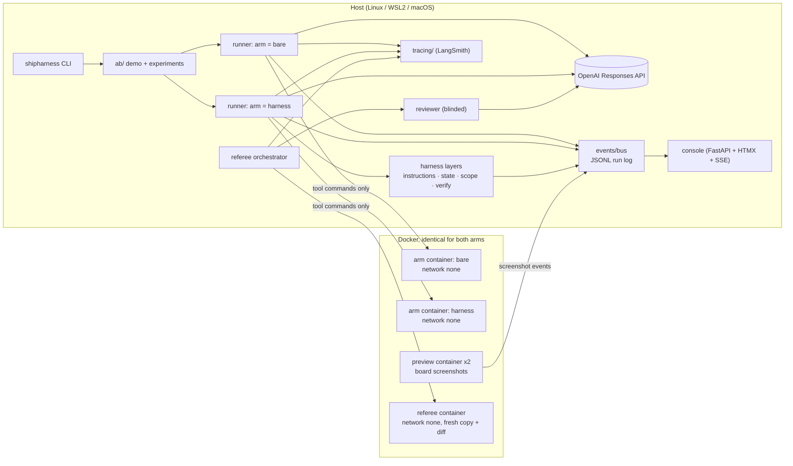
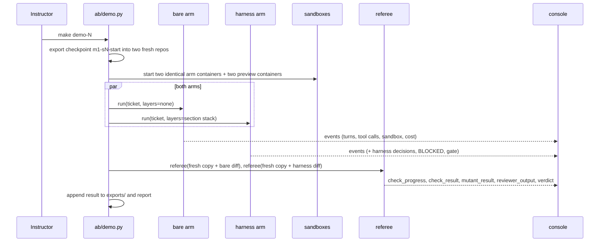

# DESIGN

Module 1 — Harness Engineering for Coding Agents: instructions, state, scope, and verification that
make agent-written code safe to merge.

> **Status: approved by the owner at the M2 checkpoint (2026-10-16), with changes applied the same day**
> (cause 3 wording, run cap covering both phases, Flex for experiments if M6 confirms tool calling,
> learner account requirements, `feature_list.json` read-only to the agent, `finish` tool). Deviations
> D-1 to D-14 are accepted. Decisions already made by the owner:
> product name `shipharness` (2026-10-16); reviewer model `gpt-5.6-luna` (2026-10-16); class host is the
> instructor's Windows PC with Docker Desktop on WSL2, with the repository inside the WSL2 filesystem
> (2026-10-16). Deviations from the brief, with reasons, are listed in §15.

Sources: every concept below traces to [RESEARCH.md](RESEARCH.md) (source IDs A1-A7, B1-B14;
finding IDs F-a-NN, F-b-NN). Interfaces are defined in [CONTRACTS.md](CONTRACTS.md).

---

## 1. Storyline

### Problem
Teams now hand features to coding agents. The agent writes code that looks right and reports "done."
In a multi-tenant service the failures are specific and expensive:
- a new endpoint returns one customer's data to another customer;
- a second session does not know what the first session did, and redoes or breaks it;
- the agent changes files it was never asked to touch, and older features stop working;
- the agent's own tests pass while the behaviour is wrong, and "the agent said it passed" is the only
  evidence a reviewer gets.

### Why it happens
1. The agent cannot follow rules it cannot see in its context. "From the agent’s point of view,
   anything it can’t access in-context while running effectively doesn’t exist." (A1, F-a-05)
2. Each new session starts without memory of the previous one: "each new session begins with no
   memory of what came before." (A2, F-a-08)
3. Agents copy existing patterns, including bad ones, and can take actions that are hard to undo
   (F-a-20, F-a-19, F-a-21). Cited side by side, not merged into one claim (RESEARCH G-1): "Codex
   replicates patterns that already exist in the repository—even uneven or suboptimal ones" (A1,
   F-a-20); the A4 author runs the agent loop with the note "(Run this in a container, not your actual
   machine)" and reports the agent running `pkill -9 bash` and ending its own loop (F-a-18, F-a-19);
   "Without guidance, Claude Opus 4.6 may take actions that are difficult to reverse or affect shared
   systems" (A6, supplementary, F-a-21); A5 restricts file operations "to the project directory only"
   (F-a-86).
4. The agent judges its own work, and its visible tests miss what held-out tests catch. "agents
   reliably skew positive when grading their own work" (A3, F-a-15); "while every frontier agent
   saturates the visible suite, reward hacking persists" (B13, F-b-45), mostly through features that
   pass in isolation and fail when composed (F-b-50).

### Solution
A harness: the environment around the agent, not a better prompt. A1 describes the work as designing
"environments, specify intent, and build feedback loops" (F-a-02); A1 never defines "harness
engineering", so the course uses this description and attributes no definition to A1 (G-2).

| Part | Answers | Addresses |
|---|---|---|
| S1 Instructions: what the agent knows | Instructions it can find | Cause 1 |
| S2 State and session lifecycle: what the agent remembers | State that survives sessions | Cause 2 |
| S3 Scope and sandbox: what the agent is allowed to change and reach | Scope enforced by code and by the sandbox | Cause 3 |
| S4 Verification: what proves the work is done | Verification the agent does not control | Cause 4 |

`shipharness` packages the four parts as a tool learners run on their own repositories.

### How we prove it
Same agent, model, reasoning effort, task, repository, tools, sandbox, turn limit, and cost cap, with
and without the harness; both judged by the same deterministic referee on what they ship; shown live;
backed by pre-run experiments. Every section repeats: problem seen live → cause → harness piece → code
walkthrough → live A/B result.

---

## 2. Audience and learning objectives

Audience: software engineers in the US who are comfortable with Python, git, pytest, and REST APIs and
new to building harnesses around coding agents.

Accounts learners need (also in `setup/PRE-CLASS.md`):
- A paid OpenAI API account on the Build tier or higher, with at least $5 of credit purchased. The
  gpt-6-luna model page lists rate limits only for Build, Launch, and Grow, not Free (RESEARCH §4.2).
- A free LangSmith Developer account with no card on file, so the 5,000-traces-per-month hard cap
  applies (RESEARCH §4.3).

By the end of each section a learner can:

| Section | Objectives |
|---|---|
| S1 Instructions | (1) Explain, citing A1, why an agent does not apply a rule that exists only outside its context. (2) Structure a repository's knowledge as a short AGENTS.md map (roughly 100 lines, A1) pointing into a structured docs/ directory, plus one Agent Skill with correct frontmatter and progressive disclosure (B1). (3) Read the S1 A/B result: tenant-isolation violations (R1) and API-convention failures (R3) with and without the instructions layer. |
| S2 State and session lifecycle | (1) Describe the initializer agent / coding agent split, init.sh, the progress file, and git history as the state a new session reads (A2). (2) Design an execution plan (active → completed, A1/A7) and a structured handoff (A3) that let a session resume after a context reset. (3) Read the S2 A/B result: redone or lost work and migration-head conflicts after a forced session stop. |
| S3 Scope and sandbox | (1) Enforce one feature at a time from a JSON feature list (A2), allowed paths per phase, and a `passes` field that only the harness sets after evidence. (2) Explain the container limits used for both arms (no network, CPU/memory/process limits, non-root, writes limited to the workspace) and read a `sandbox_denied` event. (3) Read the S3 A/B result: out-of-scope files and source edits during the test phase. |
| S4 Verification | (1) Build verification the agent does not control: TestGen-LLM-style test filters (B11), targeted mutants (B12), house-rule checks, held-out tests (B13), a blinded separate reviewer (A3), and a clean-state gate (A2). (2) Find the first wrong turn in a trace. (3) Run a fair A/B and read it: hidden tests passed and mutants caught, reported as counts per run. |

---

## 3. Product: shipharness

### 3.1 Commands

| Command | Purpose | Model calls |
|---|---|---|
| `shipharness run` | Harnessed (or bare, `--layers none`) agent builds a feature, then writes tests for it | Builder, test writer |
| `shipharness testgen` | Filtered test generation for any Python repo with pytest | Test writer |
| `shipharness check` | House-rule checks for FastAPI services; exit code for CI | None |
| `shipharness review` | Separate, blinded AI reviewer of a diff | Reviewer |
| `shipharness ab` | Same task, harness off vs on, both judged by the referee | Builder, test writer (both arms), reviewer |
| `shipharness console` | Live web console (five screens) | None |
| `shipharness skills validate` | Validate a skill folder against the Agent Skills spec | None |
| `shipharness doctor` | Environment check (keys, Docker, versions, LangSmith key validity) | One minimal OpenAI call (models list, no tokens) |

Every command prints a cost summary at exit (§11).

### 3.2 Architecture

Rules that hold everywhere:
- The agent loop runs on the host. Only tool commands run in the arm's container. API keys never enter
  any container.
- The referee runs in its own container on a fresh copy of the checkpoint with the arm's diff applied,
  never in the arm's container, and never on the host (agent-written code is never executed on the host
  except in the labelled no-Docker fallback).
- LangSmith tracing happens on the host.

### 3.3 Components and boundaries

| Package (`src/shipharness/`) | Purpose | Depends on |
|---|---|---|
| `config/` | pydantic-settings config, prices, caps | — |
| `cost/` | CostTracker: usage × prices, cap enforcement | config |
| `events/` | Typed events, bus, JSONL run log, replay reader | — |
| `sandbox/` (repo root `sandbox/` holds Dockerfile and `policy.py`) | Container lifecycle, exec with timeout, usage sampling, denial detection, no-Docker fallback | events, config |
| `runner/` | Agent loop (Responses API), tools, skills loader, session control | cost, events, sandbox, tracing |
| `harness/instructions/` | Places AGENTS.md map and skills; builds the stable context prefix | runner interfaces |
| `harness/state/` | init.sh, progress.md, exec plans, structured handoff, forced session stop and resume | runner interfaces |
| `harness/scope/` | feature_list.json, allowed paths per phase, revert and `BLOCKED`, evidence-gated `passes` | runner interfaces |
| `harness/verify/` | Test-phase filter pipeline hook, clean-state gate, gate feedback | filters, checks |
| `filters/` | Five test filters, targeted mutant runner | sandbox |
| `checks/` | R1-R7 (R8 in A4), existing-tests check, diff scope, hidden tests runner, flakiness re-runs | sandbox |
| `reviewer/` | Blinded reviewer with structured output | cost, tracing |
| `ab/` | Arm setup, parallel execution, referee orchestration, swap test, experiments, report | everything above |
| `console/` | Five screens, SSE streaming from run logs | events |
| `tracing/` | LangSmith wrappers, trace links, exports | config |
| `skills_cli/` | `skills validate` | — |
| `cli.py` | Typer entry point | all |

The harness layers talk to the runner only through the hook interface in CONTRACTS.md §5. The
referee talks to builds only through `Check.run(build_dir)`. The console reads only events.

### 3.4 Data flow of `make demo-N`

---

## 4. TeamTrack (bundled demo target)

### 4.1 Stack and layers
FastAPI, SQLAlchemy 2.1, Alembic, SQLite, pydantic-settings, structlog, Jinja2 + HTMX 2.0.11 for the
board. Layers `api/ → services/ → repositories/ → db/`; `api` never imports `db` (R6, import-linter).
Design targets at `m1-base`: about 25 endpoints and about 120 visible tests.

### 4.2 Domain
Orgs, users (roles admin / member / viewer), projects, project members, issues (status, assignee,
priority, soft delete via `deleted_at`, `version` column), audit log. Seed: orgs Acme and Globex, three
users per org (one per role), two projects per org, about 20 issues per org, with stable IDs so
cross-tenant probes are reproducible.

### 4.3 Endpoints at `m1-base` (design target 25)

| Area | Endpoints |
|---|---|
| Auth (demo) | `POST /auth/login` (demo token for a seeded user), `GET /me` |
| Org | `GET /orgs/current` |
| Users | `GET /users`, `POST /users`, `GET /users/{id}`, `PATCH /users/{id}` |
| Projects | `GET /projects`, `POST /projects`, `GET /projects/{id}`, `PATCH /projects/{id}`, `DELETE /projects/{id}` (archive) |
| Members | `GET /projects/{id}/members`, `POST /projects/{id}/members`, `DELETE /projects/{id}/members/{user_id}` |
| Issues | `GET /projects/{id}/issues`, `POST /projects/{id}/issues`, `GET /issues/{id}`, `PATCH /issues/{id}`, `POST /issues/{id}/assign`, `POST /issues/{id}/transition`, `DELETE /issues/{id}` (soft delete) |
| Audit | `GET /audit` (admin) |
| Ops | `GET /health` |
| Legacy | `GET /v1/issues` — returns all issues with offset pagination and a bare array, **without the tenant filter**. Marked in docs as legacy: do not copy. Exists because A1 reports agents copying existing patterns (F-a-20) |

All non-legacy list endpoints already follow R3 (`{items, next_cursor}`), so the right pattern to copy
is in the repository next to the wrong one.

### 4.4 Web issue board
Jinja2 + HTMX: board per project (columns by status), issue detail, create/edit forms, comments panel
(after F2), login switcher for the demo users, tenant badge on every card. Every card carries
`data-org` and `data-issue-id` attributes so screenshot scripts can mark cross-tenant or duplicate cards
without relying on the arm's code.

### 4.5 Checkpoints (git tags)

| Tag | Contents | Used by |
|---|---|---|
| `m1-base` | TeamTrack base, harness code, referee, console | All |
| `m1-s1-start` | Base | S1 demo (F1) |
| `m1-s2-start` | Base + F1 reference | S2 demo (F2) |
| `m1-s3-start` | + F2 reference | S3 demo (F3) |
| `m1-s4-start` | + F3 reference | S4 demo (F4) |
| `m1-final-start` | + F4 reference | Final (F5-F7) |
| `m1-complete` | Course complete | — |

Reference implementations for F1-F7 live under `teamtrack/reference/` (instructor backup and checkpoint
builder). They are never exported into an arm workspace (§8.3).

---

## 5. House rules and generic checks

House rules live in `teamtrack/docs/` for both arms. "House rules" is the course label for what A1 calls
"golden principles" and "taste invariants" enforced mechanically (F-a-96, F-a-99; RESEARCH G-9).

| Rule | Meaning | Check (discovers endpoints from the app's OpenAPI spec) |
|---|---|---|
| R1 Tenant isolation | No org sees another org's data | Every endpoint × method as Acme with Globex IDs → expect 404. A violation is any other status; a leak is a 2xx whose body contains Globex data |
| R2 Roles | Viewers cannot write | Every write endpoint (POST/PUT/PATCH/DELETE) as viewer → expect 403 |
| R3 Conventions | Lists return `{items, next_cursor}`; errors return `{error: {code, message}}` | Schemathesis (in-process ASGI, fixed seed per run) + envelope assertions |
| R4 Idempotent creates | Same `Idempotency-Key` → one record | Duplicate POST probe on every create endpoint; per-checkpoint exemption list (issue create is exempt until F3 lands) |
| R5 Audit | Every write adds exactly one audit row | Audit row count before/after each write probe |
| R6 Layering | `api` never imports `db` | import-linter contract |
| R7 Migrations | One head; upgrades from an empty DB | `alembic heads` count = 1; `alembic upgrade head` on a fresh DB succeeds |
| R8 Soft delete (assignment A4) | Soft-deleted rows never appear or resolve | Learners build it |

All checks report **new** violations relative to the checkpoint baseline. The legacy `/v1/issues`
violation is part of every baseline, so it does not count against either arm unless an arm makes it
worse.

---

## 6. Harness layers

`--layers` takes `none`, `all`, or a comma list of `instructions,state,scope,verify`; `-<layer>` removes
one from `all`.

### 6.1 What both arms always get (never a variable)
Same exported repository (application code, migrations, visible tests, `teamtrack/docs/` content), same
system prompt core, same seven tools (six working tools plus `finish`; CONTRACTS §6), same model and reasoning effort, same ticket text, same sandbox, same
turn and session budgets, same cost cap, same session-stop schedule, same wrap-up turns at a session stop.
Bare-arm content parity: every rule the harness documents (AGENTS.md map, ARCHITECTURE.md, SECURITY.md,
skills) is also present, in the bare arm, inside the repository's docs as an unstructured handbook
(`docs/HANDBOOK.md`). A unit test checks that each rule ID (R1-R7) and each convention appears in both
forms. The harness changes how knowledge, state, scope, and verification are organised and enforced; it
never adds facts the bare arm cannot read.

### 6.2 instructions (S1)
- Places `AGENTS.md` at the workspace root: a map of roughly 100 lines (A1, F-a-28) pointing to
  `ARCHITECTURE.md` (root) and `docs/` (`SECURITY.md`, `RELIABILITY.md`, `QUALITY_SCORE.md`, `PLANS.md`,
  `design-docs/`, `product-specs/`, `references/*-llms.txt`, `exec-plans/`), following A1's layout
  (F-a-30). AGENTS.md is injected into the stable context prefix; the files it points to are read on
  demand.
- Places skills in `.agents/skills/` and puts each skill's `name` and `description` in the context
  prefix; full SKILL.md and referenced files load only when the agent asks (B1 progressive disclosure).
- Bare arm: no injected map, no skill catalogue; the handbook is on disk.

### 6.3 state + lifecycle (S2)
- Initializer step (A2, F-a-49): before the first coding session the harness creates `init.sh`,
  `progress.md`, `feature_list.json` (if scope is on), and `docs/exec-plans/active/<feature>.md`, and
  commits them. Implemented as deterministic harness code rather than a model session, because these
  files are fixed by the ticket; the course says so and cites A2's footnote that the two agents differ
  only in their initial prompt (F-a-52).
- Getting up to speed (A2, F-a-58 to F-a-62): the session prompt tells the agent to run `pwd`, read
  `progress.md` and `git log`, read the feature list, run `init.sh`, and run the visible tests before
  changing code.
- Forced session stop: the session turn budget is smaller than the feature (allowed technique, §1.8 of the
  brief). At the stop both arms receive the same number of wrap-up turns. The harness arm's wrap-up
  message asks for a progress update, exec-plan update, handoff, and commit; the bare arm's says only that
  the session is ending. The harness also writes the machine part of `session-handoff.md` itself (files
  changed, test status, last commits, open TODOs) so the handoff exists even if the agent does not write
  one. This is A3's context reset with a structured handoff (F-a-65; RESEARCH G-5).
- Resume: a new session starts with an empty context. Both arms get the same resume prompt ("A previous
  session worked on this ticket and was stopped."); the harness arm's prefix also carries the
  getting-up-to-speed routine.
- At feature completion the exec plan moves from `active/` to `completed/`.

### 6.4 scope (S3)
- `feature_list.json` is the only scope (A2, A5). Fields per feature: `id`, `category`, `description`,
  `steps`, `passes` (A2 wording), plus course additions `evidence` and `testedAt` (RESEARCH G-6).
- One feature per session (A2, F-a-83).
- Allowed paths per phase: `build` and `test` phases each have an allow list from the dataset example.
  `apply_patch` rejects a hunk outside the list before writing; after every `run` command the guard diffs
  the workspace and reverts any change outside the list. Each rejection or revert emits `blocked` with
  file, phase, and reason, and the agent sees the reason in the tool result.
- The agent may not edit `feature_list.json` at all. A2: "It is unacceptable to remove or edit tests
  because this could lead to missing or buggy functionality" (F-a-80). Any patch or command that changes
  the file is rejected or reverted with `blocked`. Only `harness/scope/status.py` writes it.
- Only the harness sets `passes`. The agent reports completion through the `finish` tool; the harness sets `passes: true`
  with `evidence` (gate result ID, commit SHA, test counts) and `testedAt` only after the verify gate
  passes, or after the visible tests pass when the verify layer is off. A2 lets the agent set `passes`
  after careful testing (F-a-108); the course moves that decision to the harness and cites A3's
  separation of doer and judge (F-a-110).
- The sandbox is taught here (§9) but is on for both arms in every run.

### 6.5 verify (S4)
- Test phase: proposed tests go through the five filters (§7); kept tests are committed; every discarded
  test is shown with its reason.
- Gate on "done": when the agent calls `finish(claim="done")`, the harness runs, in the arm's container,
  visible tests, existing tests (the checkpoint's visible suite keeps passing), R1-R7 checks, a board
  smoke check, and the clean-state check (git clean, ruff clean, one migration head, no debug output;
  A2 F-a-84). Failures go back to the agent as a tool-style message; the agent continues within its turn
  budget. Hidden tests and referee-only mutants are never run by the gate.
- The blinded reviewer (`OPENAI_EVAL_MODEL`) is the separate evaluator taught from A3 (F-a-110 to
  F-a-112). It runs on both arms' final diffs as part of the referee output, blinded to the arm, with
  grading criteria drawn from `SECURITY.md` and `ARCHITECTURE.md` (A3's term, not "rubric"; G-10). It is
  shown in S4 and the final, and its agreement with the referee is reported.

### 6.6 Layer stack per section demo
The harness arm in `make demo-N` runs the layers taught so far:

| Demo | Harness arm layers | Reason |
|---|---|---|
| demo-1 | instructions | Isolates the S1 layer's effect on R1 |
| demo-2 | instructions, state | Adds the S2 layer |
| demo-3 | instructions, state, scope | Adds the S3 layer |
| demo-4 | all | Adds the S4 layer |
| final | all | — |

`make demo-N LAYERS=-<layer>` removes one layer from that section's stack. The ablation batch (§10)
removes one layer at a time from `all` (A3: "removing one component at a time", F-a-125).

---

## 7. Test filters and mutants

A proposed test is kept only if all five pass, in this order (cheapest first):

| # | Filter | Source |
|---|---|---|
| 1 | Imports and runs (collected by pytest, no errors) | B11 "buildable" (F-b-17) |
| 2 | Passes 5 consecutive runs | B11 "every one of five executions" (F-b-18, F-b-19) |
| 3 | Adds line coverage over the existing suite, or kills a filter-set mutant that no existing test kills | B11 coverage (F-b-20); B12 hardening (F-b-29, F-b-32) |
| 4 | Contains real assertions and does not mock the unit under test (AST check) | Course filter (G-7) |
| 5 | No source file changed during the test phase | Course filter, composite of B11 F-b-22 and A2 F-a-80 (G-7) |

Mutants are hand-written records applied one at a time by a targeted runner (mutmut is not used; RESEARCH
§4.7). Each target module's mutants are split into a **filter set** (visible to filter 3) and a
**referee set** (held out; used only by the referee). The referee never judges an arm with the mutants its
own filter used (§8).

---

## 8. Referee and A/B integrity

### 8.1 Referee
Runs in a fresh referee container (network none) on a fresh export of the checkpoint with the arm's diff
applied. Steps, each emitting `check_progress` counters and a `check_result`:
1. Apply diff; record files changed; classify each as allowed / out-of-scope for the phase.
2. Existing tests (the checkpoint's visible suite) — reported as "existing tests keep passing" (RESEARCH G-8;
   internal key `regression`).
3. R1-R7 probes (in-process ASGI; Schemathesis with a fixed seed recorded per run).
4. Hidden tests for the feature (some combine features, B13 F-b-42).
5. Referee-set mutants against the arm's shipped tests.
6. Shipped tests re-run 10 times for flakiness.
7. Playwright board checks with screenshots.
8. Continuity measures from the run log (S2).
9. Blinded reviewer on the diff.
10. Score record (≈12 scores, CONTRACTS §11) and verdict; "agent said" vs referee.

### 8.2 Pre-registered primary measures
Written before any run. One primary measure per section; all others are secondary and reported.

| Section | Feature | Primary measure (per run) | Reported as |
|---|---|---|---|
| S1 | F1 | New R1 violations ≥ 1 (run fails) | Runs failing out of k, per arm; leak counts secondary |
| S2 | F2 | Continuity failure: any of (a) R7 fails (heads ≠ 1 or fresh upgrade fails), (b) a second migration creates the same table, (c) ≥ 30% of lines added in session 1 are removed in session 2 | Runs failing out of k; components secondary |
| S3 | F3 | ≥ 1 out-of-scope file in the shipped diff, or ≥ 1 source file changed during the test phase | Runs failing out of k; existing-tests and hidden-test results secondary |
| S4 | F4 | Two co-primary counts: hidden tests passed (of N) and referee-set mutants killed by shipped tests (of M) | One dot per run per arm for each |
| Final | F5-F7 | No primary; all scores | Dots and counts |

S3 note: the scope layer enforces the S3 measure, so a harness-arm result of zero out-of-scope files is
expected by construction. The demo states this, and the secondary measures show whether the enforced arm
still shipped a working feature.

### 8.3 Integrity rules (audited by V-f in M9)
Required:
1. Both arms are judged by the same referee on what they ship, never by the harness's own filters.
2. Identical inputs (§6.1). The harness is the only difference. Both arms run in parallel.
3. The reviewer is blinded: it receives the diff and the task, with arm-identifying paths, file names
   (AGENTS.md, progress.md, feature_list.json, `.agents/`, exec plans, handoff), and commit messages
   removed by `reviewer/blind.py`; the arm label is never sent.
4. One primary measure per section (§8.2), registered here before any run.
5. Every run is a dot; results are counts ("9/10"), not percentages.

Additional rules from the M2 design:
6. Each arm works in its own fresh git repository created from a filtered export of the checkpoint
   (application, migrations, visible tests, docs), with one initial commit. It is not a worktree of the
   course repository, so hidden tests, referee mutants, reference implementations, and other branches are
   unreachable through git.
7. Mutant split: filter-set mutants (used by filter 3) and referee-set mutants are disjoint.
8. Disclosed overlap: the verify gate runs the same R1-R7 checks as the referee. These checks are
   documented house rules both arms can read. The S4 primary measures (hidden tests, referee-set mutants)
   are never available to the gate or the agent. Demos 1-3 do not include the verify layer (§6.6).
9. All runs, including aborted ones (`ABORTED: cap`), are kept, scored, and shown.
10. Schemathesis seeds and Hypothesis seeds are recorded per run; the referee is deterministic for a given
    build (pilot gate condition 3).

Allowed task-design techniques (both arms see the same repository): the legacy `/v1/issues` handler;
conventions only in docs; a session turn budget smaller than the feature; tempting off-limits shared
middleware (`app/api/middleware.py`); source easier to change than tests in the test phase; hidden tests
that combine features; targeted mutants on risky lines; easy control tasks where both arms should pass.

Forbidden: withholding docs, tools, turns, or budget from the bare arm; different model or effort per arm;
re-running until the bare arm fails; dropping runs; hiding harness failures; unlabelled recordings; tuning
the referee to one arm's style; exposing hidden tests to either arm.

---

## 9. Sandbox

| Item | Design |
|---|---|
| Containers per run | One arm container per arm (long-lived for the run, tool commands via `docker exec`), one preview container per arm, one referee container per arm at referee time |
| Image | One Dockerfile, two targets: `agent` (python:3.12-slim, uv, TeamTrack and test dependencies from the lockfile) and `referee` (adds Playwright Chromium). Built by `make setup`; dependencies baked in |
| Flags (both arms identical) | `--network none --memory 1g --memory-swap 1g --cpus 1 --pids-limit 256 --read-only --tmpfs /tmp:rw,nosuid,size=256m --user 1000:1000 --cap-drop ALL --security-opt no-new-privileges --init`, workspace bind-mounted read-write at `/work` (only writable path besides `/tmp`) |
| Timeouts | Per tool command (`TOOL_TIMEOUT_S`) and per run wall clock (`RUN_TIMEOUT_S`) |
| Policy | `sandbox/policy.py` holds limits, flags, and denial rules; printed at run start and emitted in `sandbox_start` |
| Denials | Pre-exec: commands that need the network (package installs, `curl`, `wget`, `git clone` over http, `uv add`) are refused with reason. Post-exec: output patterns for name-resolution or unreachable-network errors, `Read-only file system`, fork failures, and `State.OOMKilled` or timeout produce `sandbox_denied` with the command and reason. `apply_patch` paths are resolved on the host and refused if outside the workspace |
| Usage | `docker stats --no-stream` sampled every 2 s → `sandbox_usage` |
| Board preview | Preview container (network none) runs the arm's TeamTrack and headless Chromium; a trusted script takes a screenshot of the board as Acme every 5 s and on demand, marks cards from another org or duplicate cards using `data-` attributes, and writes PNGs that the console shows via `screenshot` events. No container needs a published port |
| No-Docker fallback | Temp directory + timeouts on the host; every screen and output shows "UNSANDBOXED — results not official" |
| Platforms | Class host: Windows + Docker Desktop (WSL2 backend), repository inside the WSL2 filesystem. Learners: Linux (Docker Engine or Podman), macOS (Docker Desktop or Colima), Windows via WSL2. Native Windows shells are not supported for sandboxed commands |

The sandbox is not an A/B variable. Detailed sandbox design is Module 2.

---

## 10. Datasets and experiments

### 10.1 `teamtrack-features-v1` (60 tasks)

| Group | Count | Purpose |
|---|---|---|
| F1-F7 canonical tickets | 7 | Main A/B |
| Reworded tickets for F1-F7 (terse, product-manager prose, bug-report style) | 21 | Result does not depend on one wording |
| F1-F4 from two alternate checkpoints | 8 | Result does not depend on one repository state |
| Session-stop variants for F2, F6, F7 (three stop points each) | 9 | Continuity under different interruptions |
| Trap variants (legacy pattern nearby, tempting middleware) | 7 | Realistic temptations |
| Easy control tasks (both arms should pass) | 8 | Shows the comparison is fair |

Subsets (LangSmith splits): `smoke` (6), `section-1` … `section-4` (8 each).

### 10.2 `testgen-targets-v1` (40 targets)
20 TeamTrack modules + 10 boltons 26.2.0 modules + 10 WTForms 3.2.2 modules (RESEARCH §4.8), about 4
mutants each (≈160), split into filter and referee sets. Library suites run on Linux (WSL2/CI); each
library has a known-failures list for its Windows-only baseline failure.
boltons doctests are part of the baseline suite (upstream command), and WTForms keeps its upstream
`filterwarnings = ["error"]`, so a generated test that triggers a warning is discarded with the
warning as the reason (owner decisions, 2026-10-16; RESEARCH G-19, G-20). Both are recorded in each
target's metadata.

### 10.3 Referee inventory (design targets; no model cost)
≈400 hidden tests across F1-F7; R1 probes for every endpoint × method (100+); R2 probes (60+);
Schemathesis cases per run (hundreds to thousands); R4-R7 probes (30+); existing tests (120+); ≈80
TeamTrack mutants; 10× flakiness re-runs of shipped tests.

### 10.4 Experiment plan (instructor, before class)

| Order | Batch set | Runs | Reviewer |
|---|---|---|---|
| 1 | Headline: F1-F4 canonical × 2 arms × k=10 | 80 | On |
| 2 | Ablation: 12 tasks × 4 leave-one-layer-out configs × k=2 | 96 | Off |
| 3 | Testgen: 40 targets × 2 arms × k=2 | 160 | Off |
| 4 | Full dataset: 60 tasks × 2 arms × k=2 | 240 | Off |

Each batch set is split into commands of at most $2.50 (`MAX_BATCH_COST_USD`). If the total would exceed
$25, reduce k in batch 4 first, then batch 3; never reduce batch 1. M6 recomputes this table from measured
per-run cost.

Service tier: experiments use `OPENAI_SERVICE_TIER=flex` (Batch-rate prices, 50% off; RESEARCH §4.2) if
the M6 pilot confirms that multi-turn tool calling works on Flex; otherwise `auto`. Both arms of a batch
always use the same tier. Live class runs always use `auto`, because Flex latency is unpredictable. The M6
result and the tier used per batch are recorded in VERIFICATION.md.

---

## 11. Cost plan

### 11.1 Caps (enforced by CostTracker; on a cap the run aborts cleanly, is marked "ABORTED: cap", and the referee still runs)

| Key | Value |
|---|---|
| `MAX_RUN_COST_USD` | 0.20 per arm per run, covering the build and test phases together (final: `MAX_FINAL_RUN_COST_USD` 0.25) |
| `MAX_REVIEW_COST_USD` | 0.04 |
| `MAX_SESSION_COST_USD` | 2.50 (one class session, persisted across commands in `.shipharness/session.json`) |
| `MAX_BATCH_COST_USD` | 2.50 (any single command) |
| `MAX_EXPERIMENT_TOTAL_USD` | 25.00 (persisted across experiment batches) |
| Also | max turns per session, max output tokens per call, tool and run wall-clock timeouts |

One run cap covers both phases: the build phase and the test phase share the $0.20 (final $0.25). M6
measures build-phase and test-phase cost separately. If build + test exceeds the cap in the pilot, the
test phase gets a smaller turn budget (a dataset field per task) until the total fits; the build-phase
budget and the cap are not changed.

### 11.2 Prices (`config/prices.toml`, per 1M tokens, verified 2026-10-16)

| Model | Input | Cached input | Cache write | Output |
|---|---|---|---|---|
| gpt-6-luna (`OPENAI_MODEL`) | 0.10 | 0.01 | 0.125 | 0.50 |
| gpt-5.6-luna (`OPENAI_EVAL_MODEL`) | 0.20 | 0.02 | 0.25 | 1.20 |

### 11.3 Class budget (worst case at caps)

| Item | Count × cap | Worst case |
|---|---|---|
| Section demos | 4 × 2 arms × $0.20 | $1.60 |
| Reviewer (S4) | 2 × $0.04 | $0.08 |
| Final | 2 arms × $0.25 | $0.50 |
| Reviewer (final) | 2 × $0.04 | $0.08 |
| Swap tests | deterministic | $0.00 |
| **Total** | | **$2.26** (session cap $2.50) |

One optional layer-switch rerun ($0.20) fits only if the session meter shows room; the session cap blocks
it otherwise.

### 11.4 Experiment budget (modelled; M6 replaces with measured values)
Modelled per-run cost for gpt-6-luna at medium effort (RESEARCH §4.2): $0.032 with ideal caching, $0.105
without, $0.128 if every cache lookup misses. Reviewer ≈ $0.006 per review (gpt-5.6-luna). At $0.032 per
run, 576 runs + 80 reviews ≈ $19; at $0.06 per run, k in batches 4 and 3 drops to 1 (376 runs ≈ $23); above
$0.065 per run, batch 2 k drops to 1 as well. Batch 1 is never reduced. If M6 confirms tool calling on
Flex (§10.4), the experiments run at Batch-rate prices (half of the figures above) and the k reductions
are recomputed from those prices.

### 11.5 Learner budget
≤ $6 OpenAI and ≤ 400 LangSmith traces across the four assignments; no single command > $2.50. Planned split:
A1 ≤ $2.50 / 150 traces (A/B on `section-1`, k=3; if M6 measures more than $0.05 per run, the assignment
subset drops to 4 tasks); A2 ≤ $1.50 / 60; A3 ≤ $0.25 / 30 (mostly deterministic); A4 ≤ $1.75 / 120.

---

## 12. LangSmith plan

| Item | Design |
|---|---|
| Projects | `shipharness-class-<date>` (ad hoc class commands), `shipharness-experiments` (non-experiment traces from batches), `shipharness-assignments`. Experiments get their own LangSmith project per experiment, named `<prefix>-<section|batch>-<arm>-<date>` |
| Tracing | `wrap_openai` on the client; `@traceable` root run per agent run with build and test phases as child runs; tool calls and sandbox exec as child tool runs. Referee evaluation is one trace with the reviewer call as a child |
| Datasets | `teamtrack-features-v1` and `testgen-targets-v1` uploaded by `make datasets` from JSONL (examples built in Python; splits for subsets) |
| Experiments | `evaluate()` per arm on the same dataset split with `num_repetitions=k`; the two arms run concurrently; one combined referee evaluator returns all scores as a list; bare vs harness compared in the comparison view (`comparison_url` stored in exports). Class demos use the same code path with a one-example dataset and k=1 |
| Retention decision | Experiment runs start at extended retention whatever feedback is attached (RESEARCH §4.3), so scores stay as evaluator feedback (needed for the comparison view). Every score record is also written to `exports/` at once, and any direct `create_feedback` call passes `extend_trace_retention=False`. If the M3 live test on a no-card account shows extended traces or feedback are blocked, the fallback is: the referee runs inside the target and scores are stored in run outputs and metadata. The decision and the live-test result are recorded in VERIFICATION.md |
| Exports | After each batch: experiment rows, score records, aggregate stats, trace URLs to `exports/*.json`; `make report` reads only `exports/` |
| Key check | `make doctor` lists one project; fails on auth, rate-limit, or connection errors |

### Trace budget (2 traces per run: agent root + referee evaluator)

| Use | Runs | Traces | Budget |
|---|---|---|---|
| M6 pilot (≤ 3 efforts × 4 features × 2 arms × k=3) | ≤ 72 | ≤ 144 | — |
| Experiment batches 1-4 | 576 | 1,152 | — |
| **Instructor experiments total** | | **≤ 1,296** | ≤ 1,500 |
| Class run (demos + final + ad hoc) | ~12 | ~40 | — |
| Development and verification | — | ≤ 1,100 | — |
| **Instructor per month** | | **≤ 2,500** | ≤ 2,500 |
| Learner, whole module | — | ≤ 400 | ≤ 400 |

If counts run high, `disable_evaluator_tracing=True` halves experiment traces (scores stay in exports).

---

## 13. Live console: screen-by-section plan

Readability for all screens: text ≥ 20 px, high contrast, ≤ 3 panels per view, symbol + label on every
status, fixed 1920×1080 layout, `F` toggles full screen for one arm.

| Key | Screen | S1 | S2 | S3 | S4 | Final |
|---|---|---|---|---|---|---|
| 1 | Live Console | Files read, AGENTS.md / skill loads in the turn list | `session_stop` / `session_resume` markers | `blocked` decisions, sandbox header | Gate pills ⏳→✓/✗ | All |
| 2 | Boards | ⚠ Globex cards on the bare board | Comments panel after resume | — | Two-tab edit conflict | Both boards |
| 3 | Evidence | Files-read map | Session timeline (redone work in red) | Diff map (allowed / blocked / out-of-scope) + sandbox denials | Mutant matrix, coverage, filter table, referee counters | All panels |
| 4 | A/B Report | S1 dots | S2 dots | S3 dots | S4 dots | All + ablation + LangSmith comparison link |
| 5 | Traces | Live tail | First wrong turn marked | — | — | Link to LangSmith |

Replays (`make replay RUN=<id>`) show a red RECORDING badge on every screen, apply the recorded diff, and
run the referee live.

---

## 14. Class plan

### 14.1 Schedule (240 minutes)

| Block | Min | Content |
|---|---|---|
| Opening | 10 | Problem with a real failure on the board (3) → why it happens (2) → the harness, four parts + sandbox (2) → shipharness, TeamTrack, console tour, `harness-setup` assessment (3) |
| S1 Instructions | 50 | Concepts 15 · walkthrough 10 · live A/B 15 · results 10 |
| S2 State and session lifecycle | 50 | Same |
| Break | 10 | |
| S3 Scope and sandbox | 50 | Same |
| S4 Verification | 50 | Same |
| Final + wrap-up | 20 | Poll → `make final FEATURES=…` → all screens → report + LangSmith comparison → skills to take home → assignments |

Live A/B within each section: glance at an easy control task, poll, `make demo-N`, screens 1→2→3. Results:
screen 4, swap test or layer switch, discussion. S3 sandbox moment: tonight's `sandbox_denied` events, or
the policy printout and the experiment denial log if none occurred.

### 14.2 Walkthrough anchors (`# [walkthrough:S<N>:<name>]` start/end, 30-40 lines each)

| Section | Anchors |
|---|---|
| Opening | `ab/demo.py:two_arms`, `Opening:publish` in `src/shipharness/events/bus.py` (+ architecture diagram) |
| S1 | `teamtrack/AGENTS.md` (whole file), `S1:progressive` in `src/shipharness/runner/skills_loader.py`, `harness/instructions/router.py:prefix` |
| S2 | `init.sh` template, `harness/state/lifecycle.py:stop_resume`, `harness/state/progress.py:write` |
| S3 | `harness/scope/guard.py:allowed_paths`, `harness/scope/status.py:passes`, `S3:policy` and `S3:run_args` in `src/shipharness/sandbox/policy.py`, `S3:dockerfile` in `sandbox/Dockerfile` |
| S4 | `filters/pipeline.py:filters`, `checks/r1_tenant.py:probe`, `reviewer/blind.py:blind`, `harness/verify/gate.py:gate` |
| Final | `ab/report.py:dots`, `skills/_template/SKILL.md` |

The S1 router module is named `router.py` per the brief; it builds the context prefix, and the docs call the
AGENTS.md file a map (RESEARCH §4.1).

### 14.3 Assignments (detailed in M7)
A1 Instructions: restructure a 900-line instruction file into an AGENTS.md map + docs + one skill; link and
rule-coverage checker; A/B on `section-1` (k=3). A2 State: three forced stops, no duplicate migration,
consistent progress and exec-plan history. A3 Scope and sandbox: per-phase diff-scope policy,
evidence-gated status, one sandbox policy rule with a denial test; hidden scripted diffs. A4 Verification +
portfolio: R8 and one new filter; testgen on the learner's own or an open-source repo; evidence report,
LangSmith link, case study, own skill.

---

## 15. Deviations from the brief (for owner review)

| # | Brief | This design | Reason |
|---|---|---|---|
| D-1 | Product `shipproof` | `shipharness` | Name clash on PyPI and npm in the same area (RESEARCH G-18); owner decision |
| D-2 | "Each arm has its own git worktree" | Each arm gets its own fresh git repository from a filtered export | A worktree shares refs and objects with the course repo, so an arm could reach hidden tests and reference code through git (violates "exposing hidden tests to either arm") |
| D-3 | Referee runs "outside the container" | Referee runs in its own fresh container (network none), never the arm's container and never the host | Agent-written code should not execute on the host; this keeps the brief's intent (fresh copy, not the arm's sandbox) |
| D-4 | Mutants used by filter 3 and the referee | Disjoint filter and referee mutant sets | Otherwise the harness arm is judged by its own filter (§1.8 rule 1) |
| D-5 | demo-N layers unspecified | Cumulative layer stack per section (§6.6) | Keeps the verify gate from affecting S1-S3 primary measures; isolates each layer |
| D-6 | Feature list fields `status, evidence, testedAt` | `passes` (A2) + `evidence`, `testedAt` | Source wording (RESEARCH correction 1) |
| D-7 | "Routing AGENTS.md"; "rubric"; "PASS_TO_PASS" | "map" / "table of contents"; "grading criteria"; "existing tests keep passing" (internal key `regression`) | Source wording (RESEARCH §4.1, G-8, G-10) |
| D-8 | Boards "auto-refreshing" | Board screenshots from a network-less preview container every 5 s | No container needs a published port; screenshots double as evidence |
| D-9 | Reviewer on the harness arm's gate | Reviewer runs on both arms' final diffs (blinded) as referee output | Class budget allows 2 reviews per demo; a reviewer in the gate would also give the harness arm reviewer feedback the bare arm cannot get |
| D-10 | OPENAI_EVAL_MODEL unspecified | `gpt-5.6-luna` | Owner decision; different generation from the agent model |
| D-11 | Initializer as an agent session | Deterministic initializer step in harness code | The initial files are fixed by the ticket; saves turns and cost; A2 footnote cited |
| D-12 | Repository layout | Adds `research/notes/` (M1 per-stream notes) and `teamtrack/reference/` | Traceability; checkpoint building |
| D-13 | Runner tools: "six tools" (§2.6 of the brief) | Seven tools: the six working tools plus `finish(claim, summary)`, identical for both arms | Owner change at the M2 review: a structured claim replaces regex detection of "done" |
| D-14 | Agent may set the status field | Agent may not edit `feature_list.json` at all; only `harness/scope/status.py` writes it | Owner change at the M2 review; A2 F-a-80 |
| D-15 | HTMX + SSE extension | HTMX 2.0.11 (0BSD) for the board and console; live streaming uses the browser `EventSource` API with a small script instead of `htmx-ext-sse` | The htmx-extensions repository states no license (checked 2026-10-16; RESEARCH G-17), so the file is not redistributed |
| D-16 | Sandbox policy file at `sandbox/policy.py` | Policy code in `src/shipharness/sandbox/policy.py`; repo-root `sandbox/` holds the Dockerfile and runtime notes | The policy is imported by the package; one source of truth |

---

## 16. Assumptions and risks

| ID | Assumption or risk | Handling |
|---|---|---|
| AS-1 | Owner review | Approved 2026-10-16 with changes (see status note at the top) |
| AS-2 | `OPENAI_API_KEY` and `LANGSMITH_API_KEY` are provided before M3 `make doctor` and `make datasets` | M3 code and unit tests proceed without keys; live steps wait |
| AS-3 | Docker Desktop (WSL2) is installed on the instructor PC and the repository is moved into the WSL2 filesystem before sandbox verification | Until then, sandbox code is unit-tested with a fake runner and verified in CI (GitHub Actions has Docker) |
| AS-4 | gpt-6-luna at the chosen effort makes the bare arm fail the primary measure in ≥ 2/3 pilot runs per section | M6 pilot gate; if not, change features or effort, never the measurement |
| AS-5 | Per-run cost is near the modelled range | M6 measures; §10.4 and §11.4-11.5 recomputed |
| AS-6 | LangSmith no-card behaviour for experiments matches the docs | M3 live test; fallback in §12 |
| AS-7 | Build-tier rate limits (2M TPM for luna) | At most 4 concurrent agent loops; exponential backoff on 429; billing 429s abort |
| AS-8 | Model variance makes single live runs differ from experiment results | Every live result is shown next to the experiment dots, never alone |
| AS-9 | Demo length ≤ 6 minutes | Turn budgets sized in M6; replay fallback |
