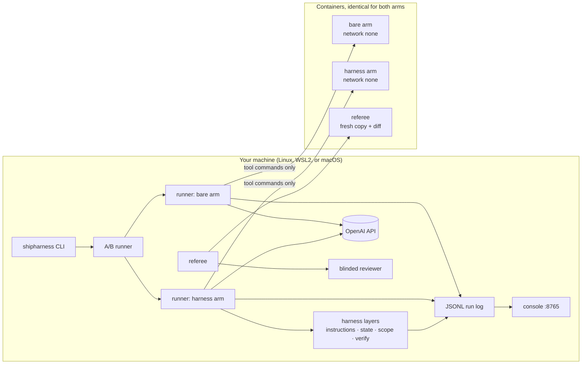

# shipharness: harness engineering for coding agents

Course repository for **Module 1: Harness Engineering for Coding Agents**: the instructions, state,
scope, and verification that make agent-written code safe to merge. It contains a command-line tool,
`shipharness`, a small multi-tenant app for the agent to work on (TeamTrack), a live console, four
course sections with assignments, four reusable skills, and a final project.

Source ids such as (A1, F-a-05) refer to the primary sources and finding ids listed with links in
[REFERENCES.md](REFERENCES.md).

Contents:

1. [The problem](#1-the-problem)
2. [Why it happens](#2-why-it-happens)
3. [The solution: a harness](#3-the-solution-a-harness)
4. [How the course proves it](#4-how-the-course-proves-it)
5. [What you get](#5-what-you-get)
6. [Architecture](#6-architecture)
7. [Prerequisites and accounts](#7-prerequisites-and-accounts)
8. [Quick start](#8-quick-start)
9. [Every make command](#9-every-make-command)
10. [How the demos work, and the class timing](#10-how-the-demos-work-and-the-class-timing)
11. [The five console screens](#11-the-five-console-screens)
12. [Assignments](#12-assignments)
13. [Costs and caps](#13-costs-and-caps)
14. [Using shipharness and the four skills on your own repository](#14-using-shipharness-and-the-four-skills-on-your-own-repository)
15. [Troubleshooting](#15-troubleshooting)
16. [Repository layout](#16-repository-layout)
17. [References](#17-references)

## 1. The problem

Teams now hand features to coding agents. The agent writes code that looks right and reports
"done". In a multi-tenant service the failures are specific and expensive:

- a new endpoint returns one customer's data to another customer;
- a second session does not know what the first session did, and redoes or breaks it;
- the agent changes files it was never asked to touch, and older features stop working;
- the agent's own tests pass while the behaviour is wrong, and "the agent said it passed" is the
  only evidence a reviewer gets.

## 2. Why it happens

1. **The agent cannot follow rules it cannot see in its context.** "From the agent’s point of view,
   anything it can’t access in-context while running effectively doesn’t exist." (A1, F-a-05)
2. **Each new session starts without memory of the previous one:** "each new session begins with no
   memory of what came before." (A2, F-a-08)
3. **Agents copy existing patterns, including bad ones, and can take actions that are hard to
   undo.** No single source says both, so the sources stand side by side: "Codex replicates patterns
   that already exist in the repository—even uneven or suboptimal ones" (A1, F-a-20); A4 runs its
   agent loop with the note "(Run this in a container, not your actual machine)" and reports the
   agent killing its own loop with `pkill -9 bash` (A4, F-a-18, F-a-19); A5 restricts file operations
   "to the project directory only" (A5, F-a-86); and, as supplementary, "Without guidance, Claude
   Opus 4.6 may take actions that are difficult to reverse or affect shared systems" (A6, F-a-21).
4. **The agent judges its own work, and its visible tests miss what held-out tests catch.** "agents
   reliably skew positive when grading their own work" (A3, F-a-15); "while every frontier agent
   saturates the visible suite, reward hacking persists" (B13, F-b-45), mostly through features that
   pass alone and fail when combined (B13, F-b-50).

## 3. The solution: a harness

A harness is the environment around the agent, not a better prompt. A1 describes the work as
designing "environments, specify intent, and build feedback loops" (A1, F-a-02). A1 never defines
"harness engineering", so the course uses this description and attributes no definition to A1.

The course teaches the harness in four parts. The section names S1 to S4 are course labels, not
source terms; the concepts inside each section use the sources' own words.

| Part | What it gives the agent | Answers cause | Key sources |
|---|---|---|---|
| S1 Instructions: what the agent knows | A short AGENTS.md "map" or "table of contents" pointing into a structured `docs/` folder, and skills loaded on demand | 1 | A1 (F-a-27, F-a-28); B1, B2 (F-b-05, F-b-06) |
| S2 State and session lifecycle: what the agent remembers | `init.sh`, a progress file, git history, an exec plan, A2's "Getting up to speed" routine, and a structured handoff at a session stop | 2 | A2 (F-a-49, F-a-58 to F-a-62); A1 (F-a-34); A3 (F-a-65) |
| S3 Scope and sandbox: what the agent may change and reach | One feature from `feature_list.json`, allowed paths per phase, a `passes` field only the harness sets, and the same container limits for both arms | 3 | A2 (F-a-80, F-a-83); A5 (F-a-86); A4 (F-a-88, F-a-90); A3 (F-a-110) |
| S4 Verification: what proves the work is done | Five test filters, targeted mutants, house-rule checks, held-out tests, a blinded separate reviewer, and a clean-state gate | 4 | B11 (F-b-17 to F-b-22); B12 (F-b-29); B13 (F-b-42); A3 (F-a-110); A2 (F-a-84) |

Two parts are course design and are marked as such wherever they appear: the harness, not the agent,
sets `passes` after evidence (A2 lets the agent set it, F-a-108; the course follows A3's separation of
doer and judge, F-a-110), and test filters 4 and 5 are course filters with no direct source.

## 4. How the course proves it

Same agent, model, reasoning effort, task, repository, tools, sandbox, turn limit, and cost cap,
with and without the harness. Both arms are judged by the same referee on what they ship, shown live
in the console, and read next to pre-run experiments.

- The **bare arm** gets the ticket and the repository, including every rule in an unstructured
  handbook (`docs/HANDBOOK.md` in TeamTrack). Nothing is withheld from it.
- The **harness arm** gets the layers taught so far. The harness changes how knowledge, state, scope,
  and verification are organised and enforced; it adds no facts the bare arm cannot read.
- The **referee** runs in its own container on a fresh copy of the starting code with the arm's diff
  applied: existing tests, house-rule probes, hidden tests, referee-set mutants, flakiness re-runs,
  board checks, and a blinded reviewer. Neither arm sees the hidden tests or those mutants.
- Each section has **one primary measure**, registered before any run. Every run is a dot, and
  results are counts such as "2/3", never percentages.

## 5. What you get

| Item | Where |
|---|---|
| `shipharness` CLI: run an agent with or without the harness, A/B it, judge it, check house rules, generate filtered tests, validate skills | `src/shipharness/`; `uv run shipharness --help` |
| TeamTrack, the demo target: a multi-tenant FastAPI issue tracker with a web board, two orgs (Acme and Globex), checkpoints per section | `teamtrack/`, handbook in [teamtrack/docs/HANDBOOK.md](teamtrack/docs/HANDBOOK.md), feature specs in [teamtrack/docs/features/](teamtrack/docs/features/) |
| A live console with five screens | `make console`, section [11](#11-the-five-console-screens) |
| Four course sections, each with concepts, a demo runbook, an assignment, and post-class reading | [submodules/](submodules/) |
| Four skills you can install into your own coding agent | [skills/](skills/), section [14](#14-using-shipharness-and-the-four-skills-on-your-own-repository) |
| A final project: the whole run end to end, then your own repository | [final-project/README.md](final-project/README.md) |
| Two datasets: 60 TeamTrack tasks and 40 test-generation targets | [datasets/README.md](datasets/README.md) |
| Setup guides, an instructor guide, troubleshooting, after-class steps, architecture | [docs/](docs/) |

## 6. Architecture



The agent loop and the API keys stay on your machine; only tool commands run in the containers, and
no key ever enters one. The full picture, with the packages, the referee steps, the event types, and
every file shipharness writes, is in [docs/architecture.md](docs/architecture.md).

## 7. Prerequisites and accounts

**Skills.** Comfortable with Python, git, pytest, and REST APIs. No prior harness work needed.

**Machine.** Linux, macOS, or Windows with WSL2, and a container runtime that provides `docker`.
Each arm container is limited to 1 CPU and 1024 MB of memory, and an A/B runs two arm containers,
two board previews, and the referee's container. Native Windows shells (PowerShell, cmd) are not
supported: on Windows everything runs inside Ubuntu on WSL2.

**Accounts.** Create one API key in each:

| Account | Plan | Why |
|---|---|---|
| OpenAI API | **Build tier** or higher. OpenAI's rate-limits page lists Build as the tier reached with "$5 in total credit purchases" (https://developers.openai.com/api/docs/guides/rate-limits, read 2026-10-17) | The agent model is `gpt-6-luna`; its model page lists the Free tier as "Not supported" and gives rate limits for the Build, Launch, and Grow tiers (https://developers.openai.com/api/docs/models/gpt-6-luna, read 2026-10-17). The reviewer model is `gpt-5.6-luna` |
| LangSmith | **Free Developer plan, no card on file**: "$0 / seat per month", "Up to 5k base traces / mo" (https://www.langchain.com/pricing, read 2026-10-17) | Traces and experiments. "Personal organizations are limited to 5,000 traces per month until a credit card is added." (https://docs.langchain.com/langsmith/billing, read 2026-10-17). Without a card, LangSmith has nothing to bill for extra traces |

Do not add a card to LangSmith. The course plans at most 400 LangSmith traces for your four
assignments together.

## 8. Quick start

Per-platform guides with every command and what was tested where:
**[Linux](docs/setup-linux.md)** · **[Windows (WSL2 + Docker Engine in Ubuntu)](docs/setup-windows.md)**
· **[macOS (Docker Desktop or Colima; not tested)](docs/setup-macos.md)**.

Once git, make, uv, and Docker are installed:

```bash
git clone https://github.com/ANI-IN/harness-engineering-session.git ~/shipharness
cd ~/shipharness
make setup          # uv sync --frozen, build the two sandbox images, create .env
# edit .env: OPENAI_API_KEY=..., LANGSMITH_API_KEY=... (and SHIPHARNESS_CLASS_DATE for class commands)
make doctor         # must end with "result: + ready"
make up             # TeamTrack board on http://127.0.0.1:8000/board (Ctrl+C to stop)
```

On Windows, clone inside Ubuntu into `~/shipharness`, never under `/mnt/c`.

Then, without spending anything:

```bash
make console                    # live console on http://127.0.0.1:8765/
make check-assignment-1         # offline self-check of assignment 1 (fails on the starter: it lists the TODOs)
uv run python skills/harness-setup/scripts/assess.py teamtrack --out harness-assessment.html
```

`SHIPHARNESS_CLASS_DATE` (`YYYY-MM-DD`) is needed only for class commands (`make demo-N`,
`make final`, `make replay`): it names the LangSmith project `shipharness-class-<date>`, and every
command under one date shares the $2.50 session cap. Class commands refuse without it. Add
`PURPOSE=assignment` to a demo or final command to trace to `shipharness-assignments` instead.

## 9. Every make command

Every target is a thin wrapper over `uv run ...`. On Windows, run make inside WSL2. Captured on
2026-10-17 from `make help` at commit 5e8fb08; your output will differ:

```
$ make help
setup doctor up console datasets lint format lint-prose test test-all test-live test-docker
demo-N [LAYERS=-<layer>]  swap-N [AB=<id>]  final [FEATURES=F5,F6]  replay RUN=<id>
experiments report pilot (later milestones)
```

The table below lists every target with what it runs (from `make -n <target>`, checked on
2026-10-17) and whether it calls a model.

| Target | Runs | Model calls and cost | Notes |
|---|---|---|---|
| `make help` | prints the three lines above | none | |
| `make setup` | `uv sync --frozen`, then `make images` if the runtime is found, then copies `.env.example` to `.env` if missing | none | `RUNTIME=podman` uses Podman |
| `make images` | `docker build -f sandbox/Dockerfile --target agent -t shipharness-agent:1 .` and the same with `--target referee -t shipharness-referee:1` | none | Rebuild after changing `sandbox/Dockerfile` or `src/` |
| `make doctor` | `uv run shipharness doctor` | none; lists OpenAI models (no tokens) and one LangSmith project | `uv run shipharness doctor --offline` skips both network checks |
| `make up` | `uv run shipharness up --port 8000` | none | TeamTrack and its board; `PORT=8001` to move it |
| `make console` | `uv run shipharness console --port 8765` | none | `CONSOLE_PORT=8766` to move it |
| `make datasets` | `uv run shipharness datasets upload` | none (LangSmith upload) | Uploads `teamtrack-features-v1` (60) and `testgen-targets-v1` (40) once; assignment 1 needs it |
| `make demo-1` ... `make demo-4` | `uv run shipharness ab --section demo-N --feature FN --purpose class` | **yes**: two agent runs and two reviews, at most $0.48 at the caps | Section A/B; `LAYERS=-<layer>`, `PURPOSE=` |
| `make swap-1` ... `make swap-4` | `uv run shipharness ab --swap latest --section demo-N --purpose class` | none | Re-judges the latest demo-N A/B with labels swapped; `AB=<ab or run id>` picks another |
| `make final` | for each feature in `FEATURES` (default `F5,F6`): `uv run shipharness ab --section final --feature <f> --purpose class` | **yes**: at most $0.58 per feature at the caps | Features run one after another; exit code is the last non-zero one |
| `make replay RUN=<id>` | `uv run shipharness replay <id>` | none (no reviewer by default) | Re-emits a recorded A/B with the RECORDING badge and re-runs the referee; needs `SHIPHARNESS_CLASS_DATE` |
| `make check-assignment-1` ... `-4` | `uv run python submodules/0N-*/assignment/check.py` | none | Offline self-check; `A1_WORK=<folder>`, `A2_IMPL=`, `A3_IMPL=`, `A4_IMPL=` pick your folder |
| `make grade-assignment-1` ... `-4` | `uv run python scripts/grade_assignment.py N "<SUBMISSION>"` | none | **Instructor only**: needs the private graders, which are not in this repository; here it stops with `no grader for assignment N: graders are private (build repository only)`. Needs `SUBMISSION=<folder or git URL>` |
| `make test` | `uv run pytest` | none | Fast suite; deselects slow, live, and Docker tests |
| `make test-all` | `uv run pytest -n auto -m "not live and not docker"` | none | Every test that needs no key and no container; takes minutes |
| `make test-live` | `uv run pytest -m live tests/live` | **yes** | Calls OpenAI and LangSmith |
| `make test-docker` | `uv run pytest -m docker tests/unit/test_sandbox_docker.py` | none | Needs Docker |
| `make lint` | `ruff check`, `ruff format --check`, the import contract, `scripts/anchors.py check`, `shipharness skills validate skills` | none | |
| `make format` | `ruff check --fix .` and `ruff format .` | none | Rewrites files |
| `make lint-prose` | `uv run python scripts/lint_prose.py` (and Vale if installed) | none | Banned words and emoji in course documents |
| `make anchors` | `uv run python scripts/anchors.py list` | none | Code walkthrough anchors; `uv run python scripts/anchors.py extract <id>` prints one |
| `make experiments`, `make report`, `make pilot` | print `! <target> is available after milestones M6 and M8` and exit 2 | none | Placeholders in this release. Use `uv run shipharness report` and `uv run shipharness experiments --help` directly |
| `make slides` | prints `! slides are built in milestone M10` and exits 2 | none | Placeholder |

Variables:

| Variable | Default | Used by | Meaning |
|---|---|---|---|
| `PURPOSE` | `class` | demo-N, swap-N, final | `class` (needs `SHIPHARNESS_CLASS_DATE`; LangSmith project `shipharness-class-<date>`), `pilot` (`shipharness-pilot`), or `assignment` (`shipharness-assignments`) |
| `FEATURES` | `F5,F6` | final | Comma-separated final features, for example `FEATURES=F6` or `FEATURES=F7,F5` |
| `LAYERS` | empty | demo-N, final | `-<layer>` removes one layer from the section's stack, for example `LAYERS=-state` |
| `AB` | `latest` | swap-N | The A/B id (or a run id) to swap-test |
| `RUN` | empty | replay | The A/B id or run id to replay (required) |
| `SUBMISSION` | empty | grade-assignment-N | Folder or git URL of a submission (instructor only) |
| `A1_WORK`, `A2_IMPL`, `A3_IMPL`, `A4_IMPL` | the starter folder | check-assignment-N | Your work folder |
| `PORT` | `8000` | up | TeamTrack port |
| `CONSOLE_PORT` | `8765` | console | Console port |
| `RUNTIME` | `docker` | setup, images | Container command (`podman` also works; set `SANDBOX_RUNTIME=podman` in `.env` too) |
| `UV` | `uv` | every target | The uv command |

All other settings come from `.env` (copied from [.env.example](.env.example)), for example
`OPENAI_MODEL=gpt-6-luna`, `OPENAI_EVAL_MODEL=gpt-5.6-luna`, `OPENAI_REASONING_EFFORT=medium`,
`SANDBOX_MODE=docker` (`none` runs commands on the host, labelled UNSANDBOXED), `RUNS_DIR`, and
`EXPORTS_DIR`.

## 10. How the demos work, and the class timing

Each section's demo is one A/B on one TeamTrack feature, starting from that section's checkpoint
tag. The harness arm runs the layers taught so far:

| Demo | Feature (spec) | Checkpoint | Sessions (turn budget) | Harness arm layers | Primary measure (per run) |
|---|---|---|---|---|---|
| `make demo-1` | F1 org-wide issue search ([f1.md](teamtrack/docs/features/f1.md)) | `m1-s1-start` | 1 (30) | instructions | One or more new R1 tenant-isolation violations fails the run |
| `make demo-2` | F2 comments ([f2.md](teamtrack/docs/features/f2.md)) | `m1-s2-start` | 2 (20, then 30) | instructions, state | Continuity failure: R7 fails, a second migration creates the same table, or 30% or more of session 1's added lines are removed in session 2 |
| `make demo-3` | F3 idempotency keys ([f3.md](teamtrack/docs/features/f3.md)) | `m1-s3-start` | build (30), then a test phase | instructions, state, scope | One or more out-of-scope files shipped, or a source file changed during the test phase |
| `make demo-4` | F4 lost updates and history ([f4.md](teamtrack/docs/features/f4.md)) | `m1-s4-start` | 1 (40) | all four | Two counts: hidden tests passed (of 69) and referee-set mutants killed by the arm's own tests (of 4) |
| `make final` | F5, F6, or F7 ([f5.md](teamtrack/docs/features/f5.md), [f6.md](teamtrack/docs/features/f6.md), [f7.md](teamtrack/docs/features/f7.md)) | `m1-final-start` | per feature | all four | None; read as counts |

Session budgets come from `teamtrack/reference/fN/task.toml`, mutant counts from
`teamtrack/mutants/features/f4.jsonl`. Some tasks contain a temptation that both arms see: the
legacy `GET /v1/issues` handler without a tenant filter next to the right pattern (A1 reports agents
copying existing patterns, F-a-20), or shared middleware that is off-limits but easier to change. The
course calls these "traps"; that is a course label.

The demos above use each feature's canonical ticket. The class task follows the pilot decision taken
after pilot run 3.

[[PENDING: the task used for each class demo after pilot run 3 (canonical, a variant, or a session budget override) | source: M6 pilot | how: course pilot (build repository)]]

**Class timing (240 minutes).** Each section opens with its poll, then `make demo-N` launches right
away. The concepts (15 minutes) and the code walkthrough (10 minutes) run while the A/B proceeds;
the 15-minute demo block then walks through the console and the results, next to the experiment
dots; a short discussion closes the section.

| Block | Minutes | What happens |
|---|---|---|
| Opening | 10 | The problem on a real board, the four causes, the harness, a console tour, the `harness-setup` assessment |
| S1 Instructions | 50 | Poll → `make demo-1` → concepts and walkthrough (A/B running) → demo block → discussion |
| S2 State and session lifecycle | 50 | Same, with `make demo-2` |
| Break | 10 | |
| S3 Scope and sandbox | 50 | Same, with `make demo-3` |
| S4 Verification | 50 | S4 poll and the final feature poll → `make demo-4`, and a minute later `make final FEATURES=<poll winners>` (two A/Bs in parallel) → concepts and walkthrough → demo block → discussion |
| Final and wrap-up | 20 | Walk through the finished final A/B on every screen, the report and LangSmith comparison, the assignments, the skills, the references. No new run |

How long an A/B takes: in the course pilot's run 2 on 2026-10-16 (12 A/Bs, F1-F4, two at a time),
every A/B finished between 485 and 923 s after its first event, so a demo launched at section
minute 3 is ready for the demo block at minute 30. Class commands call OpenAI live and never fall
back to a recording. If a live run fails for a reason outside the experiment (Docker, the network,
OpenAI), the instructor shows a recording made before class with `make replay`, and every screen then
shows RECORDING. After each demo, `make swap-N` re-judges the two diffs with the labels swapped, at no
cost: the referee judges code, not labels.

Each section's runbook (what to watch on which screen, the poll, the anchors) is in its demo folder:
[S1](submodules/01-instructions/demo/README.md),
[S2](submodules/02-state-lifecycle/demo/README.md),
[S3](submodules/03-scope-sandbox/demo/README.md),
[S4](submodules/04-verification/demo/README.md). The instructor's stage-by-stage plan is
[docs/instructor-guide.md](docs/instructor-guide.md).

## 11. The five console screens

`make console`, then http://127.0.0.1:8765/: the run list (newest first; reload to see new runs).
Open a run, then press `1` to `5` to switch screens and `F` to cycle full screen for one arm (both,
bare, harness). Every screen of a replay carries a red `● RECORDING` badge; a run without a sandbox
shows `⚠ UNSANDBOXED — results not official`.

| Key | Screen | What it shows |
|---|---|---|
| `1` | Live Console | Per arm: the container line (id, `network none`, CPU, memory, time left), cost against the run cap, the turns with up to three tool calls each (the last 8 while running; the full scrollable timeline once the run has finished), session stop and resume markers, harness decisions (`⊘ block`, `↺ revert`), gate pills, and "Agent said" next to "Referee" |
| `2` | Boards | A screenshot of each arm's running board as an Acme user, every 5 s, with `⚠ other org` and `⧉ duplicate` marks from trusted `data-` attributes; in S4 a two-tab edit conflict panel |
| `3` | Evidence | Files read by category and sessions (`↺ redone` work); the diff map (`✎ changed`, `⊘ blocked`, `↺ reverted`, `⚠ out of scope`) and sandbox denials; the referee's checks, the reviewer verdict, the test-filter table (filters 1-5, kept or discarded with the reason), and the mutant table |
| `4` | A/B Report | From `exports/`: one dot per run (`●` passed, `○` failed) per variant and arm, ablation bars, cost per verified feature, reviewer agreement, LangSmith links |
| `5` | Traces | A live tail of events, the first wrong turn per arm (a heuristic, labelled on screen), and the LangSmith trace links |

Screen 4 groups dots by variant and arm across features. For one row per feature, run
`uv run shipharness report` and open `exports/report.html`. Screenshots and a field-by-field reading
of the results are in [final-project/README.md](final-project/README.md#4-what-each-console-screen-shows).

## 12. Assignments

Each assignment has a brief with grading criteria (100 points), a starter folder with TODOs, an
offline self-check, and one required live step with the course model. Planned effort: 3 to 6 hours
each.

| Assignment | What you build | Self-check | Live step, bounded by the caps |
|---|---|---|---|
| [1 Instructions](submodules/01-instructions/assignment/README.md) | Turn a 900-line instruction file into an AGENTS.md map, a `docs/` folder, and one skill; write a link and rule-coverage checker; A/B on the `section-1` subset (k=3) | `make check-assignment-1` | At most $2.50 and 150 traces |
| [2 State and session lifecycle](submodules/02-state-lifecycle/assignment/README.md) | A state layer that survives three forced stops with no duplicated migration and a progress log and exec plan that agree with git | `make check-assignment-2` | One A/B: at most $0.40, 4 traces |
| [3 Scope and sandbox](submodules/03-scope-sandbox/assignment/README.md) | A per-phase diff-scope policy, an evidence-gated `passes` update, and one sandbox rule with a test that proves the denial; graded against hidden scripted diffs | `make check-assignment-3` | One `demo-3` A/B: 2 × $0.20 + 2 × $0.04, 4 traces |
| [4 Verification and portfolio](submodules/04-verification/assignment/README.md) | House rule R8, a sixth test filter, `shipharness testgen` on a repository you choose, one F4 A/B, and a portfolio | `make check-assignment-4` | At most $0.68 |

The learner budget for all four together is at most $6 of OpenAI usage and 400 LangSmith traces,
and no single command may spend more than $2.50. Each assignment's "Cost and trace budget" section
has the details. On a fresh clone every self-check fails and lists the TODOs to fix; that is the
starting point. `make grade-assignment-N` is the instructor's grader and is not usable without the
private graders. The reference solutions are released as a tagged release after the Thursday review
session. What to do between class and the review: [docs/after-class.md](docs/after-class.md).

## 13. Costs and caps

Every command prints a cost line when it exits. The cost tracker checks every model call against
these caps before it is made (values from `.env.example` and `src/shipharness/config/settings.py`):

| Cap | Value | Scope |
|---|---|---|
| `MAX_RUN_COST_USD` | $0.20 | Per arm per run, build and test phases together; also one `testgen` run |
| `MAX_FINAL_RUN_COST_USD` | $0.25 | Per arm per `make final` run |
| `MAX_REVIEW_COST_USD` | $0.04 | Per blinded review |
| `MAX_SESSION_COST_USD` | $2.50 | Every command under one class date (or one purpose), kept across commands |
| `MAX_BATCH_COST_USD` | $2.50 | Any single command |
| `MAX_EXPERIMENT_TOTAL_USD` | $25.00 | All `shipharness experiments` batches |
| `MAX_BUILD_TOTAL_USD` | $15.00 | Every model call in this machine's cost ledger; the cost line shows how much is left |
| `RUN_TIMEOUT_S` / `HARNESS_TIMEOUT_S` | 300 s / 120 s | Agent time and harness work per arm per run |

When a call would cross a cap it is refused, the run ends as `ABORTED: cap`, and the referee still
judges and shows it. Commands running at the same time share the caps.

Prices (`config/prices.toml`, per 1M tokens): gpt-6-luna $0.10 input, $0.01 cached input, $0.125
cache write, $0.50 output; gpt-5.6-luna (reviewer) $0.20, $0.02, $0.25, $1.20.

| Command | Worst case at the caps | Measured |
|---|---|---|
| `make demo-N` (two arms, two reviews) | 2 × $0.20 + 2 × $0.04 = $0.48 | The course pilot's run 2 on 2026-10-16: $0.3966 for 12 A/Bs (F1-F4, three each, with reviews) |
| `make final`, per feature | 2 × $0.25 + 2 × $0.04 = $0.58 | Not measured yet |
| `shipharness testgen` | $0.20 | Not measured yet |
| `make swap-N`, `make replay`, `make doctor`, `make console`, `make check-assignment-N`, `uv run shipharness report`, `shipharness check`, `assess.py` | $0 | $0 |

[[PENDING: measured cost of one make final feature | source: live class | how: the Cost line of make final FEATURES=<poll winner> in class]]

[[PENDING: measured cost of one shipharness testgen run | source: live class | how: the Cost line of uv run shipharness testgen --target TG-boltons-listutils --layers verify on the class host]]

LangSmith: an A/B writes about two traces per arm (the agent's run and the referee's evaluation).

## 14. Using shipharness and the four skills on your own repository

The tools work outside TeamTrack. The [final project, part 6](final-project/README.md#6-run-shipharness-on-your-own-repository)
has the commands and how to read their output:

- `uv run python skills/harness-setup/scripts/assess.py <your-repo> --out harness-assessment.html`:
  a read-only check of instructions, state, scope, verification, and session lifecycle, with a fix
  and a source for each gap. No model calls.
- `uv run shipharness testgen --repo <your-repo> --module <path> ...`: an agent proposes tests for one
  module, and only tests that pass all five filters are kept. Costs up to $0.20.
- `uv run shipharness check --app <your-app> --adapter <module:attr> --rules ...`: house-rule checks
  for a FastAPI service, with a baseline so only new violations count; exit code 3 on new violations,
  for CI. No model calls.

The four skills package the same ideas for a coding agent. Each follows the Agent Skills format
(B1, F-b-01 to F-b-06) and passes `uv run shipharness skills validate skills`. How to install each
one in Claude Code, Codex, or Cursor is in its README:

| Skill | What it does | README |
|---|---|---|
| `harness-setup` | Assesses a repository's harness with a deterministic script, then adds the missing parts from templates (AGENTS.md map, ARCHITECTURE.md, SECURITY.md, `feature_list.json` with a schema, `progress.md`, `session-handoff.md`, an exec plan, a clean-state checklist, `init.sh`) | [skills/harness-setup/README.md](skills/harness-setup/README.md) |
| `house-rules` | Turns a team convention into a rule document, a mechanical check whose message says how to fix the problem, and a test with a seeded violation | [skills/house-rules/README.md](skills/house-rules/README.md) |
| `assured-tests` | Runs `shipharness testgen` on one module and explains every discarded test; costs money | [skills/assured-tests/README.md](skills/assured-tests/README.md) |
| `skill-template` | A starting point for your own skill, with the spec's frontmatter fields only | [skills/skill-template/README.md](skills/skill-template/README.md) |

## 15. Troubleshooting

The most common problems:

| Symptom | Fix |
|---|---|
| `make: command not found` on Windows | You are in PowerShell; open the Ubuntu terminal |
| `make doctor`: `x missing     OPENAI_API_KEY` | Fill in `.env` in the repository root |
| `make doctor`: `! warn        container runtime      docker not found: ...` | Install or start Docker ([Linux](docs/setup-linux.md#3-install-docker-engine)) |
| `x SHIPHARNESS_CLASS_DATE is not set: ...` | Set it in `.env`, or add `PURPOSE=assignment` |
| An arm ends as `ABORTED: cap` | It reached a cost cap; it is still judged and shown |
| `! report is available after milestones M6 and M8` | Use `uv run shipharness report` |

Everything else, with the exact messages: [docs/troubleshooting.md](docs/troubleshooting.md).

## 16. Repository layout

```
src/shipharness/     the CLI: config, cost, events, sandbox, runner, harness layers, filters,
                     checks, reviewer, ab (A/B, referee, replay, report), console, tracing, testgen
teamtrack/           demo target: multi-tenant API, web board, migrations, seed, docs, tests,
                     reference implementations per feature, mutants
sandbox/             Dockerfile (agent and referee images) and runtime notes
config/prices.toml   model prices
datasets/            teamtrack-features-v1 (60 tasks), testgen-targets-v1 (40 targets), mutants
submodules/          the four sections: concepts.md, demo/, assignment/, post-class-reading/
skills/              harness-setup, house-rules, assured-tests, skill-template
final-project/       the end-to-end walkthrough
docs/                setup per platform, instructor guide, troubleshooting, after class, architecture
scripts/             anchors.py, lint_prose.py, fetch_testgen_libs.py, grade_assignment.py
tests/               unit and live tests
```

## 17. References

Every source id cited in this repository (A1 to A7, B1 to B13) and every finding id (F-a-NN,
F-b-NN), with titles, authors, dates, links, and the quoted text, is listed in
[REFERENCES.md](REFERENCES.md). The main teaching sources are A1 (OpenAI, harness engineering with
Codex), A2 and A3 (Anthropic, harnesses for long-running agents and application development), A4
(Anthropic, a C compiler built by parallel agents), B1 (the Agent Skills specification), B11 and B12
(Meta, TestGen-LLM and mutation-guided test generation), and B13 (SpecBench).

## License

MIT, see [LICENSE](LICENSE).
