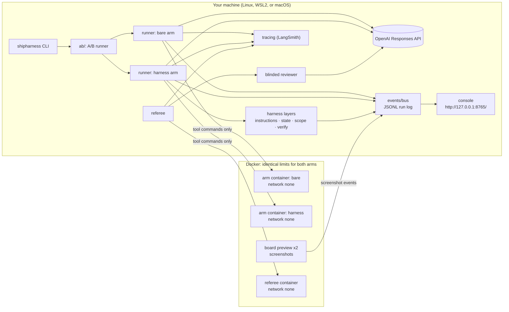
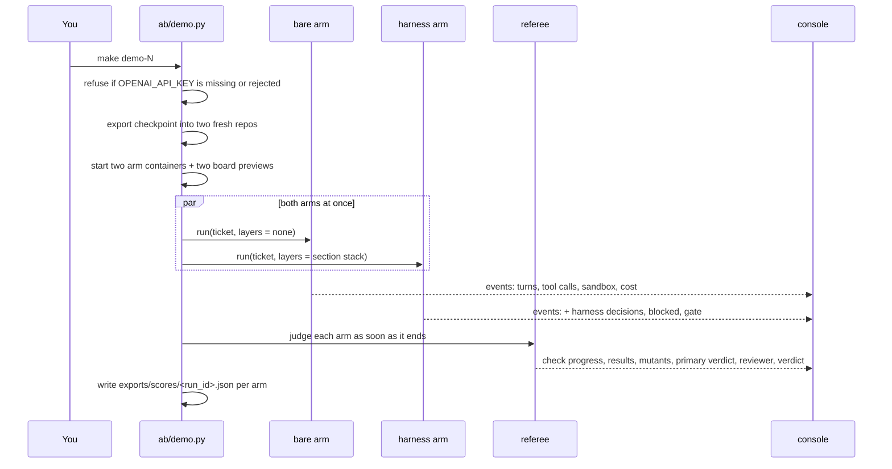

# Architecture

How shipharness is put together: what runs on your machine, what runs in containers, how one A/B
flows from the command to the console, and where every file it writes ends up. Source ids such as
(A2, F-a-49) point to [docs/REFERENCES.md](REFERENCES.md).

Contents:

1. [The big picture](#1-the-big-picture)
2. [Rules that hold everywhere](#2-rules-that-hold-everywhere)
3. [One A/B, step by step](#3-one-ab-step-by-step)
4. [Packages in `platform/src/shipharness/`](#4-packages-in-srcshipharness)
5. [The harness layers](#5-the-harness-layers)
6. [The referee](#6-the-referee)
7. [Events, the console, and replays](#7-events-the-console-and-replays)
8. [Cost tracking and caps](#8-cost-tracking-and-caps)
9. [Files on disk](#9-files-on-disk)
10. [LangSmith projects](#10-langsmith-projects)
11. [Check it on your machine](#11-check-it-on-your-machine)

## 1. The big picture



The agent loop, the API keys, and LangSmith tracing stay on the host. Each arm's tool commands
(`run`, `run_visible_tests`, and so on) run inside that arm's container. The referee judges each
arm's code inside its own container on a fresh copy of the starting checkpoint. The console reads
only the run log and `exports/`.

## 2. Rules that hold everywhere

- **No key in any container.** No host environment variable is passed into a container, and names
  containing `KEY`, `TOKEN`, or `SECRET` are refused (`platform/sandbox/README.md`). `make doctor` never
  prints any part of a key.
- **Identical sandbox for both arms.** The sandbox is never the A/B variable. The policy printed at
  the start of every run (captured on 2026-10-17 from `render_policy(default_policy(Settings()))`,
  the first command of stage 2 in [instructor-guide.md](instructor-guide.md#stage-2-t-30-minutes);
  your output will differ):

  ```
  Sandbox policy (identical for both arms)
    network: none
    cpus: 1.0
    memory: 1024 MB (swap: 0 MB)
    pids: 256
    user: 1000:1000
    read-only root: yes
    writable: /work, /tmp
    capabilities dropped: ALL
    tool timeout: 120 s; run timeout: 300 s
    refused commands: 6 rules (network access)
  ```

  This follows A4's practice of running the agent in a container without internet access (A4,
  F-a-18, F-a-88, F-a-90). The code is in `platform/src/shipharness/sandbox/policy.py` (walkthrough anchors
  `S3:policy` and `S3:run_args`). The printout shows the settings as loaded; the class profile
  (`--profile class`, the default of the `make` targets for live runs) sets `cpus` to 2.0 for every
  arm, referee, and preview container, together with reasoning effort `low` and the OpenAI Fast tier
  for the agent's calls, the same for both arms (`platform/src/shipharness/config/profiles.py`).
- **Agent-written code never runs on the host**, except in the labelled no-Docker fallback
  (`SANDBOX_MODE=none`), where every screen shows `UNSANDBOXED — results not official`.
- **Each arm gets its own fresh git repository**, exported from `platform/teamtrack/` at the checkpoint tag,
  with one initial commit. It is not a worktree of the course repository, so the hidden tests,
  referee mutants, and reference implementations cannot be reached through git
  (`platform/src/shipharness/ab/workspace.py`).
- **Both arms get the same inputs**: the same repository content (including the rules, which the
  bare arm finds in `docs/HANDBOOK.md`), the same ticket, model, reasoning effort, seven tools,
  turn and session budgets, wrap-up turns, cost cap, and sandbox. The harness changes how knowledge,
  state, scope, and verification are organised and enforced; it adds no facts the bare arm cannot
  read.

## 3. One A/B, step by step

What `make demo-N` (and each feature of `make final`) does. The walkthrough anchor
`Opening:two_arms` in `platform/src/shipharness/ab/demo.py` shows the code that starts the two arms.



1. `shipharness ab` checks the OpenAI key first (a model metadata request, no tokens) and refuses
   before any arm starts if the key is missing, rejected, or the model client is a stand-in. There
   is no scripted fallback; `make replay` is the explicit fallback and is labelled RECORDING
   (`_live_guard` in `platform/src/shipharness/ab/commands.py`).
2. The checkpoint (for example `m1-s1-start`) is exported into two new repositories.
3. Both arms run in parallel. The harness arm runs the layers of its section (table in
   [section 5](#5-the-harness-layers)); the bare arm runs none.
4. The referee judges each arm as soon as that arm ends.
5. One score record per arm goes to `exports/scores/<run_id>.json`, and the terminal prints one
   line per arm and a cost line.

`make show-N` runs the same path with `--arms harness`: only the harness arm runs and is judged
("harness in action"); its score record is marked `single_arm` and stays out of every bare-vs-harness
comparison, screen 4, and the swap test.

## 4. Packages in `platform/src/shipharness/`

| Package | What it does |
|---|---|
| `platform/config/` | Settings from `.env` (pydantic-settings), prices from `platform/config/prices.toml`, caps |
| `cost/` | Cost tracker: token usage times prices, cap checks before every model call |
| `events/` | Typed events, the event bus, the JSONL run log, the replay reader |
| `platform/sandbox/` | Container lifecycle, command execution with timeouts, usage sampling, denial detection, the no-Docker fallback; `policy.py` holds the limits |
| `runner/` | The agent loop on the OpenAI Responses API, the seven tools, the skills loader, sessions |
| `harness/instructions/` | Places the AGENTS.md map and the skills; builds the stable context prefix |
| `harness/state/` | `init.sh`, `progress.md`, exec plans, the structured handoff, session stop and resume |
| `harness/scope/` | `feature_list.json`, allowed paths per phase, revert and block, the evidence-gated `passes` field |
| `harness/verify/` | Test-phase filter pipeline, the gate on "done", gate feedback |
| `filters/` | The five test filters and the targeted mutant runner |
| `checks/` | House rules R1-R7, existing tests, diff scope, hidden tests, flakiness re-runs |
| `reviewer/` | The blinded reviewer with structured output |
| `ab/` | Arm setup, parallel execution, referee orchestration, swap test, replay, experiments, report |
| `console/` | The five screens, streamed from the run log |
| `tracing/` | LangSmith wrappers, trace links, exports |
| `skills_cli/` | `shipharness skills validate` |
| `testgen/` | `shipharness testgen` for any Python repository with a pytest suite |
| `cli.py` | The Typer entry point for every command |

The harness layers talk to the runner only through hooks; the referee talks to a build only through
`Check.run(build_dir)`; the console reads only events.

## 5. The harness layers

`--layers` takes `none`, `all`, or a comma list of `instructions,state,scope,verify`; `-<layer>`
removes one layer from the stack (`make demo-N LAYERS=-<layer>`). The section names S1 to S4 and
the word "layer" are course labels, not source terms.

| Demo | Harness arm layers | What the added layer does | Sources |
|---|---|---|---|
| `demo-1` | instructions | Puts a short AGENTS.md map in the context prefix and loads skills on demand | A1 (F-a-27, F-a-28); B1, B2 (F-b-05, F-b-06) |
| `demo-2` | instructions, state | Initializer step, Getting up to speed, progress file, exec plan, structured handoff at a session stop | A2 (F-a-49, F-a-58 to F-a-62); A1 (F-a-34); A3 (F-a-65) |
| `demo-3` | instructions, state, scope | One feature from `feature_list.json`, allowed paths per phase, out-of-scope changes rejected or reverted, `passes` set only by the harness | A2 (F-a-80, F-a-83); A5 (F-a-86); A3 (F-a-110) |
| `demo-4` | all four | Five test filters, a gate on "done" the agent does not control, clean state | B11 (F-b-17 to F-b-22); B12 (F-b-29); A2 (F-a-84) |
| `final` | all four | The whole harness | |

Course design, marked as such: A2 lets the agent set `passes` after careful testing (A2, F-a-108);
the course moves that decision to the harness, following A3's separation of the agent doing the work
from the agent judging it (A3, F-a-110). The `evidence` and `testedAt` fields are course additions.
The initializer is deterministic harness code rather than a model session; A2's two agents differ
only in their first prompt (A2, F-a-52). The forced session stop is a session turn budget smaller
than the feature; it produces what A3 calls a context reset (A3, F-a-65).

## 6. The referee

The referee runs in a fresh container (network none) on a fresh export of the checkpoint with the
arm's diff applied. Neither arm ever sees the hidden tests or the referee-set mutants.

1. Apply the diff; classify each changed file as allowed or out of scope for its phase.
2. Existing tests (the checkpoint's visible suite): "existing tests keep passing" (internal key
   `regression`; A4, F-a-129; B11, F-b-22).
3. House rules R1-R7, probed in process against every endpoint in the app's OpenAPI spec. "House
   rules" is the course's label for what A1 calls "golden principles" and "taste invariants"
   enforced mechanically (A1, F-a-96, F-a-99).
4. Hidden tests for the feature, some of which combine features, as SpecBench's held-out suites do
   (B13, F-b-42).
5. Referee-set mutants against the arm's shipped tests (B12, F-b-29); only tests that pass on the
   unmutated build can kill a mutant.
6. Shipped tests re-run five times for flakiness (TestGen-LLM's five executions; B11, F-b-19).
7. Board checks with screenshots.
8. Continuity measures from the run log (section S2).
9. The blinded reviewer on the diff: a separate evaluator (A3, F-a-110) that receives the diff and
   the ticket with arm-identifying files and commit messages removed (`S4:blind` in
   `platform/src/shipharness/reviewer/blind.py`). The reviewer is shown next to the referee, and its
   agreement is counted; it does not decide the verdict.
10. One score record per arm and a verdict, with "agent said" next to the referee's result.

Each section has one primary measure, fixed before any run: S1 new R1 violations; S2 continuity
failure; S3 out-of-scope files or source edits in the test phase; S4 hidden tests passed and
referee-set mutants killed. The final features (F5-F7) have none and are read as counts. Every run
is a dot, and results are counts such as "2/3", never percentages.

The steps the primary measure needs run first: R1 for S1, the continuity check for S2, the hidden
tests and the mutants for S4 (the S3 counts come from the diff in step 1). As soon as they finish,
the referee sends a `primary_verdict` event for that arm, and the console shows the result while
the other steps run. The order does not change any score: every step judges the same build with
the same inputs.

## 7. Events, the console, and replays

Every part of a run writes typed events to one JSONL run log: `run_start`, `sandbox_start`,
`sandbox_usage`, `sandbox_denied`, `turn`, `tool_call`, `tool_result`, `harness_decision`,
`blocked`, `session_stop`, `session_resume`, `test_proposed`, `test_filter_result`,
`check_progress`, `check_result`, `mutant_result`, `reviewer_output`, `gate_result`, `claim`,
`primary_verdict`, `verdict`, `cost`, `screenshot`, `trace_link`, `run_end`
(`platform/src/shipharness/events/models.py`; the walkthrough anchor `Opening:publish` shows how an event
is written).

The console server folds the events per arm and streams rendered HTML to the browser; the browser
never turns agent text into markup. The five screens are described in the
[README](../README.md#11-the-five-console-screens).

`make replay RUN=<id>` re-emits a recorded A/B's events with `recorded=True` under a new A/B id,
applies the recorded diffs, and runs the referee again live. Every screen of a replay carries a red
RECORDING badge. `make swap-N` re-judges a recorded A/B with each arm's diff under the other arm's
label, with no agent and no reviewer, so it costs nothing; it shows that the referee judges code,
not labels.

## 8. Cost tracking and caps

Before each model call the cost tracker reserves the call's worst case (estimated input at the
uncached rate plus the full output limit) against every active cap, under one lock, and settles it
to the actual cost afterwards. Commands running at the same time read each other's ledger entries,
so a shared cap holds across them. When a call would cross a cap, the run ends as `ABORTED: cap`,
and the referee still judges and shows it. Values are in the
[README](../README.md#13-costs-and-caps).

## 9. Files on disk

| Path | Written by | Contents |
|---|---|---|
| `.env` | you (`make setup` copies `.env.example`) | Keys and settings; git-ignored |
| `.shipharness/runs/<ab id>/events.jsonl` | every A/B | The full run log of both arms and the referee |
| `.shipharness/runs/<ab id>/ab.json` | every A/B | Task, section, pinned checkpoint commit, both arms' specs and results |
| `.shipharness/runs/<ab id>/<arm>/diff.patch` | every A/B | What the arm shipped |
| `.shipharness/runs/<ab id>/<arm>/sessions/` | every A/B | One patch per session |
| `.shipharness/runs/<ab id>/screenshots/<arm>/` | board previews | Board screenshots for screen 2 |
| `.shipharness/ledger.jsonl` | the cost tracker | One entry per model call |
| `exports/scores/<run_id>.json` | the referee | One score record per arm |
| `exports/experiments/` | `shipharness experiments` | Experiment rows and LangSmith links |
| `exports/report.json`, `exports/report.html` | `uv run shipharness report` | Dot plots per feature from `exports/` only |

`RUNS_DIR` and `EXPORTS_DIR` in `.env` move the first and last groups.

## 10. LangSmith projects

| `PURPOSE` (Make variable) or `--purpose` | LangSmith project | Cost session |
|---|---|---|
| `class` (default) | `shipharness-class-<SHIPHARNESS_CLASS_DATE>`; refuses without the date | Keyed by the class date |
| `pilot` | `shipharness-pilot` | One session named `pilot` |
| `assignment` | `shipharness-assignments` | One session named `assignment` |

`shipharness experiments` traces to `shipharness-experiments` and counts toward the experiment
total. A run writes about two traces: the agent's root trace and the referee's evaluation trace,
with the reviewer call as a child (`platform/src/shipharness/tracing/`).

## 11. Check it on your machine

Two commands show the path from a `make` target to the A/B runner without calling a model or
starting a container. Captured on 2026-10-17; your output will differ:

```
$ make -n demo-1
uv run shipharness ab --section demo-1 --feature F1   --purpose class \
  --profile class
$ uv run shipharness ab --help
 Usage: shipharness ab [OPTIONS]

 Same task, harness off vs on, both judged by the referee.
```

`make -n show-1` prints the same command with `--arms harness` (the harness arm alone). When a run
fails, the exact messages and fixes are in [troubleshooting.md](troubleshooting.md#running-an-ab).
