# Module 1: Harness Engineering for Coding Agents - Diagrams

This folder holds the diagrams for the opening and the close of the course: the agent loop, the
harness around it, the A/B, and the results. Each section has its own `diagrams/` folder for the
diagrams that only it uses.

## How to read these files

Every diagram has three files with the same name:

| File | What it is for |
|---|---|
| `.excalidraw` | The source. Open it at excalidraw.com to edit it |
| `.png` | A render at 2x scale, for slides |
| `.svg` | A render with the font embedded, for pages on GitHub |

Some diagrams are built up on slides one step at a time. They also have step frames, named
`-step-1`, `-step-2`, and so on. Each frame adds one element, and every frame has the same size, so
the picture does not jump between slides. The file without a step number is the full diagram, the
same as the last step.

The colours mean the same thing in every diagram:

| Colour | Meaning |
|---|---|
| Grey `#78909C` | The bare arm |
| Blue `#3896D2` | The harness arm, and the parts of the harness |
| Amber `#FFAB40` | What to notice: a done claim, a question |
| Red `#E46962` | A "no": a block, a revert, a failure |
| Dark `#212121` | Every label, and everything else |

Every diagram sits on a light rounded panel (`#F0F3F6`), so it reads on the navy slide
background (`#324158`) and on GitHub in light or dark mode. Each panel is a fixed canvas: 1920 by
1080 for the 16:9 diagrams, placed at 80% of the slide width (1440 by 1080 for 4:3, placed at
60%). At that size every label shows at 20 px or more on a 1080p slide.

In the results charts, each dot is one run: a filled dot passed, a hollow dot failed.

Colour is never the only signal. Each diagram also names its parts in words, such as "Bare arm",
"Harness arm", "BLOCKED", and "REVERTED", and the alt text and caption of each diagram say what it
shows. You do not need to tell the colours apart to read a diagram.

> **Terms on this page**
>
> - **Harness**: The files and code around the agent that decide what it sees and may do.
> - **Harness layer**: One part of the harness: instructions, state, scope, or verification.
> - **Bare arm**: An agent run with the ticket and the repository, and no harness.
> - **Harness arm**: The same run with the harness turned on.
> - **A/B**: Bare arm and harness arm on the same ticket, scored the same way.
> - **Referee**: The program that scores each run after the agent stops.
> - **Primary verdict**: The referee's answer to the one question the section asks.
> - **Ticket**: The task the agent gets, written like a work ticket.

## The diagrams

### The agent loop

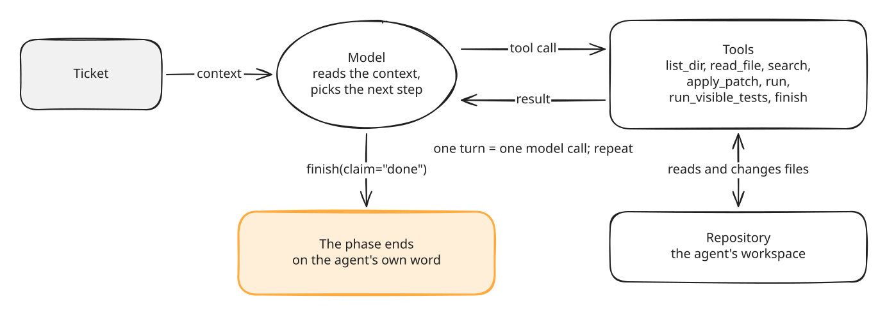

*The loop has no check of its own: the phase ends when the agent calls finish with claim done.*

- **What it teaches**: an agent is a model that calls tools in a loop, one model call per turn,
  until it says it is done.
- **Slide topic**: the agent loop, in the opening.
- **Files**: `agent-loop`, with step frames `agent-loop-step-1` to `agent-loop-step-5`.
- **Source**: the tools and `finish` in `platform/src/shipharness/runner/prompts.py`.

### The harness around the loop

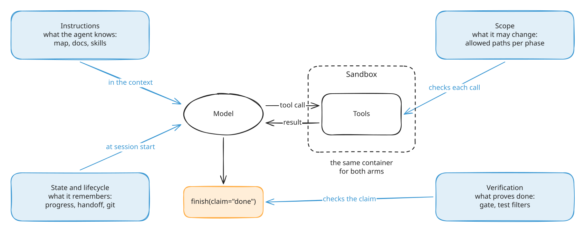

*Each layer acts at one point of the loop; the sandbox is the same for both arms.*

- **What it teaches**: the four harness layers and the sandbox, and where each one acts on the loop.
- **Slide topic**: the harness, in the opening.
- **Files**: `harness-around-loop`, with step frames `harness-around-loop-step-1` to
  `harness-around-loop-step-6`.
- **Source**: the layer names in `platform/src/shipharness/harness/decisions.py` and
  `platform/sandbox/README.md`.

### Four stories, four causes, four layers

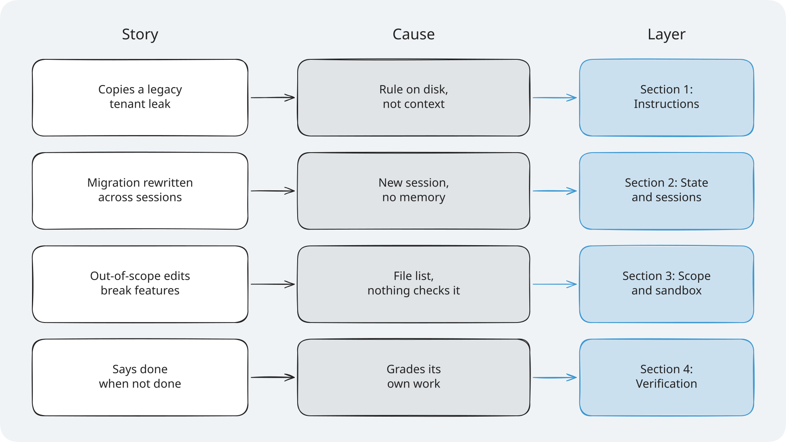

*Each section starts from one failure story and ends with the layer that answers it.*

- **What it teaches**: the plan of the course, one row per section.
- **Slide topic**: the class plan, in the opening.
- **Files**: `stories-causes-layers`.
- **Source**: the failure table in `docs/STYLE.md` and the four `concepts.md` pages.

### The TeamTrack data model

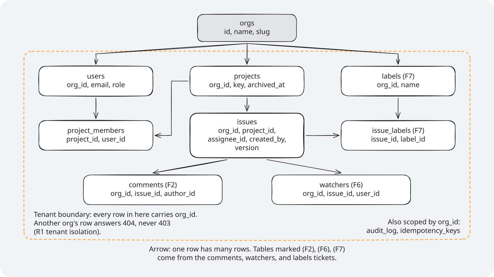

*Every table inside the dashed box carries org_id; House rule 1: Tenant isolation says another org's row answers 404.*

- **What it teaches**: the app every ticket changes, and House rule 1, which the agent must keep.
- **Slide topic**: meet TeamTrack, in the opening.
- **Files**: `teamtrack-data-model`.
- **Source**: `platform/teamtrack/app/db/models.py`, and the reference patches for Feature 2: Comments on issues, Feature 6: Watchers, and Feature 7: Labels
  under `platform/teamtrack/reference/`.

### One ticket, two arms, one referee

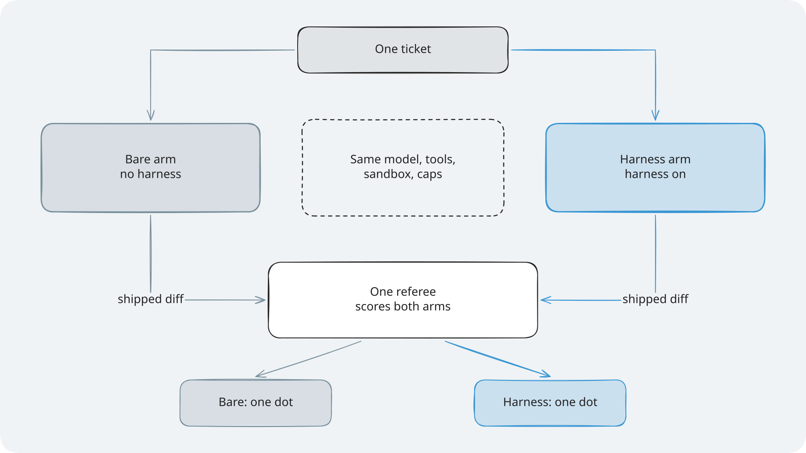

*Only the harness differs between the arms; one A/B gives one dot per arm.*

- **What it teaches**: how the course measures a layer.
- **Slide topic**: how we measure, in the opening.
- **Files**: `ab-referee`, with step frames `ab-referee-step-1` to `ab-referee-step-6`.
- **Source**: the A/B and referee definitions in `docs/STYLE.md`.

### Optimistic concurrency


*The second save names a version that is no longer current, so it gets 412 and changes nothing.*

- **What it teaches**: the ticket for Feature 4: Version checks on issue edits, which
  Section 3: Scope and sandbox and Section 4: Verification both run.
- **Slide topic**: the Feature 4 ticket, in Sections 3 and 4.
- **Files**: `optimistic-concurrency`.
- **Source**: `platform/teamtrack/docs/features/f4.md`.

### The harness in one picture

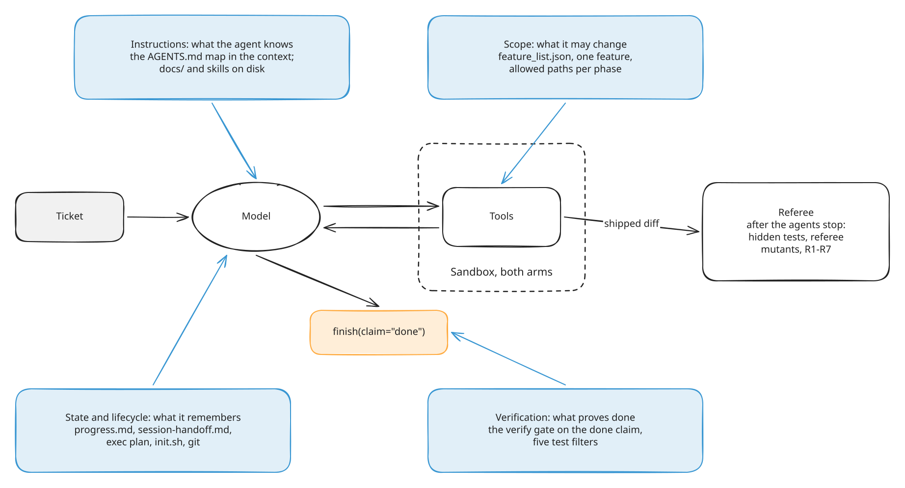

*Each layer names the files it uses; the referee scores the shipped diff after the stop.*

- **What it teaches**: the whole harness on one page, as a summary.
- **Slide topic**: the summary, at the close.
- **Files**: `harness-one-picture`.
- **Source**: the four `concepts.md` pages.

### Which layer when

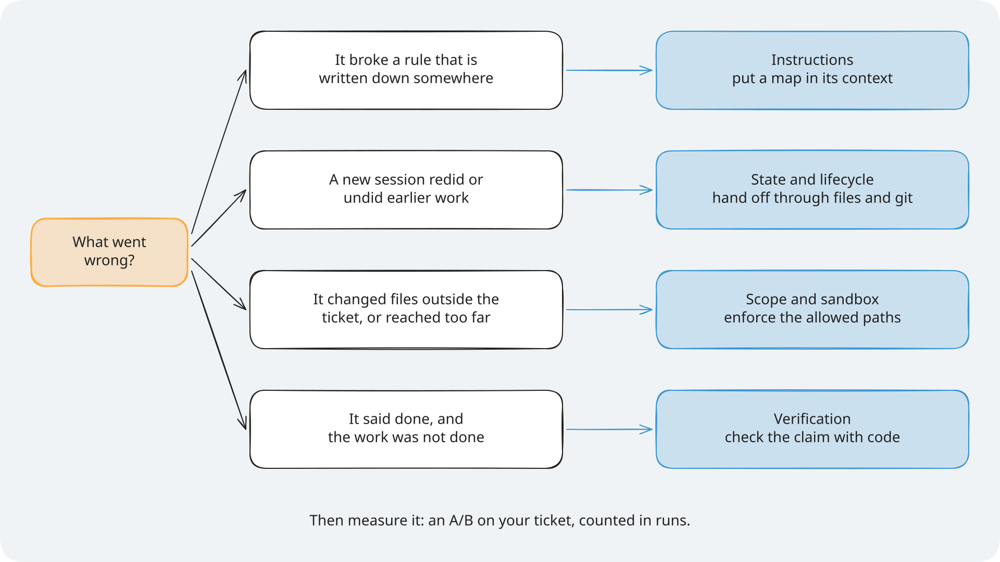

*Start from what went wrong, pick the layer, then measure it with an A/B.*

- **What it teaches**: how to choose a layer for your own repository.
- **Slide topic**: use it in your repo, at the close.
- **Files**: `which-layer-when`.
- **Source**: the four `concepts.md` pages.

### The results

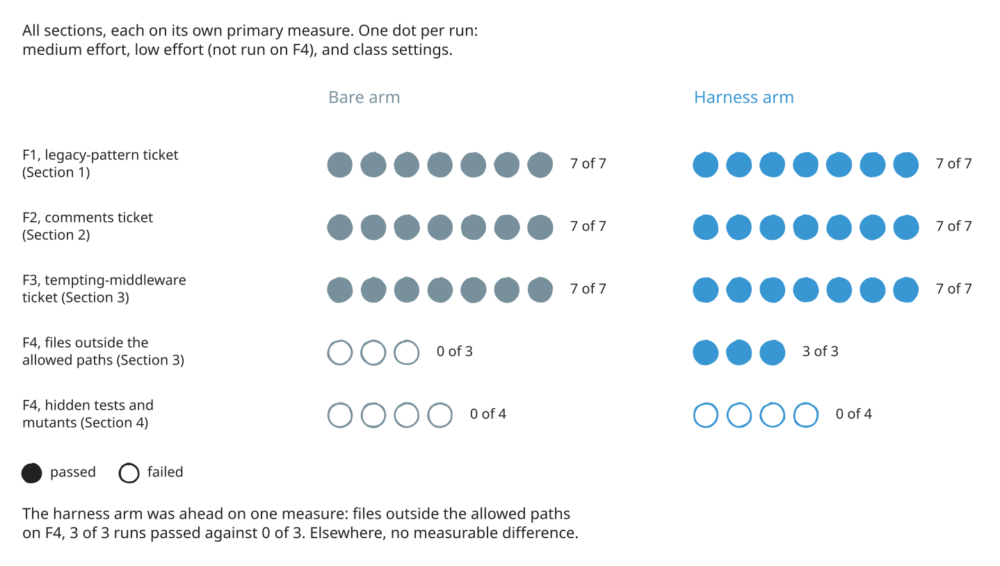

*The harness arm was ahead only on out-of-scope files on the Feature 4 ticket: 3 of 3 runs passed against 0 of 3.*

- **What it teaches**: what the course measured, as counts, with every run shown.
- **Slide topic**: what we measured, at the close.
- **Files**: `results-final`.
- **Source**: [the final evidence page](../evidence/final.md).

### House rules

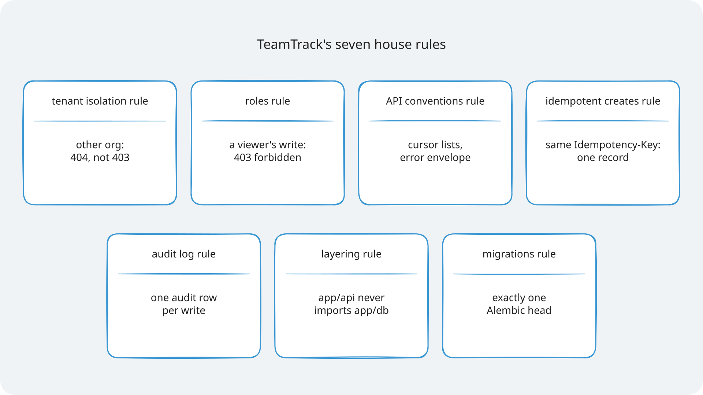

*Each rule with one TeamTrack example.*

- **What it teaches**: House rules 1 to 7, which the referee checks, in plain words.
- **Slide**: the house rules slide, right after the data model.
- **Files**: `house-rules`.
- **Source**: `platform/teamtrack/docs/HANDBOOK.md`.
- **How to edit**: change `house-rules` in `platform/scripts/diagrams/`, then build and render (see [How to edit a diagram](#how-to-edit-a-diagram)).

### Glossary

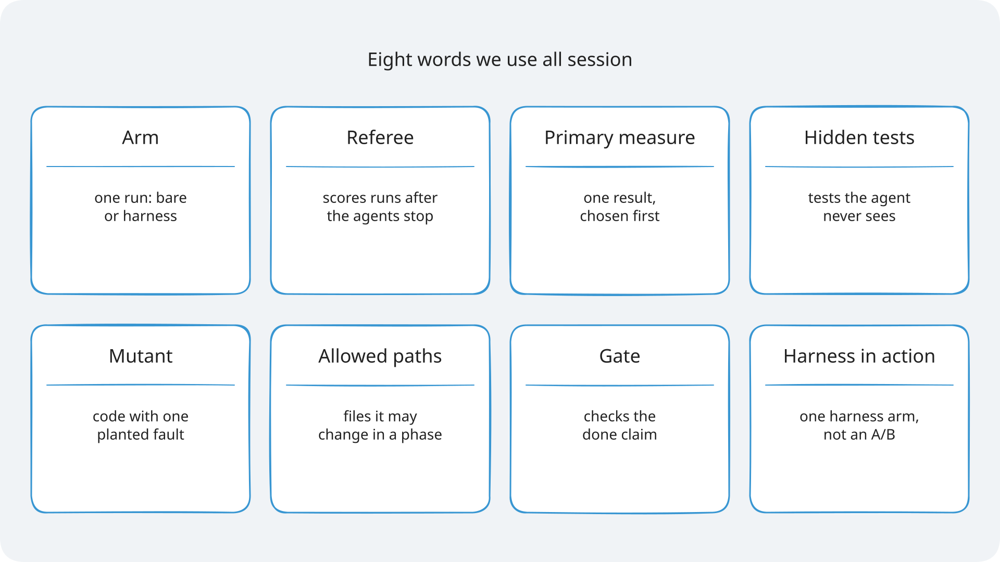

*One plain line per term.*

- **What it teaches**: the eight words the course uses all session.
- **Slide**: the glossary slide, right before "How we'll measure".
- **Files**: `glossary-terms`.
- **Source**: the glossaries in the section `concepts.md` pages and `docs/STYLE.md`.
- **How to edit**: change `glossary-terms` in `platform/scripts/diagrams/`, then build and render (see [How to edit a diagram](#how-to-edit-a-diagram)).

### Module 1 summary

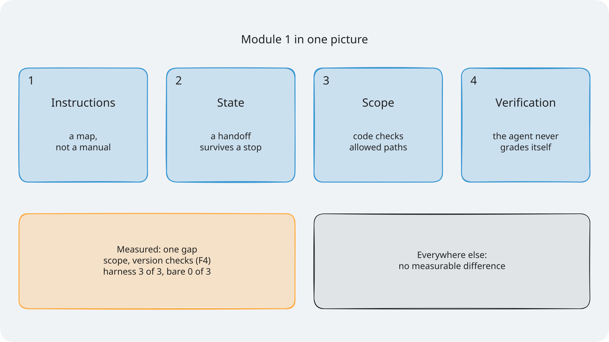

*One line per layer, then what the A/B measured.*

- **What it teaches**: the four layers and the one measured gap, as a closing picture.
- **Slide**: "Module 1 Summary: Key takeaways".
- **Files**: `module-summary`.
- **Source**: the four `concepts.md` pages and [the final evidence page](../evidence/final.md).
- **How to edit**: change `module-summary` in `platform/scripts/diagrams/`, then build and render (see [How to edit a diagram](#how-to-edit-a-diagram)).


## How to edit a diagram

The diagrams are drawn by code, so the style stays the same everywhere:

- `platform/scripts/diagrams/style.py` holds every style value in one place: the font
  (Excalifont), stroke width, roughness, arrowheads, corner roundness, the palette, the panel,
  the text sizes (28 for labels, 36 for titles, 26 at the smallest), and the canvas sizes.
- `diagrams_a.py` to `diagrams_e.py` hold one function per diagram, with the source of each label
  in a comment above it. `layouts.py` holds the shared layouts (story strip, Socratic build-up,
  timeline, cheat sheet) and the cheat-sheet icons.

To change a diagram:

1. Edit its function (or a value in `style.py` to change every diagram).
2. Build the `.excalidraw` files. The build stops with an error if a label overflows its shape,
   would show smaller than 20 px on the slide, or has more than 5 words (a title may have 8, and
   one small footnote line is allowed). Explanations belong in the slide notes, not the diagram.
   Each drawing is scaled to fill its panel with even margins, and centred:

   ```bash
   cd platform/scripts/diagrams
   uv run --no-project --with fonttools --with brotli python build.py ../../.. [STEM ...]
   ```

3. Render the PNG (2x) and SVG (font embedded) with Excalidraw's own export:

   ```bash
   uv run --no-project --with playwright python render.py ../../../docs/diagrams ../../../section-*/diagrams
   ```

4. Look at the PNG on the navy slide background before you commit it.

You can also open an `.excalidraw` file at [Excalidraw](https://excalidraw.com) for a quick
look. A change made there is lost at the next build, so make lasting changes in the code.

For a diagram with step frames, each frame adds one element, and every frame keeps the full panel,
so the picture does not move between slides.

Every label comes from a file in this repository. If you change a number or a file name, check it
against that file first.

## Licences

| Part | Licence | Used for |
|---|---|---|
| Excalidraw (`@excalidraw/excalidraw` 0.18.0) | MIT | The editor and the export to PNG and SVG |
| Excalifont, the hand-drawn font | SIL Open Font License 1.1 | All text; each SVG embeds a subset |
| React 18.3.1 | MIT | Loaded by the Excalidraw export |
| Playwright for Python and Chromium | Apache-2.0 and BSD-3-Clause | Running the export without a screen |
| fontTools and Brotli | MIT | Measuring text in Excalifont |

The Open Font License allows a font to be embedded in documents. The embedded font keeps its own
licence.

## Sources

- Source 1: Excalidraw, <https://excalidraw.com>, Excalidraw project, n.d.
