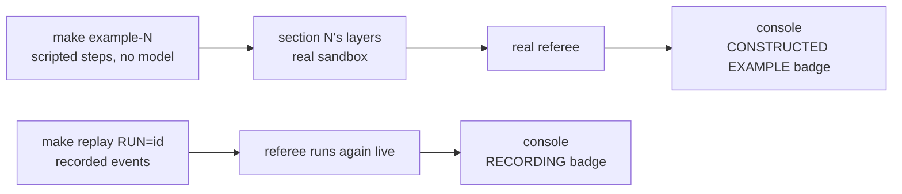

# Optional extras

Two things on this page show a harness layer catching a mistake without a live model run: scripted
**constructed examples** and **replays** of four named pilot runs. Neither is part of any class
section: every demo section in class is a live run (`make show-N` in S1 to S4, `make final` in the
final), with the live checks and the live console. Use these extras after class, to see a failure
the live runs did not happen to produce, or when you want to study one mistake slowly.

| Extra | Command | Model calls | Badge on every console screen | Counted in any result |
|---|---|---|---|---|
| Constructed example | `make example-1` ... `make example-4` | none, $0 | `CONSTRUCTED EXAMPLE: scripted steps, no model` | No |
| Replay of a named pilot run | `make replay RUN=<id> PURPOSE=pilot` | none without the reviewer | `● RECORDING` | No (left out unless `--include-recorded`) |

`make replay` is also the class's emergency fallback: if a live run fails for a reason outside the
experiment (Docker, the network, OpenAI), the instructor replays a recording, and every screen then
says RECORDING.



## Constructed examples

What it is: section N's harness layer stack on its canonical TeamTrack task, in the real sandbox and
judged by the real referee, but the agent's turns are scripted steps that make the mistake the layer
exists to catch. There is no model and no API key, and it costs $0 (`shipharness example --help`:
"No model, no API key, $0."). The run record and score are marked `constructed`; the score stays in
the run directory and never reaches `exports/`, so the A/B report, screen 4, and `make swap-N` never
count it.

| Command | Section's layers | The scripted mistake | What catches it |
|---|---|---|---|
| `make example-1` | instructions | Reads the map and one document, then ships a search query without the org filter | The referee's R1 check reports the cross-org leak, and screen 2 marks the other org's cards `⚠ other org` |
| `make example-2` | instructions, state | Runs out of turns in session 1 | The state layer writes `session-handoff.md` and `progress.md` at the stop, and session 2 resumes from them |
| `make example-3` | instructions, state, scope | Edits the shared middleware, then runs `pip install requests` | The scope layer blocks the out-of-scope patch, and the sandbox denies the network command |
| `make example-4` | all four | Claims done while its own test fails | The verify gate refuses the first claim and accepts the second, after the test is fixed |

How to run it: Docker must be running (the example uses the real sandbox and referee containers;
`make doctor` shows `+ ok` on the `container runtime` line). Then, in two terminals in the
repository root:

```bash
make console        # terminal 1: http://127.0.0.1:8765/
make example-1      # terminal 2
```

`make example-1` runs `uv run shipharness example --section demo-1 --profile class` (from
`make -n example-1`). Captured on 2026-10-17, run `ab-20261017-100044-031a15`; your output will
differ:

```text
uv run shipharness example --section demo-1 --profile class
CONSTRUCTED EXAMPLE: scripted steps, no model (demo-1: reads the map and one document, then ships a search query without the org filter)
A/B ab-20261017-100044-031a15 (F1, layers=['instructions'], profile=class, constructed example)
  harness  completed         claim=done     primary={"r1_new_violations": 1} passed=False hidden 9/52 mutants 0/4 reviewer=None cost=$0.0000
What it demonstrates: the referee's R1 check reports the cross-org leak, and the board shows the other org's cards.
  instructions: agent read AGENTS.md
  instructions: agent read docs/design-docs/api-conventions.md
  agent: finish(done) in the build phase
  agent: finish(done) in the test phase
  referee: r1_tenant 1 new: leak no_path: GET /issues -> 200 {"items":[{"id":40,"org_id":2,"project_id":4,"title":"Broken link in footer","description":"Reported in project 4.","status":"open","priority
  referee: primary r1_new_violations>=1 FAIL {'r1_new_violations': 1}
  referee: regression 1 new: violation tests/visible/test_board.py::test_board_shows_only_own_org_cards_with_badges: failed
  referee: diff_scope 1 new: violation app/web/routes.py is outside the allowed paths
  referee: board 1 new: violation cards from another org: ['21', '22', '23', '24', '25', '26', '27', '28', '29', '30', '31', '32', '33', '34', '35', '36', '37', '38', '39', '40']
Cost: $0.000000 (constructed example: scripted steps, no model calls)
```

The key lines of the other three, from the same day (runs `ab-20261017-100051-c21e99`,
`ab-20261017-100915-6f03a4`, `ab-20261017-103436-ae374a`; your output will differ):

```text
  state: session 1 handoff written to session-handoff.md
  runner: session 1 stopped (turn_budget)
  runner: session 2 resumed
```

```text
  scope: BLOCKED app/api/middleware.py: app/api/middleware.py: outside the allowed paths for the build phase (app/api/issues.py, app/services/issues.py, docs/HANDBOOK.md, tests/visible/**); patch not applied
  sandbox: DENIED network: pip install requests (the sandbox has no network; dependencies are already installed in the image)
```

```text
  verify: GATE FAIL: Gate r-20261017-103436-ca37ab-g1: 1 of 11 items failed (visible tests). | FAILED tests/visible/test_issue_etag.py::test_etag_is_the_quoted_version: as...
  agent: finish(done) in the build phase
  verify: GATE PASS: gate r-20261017-103436-ca37ab-g2 passed
```

How to check it worked: the last line is `Cost: $0.000000 (constructed example: scripted steps, no
model calls)`, the exit code is 0, and every console screen of the run carries the CONSTRUCTED
EXAMPLE badge. A constructed example's verdict says nothing about how often a real agent makes the
mistake; it only shows that the layer catches it when it happens.

How long it takes: on the class host on 2026-10-17 the four took 3 min 17 s, 7 min 59 s, 12 min
22 s, and 11 min 21 s (the `real` line of `time make example-N`); the first three ran while other
runs shared the machine, so treat these as an upper guide only.

## Replays of four named pilot runs

What it is: `make replay RUN=<id>` re-emits a recorded run's events with the RECORDING badge,
applies the recorded diffs, and runs the referee again live; without `--reviewer` it makes no model
calls (`uv run shipharness replay --help`). Each run below shows a real mistake from the course
pilot on 2026-10-16 and 2026-10-17 and what caught it.

| Section | Run | What it shows |
|---|---|---|
| S1 | `ab-20261016-212252-aa1644` (pilot run 3, F4) | The harness arm's change added 3 new R1 violations, which the referee's R1 check reports |
| S2 | `ab-20261016-213317-9a0ec1` (pilot run 3, F2) | The harness arm gave up the build phase with `finish(claim="not_done")` after a 12-turn session 1; the runner now ends only that session, for both arms |
| S3 | `ab-20261016-214151-ca9841` (pilot run 3, F4) | The bare arm changed 2 files outside the allowed paths; the harness arm 0 |
| S4 | `ab-20261017-090903-926c02` (class-profile round, F4) | The bare arm claimed done with 68 of 69 hidden tests passing; the referee fails it |

How to run it: the recorded run directories live in `.shipharness/runs/` on the machine that ran
them (the course's class host); `.shipharness/` is git-ignored, so they are not in this repository.
On your machine, replay your own runs the same way, with an id from the console's run list:

```bash
make replay RUN=<ab or run id> PURPOSE=pilot
```

which runs `uv run shipharness replay <id> --purpose pilot` (from
`make -n replay RUN=ab-20261016-212252-aa1644 PURPOSE=pilot`). Without `PURPOSE`, replay runs as a
class command and needs `SHIPHARNESS_CLASS_DATE` in `.env`.

How to check it worked: the console lists a new run whose every screen carries the red
`● RECORDING` badge, and the referee's checks appear again on screen 3.

## If it fails

| Symptom | Fix |
|---|---|
| `make example-N` stops with a line starting `x` before any step | Usually no container runtime: start Docker (`sudo systemctl start docker`) and check with `make doctor` |
| `! replay needs RUN=<ab or run id>` | Add `RUN=<id>` |
| `make replay` asks for `SHIPHARNESS_CLASS_DATE` | Add `PURPOSE=pilot` (or `PURPOSE=assignment`) |
| Screen 2 of a replay shows broken images | Replay does not copy the `screenshots/` folder; the fix is in [troubleshooting.md](troubleshooting.md#replay-and-swap-test) |

Everything else: [troubleshooting.md](troubleshooting.md).
