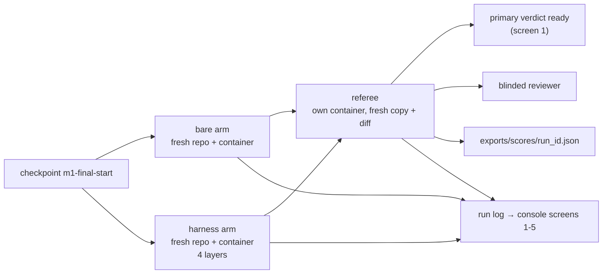
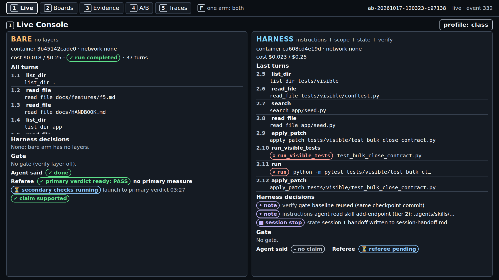
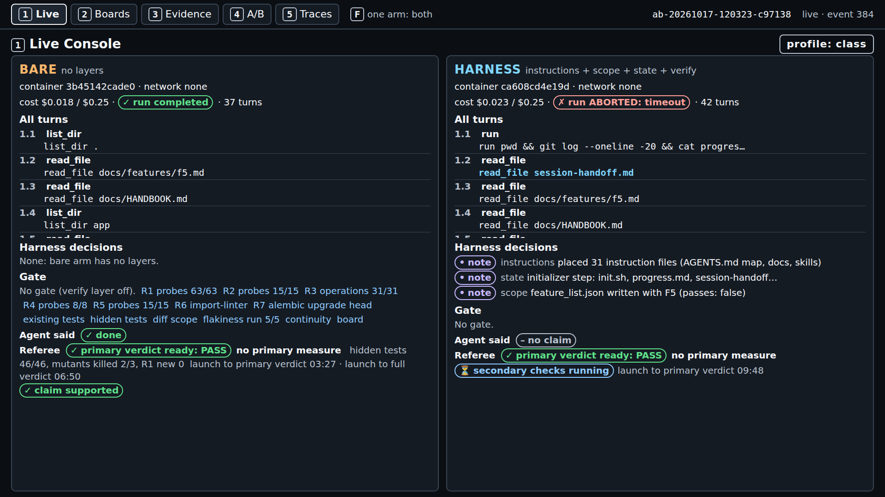
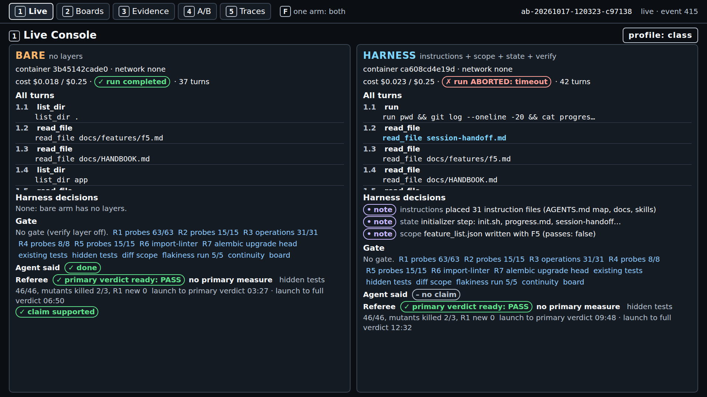
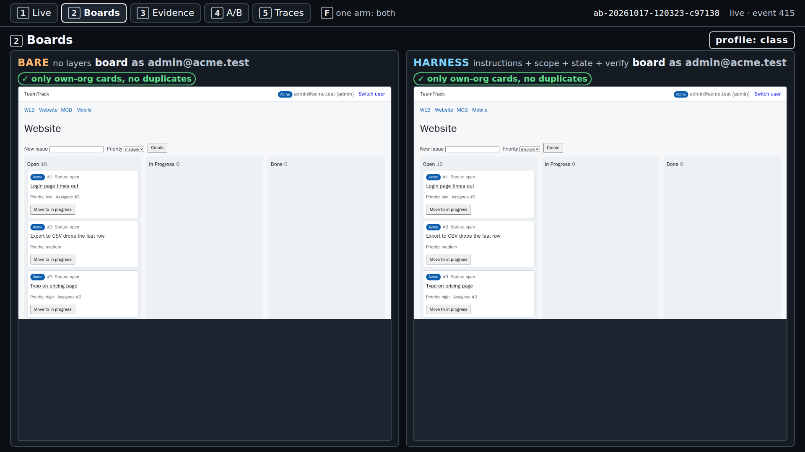
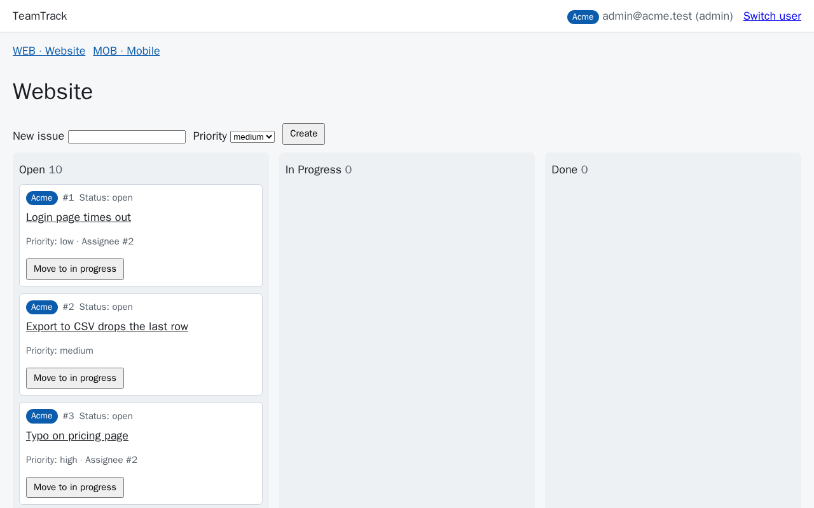
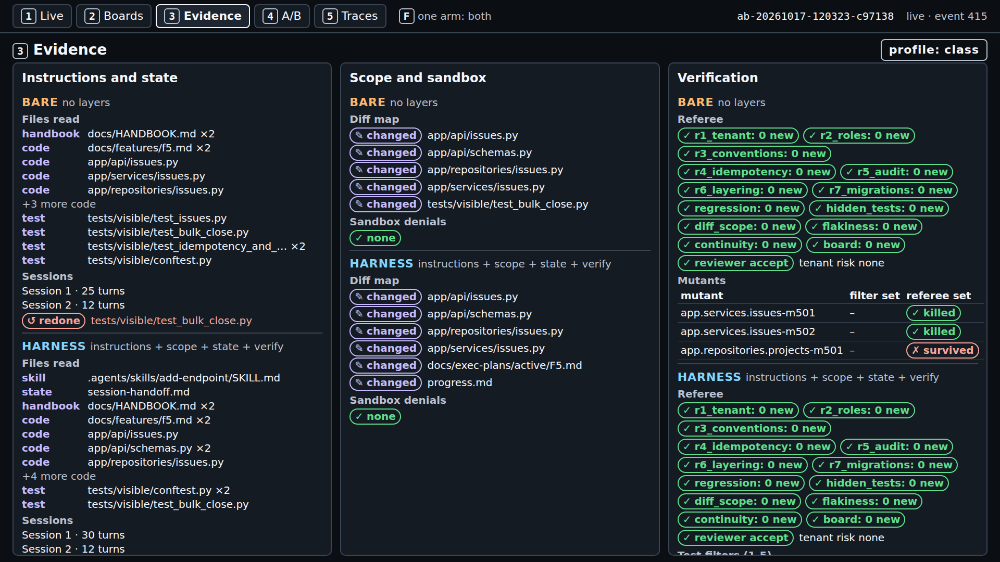
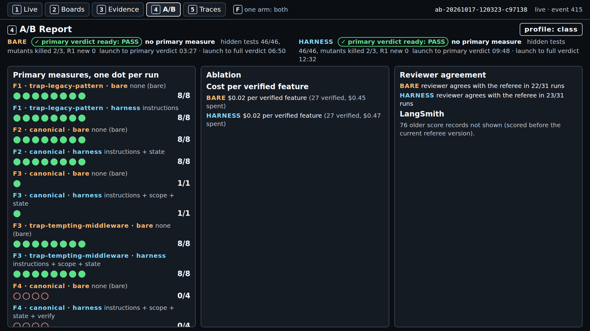
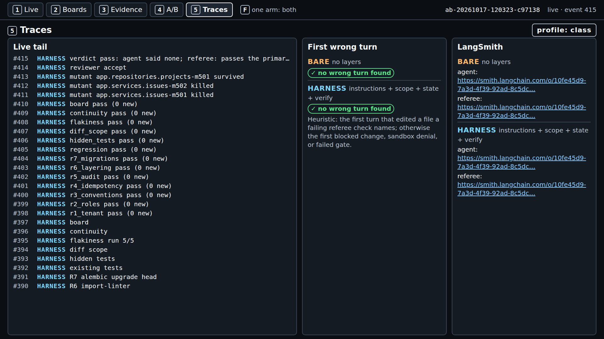

# Final project: shipharness end to end

Source ids and finding ids such as (A3, F-a-65) are listed with links in
[REFERENCES.md](../REFERENCES.md).

Contents:

1. [What this demo shows and why](#1-what-this-demo-shows-and-why)
2. [Prerequisites per operating system](#2-prerequisites-per-operating-system)
3. [Before you start: the checks](#3-before-you-start-the-checks)
4. [Run it](#4-run-it)
5. [What to watch, minute by minute](#5-what-to-watch-minute-by-minute)
6. [What a result means](#6-what-a-result-means)
7. [Expected time and cost](#7-expected-time-and-cost)
8. [If it fails](#8-if-it-fails)
9. [Run shipharness on your own repository](#9-run-shipharness-on-your-own-repository)
10. [Portfolio: how this feeds assignment 4](#10-portfolio-how-this-feeds-assignment-4)

## 1. What this demo shows and why

This page runs the class's one live A/B, `make final`, on TeamTrack and shows how to read it. It
matters because one A/B is one dot, and the page shows how to read that dot against the pilot's
results.

## 2. Prerequisites per operating system

You need git, make, uv (which brings Python), a container runtime that provides `docker`, and two
API keys. The full steps, with sources, are on the setup page for your platform; the table gives
the install commands and the versions the course tested.

| | Linux (Ubuntu) | Windows (WSL2) | macOS |
|---|---|---|---|
| Setup page | [setup-linux.md](../docs/setup-linux.md) | [setup-windows.md](../docs/setup-windows.md) | [setup-macos.md](../docs/setup-macos.md) (not tested for the course) |
| First | | In PowerShell as administrator: `wsl --install`, restart, then open the Ubuntu terminal and run every later command there | |
| git, make, curl | `sudo apt update && sudo apt install -y git make curl` | the Linux command, in Ubuntu | `xcode-select --install` |
| uv | `curl -LsSf https://astral.sh/uv/0.13.1/install.sh \| sh` | the Linux command, in Ubuntu | the same command, or `brew install uv` |
| Python | Nothing to install: uv fetches 3.12 (`.python-version`; `pyproject.toml` needs `>=3.12`) | the same | the same |
| Container runtime | Docker Engine from Docker's apt repository ([step 3](../docs/setup-linux.md#3-install-docker-engine)) | Docker Engine inside Ubuntu, systemd on ([steps 2-3](../docs/setup-windows.md#2-check-that-systemd-is-on)) | Docker Desktop or Colima ([setup-macos.md](../docs/setup-macos.md)) |
| The repository | `git clone https://github.com/ANI-IN/harness-engineering-session.git ~/shipharness`, then `cd ~/shipharness && make setup` | the same, in `~` (never under `/mnt/c`) | the same |
| Versions tested (class host, 2026-10-17) | `git version 2.53.0`, `GNU Make 4.4.1`, `uv 0.13.1`, Python 3.12.15, `Docker version 29.9.1` on Ubuntu 26.04.1 | the Linux versions, inside WSL 3.0.3.0 on Windows 11 Pro | none (no Mac was tested) |

Check your versions with `git --version`, `make --version | head -1`, `uv --version`, and
`docker --version`. Accounts: an OpenAI API account at the Build tier or higher and a LangSmith
account on the free Developer plan with no card ([README, section 7](../README.md#7-prerequisites-and-accounts)).
Put both keys in `.env` in the repository root (`make setup` creates it from `.env.example`).

## 3. Before you start: the checks

Run these from the repository root, in order.

**1. `make doctor`: tools, runtime, and both keys.** You are ready when the last line is
`result: + ready` and every line starts with `+ ok`; the key lines then end in `accepted by OpenAI`
and `accepted by LangSmith` (the OpenAI check lists models and uses no tokens). Captured on
2026-10-17 from `make doctor` in a checkout without a `.env` file, so both keys show as missing;
your output will differ:

```
$ make doctor
uv run shipharness doctor
shipharness doctor
  + ok          python                 3.12.15
  + ok          git                    /usr/bin/git
  + ok          uv                     /home/ani/.local/bin/uv
  + ok          container runtime      docker at /usr/bin/docker
  x missing     OPENAI_API_KEY         not set
    next step: OPENAI_API_KEY is missing: add it to .env at the repo root
  x missing     LANGSMITH_API_KEY      not set
    next step: LANGSMITH_API_KEY is missing: add it to .env at the repo root
  + ok          prices                 gpt-6-luna, gpt-5.6-luna
  + ok          .env not in git        not tracked
  result: x not ready (fix the items above)
Cost: $0.000000 (no model calls)
make: *** [Makefile:54: doctor] Error 1
```

**2. The class date.** Class commands need `SHIPHARNESS_CLASS_DATE=<the day you run, YYYY-MM-DD>`
in `.env` and refuse without it (`x SHIPHARNESS_CLASS_DATE is not set: ...`). Practising alone, add
`PURPOSE=assignment` to every command below instead.

**3. `make warm`: images, containers, and baselines, with no model calls.** It rebuilds the two
sandbox images only if their source changed, starts and removes one container per image, and caches
the referee baseline of every class task and the gate baseline of every task with the verify layer
(`uv run shipharness warm --help`: "Prepare the class host: images, containers, and baselines. No
model calls."). Done when it prints `warm: done (<s> s)` before its cost line. Captured on 2026-10-17 on the class
host, last lines; the images were rebuilt because their source had changed; your output will
differ:

```
images: built (shipharness-agent:1: source changed; shipharness-referee:1: source changed) (137.9 s)
page-in shipharness-agent:1 (0.8 s)
page-in shipharness-referee:1 (0.5 s)
plan: 0 baselines to compute (0.7 s)
referee baseline demo-1 F1: cached (0.0 s)
...
referee baseline final F5: cached (0.0 s)
...
gate baseline final F5: cached (0.0 s)
...
warm: done (140.6 s)
Cost: $0.000000 (this command: no calls; session $0.000000 of $2.50; build $2.248909 of $15.00 ($12.751091 left))
```

In the course's class-profile round, the first `make warm` on a machine with no cached baselines
took 407 s (image rebuild 145 s, 7 referee and 4 gate baselines) and the second 1.2 s. `make -n warm`
only prints the command and starts nothing.

**4. The checkpoint tags.** `git tag -l 'm1-*'` lists nine tags, from `m1-alt-a` to `m1-s4-start`,
including `m1-final-start`, where the final features start (the base product plus the F1-F4
reference implementations).

## 4. Run it

**Pick the features.** In class, the poll at the start of S4 picks the features from F5-F7: the
winner, and the runner-up when the session budget has room. Each feature is a separate A/B: a bare
arm and a harness arm with all four layers (instructions, state, scope, verify), the same ticket,
model, tools, sandbox, turn budgets, and cost cap.

| Feature | Spec | Sessions (turn budget each) | Hidden tests | Referee-set mutants |
|---|---|---|---|---|
| F5 Bulk close | [f5.md](../teamtrack/docs/features/f5.md) | 1 (30) | 46 | 3 |
| F6 Watchers | [f6.md](../teamtrack/docs/features/f6.md) | 2 (20, then 30) | 54 | 3 |
| F7 Labels | [f7.md](../teamtrack/docs/features/f7.md) | 2 (25, then 35) | 64 | 3 |

Sources: session budgets from `teamtrack/reference/f5/task.toml` (and `f6`, `f7`); hidden-test
counts are the test functions in `teamtrack/tests/hidden/f5/` (3 files, 46 tests), `f6/` (3 files,
54) and `f7/` (4 files, 64), none of them parametrized; referee-set mutants from
`teamtrack/mutants/features/f5.jsonl` (and `f6`, `f7`), which also hold two filter-set mutants each.
F6 and F7 run over two sessions, so a session ends partway through the feature and the next session
starts with an empty context: A3's "context reset", produced here by a session turn budget smaller
than the feature (A3, F-a-65). "Session turn budget" is the course's name for the mechanism, not a
source term. Some hidden tests combine the new feature with an earlier one (for example
`tests/hidden/f7/test_f7_with_f1.py` in `teamtrack/`), as SpecBench's "held-out tests that compose
those same features to simulate real-world usage" (B13, F-b-42). Neither arm ever sees the hidden
tests or the referee-set mutants.

**Start it, in two terminals in the repository root:**

| Terminal | Command | What it does |
|---|---|---|
| 1 | `make console` | The live console on http://127.0.0.1:8765/; leave it running |
| 2 | `make final FEATURES=F5` | One live A/B on F5 (in class: `FEATURES=<poll winners>`, for example `FEATURES=F5,F6`); add `PURPOSE=assignment` when practising alone |

Then open http://127.0.0.1:8765/ and click the newest run (ids start with a time stamp).

`FEATURES` is a comma-separated list; the default is `F5,F6`, run one after the other. What it runs
(captured on 2026-10-17 from `make -n final FEATURES=F5`; the defaults are `PURPOSE=class` and
`PROFILE=class`):

```
rc=0; for f in $(echo "F5" | tr ',' ' '); do \
  uv run shipharness ab --section final --feature $f  --purpose class \
    --profile class || rc=$?; \
done; exit $rc
```

`--profile class` is the class profile, identical for both arms: reasoning effort `low`, 2 CPUs per
arm and referee container, and the agent's model calls at OpenAI's Fast tier (twice the Standard
token rate; prices in part 7). `PROFILE=standard` runs the settings in your `.env` instead. Every
feature runs even if an earlier one fails, and the exit code is the last non-zero one.
`make final FEATURES=F5 LAYERS=-scope` removes one layer from the harness arm, the same
leave-one-out idea as A3's "removing one component at a time" (A3, F-a-125).

`shipharness ab` checks your OpenAI key before any arm starts and refuses when it is missing or
rejected. It never falls back to a recorded run.

What one A/B does:



1. The checkpoint is exported into two fresh git repositories, one per arm.
2. Two identical arm containers (network none) and two board-preview containers start.
3. Both arms build the feature, then write tests, in parallel. The agent loop runs on your machine;
   only tool commands run in the containers, and no API key enters a container.
4. The referee judges each arm's diff in its own container on a fresh copy of the checkpoint, as soon
   as that arm ends. It runs the checks the primary measure needs first and announces the primary
   verdict (screen 1 shows "primary verdict ready"), then the rest: existing tests, house-rule probes
   R1-R7, hidden tests, referee-set mutants against the arm's shipped tests, five re-runs for
   flakiness, board checks, and the blinded reviewer.
5. One score record per arm is written to `exports/scores/<run_id>.json`, and the terminal prints one
   line per arm and a cost line.

The per-arm line shows: the arm, run status, the agent's claim (`claim=done` or not), the primary
values and `passed` flag, `hidden <passed>/<total>`, `mutants <killed>/<total>`, the reviewer's
verdict, and the arm's cost (`_print_record` in `src/shipharness/ab/commands.py`). The last line is
`Cost: $<x> (this command: <costs per model>; session $<x> of $2.50; build $<x> of $15.00 (...))`.

The course ran `make final FEATURES=F5 PURPOSE=pilot` with the class profile on a quiet machine,
one command at a time, after `make warm`. Its output, captured on 2026-10-17, run ab-20261017-120323-c97138; your output will differ (the
recipe lines cut):

```
A/B ab-20261017-120323-c97138 (F5, layers=['instructions', 'scope', 'state', 'verify'], profile=class)
  bare     completed         claim=done     primary={} passed=True hidden 46/46 mutants 2/3 reviewer=accept cost=$0.0177
  harness  ABORTED: timeout  claim=none     primary={} passed=True hidden 46/46 mutants 2/3 reviewer=accept cost=$0.0226
Cost: $0.045597 (this command: gpt-5.6-luna $0.005302, gpt-6-luna $0.040295; session $1.461754 of $2.50; build $2.387502 of $15.00 ($12.612498 left))
make: *** [Makefile:163: final] Error 2

real	12m46.782s
```

The harness arm hit the agent time limit in its test phase (`ABORTED: timeout`), so the command
exited 2. `passed=True` on both lines only means that F5 has no primary measure (part 6.1).

If an arm is aborted (cost cap or agent time limit), the run is still judged and shown, and the
command exits 2, which make reports as `Error 2` after the cost line.

**In class.** The instructor starts `make final` in a third terminal one minute after `make show-4`,
at the start of S4, so the final A/B runs while S4 is taught. Two runs go at once, show-4 (one arm)
and one final feature (two arms); because `make final` runs its features one after another, there
are never more. The closing block (Final and wrap-up, 20 minutes) walks through the finished results.

Emergency fallback only: if a live run fails for a reason outside the experiment (Docker, network,
OpenAI), `make replay RUN=<ab or run id>` shows a recorded A/B; every screen then carries a red
RECORDING badge and the referee runs again live.

The architecture behind these steps is in [docs/architecture.md](../docs/architecture.md).

## 5. What to watch, minute by minute

The run below is the course's own `make final FEATURES=F5` (A/B `ab-20261017-120323-c97138`, launched on
2026-10-17 at 12:03:21 UTC). The console was photographed every minute; the minute is the time since
launch. Your run will take a different path and different times.

| Minute | Screen | What you see |
|---|---|---|
| 1 | 1 | Both arms building. Each turn row shows its tool calls (`read_file`, `apply_patch app/api/schemas.py`, ...). The harness arm's "Harness decisions" show `• note scope feature_list.json written with F5 (passes: false)`, `• note verify gate baseline reused (same checkpoint commit)`, and `• note instructions agent read skill add-endpoint`. Both say "Agent said – no claim" and "Referee ⏳ referee pending" |
| 2 | 1 | Both arms write `tests/visible/test_bulk_close.py` and run it; failing runs show red `✗ run_visible_tests` and `✗ run` pills |
| 3 | 1 | Bare: turn `1.25 finish done`, "Agent said ✓ done", then test-phase turns `2.1`, `2.2`, ... Harness: `■ session stop state session 1 handoff written to session-handoff.md`; its test phase starts by reading `progress.md`, the git log, and the handoff |
| 4 | 1 | Bare: `✓ run completed · 37 turns`, then `✓ primary verdict ready: PASS` with "no primary measure", "launch to primary verdict 03:27", `⏳ secondary checks running`, and `✓ claim supported` |
| 6-7 | 1 | Bare: the full verdict, "hidden tests 46/46, mutants killed 2/3, R1 new 0 ... launch to full verdict 06:50". Harness: a second `■ session stop` (session 2 handoff written) |
| 10 | 1 | Harness: `✗ run ABORTED: timeout · 42 turns`, "Agent said – no claim", `✓ primary verdict ready: PASS` at 09:48, secondary checks running |
| 13 | 1, then 2-5 | Harness: full verdict at 12:32 (hidden 46/46, mutants killed 2/3, R1 new 0). The terminal prints both arm lines and the cost line; walk through screens 2 to 5 |
| all | 2 | One board frame per arm, each marked `✓ only own-org cards, no duplicates`: F5 changes no board pixels, so the frame does not change |

There is no verdict banner that names a winner: each arm gets its own "primary verdict ready" pill
and its own full verdict, and part 6 says how to read the pair.



Console screen 1 (final, minute 4), captured on 2026-10-17, run ab-20261017-120323-c97138; your output will differ.



Console screen 1 (final, minute 10), captured on 2026-10-17, run ab-20261017-120323-c97138; your output will differ.

### The five screens

Keys `1` to `5` switch screens; `F` cycles full screen for one arm. The screens are built only from
the run log's events and from `exports/`.

After the referee finished, the five screens of the same run:



Console screen 1 (final), captured on 2026-10-17, run ab-20261017-120323-c97138; your output will differ.



Console screen 2 (final), captured on 2026-10-17, run ab-20261017-120323-c97138; your output will differ.



The harness arm's board frame as the preview container captured it (screen 2 shows it scaled),
captured on 2026-10-17, run ab-20261017-120323-c97138; your output will differ.



Console screen 3 (final), captured on 2026-10-17, run ab-20261017-120323-c97138; your output will differ.



Console screen 4 (final), captured on 2026-10-17, run ab-20261017-120323-c97138; your output will differ. Screen 4 pools every score record of the current referee version in
`exports/`, so its rows show every scored run there (mostly the course pilot's), not only this run.



Console screen 5 (final), captured on 2026-10-17, run ab-20261017-120323-c97138; your output will differ.

#### Screen 1: Live Console

Both arms side by side. For each arm:

- **Sandbox line:** the container id, `network none`, CPU and memory use against the limit, and agent
  time left.
- **Cost:** spend against the run cap ($0.25 per arm for the final).
- **Turns:** while the run is live, the last 8 turns ("Last turns"); once the run has finished, the
  full scrollable timeline ("All turns"). Each row has the turn's message and up to three tool calls;
  reads of harness documents (AGENTS.md, skills) are marked. For F6 and F7, `■ Session 1 stopped`
  and `▶ Session 2 resumed` markers show the context reset.
- **Harness decisions:** `⊘ block` and `↺ revert` from the scope layer, and other layer decisions.
  The bare arm shows "None: bare arm has no layers."
- **Gate:** one pill per gate item, `⏳ pending` turning into `✓ pass` or `✗ fail`, when the harness
  arm calls `finish`. The bare arm shows "No gate (verify layer off)."
- **Agent said vs Referee:** the agent's claim next to the referee's verdict, and whether the claim is
  supported. This is the gap cause 4 describes: "agents reliably skew positive when grading their
  own work" (A3, F-a-15).
- **Primary verdict ready:** a `primary verdict ready: PASS` or `FAIL` pill as soon as the referee
  has the primary measure, with the time from launch, before the secondary checks finish. F5-F7 have
  no primary measure, so read part 6.1 before you trust a PASS on them.

#### Screen 2: Boards

A screenshot of each arm's running TeamTrack board, taken as an Acme user every 5 s by the arm's
preview container. Cards from another org are marked `⚠ other org`, duplicate cards `⧉ duplicate`; a
clean board says "only own-org cards, no duplicates". If a run captured a two-tab edit, a third panel
shows it (`✗ lost update` or `✓ conflict detected`). In the course pilot no arm leaked another org's
cards, so the `⚠ other org` mark has not appeared in a real run (the console tests cover it).

#### Screen 3: Evidence

Three panels, each split by arm:

- **Instructions and state:** files read, grouped by category; sessions with their turn counts, how
  each ended, and any work redone in a later session (`↺ redone`).
- **Scope and sandbox:** the diff map, each changed file labelled `✎ changed`, `⊘ blocked`,
  `↺ reverted`, or `⚠ out of scope`; and sandbox denials (`⊘ denied` with the reason and command), or
  `✓ none`.
- **Verification:** the referee's checks (each with its count of new violations), the blinded
  reviewer's verdict, the test-filter table (filters 1-5 per proposed test, `✓ kept` or
  `✗ discarded` with the reason), the coverage count for filter 3, and the mutant table (filter set
  and referee set, `✓ killed` or `✗ survived`).

#### Screen 4: A/B Report

Read from `exports/`, so it includes every scored run there, not only the runs of this class:

- **Primary measures, one dot per run:** one row per feature, dataset variant (for example
  `CANONICAL`), and arm, with the layers, one dot per run (`●` passed, `○` failed), and a passed count
  in the form `<passed>/<runs>`. Score records made by an older referee version and harness-in-action
  runs (`make show-N`, one arm only) are left out; the screen says how many.
- **Ablation:** one bar per layer combination with its count, from leave-one-layer-out runs. The
  course's own ablation batch was not run (part 6.3), so this panel is empty unless you run
  `make demo-N LAYERS=-<layer>` yourself.
- **Cost per verified feature:** spend divided by runs that passed, per arm.
- **Reviewer agreement:** how often the blinded reviewer's verdict matched the referee's, as a count.
- **LangSmith:** experiment links and comparison links from `exports/experiments/`. A `make final`
  A/B does not create a comparison link itself; comparison links come from `shipharness experiments`.

#### Screen 5: Traces

- **Live tail:** the last events from both arms and the A/B.
- **First wrong turn** per arm. The rule is a heuristic and says so on screen: the first turn that
  edited a file a failing referee check names; otherwise the first blocked change, sandbox denial, or
  failed gate.
- **LangSmith:** the agent and referee trace links for each arm. A3's advice to the harness builder
  is to "read its traces on realistic problems" (A3, F-a-126).

## 6. What a result means

### 6.1 The final has no primary measure

F5-F7 register no primary measure (`primary_measure = ""` in each `task.toml`). For such a task the
referee records an empty `primary` and `passed_primary: true` for every run (`evaluate_primary` in
`src/shipharness/ab/score.py`). That value shows up in three places, and for the final it does not
mean the feature works:

- screen 1's Referee line shows `✓ pass`;
- screen 4 draws a filled dot and counts the run as verified in "Cost per verified feature";
- the HTML report draws no dot plot for F5-F7, because it plots only primary measures.

For the final, read the per-run counts instead (6.2).

### 6.2 One run: the score record

Each arm's record is in `exports/scores/<run_id>.json`. The fields to compare between the two arms of
one A/B:

| Field | What it counts |
|---|---|
| `hidden_passed` of `hidden_total` | Hidden tests passed (46, 54, or 64 for F5, F6, F7) |
| `mutants_killed` of `mutants_total` | Referee-set mutants killed by the arm's own shipped tests (only tests that pass on the unmutated build count) |
| `regression_passed` of `regression_total` | Existing tests keep passing (internal key `regression`) |
| `r1_new_violations`, `r1_leaks` | New tenant-isolation violations, and responses that returned another org's data |
| `r2_new_violations`, `r3_new_failures`, `r4_duplicates`, `r5_audit_missing`, `r6_ok`, `r7_ok` | The other house rules |
| `out_of_scope_files`, `test_phase_source_edits` | Files outside the task's allowed paths; source edits during the test phase |
| `flaky_tests`, `shipped_tests` | Shipped tests flagged as flaky over five re-runs; how many tests the arm shipped |
| `continuity_failure`, `redone_lines_pct` | Whether the work broke across a session stop, and how much of session 1's work was redone; they matter for F6 and F7 |
| `claim`, `reviewer_verdict`, `reviewer_agrees` | What the agent said, what the blinded reviewer said, and whether the reviewer matched the referee |
| `status`, `cost_usd`, `review_cost_usd`, `turns_total`, `wall_s` | `completed`, `ABORTED: cap`, and so on; spend, review spend, turns, and agent time |

An example from a section demo, not the final: the bare arm of an F4 A/B in the course pilot's run 2
on 2026-10-16.
Captured on 2026-10-16, run r-20261016-185422-ce2096 (A/B ab-20261016-185422-8a8c2a); excerpt, trace
links cut; your output will differ:

```json
  "arm": "bare",
  "checkpoint": "m1-s4-start",
  "claim": "none",
  "cost_usd": 0.016903,
  "feature_id": "F4",
  "hidden_passed": 66,
  "hidden_total": 69,
  "mutants_killed": 4,
  "mutants_total": 4,
  "out_of_scope_files": 1,
  "passed_primary": false,
  "primary": {
    "hidden_passed": 66,
    "mutants_killed": 4
  },
  "regression_passed": 190,
  "regression_total": 190,
  "reviewer_agrees": true,
  "reviewer_verdict": "reject",
  "shipped_tests": 33,
  "status": "completed",
  "turns_total": 52,
  "wall_s": 225.33
```

Read it like this: the arm never claimed to be done (`claim: none`), its own 33 tests killed all 4
referee-set mutants, but 3 of the 69 hidden tests failed, so it failed F4's primary measure, which
needs all of both. Existing tests kept passing (190 of 190). The blinded reviewer rejected the diff,
and that agreed with the referee.

A4's warning applies to the agent's own claim: "it is easy to see tests pass and assume the job is
done, when this is rarely the case." (A4, F-a-17). Compare `claim` with the hidden-test and mutant
counts, not with the agent's summary. The reviewer is a separate evaluator, following A3:
"Separating the agent doing the work from the agent judging it proves to be a strong lever" (A3,
F-a-110). It receives the diff and the ticket with arm-identifying files and commit messages
removed, and the arm label is never sent.

### 6.3 Many runs: the report

```bash
uv run shipharness report
```

(`make report` is a placeholder target in this release and prints
`! report is available after milestones M6 and M8`.) The report reads only `exports/` and writes
`exports/report.json` and `exports/report.html`. It makes no model calls and prints
`Cost: $0.000000 (no model calls; runs in exports $...)`, with the total spend of the runs it read.
For each feature that has a primary measure (F1-F4), the HTML report draws one row per arm and
**one dot per run**: a filled dot passed the primary measure, a hollow dot failed it, so pass and fail
never depend on colour alone. The row label carries the count, in the form
`bare (<failing>/<runs> failing)`, and a table under each plot lists the value per run. The drawing
code is the walkthrough anchor `Final:dots`:

```bash
uv run python scripts/anchors.py extract Final:dots
```

which prints the start of `render_dot_plot` in `src/shipharness/ab/report.py` (captured on
2026-10-17 from `uv run python scripts/anchors.py extract Final:dots`; first lines;
your output will differ):

```
def render_dot_plot(group: dict[str, Any], width: int = 640) -> str:
    """One row per arm, one dot per run. Filled = passed the primary measure, hollow = failed,
    so pass/fail never depends on colour alone. The row label carries the count."""
```

Rules for reading it:

- Every run is a dot; results are counts ("3/3"), not percentages. With 3 runs per arm, one run
  is one dot; a percentage would hide how few runs stand behind it.
- Aborted runs (`ABORTED: cap`) are kept, scored, and shown.
- Each section has one primary measure, registered before any run. Everything else is secondary.

Replays are left out unless you pass `--include-recorded`. Model output varies between runs, so a
single live A/B is one dot: read it next to the course pilot's dots, never alone.

The course pilot's dots for F1-F4, primary measure passed per run, bare / harness, are below. The
headline batch with k=10 per arm (and the ablation and control-task batches) was not run, because the
pre-registered gate before it did not pass: the harness arm was ahead in none of the four sections.

| Feature | Pilot run 3, effort medium (k=3) | Pilot run 4, effort low (k=3) | Class-profile round (k=1) |
|---|---|---|---|
| F1, legacy-pattern ticket | bare ●●●, harness ●●● | bare ●●●, harness ●●● | bare ●, harness ● (`ab-20261017-084558-0356a0`) |
| F2, first session 12 turns, then 38 | bare ●●●, harness ●●● | bare ●●●, harness ●●● | bare ●, harness ● (`ab-20261017-085139-7c0661`) |
| F3, tempting-middleware ticket | bare ●●●, harness ●●● | bare ●●●, harness ●●● | bare ●, harness ● (`ab-20261017-090051-91f837`) |
| F4, canonical ticket | bare ○○○, harness ○○○ | not run | bare ○, harness ○ (`ab-20261017-090903-926c02`) |

Every section: no measurable difference on this task with this model. The run 3 and run 4 A/B ids
are listed in the [README, section 4](../README.md#4-how-the-course-measures-it), with the post hoc
counts (measures chosen after the results; descriptive).

### 6.4 Harness ahead, no measurable difference, bare ahead

F5-F7 have no primary measure, and the final runs one A/B per feature, so a final A/B can only show
counts per arm: hidden tests passed, referee-set mutants killed by the arm's own tests, files
outside the allowed paths, existing tests kept, and whether the agent's claim held. What the three
readings mean for the final:

- **Harness ahead**: the harness arm has the better counts, and the pilot's dots already show the
  same gap. One A/B alone cannot show it: a difference in one A/B is one dot.
- **No measurable difference**: the counts are equal, or they differ in a way one run can produce.
  This is the honest reading of a single final A/B unless the pilot's dots already show a gap, and
  the pilot showed none in any section (6.3).
- **Bare ahead**: the same as harness ahead, the other way round.

The course's own final A/B (F5, captured on 2026-10-17, run ab-20261017-120323-c97138; your output will differ): both arms passed all 46 hidden tests, killed 2 of the 3
referee-set mutants with their own tests, kept all 216 existing tests passing, and changed no file
outside the allowed paths, and the blinded reviewer accepted both. The bare arm claimed done after
37 turns and shipped 8 tests; the harness arm hit the agent time limit in its test phase after 42
turns, made no claim, and shipped 2 tests. Reading: **no measurable difference**. An earlier F5 run of
`make final`, made while other work loaded the machine (A/B `ab-20261017-101037-8e6924`, 2026-10-17,
both arms at the agent time limit), had 46 of 46 hidden tests in both arms and mutants 1 of 3 bare
and 3 of 3 harness: a different split from one run to the next, which is why one A/B is one dot.

## 7. Expected time and cost

Caps (from `.env.example` and `src/shipharness/config/settings.py`; the cost tracker enforces them,
and a run that hits one ends as `ABORTED: cap` and is still scored):

| Cap | Value |
|---|---|
| Per arm per final run (build and test phases together) | $0.25 (`MAX_FINAL_RUN_COST_USD`) |
| Per arm per demo run, and per testgen run | $0.20 (`MAX_RUN_COST_USD`) |
| Per blinded review | $0.04 (`MAX_REVIEW_COST_USD`) |
| Per command | $2.50 (`MAX_BATCH_COST_USD`) |
| Per class session (every command under one `SHIPHARNESS_CLASS_DATE`) | $2.50 (`MAX_SESSION_COST_USD`) |
| Agent time per arm per run | 300 s (`RUN_TIMEOUT_S`) |
| Harness work per arm per run | 120 s (`HARNESS_TIMEOUT_S`) |

Worst case at the caps, per final feature: 2 arms × $0.25 + 2 reviews × $0.04 = $0.58. So
`FEATURES=F5,F6` is at most $1.16, and all three features at most $1.74, which fits a session in which
you ran nothing else. In class, four `make show-N` runs (at most $0.24 each with the review) and two
final features stay under the $2.50 session cap at the caps (at most $2.12). Prices are in
`config/prices.toml`, per 1M tokens: gpt-6-luna at the Standard tier $0.10 input, $0.01 cached input,
$0.125 cache write, $0.50 output, and at the Fast tier, which the class profile uses for the agent's
calls, $0.20, $0.02, $0.25, $1.00; gpt-5.6-luna, the reviewer, $0.20, $0.02, $0.25, $1.20 (Standard
tier only). Each call is charged by the tier its response reports.

Measured, one final feature (F5) with the class profile, one command at a time on a quiet machine
(captured on 2026-10-17, run ab-20261017-120323-c97138; your output will differ): launch to the cost line 12 min 47 s (`real 12m46.782s`); on screen 1, launch to primary
verdict 03:27 for the bare arm and 09:48 for the harness arm, and launch to full verdict 06:50 and
12:32. Cost: bare arm $0.0177 and its review $0.0025, harness arm $0.0226 and its review $0.0028;
command total $0.045597 (agents on gpt-6-luna $0.040295, reviews on gpt-5.6-luna $0.005302). An
earlier F5 run while other work loaded the machine (`ab-20261017-101037-8e6924`) took 15 min 16 s and
cost $0.0329. For comparison, the course's class-profile round ran one section A/B for each of F1-F4
for $0.1953 in total (A/Bs `ab-20261017-084558-0356a0`, `ab-20261017-085139-7c0661`,
`ab-20261017-090051-91f837`, `ab-20261017-090903-926c02`).

| Command | Model cost | LangSmith traces |
|---|---|---|
| `make final`, per feature | Up to $0.58 (caps above) | About 4: an agent trace and a referee trace per arm |
| `shipharness testgen` | Up to $0.20; one measured example run, captured on 2026-10-17, run `r-20261017-093940-52dde8` (TeamTrack's `app/repositories/issues.py`, 5 proposed tests, 1 kept), printed `Cost: $0.003287 (testgen, model gpt-6-luna)`; the starter kit's worked example on boltons (3 proposed tests, 3 kept, run `r-20261017-121823-aa1c4b`) printed `Cost: $0.002031 (testgen, model gpt-6-luna)`; your cost will differ | One agent trace |
| `assess.py`, `shipharness check`, `uv run shipharness report` | None | None |

The agent and harness time limits apply per arm, and the arms run in parallel; referee time comes on
top of both. F6 and F7 have not been measured with the class profile.

## 8. If it fails

The most likely problems, most likely first. Every message is in
[docs/troubleshooting.md](../docs/troubleshooting.md) with the file that prints it.

| What you see | What it means | What to do |
|---|---|---|
| Results printed, then `make: *** [Makefile:<line>: final] Error 2` | An arm was aborted (`ABORTED: timeout` or `ABORTED: cap`); `shipharness ab` exits 2 then | Nothing to fix: the run is complete, judged, and shown; an aborted arm is a result ([details](../docs/troubleshooting.md#arm-status-and-result-lines)) |
| An arm line says `ABORTED: timeout`, reason `agent time limit: RUN_TIMEOUT_S 300 s` | The arm used its 300 s of agent time | Judged with what it shipped. Run one A/B at a time on a quiet machine; other work slows the arms |
| The run took longer, or cost less, than the Fast prices predict | OpenAI answered some Fast requests at the Standard tier; those calls report `default` and are charged the Standard rate | Nothing to fix; `tail -n 20 .shipharness/ledger.jsonl` shows `"service_tier"` per call ([details](../docs/troubleshooting.md#the-class-profile-and-the-fast-tier)) |
| `x OPENAI_API_KEY is missing: ...` or `x OpenAI refused the key: ...; no arm was started` | The live guard refused before any arm started | `make doctor` names the problem; fix `.env` |
| `x SHIPHARNESS_CLASS_DATE is not set: ...` | Class commands need the class date | Set it in `.env`, or add `PURPOSE=assignment` |
| Every screen says UNSANDBOXED, or an arm ends in `ERROR` with `docker run failed` | Docker is not running, or an image is missing | `sudo systemctl start docker`, then `make doctor` (the `container runtime` line must start with `+ ok`) and `make images` |
| `make console` fails because port 8765 is taken | Another server runs on it | `make console CONSOLE_PORT=8766`, and open that port |
| `make -n warm` started baselines | An old checkout: before the 2026-10-17 fix the recipe called make, so `make -n` ran it | Update the checkout; today `make -n warm` only prints the command |

More in [docs/troubleshooting.md](../docs/troubleshooting.md).

## 9. Run shipharness on your own repository

Three tools work outside TeamTrack. Run them from the shipharness repository root and pass your
repository's path. The four course skills package the same workflows for coding agents; their
READMEs describe how to install them in Claude Code, Codex, and Cursor:
[harness-setup](../skills/harness-setup/README.md), [house-rules](../skills/house-rules/README.md),
[assured-tests](../skills/assured-tests/README.md),
[skill-template](../skills/skill-template/README.md).

### 9.1 Assess the harness: the `harness-setup` skill

```bash
uv run python skills/harness-setup/scripts/assess.py <your-repo> --out harness-assessment.html
```

The script reads files only: no network or model calls, no code from your repository is run, and the
same files give the same report (`skills/harness-setup/SKILL.md`). It prints a summary per area and
one line per check, and writes an HTML table with each check's status (pass, partial, fail), the
evidence, the fix, and the source. Add `--json` to also print the checks as JSON. The areas are
instructions (I1-I6), state (S1-S4), scope (C1-C5), verification (V1-V5), and session lifecycle
(L1-L5).

Captured on 2026-10-17 on the bare TeamTrack from
`uv run python skills/harness-setup/scripts/assess.py teamtrack --out harness-assessment.html`, first lines; your output will differ:

```
Instructions       pass 0  partial 1  fail 5
State              pass 0  partial 0  fail 4
Scope              pass 1  partial 1  fail 3
Verification       pass 1  partial 1  fail 3
Session lifecycle  pass 0  partial 0  fail 5
FAIL     I1 AGENTS.md map at the repository root: no AGENTS.md at the repository root
```

Then fill the gaps from the skill's templates (`skills/harness-setup/assets/templates/`), area by
area, and run the script again. The first rule of the skill is to keep AGENTS.md a map: "we treat it
as the table of contents", "roughly 100 lines" (A1, F-a-27, F-a-28). The skill also says what it
does not do: templates write rules down, and enforcement needs code (checks, tests, a gate).

### 9.2 Generate tests that prove something: `shipharness testgen`

```bash
uv run shipharness testgen --repo <your-repo> --module <path/in/repo.py> --layers verify \
  --max-tests 10 --python /absolute/path/to/your/venv/bin/python
```

An agent writes tests for one module of a repository with a pytest suite; each proposed test is kept
only if it passes all five filters, cheapest first:

| # | Filter | Source |
|---|---|---|
| 1 | Imports and runs | B11 (F-b-17) |
| 2 | Passes 5 consecutive runs: "every one of five executions" | B11 (F-b-18, F-b-19) |
| 3 | Adds line coverage over the existing suite, or kills a filter-set mutant no existing test kills | B11 (F-b-20); B12 (F-b-29, F-b-32) |
| 4 | Real assertions, and the unit under test is not mocked | Course filter, no direct source |
| 5 | No source file changed during the test phase | Course filter, built from B11 (F-b-22) and A2 (F-a-80) |

Options that matter on your own code (`uv run shipharness testgen --help`):

- `--python`: the interpreter that has your repository's dependencies, pytest, and coverage
  installed. The default is `python`.
- `--sandbox local` (the default without `--image`) runs the generated tests on your machine with
  your permissions, and shipharness prints UNSANDBOXED. For a repository you do not trust, build an
  image with its dependencies, pytest, and coverage, and pass `--sandbox docker --image <image>`.
- `--layers none` (the default) lets the agent write tests with no verify layer; the five filters
  still decide what is kept. Comparing `none` with `verify` on the same module is a small A/B of
  your own.
- Without mutants, filter 3 can only keep tests that add line coverage. On a well-covered module most
  tests then fail filter 3; that is expected (`skills/assured-tests/SKILL.md`).
- `--out <dir>`: kept tests and `testgen-report.json` go there; the default is
  `.shipharness/runs/<run_id>/kept/`.
- `--target <id>` runs one of the pinned course targets from `datasets/testgen-targets-v1.jsonl`
  instead (for example `TG-boltons-listutils`).

The command prints one line per test: `+ <test id>` for kept, `- <test id>: filter <n>: <reason>` for
discarded, then the cost line. It calls the model and costs up to the $0.20 run cap. A kept test
asserts what the code does today, so it guards against future regressions but cannot catch a fault
that is already in the code (B12, F-b-41). Review kept tests as code before you commit them.

### 9.3 Check house rules on a FastAPI service: `shipharness check --adapter`

```bash
uv run shipharness check --app <your-app-dir> --adapter mypackage.harness_adapter:ADAPTER \
  --rules R1,R2,R5 --json > baseline.json
uv run shipharness check --app <your-app-dir> --adapter mypackage.harness_adapter:ADAPTER \
  --rules R1,R2,R5 --baseline baseline.json
```

The checks are generic for FastAPI services and discover endpoints from the app's OpenAPI spec.
Everything specific to your app goes through an adapter: an object implementing the
`TenantAppAdapter` protocol in `src/shipharness/checks/adapter.py`. It builds a seeded app on a fresh
database, returns headers for a role in an org, names two orgs (probes run as the first against the
second's data), gives the ids to probe with, counts audit rows, detects another org's data in a
response, and lists exemptions. The built-in TeamTrack adapter in the same file is a worked example.

Try it on TeamTrack first (no adapter needed). Captured on 2026-10-17 from
`uv run shipharness check --app teamtrack --rules R6,R7`; your output will differ:

```
$ uv run shipharness check --app teamtrack --rules R6,R7
UNSANDBOXED: the checks import and run this app's code on this machine.
  R6 import-linter
  R7 alembic upgrade head
PASS  r6_layering      new=0 baseline=0 probes=1 285 ms
PASS  r7_migrations    new=0 baseline=0 probes=2 3793 ms
Cost: $0.000000 (no model calls)
```

Pick the rules that match your service (R1 tenant isolation, R2 viewers cannot write, R3 list and
error conventions, R4 idempotent creates, R5 one audit row per write, R6 layering, R7 one migration
head). The first command records today's violations as a baseline; with `--baseline`, only new
violations count. Exit codes: 0 no new violations, 3 new violations, 1 error, so the second command
can run in CI. `check` makes no model calls, and it runs your app's code in process, so run it only
on code you trust. "House rules" is the course's label for what A1 calls "golden principles" and
"taste invariants" enforced mechanically (A1, F-a-96, F-a-99). To turn one of your own conventions
into a rule with a check and a test, use the `house-rules` skill
(`skills/house-rules/scripts/new_rule.py --help`).

## 10. Portfolio: how this feeds assignment 4

Assignment 4 (Verification and portfolio) asks for house rule R8 and one new filter, `shipharness
testgen` on a repository you choose, one live F4 A/B, and the portfolio: an evidence report, a
LangSmith page with the A/B's trace links, a one-page case study, and your own skill. The full brief
and grading criteria are in
[submodules/04-verification/assignment/README.md](../submodules/04-verification/assignment/README.md).
This project gives you each piece:

| Portfolio item | Where it comes from |
|---|---|
| Evidence report | The testgen output from 9.2 (`testgen-report.json` and the kept tests), the assessment from 9.1, and the check results from 9.3; or your own A/B scores in `exports/scores/` with `exports/report.html` |
| LangSmith links | The `trace_url` and `referee_trace_url` of each arm's score record, and the links on screens 4 and 5 |
| One-page case study | The repository, what the assessment found, which harness parts you added, the counts before and after (kept tests of proposed, new violations, hidden tests and mutants), and what still fails |
| Your own skill | Start from `skills/skill-template/` (walkthrough anchor `Final:skill_template`), then `uv run shipharness skills validate <your-skill-dir>` |

Report counts the way the course does: one dot per run, as counts such as "3/3", not percentages.

