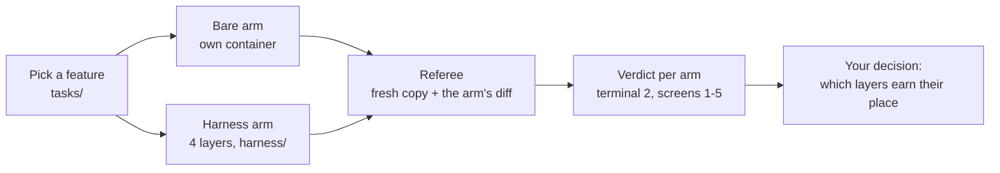

# Module 1: Harness Engineering for Coding Agents - Final project: ship a feature with the whole harness

## The problem

**Illustrative scenario.** You have a real feature to ship with an agent. Use the whole harness and
decide which layers earn their place. The easy path is to switch every layer on, run the feature
once, and keep what looked better. A second run might split the other way; nobody runs one.

The cost: every task pays for the harness on one data point, or a good layer goes after one bad run.

> **Terms on this page**
>
> - **Harness**: the files and code around the agent that decide what it sees and may do.
> - **Harness layer**: one part of the harness: instructions, state, scope, or verification.
> - **Bare arm**: an agent run with the ticket and the repository, and no harness.
> - **Harness arm**: the same run with the harness turned on.
> - **A/B**: bare arm and harness arm on the same ticket, scored the same way.
> - **Referee**: the program that scores each run after the agent stops.
> - **Primary verdict**: the referee's answer to the one question the section asks.
> - **Console**: the browser page that shows a run live, on five screens.
> - **Hidden tests**: tests the referee runs that the agent never sees.
> - **Referee-set mutant**: a small planted bug; the arm's own tests should fail on it.

Why it happens:

- Each harness piece encodes an assumption about what the model cannot do on its own, and "those
  assumptions are worth stress testing" ([Harness design for long-running application development](https://www.anthropic.com/engineering/harness-design-long-running-apps)).
- The way to find out is "removing one component at a time and reviewing what impact it had on the
  final result" (the same source). One run removes nothing and compares nothing.
- Model output changes from run to run. The course ran `make final` on the same feature several
  times, and the A/Bs split differently ([evidence](../docs/evidence/final.md#final-project)).

The final project runs one live A/B with all four layers and teaches you to read it as one dot among
many. Then you put the same harness on your own repository. The course measures whether the harness
helps, and reports every result as measured.

## What you'll see

You pick one feature, Feature 5: Bulk close, Feature 6: Watchers, or Feature 7: Labels, and run both arms on it at the same time. The
harness arm gets all four layers; everything else is the same: ticket, model, tools, sandbox, turn
budgets (the most turns each session may take), and cost cap. One referee scores both arms, and you
watch them side by side on console screen 1.



> Your output will differ: run times, ids, and the agent's wording change on every run.


*The end of the course's own run: both arms at hidden tests 46/46; mutants killed 2/3 (bare) and 3/3 (harness); both runs completed.*

| Path | What it holds |
|---|---|
| [run.sh](run.sh) | The live run: checks, then `make final` |
| [tasks/](tasks/f5-bulk-close.md) | Features 5 to 7: the ask, the rules at risk, the referee's checks |
| [harness/](harness/README.md) | Every file the harness arm gets, all four layers |
| [walkthrough.md](walkthrough.md) | One run through the code, step by step |
| [expected/](expected/README.md) | Real terminal output and all five screens from one run |
| [your-repo/](your-repo/README.md) | Part 2: the harness on your own repository |
| [CHECKLIST.md](CHECKLIST.md) | What to show when you are done |

## Run it

### Step 1: Get ready

First time on this machine? Follow [setup/](../setup/README.md) until `make doctor` ends with
`result: + ready`. Then run `make warm` once: it builds the images and caches the referee and gate
baselines, with no model calls. In class, `.env` holds `SHIPHARNESS_CLASS_DATE` with the class day.
Practising alone, put `PURPOSE=pilot` in front of the command instead.

### Step 2: Pick the feature

In class, a poll picks one. Each feature is a separate A/B. The task pages say what each asks for,
which house rules it puts at risk, and what the referee checks.

| Feature | Task page | Build sessions (turns each) | Hidden tests |
|---|---|---|---|
| Feature 5: Bulk close | [f5-bulk-close.md](tasks/f5-bulk-close.md) | 1 (30) | 46 |
| Feature 6: Watchers | [f6-watchers.md](tasks/f6-watchers.md) | 2 (20, then 30) | 54 |
| Feature 7: Labels | [f7-labels.md](tasks/f7-labels.md) | 2 (25, then 35) | 64 |

### Step 3: Start the console

In terminal 1, leave it running, then open `http://127.0.0.1:8765/`:

```bash
make console
```

### Step 4: Run the A/B

In terminal 2. `run.sh` checks the keys, the class date, Docker, and the console, then runs
`make final` on the feature you name: `bulk-close` (the default), `watchers`, or `labels`.

```bash
PURPOSE=pilot ./final-project/run.sh bulk-close
```

Reload the run list in the browser, click the top card ("Final project", the feature, "A/B"), and press `1`. Terminal 2 then prints, per arm, one line, and a cost line (the
2026-10-17 run in the current wording; [expected/terminal.txt](expected/terminal.txt) is the original):

```text
Final A/B: Feature 5: Bulk close
A/B ... (Feature 5: Bulk close, layers=['instructions', 'scope', 'state', 'verify'], profile=class)
  bare     completed         agent said done · no primary measure · hidden tests 46 of 46 · mutants killed 3 of 3 · reviewer accept · cost $0.0196
  harness  ABORTED: timeout  agent said done · no primary measure · hidden tests 46 of 46 · mutants killed 1 of 3 · reviewer reject · cost $0.0139
Cost: $0.038253 (this command: gpt-5.6-luna $0.004675, gpt-6-luna $0.033578; session $0.060114 of $2.50; build $0.060114 of $15.00 ($14.939886 left))
make: *** [Makefile:214: final] Error 2
```

The harness arm said done after 20 turns. Its gate then ran the house-rule checks in the arm's
container, and on a busy machine two gate commands hit their time limits. The gate failed on those
timeouts, the harness's own time ran out, and the arm ended `ABORTED: timeout` before a test phase.
An aborted arm is still judged and shown, so the command exits 2: a result, not a failure.

`make final FEATURES=bulk-close LAYERS=-scope` removes one layer from the harness arm. That is the
leave-one-out idea from the problem above, one layer and one feature at a time.

### Time and cost

The caps come from `.env.example` and `platform/src/shipharness/config/settings.py`: at most $0.25
per arm and $0.04 per review, so at most $0.58 per feature. The class profile gives each arm an
agent time limit of 420 s (`platform/src/shipharness/config/profiles.py`), plus 900 s for the
harness's own work (`HARNESS_TIMEOUT_S`; 120 s before 2026-10-18). Prices are in `platform/config/prices.toml`.

Three runs of `make final FEATURES=bulk-close` on 2026-10-18 (class profile, after the harness
speed-up): bare primary verdict 1:49 to 5:00 after launch, full 4:16 to 7:58; harness primary 6:41
to 12:04, full 8:41 to 15:22 (its test filters run to the end); $0.044 to $0.048 each
([runs](../docs/evidence/general.md#demo-runs-after-the-speed-up), [earlier](../docs/evidence/final.md#final-project)).

## What to watch

| Minute of the console clock, screenshot run of 2026-10-18 | Screen | What appears |
|---|---|---|
| 1 | 1 | Both arms at work; the harness arm shows its layer notes |
| 2 to 3 | 1 | Bare: run completed, then "verdict ready: PASS · judged on all checks" |
| 6 | 1 | Harness: said done; every gate item passes; the test phase starts |
| 12 to 15 | 1 to 5 | Harness primary verdict, then both full verdicts; terminal 2 prints both lines |

Then switch screens with the keys `1` to `5`; [expected/](expected/README.md) shows each screen and what to notice on it.


*Minute 1. The harness arm's notes show the feature list in place and the skill it read.*


*Minute 3. The bare arm is judged; its secondary checks still run.*


*Minute 6. The harness arm's gate passed every item, and its test phase began.*

## What the result means

**The three final features have no primary measure.** Their `task.toml` files set `primary_measure = ""`, so the
referee marks every run as passed. On screen 1, "verdict ready: PASS · judged on all checks" says
nothing about the feature. Compare the counts instead:

| Count | Where | What it tells you |
|---|---|---|
| Hidden tests passed | `hidden 46/46` | Does the feature work as specified? |
| Mutants killed | `mutants 2/3` | Do the arm's own tests catch planted bugs? |
| Claim | `claim=done` | Did the agent say it was done? |
| Out-of-scope files | Screen 3 diff map | Did it change files it should not? |

Each arm's full record is in `exports/scores/`, one JSON file per run. "It is easy to see tests pass
and assume the job is done, when this is rarely the case" ([Building a C compiler with a team of parallel Claudes](https://www.anthropic.com/engineering/building-c-compiler)).
So compare the claim with the counts, not with the agent's summary.

**One A/B is one dot.** Read the three outcomes like this:

- **Harness ahead**: the harness arm has better counts, and many runs already show the same gap.
- **No measurable difference**: the counts are equal, or differ in a way one run can produce.
- **Bare ahead**: the same as harness ahead, the other way round.


*Tonight's A/B adds one dot per arm to rows like these.*

The course's own run: both arms passed 46 of 46 hidden tests. The bare arm's tests killed 3 of 3
mutants and the harness arm's 1 of 3, and the blinded reviewer (a separate model that reads the diff
without knowing which arm wrote it) rejected the harness arm's change over its audit row. The
harness arm never reached its test phase, because its gate ran out of time on a busy machine. As one
dot it reads bare ahead on mutants, for a reason that is about time, not about the layers. An
earlier Feature 5 run split the other way: 1 of 3 (bare) against 3 of 3 (harness).

**What many runs showed.** Before class, the course ran each section's ticket several times per
arm, plus a confirmation on a second ticket for Section 3: Scope and sandbox ([evidence](../docs/evidence/final.md#final-project)):

| Section | Primary measure | Result |
|---|---|---|
| Section 1: Instructions | No new tenant leak | No measurable difference |
| Section 2: State and sessions | Work survives a session stop | No measurable difference |
| Section 3, Feature 3: Safe retries for issue creation | No file outside the allowed paths | No measurable difference |
| Section 3, Feature 4: Version checks on issue edits (confirmation) | No file outside the allowed paths | Harness ahead: 3 of 3 against 0 of 3 |
| Section 4: Verification | All hidden tests and mutants | No measurable difference (both fail) |

To draw your own dots from every run in `exports/`, run the report. It makes no model calls and
writes `exports/report.html`, one dot per run, filled for passed and hollow for failed:

```bash
uv run shipharness report
```

## If it fails

| What you see | Why | What to do |
|---|---|---|
| Results printed, then `Error 2` | An arm was aborted on time or cost | Nothing: the run is judged and shown |
| Harness arm `ABORTED: timeout` with 0 turns | Gate baseline not cached: setup used the 120 s | `make warm`, then run again |
| `x OPENAI_API_KEY is not set` | The key is missing from `.env` | Add it, then `make doctor` |
| `x SHIPHARNESS_CLASS_DATE is not set` | Class runs need the class day | Set it in `.env`, or use `PURPOSE=pilot` |
| `x feature 'version-checks': the final project runs bulk-close, watchers, or labels` | Features 1 to 4 belong to the sections | Pick `bulk-close`, `watchers`, or `labels` |
| `x Docker is not running` | The Docker service is stopped | `sudo systemctl start docker`, then `make warm` |
| `! console not reachable` | The console is not started | `make console` in another terminal |

The command never falls back to a recording. If Docker, the network, or OpenAI fails in class, the
instructor can show a recorded A/B with `make replay RUN=` and the A/B id; every screen then says
RECORDING. More fixes: [docs/troubleshooting.md](../docs/troubleshooting.md).

## Use it on your own repository

The harness pieces work outside TeamTrack. [your-repo/](your-repo/README.md) takes you step by step
from `shipharness init` to filling the map, setting house rules, a first harnessed run, reading the
results, and deciding which layers to keep. Every step shows its command and the real output it
printed on a worked example, a small library, in [your-repo/example/](your-repo/example/README.md).

| Tool | What it does | Model calls |
|---|---|---|
| `shipharness init` | Copies the starter kit into your repository | None |
| `shipharness check` | Runs your house rules against a baseline | None |
| `shipharness testgen` | Writes tests and keeps only those that pass Filters 1 to 5 | Yes, capped |

The four course skills package the same work for Claude Code, Codex, and Cursor; start at
[use-in-your-repo/](../use-in-your-repo/README.md). When you are done, show the items in
[CHECKLIST.md](CHECKLIST.md). Report results the way this page does: as counts, one dot per run.

## Sources

- Source 1: Harness design for long-running application development, <https://www.anthropic.com/engineering/harness-design-long-running-apps>, Prithvi Rajasekaran (Anthropic), 2026-03-24
- Source 2: Building a C compiler with a team of parallel Claudes, <https://www.anthropic.com/engineering/building-c-compiler>, Nicholas Carlini (Anthropic), 2026-02-05
