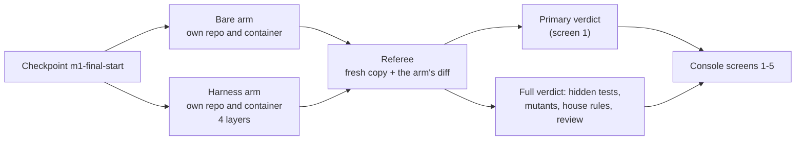
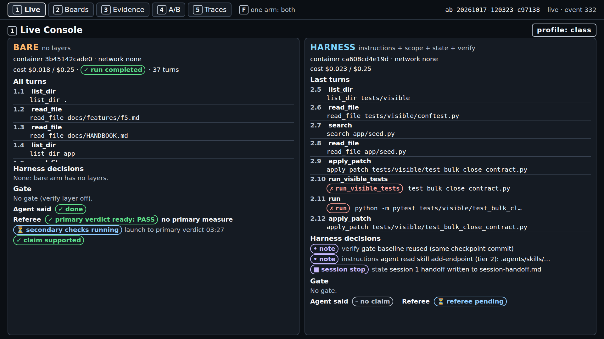
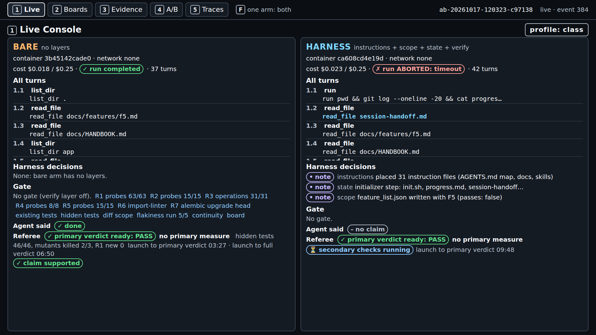

# Module 1: Harness Engineering for Coding Agents - Final project: one live A/B

## The problem

**Illustrative scenario.** After a bad week with a coding agent, your team adds a harness and runs
one feature with it and without it. The harness run looks better, so the harness becomes mandatory
for every task. A second comparison might have split the other way, but nobody runs one.

The cost: every task now pays the harness's extra time and money on the strength of one data point.
Or the opposite happens, and a piece that helps is dropped after one bad run.

> **Terms on this page**
>
> - **Harness**: the files and code around the agent that decide what it sees and may do.
> - **Bare arm**: an agent run with the ticket and the repository, and no harness.
> - **Harness arm**: the same run with the harness turned on.
> - **A/B**: bare arm and harness arm on the same ticket, scored the same way.
> - **Referee**: the program that scores each run after the agent stops.
> - **Primary verdict**: the referee's answer to the one question the section asks.
> - **Console**: the browser page that shows a run live, on five screens.
> - **Hidden tests**: tests the referee runs that the agent never sees.
> - **Referee-set mutant**: a small planted bug; the arm's own tests should fail on it.

Why it happens:

- Each harness piece encodes an assumption about what the model cannot do on its own, and "those
  assumptions are worth stress testing"
  ([Anthropic, Harness design](../docs/evidence/final.md#quotes-used-on-these-pages)).
- The way to find out is "removing one component at a time and reviewing what impact it had on the
  final result" (the same source). One run removes nothing and compares nothing.
- Model output changes from run to run. The course ran `make final` twice on the same feature, and
  the two A/Bs split differently ([evidence](../docs/evidence/final.md#final-project)).

The final project runs one live A/B and teaches you to read it as one dot among many. The course
measures whether the harness helps, and reports every result as measured.

## What you'll see

`make final FEATURES=F5` runs the bare arm against the harness arm with all four layers:
instructions, state, scope, and verification. Without `FEATURES` it runs F5 and then F6: two A/Bs,
at most $0.58 each. Both arms get the same ticket, model, tools, sandbox, turn budgets, and
cost cap, and one referee scores both. You watch both arms work side by side on console screen 1.

> Your output will differ: run times, ids, and the agent's wording change on every run.


*The end of a real run: the same counts in both arms, but only the bare arm claimed done.*



## Run it

First time on this machine? Follow [setup/](../setup/README.md) until `make doctor` ends with
`result: + ready`. Then run `make warm` once; it builds the images and caches baselines with no model
calls. In class, `.env` holds `SHIPHARNESS_CLASS_DATE` with the class day. Practising alone, add
`PURPOSE=pilot` to the commands instead.

**Pick the feature.** In class, a poll picks from F5 to F7. Each feature is a separate A/B.

| Feature | Spec | Build sessions (turns each) | Hidden tests |
|---|---|---|---|
| F5 Bulk close | [f5.md](../platform/teamtrack/docs/features/f5.md) | 1 (30) | 46 |
| F6 Watchers | [f6.md](../platform/teamtrack/docs/features/f6.md) | 2 (20, then 30) | 54 |
| F7 Labels | [f7.md](../platform/teamtrack/docs/features/f7.md) | 2 (25, then 35) | 64 |

Each feature has 3 referee-set mutants. Session budgets come from
`platform/teamtrack/reference/f5/task.toml` (and `f6`, `f7`). F6 and F7 end a session partway
through the feature, so the next session starts with an empty context.

**Terminal 1, the console.** Leave it running, then open `http://127.0.0.1:8765/`:

```bash
make console
```

**Terminal 2, the A/B.** In class, use the poll's winners, for example `FEATURES=F5,F6`:

```bash
make final FEATURES=F5
```

In the browser, open the newest run and press `1`. When both arms are judged, terminal 2 prints one
line per arm and a cost line. The course's own run, with the A/B id replaced:

```text
A/B <A/B id> (F5, layers=['instructions', 'scope', 'state', 'verify'], profile=class)
  bare     completed         claim=done     primary={} passed=True hidden 46/46 mutants 2/3 reviewer=accept cost=$0.0177
  harness  ABORTED: timeout  claim=none     primary={} passed=True hidden 46/46 mutants 2/3 reviewer=accept cost=$0.0226
Cost: $0.045597 (this command: gpt-5.6-luna $0.005302, gpt-6-luna $0.040295; session $1.461754 of $2.50; build $2.387502 of $15.00 ($12.612498 left))
make: *** [Makefile:163: final] Error 2
```

The harness arm used up its agent time in its test phase, so the command exited 2. An aborted arm is
still judged and shown; it is a result, not a failure of the command.

`make final FEATURES=F5 LAYERS=-scope` removes one layer from the harness arm. That is the
leave-one-out idea from the problem above, one feature at a time.

### Time and cost

The caps come from `.env.example` and `platform/src/shipharness/config/settings.py`: at most $0.25
per arm and $0.04 per review, so at most $0.58 per feature. The class profile gives each arm an
agent time limit of 420 s (`platform/src/shipharness/config/profiles.py`). Prices are in
`platform/config/prices.toml`.

The course's own F5 run on 2026-10-17 took 12 min 47 s from launch to the cost line and cost $0.045597. It ran
with the earlier 300 s agent time limit ([evidence](../docs/evidence/final.md#final-project)).

## What to watch

Minutes count from the launch of the course's own F5 run.

| Minute | Screen | What appears |
|---|---|---|
| 1 | 1 | Both arms build; harness notes: map placed, feature list written |
| 3 | 1 | Harness: "session stop", handoff written; its test phase reads the handoff |
| 4 | 1 | Bare: run completed, then "primary verdict ready: PASS" |
| 7 | 1 | Bare: full verdict, hidden tests 46/46, mutants killed 2/3 |
| 10 | 1 | Harness: "run ABORTED: timeout", then its primary verdict |
| 13 | 1 to 5 | Harness: full verdict; terminal 2 prints both lines |



*Minute 4. The bare arm is judged while the harness arm writes its tests after a handoff.*



*Minute 10. The harness arm hit its time limit; the referee still judges what it shipped.*

Then switch screens with the keys `1` to `5`.


*Screen 2, Boards. F5 changes no board pixels, so both boards stay clean and unchanged.*


*Screen 3, Evidence. Both arms changed only allowed files; one mutant survived in each arm.*


*Screen 4, A/B Report. Tonight's A/B is one dot; the rows pool every scored run in `exports/`.*


*Screen 5, Traces. Open a LangSmith link to see every model call of an arm.*

## What the result means

**F5 to F7 have no primary measure.** Their `task.toml` files set `primary_measure = ""`, so the
referee marks every run as passed. On screen 1, "primary verdict ready: PASS" says nothing about the
feature. Compare the counts instead:

| Count | Where | What it tells you |
|---|---|---|
| Hidden tests passed | `hidden 46/46` | Does the feature work as specified? |
| Mutants killed | `mutants 2/3` | Do the arm's own tests catch planted bugs? |
| Claim | `claim=done` | Did the agent say it was done? |
| Out-of-scope files | Screen 3 diff map | Did it change files it should not? |

Each arm's full record is in `exports/scores/<run_id>.json`. "It is easy to see tests pass and
assume the job is done, when this is rarely the case"
([Anthropic, C compiler](../docs/evidence/final.md#quotes-used-on-these-pages)). So compare the claim
with the counts, not with the agent's summary.

**One A/B is one dot.** Read the three outcomes like this:

- **Harness ahead**: the harness arm has better counts, and many runs already show the same gap.
- **No measurable difference**: the counts are equal, or differ in a way one run can produce.
- **Bare ahead**: the same as harness ahead, the other way round.

The course's own F5 run reads as no measurable difference: both arms passed 46 of 46 hidden tests
and killed 2 of 3 mutants. An earlier F5 run killed 1 of 3 (bare) and 3 of 3 (harness). Same feature,
same harness, a different split.

**What many runs showed.** Before class, the course ran each section's ticket several times per
arm, plus a confirmation on a second Section 3 ticket
([evidence](../docs/evidence/final.md#final-project)):

| Section | Primary measure | Result |
|---|---|---|
| 1 Instructions | No new tenant leak | No measurable difference |
| 2 State | Work survives a session stop | No measurable difference |
| 3 Scope (F3, the section's ticket) | No file outside the allowed paths | No measurable difference |
| 3 Scope (F4, the confirmation) | No file outside the allowed paths | Harness ahead: 3 of 3 against 0 of 3 |
| 4 Verification | All hidden tests and mutants | No measurable difference (both fail) |

To draw your own dots from every run in `exports/`, run the report. It makes no model calls and
writes `exports/report.html`, one dot per run, filled for passed and hollow for failed:

```bash
uv run shipharness report
```

## If it fails

| What you see | Why | What to do |
|---|---|---|
| Results printed, then `Error 2` | An arm was aborted on time or cost | Nothing: the run is judged and shown |
| `x OpenAI refused the key`, no arm started | The key is missing or rejected | Fix `.env`, then `make doctor` |
| `x SHIPHARNESS_CLASS_DATE is not set` | Class runs need the class day | Set it in `.env`, or add `PURPOSE=pilot` |
| An arm ends `ERROR` with `docker run failed` | Docker is down or an image is missing | `sudo systemctl start docker`, then `make warm` |
| `make console` says the port is in use | Another program holds 8765 | `make console CONSOLE_PORT=8766` |

The command never falls back to a recording. If Docker, the network, or OpenAI fails in class, the
instructor can show a recorded A/B with `make replay RUN=<id>`; every screen then says RECORDING.
More fixes: [docs/troubleshooting.md](../docs/troubleshooting.md).

## Use it on your own repository

The harness pieces work outside TeamTrack. The guide
[use-in-your-repo/apply-to-your-repo.md](../use-in-your-repo/apply-to-your-repo.md) takes you from
install to a first harnessed run on your own code, with a worked example on a small library. It
uses three tools, two of them with no model calls:

| Tool | What it does | Model calls |
|---|---|---|
| `shipharness init` | Copies the starter kit into your repository | None |
| `shipharness check` | Runs your house rules against a baseline | None |
| `shipharness testgen` | Writes tests and keeps only those that pass five filters | Yes, capped |

The four course skills package the same work for Claude Code, Codex, and Cursor; start at
[use-in-your-repo/](../use-in-your-repo/README.md).

**Your portfolio.** [Assignment 4](../04-verification/assignment/README.md) asks for one live A/B, a
testgen run on a repository you choose, a one-page case study, and a skill of your own. This project
gives you each piece: the A/B's score records and trace links, the kit's check and testgen output,
and the skill template. Report results the way this page does: as counts, one dot per run.
