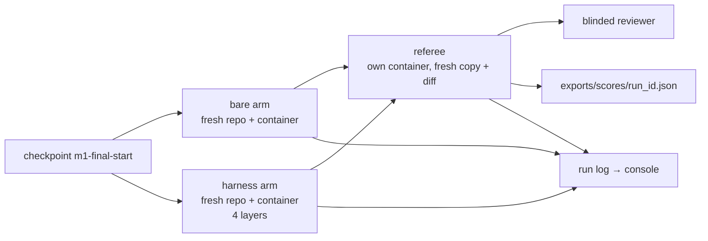

# Final project: shipharness end to end

This walkthrough takes you through one complete shipharness run on TeamTrack, from a clean checkout
to the score records, shows how to read what it produces, and then points the same tools at your own
repository. In class, the final feature poll opens S4, `make final FEATURES=...` runs during S4 next
to `make demo-4`, and the closing block (Final and wrap-up, 20 minutes) walks through its finished
results: all screens, screen 4 and the report, the LangSmith comparison, skills to take home, and the
assignments. This page is written so you can repeat the run alone afterwards. What you produce in
part 6 is the raw material for the assignment 4 portfolio (part 8).

The harness is the environment around the agent. The course uses A1's description of that work:
engineers "design environments, specify intent, and build feedback loops" (A1, F-a-02). A1 does not
define "harness engineering", so no definition is attributed to it. Source ids and finding ids such
as (A3, F-a-65) are listed with links in [REFERENCES.md](../REFERENCES.md).

Contents:

1. [Before you start](#1-before-you-start)
2. [The final features](#2-the-final-features)
3. [Run `make final`](#3-run-make-final)
4. [What each console screen shows](#4-what-each-console-screen-shows)
5. [How to read the results](#5-how-to-read-the-results)
6. [Run shipharness on your own repository](#6-run-shipharness-on-your-own-repository)
7. [Cost and time](#7-cost-and-time)
8. [Portfolio: how this feeds assignment 4](#8-portfolio-how-this-feeds-assignment-4)
9. [When something goes wrong](#9-when-something-goes-wrong)

## 1. Before you start

Work through these in order. Each line says how to check it.

| Step | Command | Done when |
|---|---|---|
| Setup for your platform | [Linux](../docs/setup-linux.md), [Windows (WSL2)](../docs/setup-windows.md), [macOS](../docs/setup-macos.md) | `make doctor` ends with `result: + ready`, and its `container runtime` line starts with `+ ok` |
| Checkpoint tags | `git tag -l 'm1-*'` | The list includes `m1-final-start`: the base product plus the F1-F4 reference implementations, where the final features start |
| Images | `make images` (only if `make setup` could not build them) | `make setup` printed no `docker not found` line |
| Class date | `SHIPHARNESS_CLASS_DATE=<today>` in `.env` | Class commands refuse without it. Or add `PURPOSE=assignment` to every command below |
| Budget | Read [part 7](#7-cost-and-time) | Every command under one class date shares a $2.50 session cap |

## 2. The final features

In class the poll at the start of S4 picks the features from F5-F7: the winner, and the runner-up
when the session budget has room. Each feature is a separate A/B: a bare arm and a harness arm with
all four layers (instructions, state, scope, verify), the same ticket, model, tools, sandbox, turn
budgets, and cost cap.

| Feature | Spec | Sessions (turn budget each) | Hidden tests | Referee-set mutants |
|---|---|---|---|---|
| F5 Bulk close | [f5.md](../teamtrack/docs/features/f5.md) | 1 (30) | 46 | 3 |
| F6 Watchers | [f6.md](../teamtrack/docs/features/f6.md) | 2 (20, then 30) | 54 | 3 |
| F7 Labels | [f7.md](../teamtrack/docs/features/f7.md) | 2 (25, then 35) | 64 | 3 |

Sources: session budgets from `teamtrack/reference/f5/task.toml` (and `f6`, `f7`); hidden-test
counts as counted in the course's audit of the hidden tests on 2026-10-16; referee-set mutants from
`teamtrack/mutants/features/f5.jsonl` (and `f6`, `f7`), which also hold two filter-set mutants each.

F6 and F7 run over two sessions, so a session ends partway through the feature and the next session
starts with an empty context. That is A3's "context reset", produced here by a session turn budget
smaller than the feature (A3, F-a-65). "Session turn budget" is the course's name for the mechanism;
it is not a source term.

Some hidden tests combine the new feature with an earlier one (for example
`tests/hidden/f7/test_f7_with_f1.py` in `teamtrack/`). SpecBench's held-out suites work the same way:
"held-out tests that compose those same features to simulate real-world usage" (B13, F-b-42).
Neither arm ever sees the hidden tests or the referee-set mutants.

F5-F7 have no pre-registered primary measure. Their results are read as dots and counts. Part 5
explains what that means on screen.

## 3. Run `make final`

Use two terminals in the repository root.

```bash
make console                  # terminal 1: live console on http://127.0.0.1:8765/
make final FEATURES=F5,F6     # terminal 2: the features the poll chose
```

`FEATURES` is a comma-separated list; the default is `F5,F6`. `make final` runs one A/B per
feature, one after the other. What it runs (from `make -n final FEATURES=F6,F5`):

```
rc=0; for f in $(echo "F6,F5" | tr ',' ' '); do \
  uv run shipharness ab --section final --feature $f  --purpose class || rc=$?; \
done; exit $rc
```

Every feature runs even if an earlier one fails, and the exit code is the last non-zero one.
`make final FEATURES=F5 LAYERS=-scope` removes one layer from the harness arm, the same
leave-one-out idea as A3's "removing one component at a time" (A3, F-a-125). `PURPOSE=assignment`
traces to the `shipharness-assignments` LangSmith project instead of the class project.

`shipharness ab` checks your OpenAI key before any arm starts and refuses when it is missing or
rejected. It never falls back to a recorded run; replays are a separate command and are labelled.

In class the instructor starts `make final` in a third terminal one minute after `make demo-4`, at
the start of S4, so the final A/B runs while S4 is taught. Two A/Bs run at once, demo-4 and one
final feature; because `make final` runs its features one after another, there are never more
than two. The results are discussed in the closing block.

What one A/B does:



1. The checkpoint is exported into two fresh git repositories, one per arm.
2. Two identical arm containers (network none) and two board-preview containers start.
3. Both arms build the feature, then write tests, in parallel. The agent loop runs on your machine;
   only tool commands run in the containers, and no API key enters a container.
4. The referee judges each arm's diff in its own container on a fresh copy of the checkpoint, as soon
   as that arm ends: existing tests, house-rule probes R1-R7, hidden tests, referee-set mutants
   against the arm's shipped tests, ten re-runs for flakiness, board checks, and the blinded
   reviewer.
5. One score record per arm is written to `exports/scores/<run_id>.json`, and the terminal prints one
   line per arm and a cost line.

The per-arm line shows: the arm, run status, the agent's claim (`claim=done` or not), the primary
values and `passed` flag, `hidden <passed>/<total>`, `mutants <killed>/<total>`, the reviewer's
verdict, and the arm's cost (`_print_record` in `src/shipharness/ab/commands.py`). The last line is
`Cost: $<x> (this command: <costs per model>; session $<x> of $2.50; build $<x> of $15.00 (...))`.

[[PENDING: captured terminal output of `make final FEATURES=F5,F6` (A/B ids, per-arm lines, cost lines) | source: live class | how: make final FEATURES=F5,F6, saving the full terminal output]]

The architecture behind these steps is in [docs/architecture.md](../docs/architecture.md).

To show a recorded A/B instead of a live one, use `make replay RUN=<ab or run id>`. Every screen then
carries a red RECORDING badge; the recorded diff is applied and the referee runs again live.

## 4. What each console screen shows

Open http://127.0.0.1:8765/ and click the newest run (ids start with a time stamp). Keys `1` to `5`
switch screens; `F` cycles full screen for one arm. The screens are built only from the run log's
events and from `exports/`.

### Screen 1: Live Console

Both arms side by side. For each arm:

- **Sandbox line:** the container id, `network none`, CPU and memory use against the limit, and agent
  time left.
- **Cost:** spend against the run cap ($0.25 per arm for the final).
- **Turns:** while the run is live, the last 8 turns ("Last turns"); once the run has finished, the
  full scrollable timeline ("All turns"). Each row has the turn's message and up to three tool calls;
  reads of harness documents (AGENTS.md, skills) are marked. For F6 and F7, `■ Session 1 stopped`
  and `▶ Session 2 resumed` markers show the context reset.
- **Harness decisions:** `⊘ block` and `↺ revert` from the scope layer, and other layer decisions.
  The bare arm shows "None: bare arm has no layers."
- **Gate:** one pill per gate item, `⏳ pending` turning into `✓ pass` or `✗ fail`, when the harness
  arm calls `finish`. The bare arm shows "No gate (verify layer off)."
- **Agent said vs Referee:** the agent's claim next to the referee's verdict, and whether the claim is
  supported. This is the gap cause 4 describes: "agents reliably skew positive when grading their
  own work" (A3, F-a-15).

[[PENDING: screenshot of screen 1 during the final (both arms, F6 session stop marker visible) | source: live class | how: make console, open the final A/B, press 1, capture at 1920x1080]]

### Screen 2: Boards

A screenshot of each arm's running TeamTrack board, taken as an Acme user every 5 s by the arm's
preview container. Cards from another org are marked `⚠ other org`, duplicate cards `⧉ duplicate`; a
clean board says "only own-org cards, no duplicates". If a run captured a two-tab edit, a third panel
shows it (`✗ lost update` or `✓ conflict detected`).

[[PENDING: screenshot of screen 2 during the final (both boards) | source: live class | how: make console, open the final A/B, press 2, capture at 1920x1080]]

### Screen 3: Evidence

Three panels, each split by arm:

- **Instructions and state:** files read, grouped by category; sessions with their turn counts, how
  each ended, and any work redone in a later session (`↺ redone`).
- **Scope and sandbox:** the diff map, each changed file labelled `✎ changed`, `⊘ blocked`,
  `↺ reverted`, or `⚠ out of scope`; and sandbox denials (`⊘ denied` with the reason and command), or
  `✓ none`.
- **Verification:** the referee's checks (each with its count of new violations), the blinded
  reviewer's verdict, the test-filter table (filters 1-5 per proposed test, `✓ kept` or
  `✗ discarded` with the reason), the coverage count for filter 3, and the mutant table (filter set
  and referee set, `✓ killed` or `✗ survived`).

[[PENDING: screenshot of screen 3 after the referee finished (filter table and mutant matrix visible) | source: live class | how: make console, open the final A/B, press 3, capture at 1920x1080]]

### Screen 4: A/B Report

Read from `exports/`, so it includes every scored run there, not only tonight's:

- **Primary measures, one dot per run:** rows grouped by dataset variant (for example `CANONICAL`)
  and arm, with the layers, one dot per run (`●` passed, `○` failed), and a passed count in the form
  `<passed>/<runs>`. Rows are not split by feature: every canonical run of one arm, from any
  feature, lands in the same row.
- **Ablation:** one bar per layer combination with its count.
- **Cost per verified feature:** spend divided by runs that passed, per arm.
- **Reviewer agreement:** how often the blinded reviewer's verdict matched the referee's, as a count.
- **LangSmith:** experiment links and comparison links from `exports/experiments/`. A `make final`
  A/B does not create a comparison link itself; comparison links come from `shipharness experiments`.

[[PENDING: screenshot of screen 4 after the final, with the M8 experiment exports loaded | source: M8 batch 1 | how: make console, open the final A/B, press 4, capture at 1920x1080]]

### Screen 5: Traces

- **Live tail:** the last events from both arms and the A/B.
- **First wrong turn** per arm. The rule is a heuristic and says so on screen: the first turn that
  edited a file a failing referee check names; otherwise the first blocked change, sandbox denial, or
  failed gate.
- **LangSmith:** the agent and referee trace links for each arm. A3's advice to the harness builder
  is to "read its traces on realistic problems" (A3, F-a-126).

[[PENDING: screenshot of screen 5 for one final arm with a first wrong turn marked | source: live class | how: make console, open the final A/B, press 5, capture at 1920x1080]]

## 5. How to read the results

### 5.1 The final has no primary measure

F5-F7 register no primary measure (`primary_measure = ""` in each `task.toml`). For such a task the
referee records an empty `primary` and `passed_primary: true` for every run (`evaluate_primary` in
`src/shipharness/ab/score.py`). That value shows up in three places, and for the final it does not
mean the feature works:

- screen 1's Referee line shows `✓ pass`;
- screen 4 draws a filled dot and counts the run as verified in "Cost per verified feature";
- the HTML report draws no dot plot for F5-F7, because it plots only primary measures.

For the final, read the per-run counts instead (5.2).

### 5.2 One run: the score record

Each arm's record is in `exports/scores/<run_id>.json`. The fields to compare between the two arms of
one A/B:

| Field | What it counts |
|---|---|
| `hidden_passed` of `hidden_total` | Hidden tests passed (46, 54, or 64 for F5, F6, F7) |
| `mutants_killed` of `mutants_total` | Referee-set mutants killed by the arm's own shipped tests (only tests that pass on the unmutated build count) |
| `regression_passed` of `regression_total` | Existing tests keep passing (internal key `regression`) |
| `r1_new_violations`, `r1_leaks` | New tenant-isolation violations, and responses that returned another org's data |
| `r2_new_violations`, `r3_new_failures`, `r4_duplicates`, `r5_audit_missing`, `r6_ok`, `r7_ok` | The other house rules |
| `out_of_scope_files`, `test_phase_source_edits` | Files outside the task's allowed paths; source edits during the test phase |
| `flaky_tests`, `shipped_tests` | Shipped tests flagged as flaky over ten re-runs; how many tests the arm shipped |
| `continuity_failure`, `redone_lines_pct` | Whether the work broke across a session stop, and how much of session 1's work was redone; they matter for F6 and F7 |
| `claim`, `reviewer_verdict`, `reviewer_agrees` | What the agent said, what the blinded reviewer said, and whether the reviewer matched the referee |
| `status`, `cost_usd`, `review_cost_usd`, `turns_total`, `wall_s` | `completed`, `ABORTED: cap`, and so on; spend, review spend, turns, and agent time |

An example from a section demo, not the final: the bare arm of an F4 A/B in the course pilot.
Captured on 2026-10-16, run r-20261016-185422-ce2096 (A/B ab-20261016-185422-8a8c2a); excerpt, trace
links cut; your output will differ:

```json
  "arm": "bare",
  "checkpoint": "m1-s4-start",
  "claim": "none",
  "cost_usd": 0.016903,
  "feature_id": "F4",
  "hidden_passed": 66,
  "hidden_total": 69,
  "mutants_killed": 4,
  "mutants_total": 4,
  "out_of_scope_files": 1,
  "passed_primary": false,
  "primary": {
    "hidden_passed": 66,
    "mutants_killed": 4
  },
  "regression_passed": 190,
  "regression_total": 190,
  "reviewer_agrees": true,
  "reviewer_verdict": "reject",
  "shipped_tests": 33,
  "status": "completed",
  "turns_total": 52,
  "wall_s": 225.33
```

Read it like this: the arm never claimed to be done (`claim: none`), its own 33 tests killed all 4
referee-set mutants, but 3 of the 69 hidden tests failed, so it failed F4's primary measure, which
needs all of both. Existing tests kept passing (190 of 190). The blinded reviewer rejected the diff,
and that agreed with the referee.

A4's warning applies to the agent's own claim: "it is easy to see tests pass and assume the job is
done, when this is rarely the case." (A4, F-a-17). Compare `claim` with the hidden-test and mutant
counts, not with the agent's summary. The reviewer is a separate evaluator, following A3:
"Separating the agent doing the work from the agent judging it proves to be a strong lever" (A3,
F-a-110). It receives the diff and the ticket with arm-identifying files and commit messages
removed, and the arm label is never sent.

### 5.3 Many runs: the report

```bash
uv run shipharness report
```

(`make report` is a placeholder target in this release and prints
`! report is available after milestones M6 and M8`.) The report reads only `exports/` and writes
`exports/report.json` and `exports/report.html`. It makes no model calls and prints
`Cost: $0.000000 (no model calls; runs in exports $...)`, with the total spend of the runs it read.
For each feature that has a primary measure (F1-F4), the HTML report draws one row per arm and
**one dot per run**: a filled dot passed the primary measure, a hollow dot failed it, so pass and fail
never depend on colour alone. The row label carries the count, in the form
`bare (<failing>/<runs> failing)`, and a table under each plot lists the value per run. The drawing
code is the walkthrough anchor `Final:dots`:

```bash
uv run python scripts/anchors.py extract Final:dots
```

which prints the start of `render_dot_plot` in `src/shipharness/ab/report.py` (captured on
2026-10-17; first lines):

```
def render_dot_plot(group: dict[str, Any], width: int = 640) -> str:
    """One row per arm, one dot per run. Filled = passed the primary measure, hollow = failed,
    so pass/fail never depends on colour alone. The row label carries the count."""
```

Rules for reading it:

- Every run is a dot; results are counts ("9/10"), not percentages. With 10 runs per arm, a
  difference of one run is one dot; a percentage would hide how few runs stand behind it.
- Aborted runs (`ABORTED: cap`) are kept, scored, and shown.
- Each section has one primary measure, registered before any run. Everything else is secondary.

Replays are left out unless you pass `--include-recorded`. Model output varies between runs, so a
single live A/B is one dot: read it next to the experiment dots, never alone.

[[PENDING: report.html dot plots for F1-F4 from the headline batch (k=10 per arm) | source: M8 batch 1 | how: uv run shipharness experiments (batch 1), then uv run shipharness report]]

## 6. Run shipharness on your own repository

Three tools work outside TeamTrack. Run them from the shipharness repository root and pass your
repository's path. The four course skills package the same workflows for coding agents; their
READMEs describe how to install them in Claude Code, Codex, and Cursor:
[harness-setup](../skills/harness-setup/README.md), [house-rules](../skills/house-rules/README.md),
[assured-tests](../skills/assured-tests/README.md),
[skill-template](../skills/skill-template/README.md).

### 6.1 Assess the harness: the `harness-setup` skill

```bash
uv run python skills/harness-setup/scripts/assess.py <your-repo> --out harness-assessment.html
```

The script reads files only: no network or model calls, no code from your repository is run, and the
same files give the same report (`skills/harness-setup/SKILL.md`). It prints a summary per area and
one line per check, and writes an HTML table with each check's status (pass, partial, fail), the
evidence, the fix, and the source. Add `--json` to also print the checks as JSON. The areas are
instructions (I1-I6), state (S1-S4), scope (C1-C5), verification (V1-V5), and session lifecycle
(L1-L5).

Captured on 2026-10-17 on the bare TeamTrack (`assess.py teamtrack`), first lines; your output will
differ:

```
Instructions       pass 0  partial 1  fail 5
State              pass 0  partial 0  fail 4
Scope              pass 1  partial 1  fail 3
Verification       pass 1  partial 1  fail 3
Session lifecycle  pass 0  partial 0  fail 5
FAIL     I1 AGENTS.md map at the repository root: no AGENTS.md at the repository root
```

Then fill the gaps from the skill's templates (`skills/harness-setup/assets/templates/`), area by
area, and run the script again. The first rule of the skill is to keep AGENTS.md a map: "we treat it
as the table of contents", "roughly 100 lines" (A1, F-a-27, F-a-28). The skill also says what it
does not do: templates write rules down, and enforcement needs code (checks, tests, a gate).

### 6.2 Generate tests that prove something: `shipharness testgen`

```bash
uv run shipharness testgen --repo <your-repo> --module <path/in/repo.py> --layers verify \
  --max-tests 10 --python /absolute/path/to/your/venv/bin/python
```

An agent writes tests for one module of a repository with a pytest suite; each proposed test is kept
only if it passes all five filters, cheapest first:

| # | Filter | Source |
|---|---|---|
| 1 | Imports and runs | B11 (F-b-17) |
| 2 | Passes 5 consecutive runs: "every one of five executions" | B11 (F-b-18, F-b-19) |
| 3 | Adds line coverage over the existing suite, or kills a filter-set mutant no existing test kills | B11 (F-b-20); B12 (F-b-29, F-b-32) |
| 4 | Real assertions, and the unit under test is not mocked | Course filter, no direct source |
| 5 | No source file changed during the test phase | Course filter, built from B11 (F-b-22) and A2 (F-a-80) |

Options that matter on your own code (`uv run shipharness testgen --help`):

- `--python`: the interpreter that has your repository's dependencies, pytest, and coverage
  installed. The default is `python`.
- `--sandbox local` (the default without `--image`) runs the generated tests on your machine with
  your permissions, and shipharness prints UNSANDBOXED. For a repository you do not trust, build an
  image with its dependencies, pytest, and coverage, and pass `--sandbox docker --image <image>`.
- `--layers none` (the default) lets the agent write tests with no verify layer; the five filters
  still decide what is kept. Comparing `none` with `verify` on the same module is a small A/B of
  your own.
- Without mutants, filter 3 can only keep tests that add line coverage. On a well-covered module most
  tests then fail filter 3; that is expected (`skills/assured-tests/SKILL.md`).
- `--out <dir>`: kept tests and `testgen-report.json` go there; the default is
  `.shipharness/runs/<run_id>/kept/`.
- `--target <id>` runs one of the pinned course targets from `datasets/testgen-targets-v1.jsonl`
  instead (for example `TG-boltons-listutils`).

The command prints one line per test: `+ <test id>` for kept, `- <test id>: filter <n>: <reason>` for
discarded, then the cost line. It calls the model and costs up to the $0.20 run cap. A kept test
asserts what the code does today, so it guards against future regressions but cannot catch a fault
that is already in the code (B12, F-b-41). Review kept tests as code before you commit them.

### 6.3 Check house rules on a FastAPI service: `shipharness check --adapter`

```bash
uv run shipharness check --app <your-app-dir> --adapter mypackage.harness_adapter:ADAPTER \
  --rules R1,R2,R5 --json > baseline.json
uv run shipharness check --app <your-app-dir> --adapter mypackage.harness_adapter:ADAPTER \
  --rules R1,R2,R5 --baseline baseline.json
```

The checks are generic for FastAPI services and discover endpoints from the app's OpenAPI spec.
Everything specific to your app goes through an adapter: an object implementing the
`TenantAppAdapter` protocol in `src/shipharness/checks/adapter.py`. It builds a seeded app on a fresh
database, returns headers for a role in an org, names two orgs (probes run as the first against the
second's data), gives the ids to probe with, counts audit rows, detects another org's data in a
response, and lists exemptions. The built-in TeamTrack adapter in the same file is a worked example.

Try it on TeamTrack first (no adapter needed). Captured on 2026-10-17 on the class host; your output
will differ:

```
$ uv run shipharness check --app teamtrack --rules R6,R7
UNSANDBOXED: the checks import and run this app's code on this machine.
  R6 import-linter
PASS  r6_layering      new=0 baseline=0 probes=1 342 ms
PASS  r7_migrations    new=0 baseline=0 probes=2 2927 ms
  R7 alembic upgrade head
Cost: $0.000000 (no model calls)
```

Pick the rules that match your service (R1 tenant isolation, R2 viewers cannot write, R3 list and
error conventions, R4 idempotent creates, R5 one audit row per write, R6 layering, R7 one migration
head). The first command records today's violations as a baseline; with `--baseline`, only new
violations count. Exit codes: 0 no new violations, 3 new violations, 1 error, so the second command
can run in CI. `check` makes no model calls, and it runs your app's code in process, so run it only
on code you trust. "House rules" is the course's label for what A1 calls "golden principles" and
"taste invariants" enforced mechanically (A1, F-a-96, F-a-99). To turn one of your own conventions
into a rule with a check and a test, use the `house-rules` skill
(`skills/house-rules/scripts/new_rule.py --help`).

## 7. Cost and time

Caps (from `.env.example` and `src/shipharness/config/settings.py`; the cost tracker enforces them,
and a run that hits one ends as `ABORTED: cap` and is still scored):

| Cap | Value |
|---|---|
| Per arm per final run (build and test phases together) | $0.25 (`MAX_FINAL_RUN_COST_USD`) |
| Per arm per demo run, and per testgen run | $0.20 (`MAX_RUN_COST_USD`) |
| Per blinded review | $0.04 (`MAX_REVIEW_COST_USD`) |
| Per command | $2.50 (`MAX_BATCH_COST_USD`) |
| Per class session (every command under one `SHIPHARNESS_CLASS_DATE`) | $2.50 (`MAX_SESSION_COST_USD`) |
| Agent time per arm per run | 300 s (`RUN_TIMEOUT_S`) |
| Harness work per arm per run | 120 s (`HARNESS_TIMEOUT_S`) |

Worst case at the caps, per final feature: 2 arms × $0.25 + 2 reviews × $0.04 = $0.58. So
`FEATURES=F5,F6` is at most $1.16, and all three features at most $1.74, which fits a session in which
you ran nothing else. In class, four demos (at most $0.48 each with reviews) and one final feature
reach the $2.50 session cap at the caps; the cap then ends a run cleanly and the referee still scores
it. Prices are in `config/prices.toml` (gpt-6-luna: $0.10 input, $0.01 cached input, $0.125 cache
write, $0.50 output per 1M tokens; gpt-5.6-luna, the reviewer: $0.20, $0.02, $0.25, $1.20).

Measured so far: the course pilot's run 2 on 2026-10-16 spent $0.3966 on 12 section A/Bs (F1-F4,
three each, both arms and reviews), and every one of those A/Bs took between 485 and 923 s from the
first event to the last verdict, with two A/Bs running at a time.

| Command | Model cost | LangSmith traces |
|---|---|---|
| `make final`, per feature | Up to $0.58 (caps above) | About 4: an agent trace and a referee trace per arm |
| `shipharness testgen` | Up to $0.20 | One agent trace |
| `assess.py`, `shipharness check`, `uv run shipharness report` | None | None |

The agent and harness time limits apply per arm, and the arms run in parallel; referee time comes on
top of both.

[[PENDING: measured cost per final feature (both arms + reviews) for F5, F6, F7 | source: live class | how: make final FEATURES=F5,F6,F7, read the Cost lines and cost_usd + review_cost_usd in exports/scores]]

[[PENDING: measured wall time per final feature, from start to referee verdict | source: M6 pilot | how: time make final FEATURES=F5 (and F6, F7); wall_s in exports/scores for the agent part]]

[[PENDING: measured cost and wall time of one shipharness testgen run on a library target | source: M6 pilot | how: time uv run shipharness testgen --target TG-boltons-listutils --layers verify]]

## 8. Portfolio: how this feeds assignment 4

Assignment 4 (Verification and portfolio) asks for house rule R8 and one new filter, `shipharness
testgen` on a repository you choose, one live F4 A/B, and the portfolio: an evidence report, a
LangSmith page with the A/B's trace links, a one-page case study, and your own skill. The full brief
and grading criteria are in
[submodules/04-verification/assignment/README.md](../submodules/04-verification/assignment/README.md).
This project gives you each piece:

| Portfolio item | Where it comes from |
|---|---|
| Evidence report | The testgen output from 6.2 (`testgen-report.json` and the kept tests), the assessment from 6.1, and the check results from 6.3; or your own A/B scores in `exports/scores/` with `exports/report.html` |
| LangSmith links | The `trace_url` and `referee_trace_url` of each arm's score record, and the links on screens 4 and 5 |
| One-page case study | The repository, what the assessment found, which harness parts you added, the counts before and after (kept tests of proposed, new violations, hidden tests and mutants), and what still fails |
| Your own skill | Start from `skills/skill-template/` (walkthrough anchor `Final:skill_template`), then `uv run shipharness skills validate <your-skill-dir>` |

Report counts the way the course does: one dot per run, "9/10", not percentages.

## 9. When something goes wrong

| Symptom | What it means | What to do |
|---|---|---|
| `x SHIPHARNESS_CLASS_DATE is not set: ...` | Class commands need the class date | Set it in `.env`, or add `PURPOSE=assignment` |
| `x OPENAI_API_KEY is missing: ...` or `x OpenAI refused the key: ...` | The live guard refused before any arm started | `make doctor` names the problem |
| Every screen says UNSANDBOXED | No container runtime was found, or `SANDBOX_MODE=none` | Fix the runtime ([setup docs](../docs/setup-linux.md#3-install-docker-engine)); unsandboxed results are not official |
| An arm ends as `ABORTED: cap` | It reached a cost cap | The run is still scored and shown; check the session figure in the cost line |
| `x no task for feature=...` | The feature id is not in `datasets/teamtrack-features-v1.jsonl` | Use F5, F6, or F7 |
| `make replay` prints `! replay needs RUN=<ab or run id>` | No id given | `make replay RUN=<id>` with an id from the console's run list |
| The console shows no runs | It reads `.shipharness/runs/` (`RUNS_DIR`) | Start `make console` from the repository root |
| Port 8765 or 8000 is taken | Another server is running | `make console CONSOLE_PORT=8766`, `make up PORT=8001` |
| Screen 4 says "No exports yet" | Nothing in `exports/scores/` yet | Wait for the referee to finish the first arm |

More in [docs/troubleshooting.md](../docs/troubleshooting.md).
