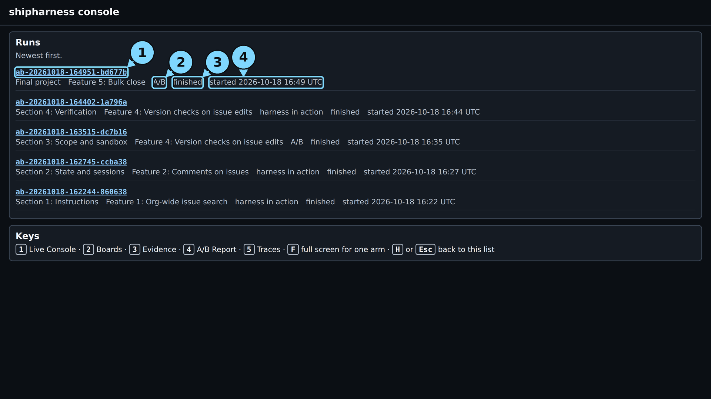
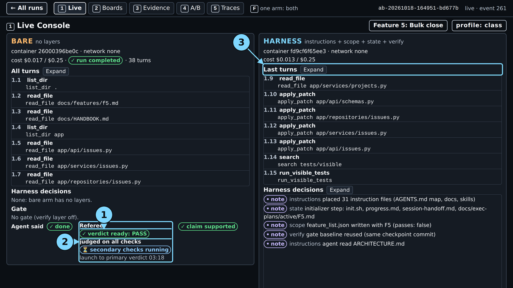
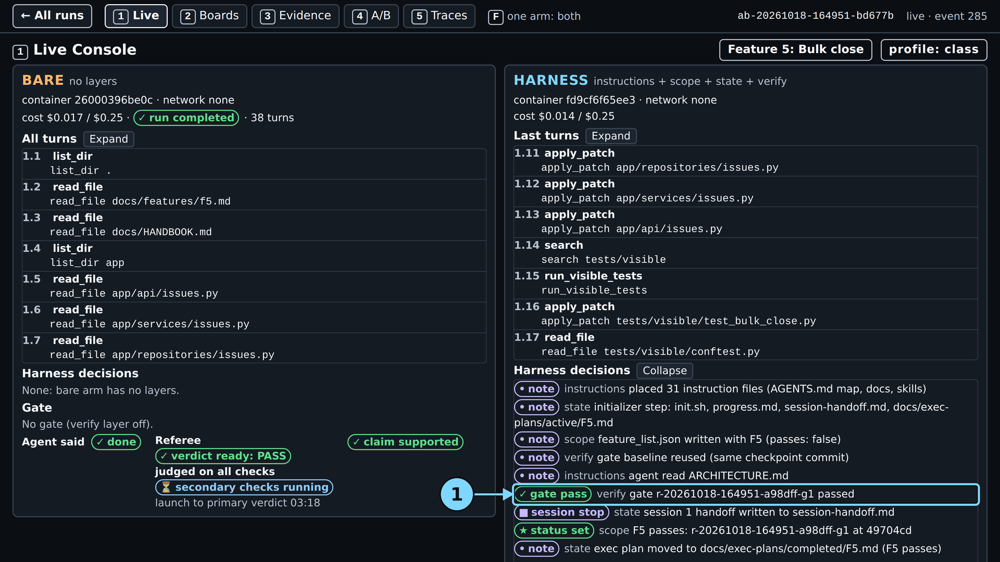
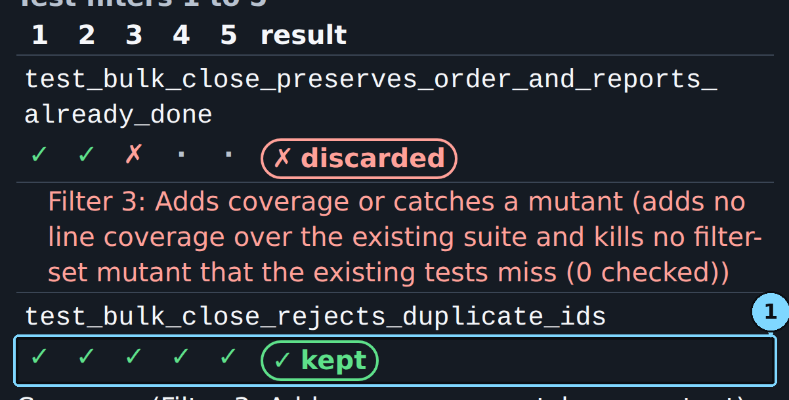

# Module 1: Harness Engineering for Coding Agents - Final project: what one real run looked like

This folder holds the terminal output and the console screenshots of one real `make final` run on
Feature 5: Bulk close, the live run of 2026-10-18 for the demo guide, with `make final
FEATURES=bulk-close PURPOSE=pilot` and the class profile (run id on the
[evidence page](../../docs/evidence/final.md#final-project-captures)). Nothing here is staged or
cut; the start and end lines of `terminal.txt` (with the wall time) are the capture script's.
When and how it was captured is on the
[evidence page](../../docs/evidence/final.md#final-project-captures).

> **Terms on this page**
>
> - **Referee**: the program that scores each run after the agent stops.
> - **Primary verdict**: the referee's answer to the one question the section asks.
> - **Full verdict**: the primary verdict plus every other check: hidden tests, mutants, review.
> - **Mutant**: a copy of the code with one small planted bug; a test that fails on it catches it.
> - **Gate**: the checks the verify layer runs when the agent says done; the agent cannot skip them.
> - **Harness note**: a line a layer adds to screen 1, such as "placed 31 instruction files".

## Terminal output

| File | What it holds |
|---|---|
| `terminal.txt` | The command, both arm lines, the cost line, the start and end lines |

Read the two arm lines column by column: status, claim, hidden tests, mutants killed, the
reviewer's verdict, and the arm's cost. Both arms completed in this run. If an arm is aborted on
time, the command ends with `Error 2`, and both arms are still judged.

## Screenshots

All from `make console`; the three moment screens of screen 1 were taken while the run was live.
The numbered circles are the demo guide's callouts. Times count from the make command's launch.

> Your output will differ: run times, ids, and the agent's wording change on every run.

*The run list. Circles: 1 the run id, 2 the type, "A/B", 3 the status, 4 the start time.*

*About one minute in: both arms are at work; the harness arm's notes show the files its layers wrote.*

*3:27: the bare arm completed after 38 turns: "verdict ready: PASS · judged on all checks". Feature 5 has no primary measure, so PASS says nothing about the feature.*

*3:44: the harness arm said done at 2:11; every gate check passed on the first attempt, and the test phase began.*

*The end: hidden tests 46/46 in both arms, mutants killed 1/3 (bare) and 0/3 (harness), full verdicts at 6:02 and 9:10.*

*Screen 2, Boards: Feature 5 changes no board pixels, so both boards show only their own org's cards.*

*Screen 3, Evidence: both arms changed only allowed files, no sandbox denials, every referee check 0 new; both reviewers accept.*

*The harness arm proposed two tests: one kept after five filters, one discarded by Filter 3: Adds coverage or catches a mutant.*

*Screen 4, A/B Report: both arms' verdicts at the top; below, "Measured before class", where Feature 5's rows read "8/8 before class" plus this run's new dot.*

*Screen 5, Traces: the live tail, "no wrong turn found" for either arm, and the LangSmith links of each arm.*

## How to read each screen

| Screen | Look at | It answers |
|---|---|---|
| 1 Live | Status, "Agent said", the gate pills, the referee line | Did each arm finish, and does its claim match the counts? |
| 2 Boards | Each card's org | Did a change leak another org's data onto the board? |
| 3 Evidence | Files read, the diff map, sandbox denials | What did each arm read and change, and what was refused? |
| 4 A/B Report | One dot per run | Is tonight's dot in line with the earlier runs? |
| 5 Traces | The LangSmith links | Which model calls led to the result? |
