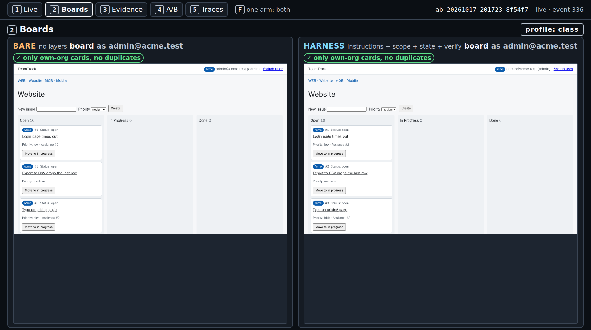
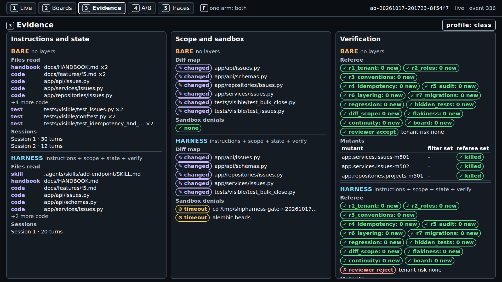
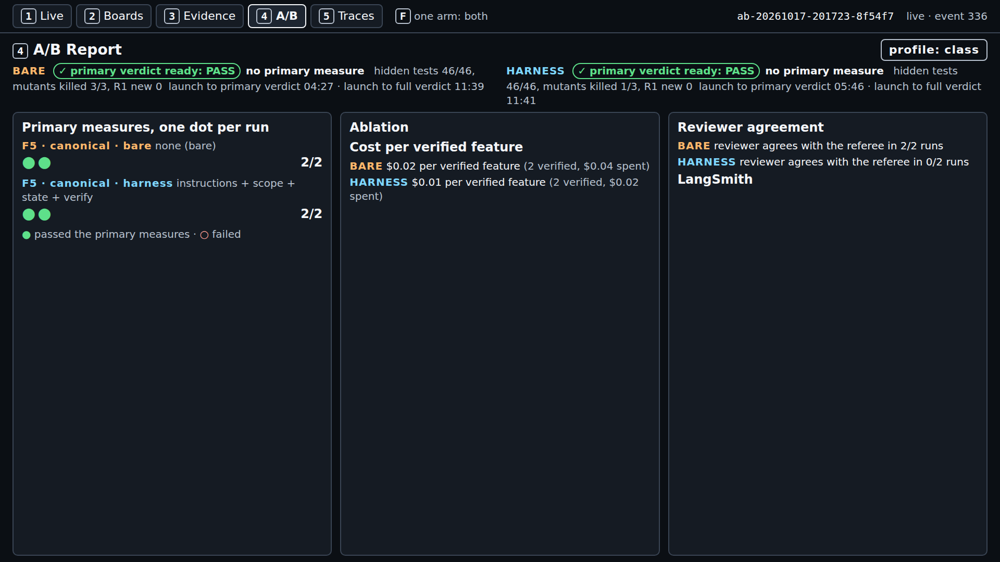
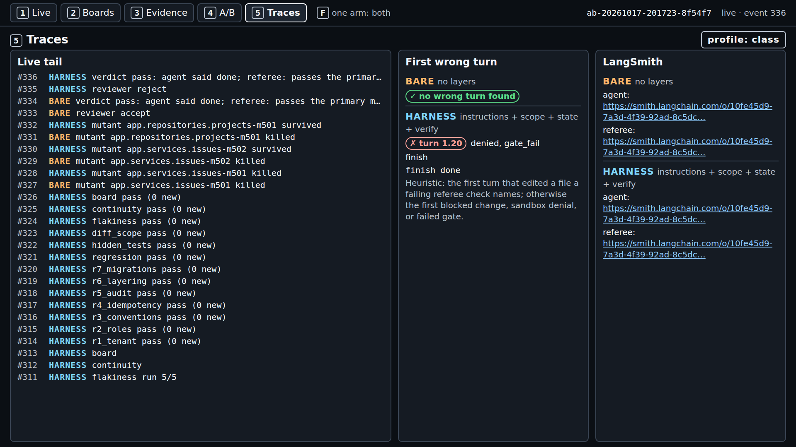

# Module 1: Harness Engineering for Coding Agents - Final project: what one real run looked like

This folder holds the terminal output and the console screenshots of one real `make final` run on
F5, started with `PURPOSE=pilot ./final-project/run.sh`, with the class profile. Nothing here is
staged; the A/B id is cut from `terminal.txt` where it shows `...`, and the screenshots are cropped
to the panels. When and how it was captured is on the
[evidence page](../../docs/evidence/final.md#final-project-captures).

> **Terms on this page**
>
> - **Primary verdict**: the referee's answer to the one question the section asks.
> - **Full verdict**: the primary verdict plus every other check: hidden tests, mutants, review.
> - **Gate**: the checks the verify layer runs when the agent says done; the agent cannot skip them.
> - **Harness note**: a line a layer adds to screen 1, such as "placed 31 instruction files".

## Terminal output

| File | What it holds |
|---|---|
| `terminal.txt` | Terminal 2: the checks, both arm lines, the cost line, the wall time |

Read the two arm lines column by column: status, claim, hidden tests, mutants killed, the
reviewer's verdict, and the arm's cost. `Error 2` at the end means an arm was aborted on time; both
arms were still judged. The cost line's session and build totals also count an earlier run on the
same checkout.

## Screenshots

> Your output will differ: run times, ids, and the agent's wording change on every run.

*Minute 1: both arms are at work; the harness arm's notes list the files its layers placed.*

*Minute 5: the bare arm completed after 42 turns, primary verdict PASS; F5 has no primary measure, so PASS says nothing about the feature.*

*Minute 7: the harness arm said done after 20 turns; its gate items failed on time limits, and the run ended `ABORTED: timeout`.*

*The end: hidden tests 46/46 in both arms, mutants killed 3/3 (bare) and 1/3 (harness), full verdicts at 11:39 and 11:41 after launch.*

*Screen 2, Boards: F5 changes no board pixels, so both boards show only their own org's cards.*

*Screen 3, Evidence: both arms changed only allowed files; the harness arm's two sandbox denials are the gate's timed-out commands.*

*Screen 4, A/B Report: one dot per scored run in this checkout's `exports/`, here this run and the run before it.*

*Screen 5, Traces: the live tail, the first wrong turn (the harness arm's turn 1.20, where its gate failed), and the LangSmith links of each arm.*

## How to read each screen

| Screen | Look at | It answers |
|---|---|---|
| 1 Live | Status, "Agent said", the gate pills, the referee line | Did each arm finish, and does its claim match the counts? |
| 2 Boards | Each card's org | Did a change leak another org's data onto the board? |
| 3 Evidence | Files read, the diff map, sandbox denials | What did each arm read and change, and what was refused? |
| 4 A/B Report | One dot per run | Is tonight's dot in line with the earlier runs? |
| 5 Traces | The LangSmith links | Which model calls led to the result? |
