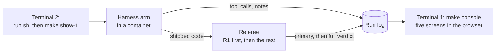
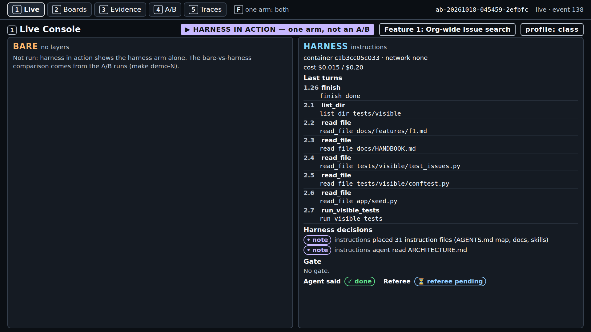
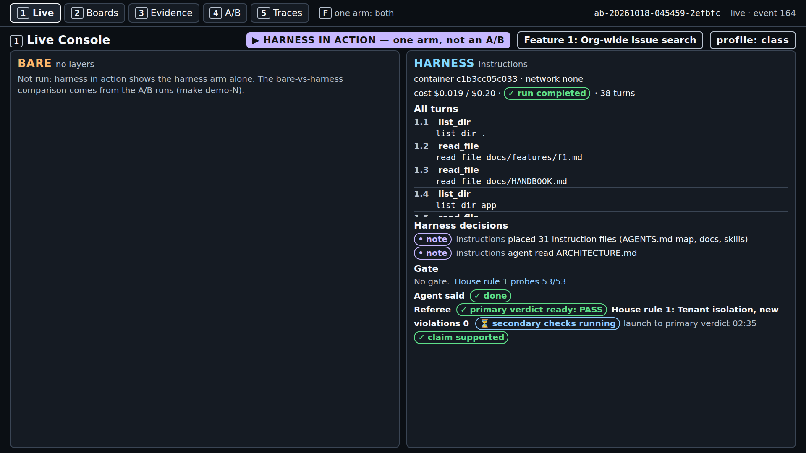
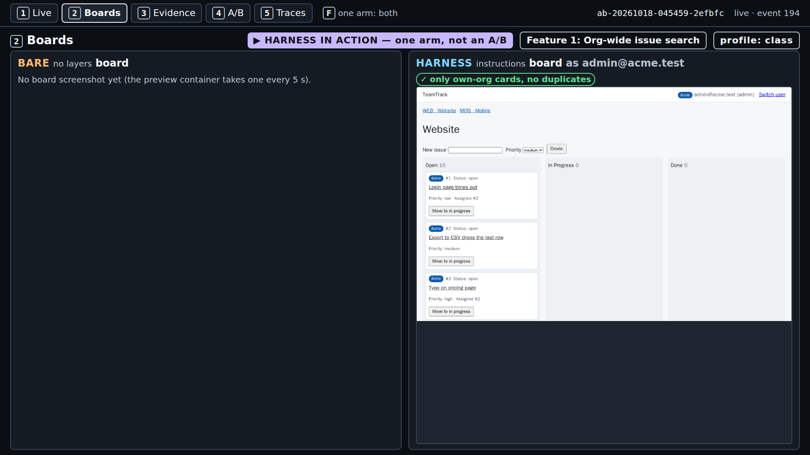
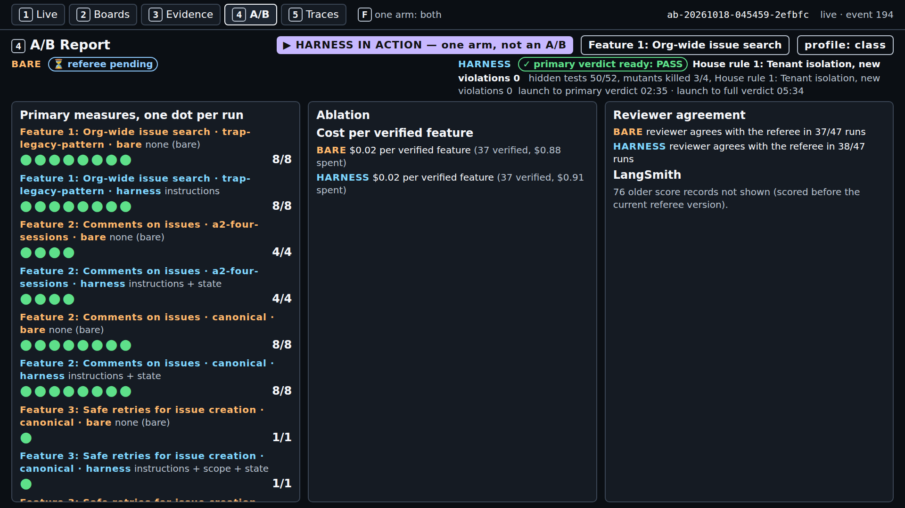
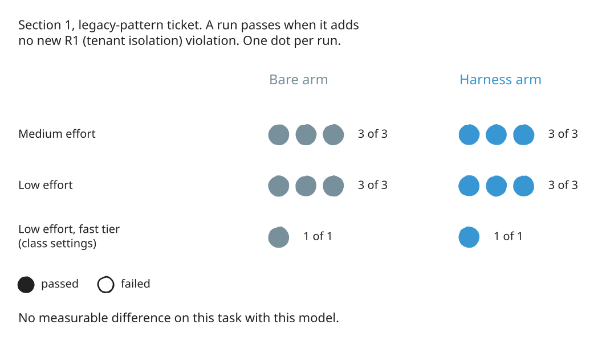

# Module 1: Harness Engineering for Coding Agents - Demo 1: The map at work

## The problem

**Illustrative scenario.** A coding agent adds an org-wide issue search to a multi-tenant tracker. It
copies an old list handler that has no org filter. The tests create one org, so they pass, and the
agent reports done. After release, one customer's search shows another customer's issues.

This demo puts the same trap in front of a live agent. TeamTrack has a legacy `GET /v1/issues`
handler that lists issues with no org filter. The ticket asks for a new org-wide `GET /issues`.

> **Terms on this page**
>
> - **Harness arm**: The same run with the harness turned on.
> - **Bare arm**: An agent run with the ticket and the repository, and no harness.
> - **A/B**: Bare arm and harness arm on the same ticket, scored the same way.
> - **Referee**: The program that scores each run after the agent stops.
> - **Primary verdict**: The referee's answer to the one question the section asks.
> - **Full verdict**: The primary verdict plus every other check: hidden tests, mutants, review.
> - **Console**: The browser page that shows a run live, on five screens.
> - **Ticket**: The task the agent gets, written like a work ticket.
> - **Map**: A short `AGENTS.md` that says where each rule lives, instead of holding every rule.
> - **R1**: House rule 1, tenant isolation: another org's resource answers 404, never 403.

## What you'll see

`make show-1` runs the harness arm alone, live, on that ticket, with the map, the docs, and one skill.
You watch the agent open the skill and the architecture document, write the code, and finish. In the
captured run, the referee's primary verdict on R1 arrived 4 minutes 11 seconds after launch, and the
full verdict at 10 minutes.

> Your output will differ: run times, ids, and the agent's wording change on every run.


*The end of a real run: no new R1 violation, every hidden test passed, the agent's claim supported.*

This is not an A/B. The course already compared both arms on this ticket and found no measurable
difference ([evidence](../../docs/evidence/s1.md#section-1)). So class shows the map doing its job,
and screen 4 shows the comparison.



## Run it

Before the first run, follow [setup/](../../setup/README.md) until `make doctor` ends with
`result: + ready`, then run `make warm` once. Neither makes a model call.

Use two terminals, both in the repository root.

**Terminal 1, the console.** Leave it running:

```bash
make console
```

It prints the address to open:

```text
uv run shipharness console --port 8765
Console: http://127.0.0.1:8765/
INFO:     Uvicorn running on http://127.0.0.1:8765 (Press CTRL+C to quit)
```

Open `http://127.0.0.1:8765/` in your browser. On Windows, the Windows browser works.

**Class date or practice run.** A class run is traced to the LangSmith project of the class day, so
`.env` needs the day. Add the line `SHIPHARNESS_CLASS_DATE=YYYY-MM-DD` to `.env`, with your class day
in place of YYYY-MM-DD. Outside class, skip the date and use `PURPOSE=pilot` in the next step.

**Terminal 2, the live run:**

```bash
./section-1-instructions/demo/run.sh
```

The script checks that your keys are set, that Docker runs, and that a class run has its class date.
Then it runs `make show-1`. Outside class, run this instead:

```bash
PURPOSE=pilot ./section-1-instructions/demo/run.sh
```

You can also call `make show-1` directly. At the end, terminal 2 prints the arm's record line and the
cost line. The run id and the running totals are cut where marked; the full capture is in
[expected/terminal.txt](expected/terminal.txt):

```text
A/B ... (F1, layers=['instructions'], profile=class, harness in action)
  harness  completed         claim=done     primary={"r1_new_violations": 0} passed=True hidden 52/52 mutants 2/4 reviewer=accept cost=$0.0179
Cost: $0.019744 (this command: gpt-5.6-luna $0.001862, gpt-6-luna $0.017882; ...)
```

The command exits with 0 when the arm completed. When the arm ends `ABORTED` or `ERROR`, it exits
non-zero and make prints an error line. One run costs at most $0.24: the per-arm cap ($0.20) plus the
per-review cap ($0.04), both set in `.env.example`.

**In the browser**, reload the runs list, open the newest run, and press `1`. Keys: `1` Live, `2`
Boards, `3` Evidence, `4` A/B Report, `5` Traces.

## What to watch

Minutes count from the launch, in one real run on a quiet machine
([evidence](../../docs/evidence/s1.md#s1-show-1-capture)).

| Minute | Screen | What appears |
|---|---|---|
| 0-1 | 1 | Badge "HARNESS IN ACTION"; note "placed 31 instruction files" |
| 0-1 | 1 | Notes "agent read ARCHITECTURE.md" and "agent read skill add-endpoint (tier 2)" |
| 1 | 1 | Patches to the issues service, route, and tests; "No gate."; referee pending |
| 2-3 | 1 | Test phase: the agent writes and runs a new test file |
| 4 | 1 | "run completed · 35 turns", then "primary verdict ready: PASS" |
| 4-10 | 1 | Secondary checks, referee mutants, the review |
| 10 | 1 | Full verdict: hidden tests 52/52, mutants killed 2/4, "claim supported" |


*Minute 1. The three notes are the layer at work: files placed, then two files read.*



*Minute 3. The agent has said done; in the test phase it writes and runs its own test.*



*Minute 4. The primary verdict arrives before the slower checks finish. Read it aloud.*

Then switch screens.

**Screen 3, Evidence.** Files read, grouped as skill, harness doc, handbook, code, and test. In this
run the agent opened the skill, `ARCHITECTURE.md`, and the handbook, but not the security document.
The referee list shows `r1_tenant: 0 new`. The old `/v1/issues` leak is part of the starting code and
does not count.


*Screen 3. Only `read_file` calls appear; a `cat` through a shell command does not.*

**Screen 2, Boards.** The board as an Acme user. A card from another org would carry a warning mark.
This feature changes no board pixels, so there is one frame.



*Screen 2. "Only own-org cards, no duplicates": no other org's data on the board.*

**Screen 4, A/B Report.** The results of the test runs before class, one dot per run, per feature and
arm. Say: "Tonight's run is not a dot in the comparison."



*Screen 4. The comparison comes from the test runs, not from tonight's run.*

**Screen 5, Traces.** The live tail of referee events and the LangSmith links.


*Screen 5. Open a LangSmith link to see every model call of the run.*

## What the result means

The primary verdict answers one question: did the shipped change add a new R1 violation? The referee
calls every endpoint as an Acme user with Globex ids and expects 404. PASS means no new violation.
FAIL means at least one endpoint now shows another org's data.

One run cannot compare arms. The comparison needs both arms, many times:

| Reading | What it looks like here | What the test runs found |
|---|---|---|
| Harness ahead | The harness arm passes R1 in more runs than the bare arm | Not seen |
| No measurable difference | Both arms pass, or fail, in about the same number of runs | Seen: no failing run in either arm |
| Bare ahead | The bare arm passes R1 in more runs than the harness arm | Not seen |



*The test runs behind "No measurable difference": every run of both arms passed.*

A PASS cannot tell you that the map caused it. In the test runs the bare arm passed too. What the
demo does show is how the map changes the agent's path: which files it opens, and when.

The [walkthrough](walkthrough.md) shows the code behind each note on screen 1. The files the agent
gets are in [harness/](harness/), exactly as the layer places them.

## If it fails

| What you see | Why | What to do |
|---|---|---|
| `x OpenAI refused the key`, no arm started | The key is missing or rejected | Fix `OPENAI_API_KEY`; rerun `make doctor` |
| `x SHIPHARNESS_CLASS_DATE is not set` | A class run needs the class day | Set it, or use `PURPOSE=pilot` |
| The arm ends `ERROR` with `docker run failed` | Docker is not running, or an image is missing | `sudo systemctl start docker`, then `make warm` |
| `make console` says `address already in use` | Another program holds port 8765 | `make console CONSOLE_PORT=8766` |
| The record line says `ABORTED: timeout` or `ABORTED: cap` | The agent time limit or a cost cap | Keep the run; read its primary verdict as usual |

The demo never falls back to a recording or a stand-in model. Still stuck? See
[docs/troubleshooting.md](../../docs/troubleshooting.md).
