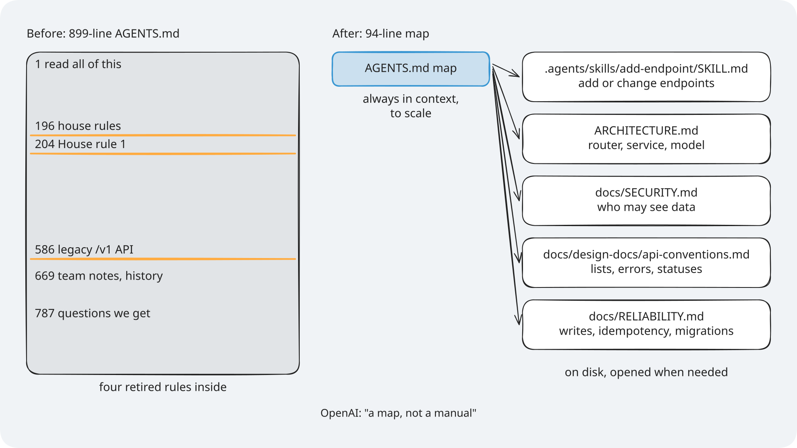
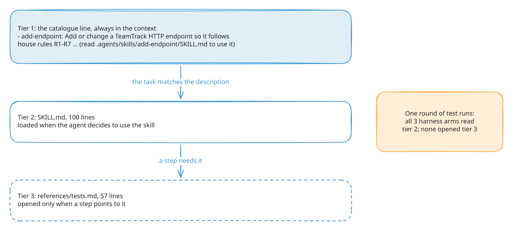
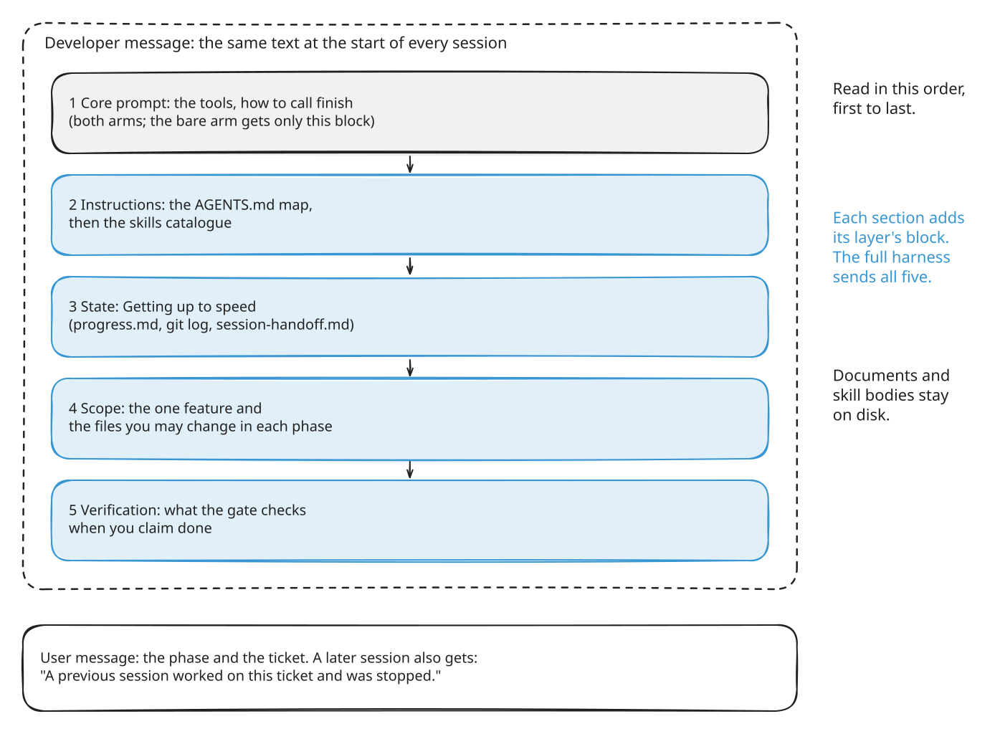

# Module 1: Harness Engineering for Coding Agents - Section 1 diagrams

The diagrams for Section 1, the instructions layer. Each one has an `.excalidraw` source, a `.png`
at 2x for slides, and an `.svg` with the font embedded for pages. Colours, step frames, editing,
and licences are explained once, in [the course diagrams guide](../../docs/diagrams/README.md).

> **Terms on this page**
>
> - **Bare arm**: An agent run with the ticket and the repository, and no harness.
> - **Harness arm**: The same run with the harness turned on.
> - **Map**: A short `AGENTS.md` that says where each rule lives, instead of holding every rule.
> - **Context prefix**: The fixed text block sent at the start of every agent session.
> - **R1**: House rule 1, tenant isolation: another org's resource answers 404, never 403.

## The diagrams

### Manual or map

*The tenant rule sits at line 204 of the manual; the map is drawn to scale and names the file that holds it.*

- **What it teaches**: why a short map in the context beats one long instruction file.
- **Slide topic**: a map, not a manual.
- **Files**: `manual-vs-map`.
- **Source**: `section-1-instructions/assignment/starter/original/AGENTS.md` (899 lines) and
  `platform/teamtrack/harness/instructions/AGENTS.md` (94 lines).

### Skills in three tiers

*Only the one catalogue line is always in the context; the body and its files load when needed.*

- **What it teaches**: progressive disclosure in Agent Skills, with TeamTrack's `add-endpoint` skill.
- **Slide topic**: skills load in three tiers.
- **Files**: `skills-three-tiers`.
- **Source**: `platform/teamtrack/harness/instructions/.agents/skills/add-endpoint/`, the catalogue
  line format in `platform/src/shipharness/runner/skills_loader.py`, and what each arm read in
  [the Section 1 evidence](../../docs/evidence/s1.md).

### The context prefix

*The bare arm gets only block 1; each section adds its layer's block, in this order.*

- **What it teaches**: what the agent sees first in every session, and in what order.
- **Slide topic**: what the agent sees first.
- **Files**: `context-prefix`.
- **Source**: `base_items` in `platform/src/shipharness/runner/loop.py` and the layer order in
  `platform/src/shipharness/harness/base.py`.

### Section 1 results

*All 7 runs of each arm passed: no measurable difference on this task with this model.*

- **What it teaches**: how to read a result as dots, one per run.
- **Slide topic**: what we measured in Section 1.
- **Files**: `results-s1`.
- **Source**: [the Section 1 evidence](../../docs/evidence/s1.md).
