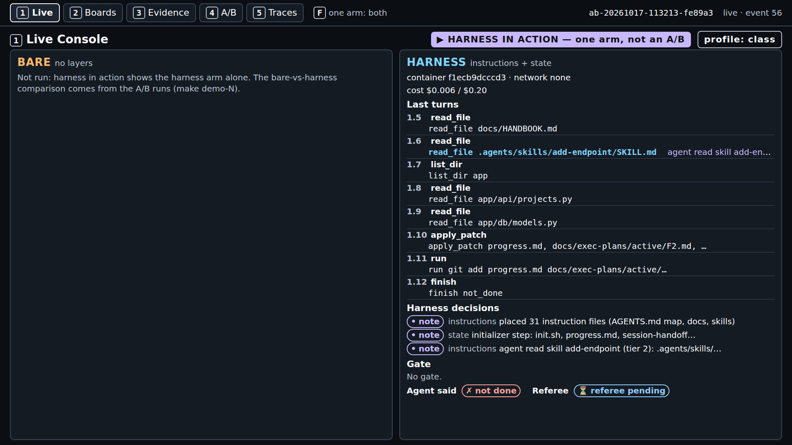
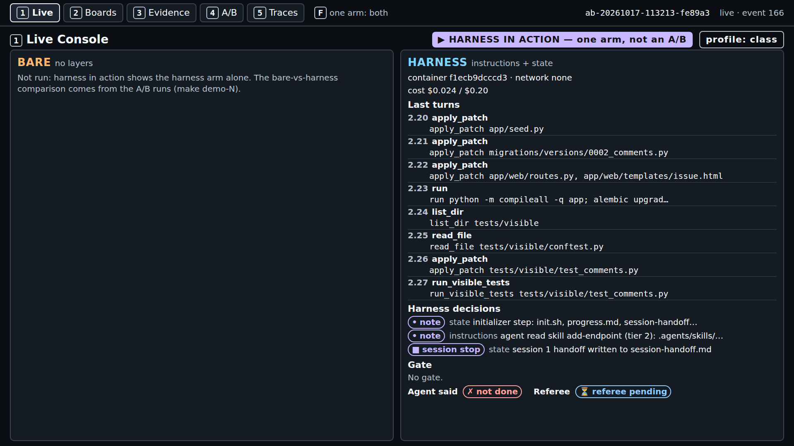
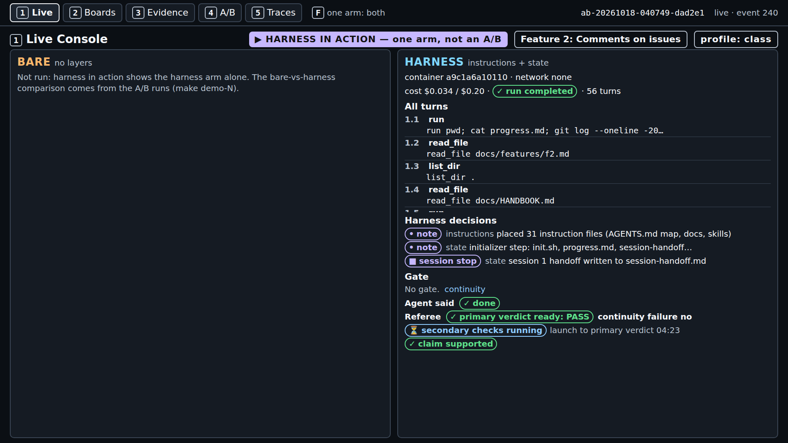

# Module 1: Harness Engineering for Coding Agents - Demo 2: What one real run looked like

This folder holds the output and the screenshots of one real `make show-2 SESSION_BUDGET=12,38`
run, on a quiet machine, with the class settings. Nothing here is staged or edited, except where a
line says it was cut. Use it to check that your run looks roughly like this one, or to follow the
demo without running it. When and how it was captured is in the
[evidence page](../../../docs/evidence/s2.md#s2-show-2-capture).

> **Terms on this page**
>
> - **Referee**: The program that scores each run after the agent stops.
> - **Primary verdict**: The referee's answer to the one question the section asks.
> - **Full verdict**: The primary verdict plus every other check: hidden tests, mutants, review.
> - **Continuity failure**: Two migration heads, a table created twice, or 30% or more of session 1's lines redone in session 2.
> - **Structured handoff**: A file that carries the last session's state and the next steps to the next session.
> - **Hidden tests**: Tests the referee runs that the agent never sees.
> - **Mutant**: A copy of the code with one small bug planted on purpose; good tests catch (kill) it.
> - **Harness note**: A line a harness layer adds to screen 1, such as "session 1 handoff written to session-handoff.md".

## Terminal output

| File | What it holds |
|---|---|
| `terminal.txt` | The end of terminal 2: record line, cost line, wall time |
| `session-1-notes.txt` | The notes the agent left in the handoff before the stop |
| `session-2-first-call.txt` | Session 2's first command and the start of what it read |

The run id and the running cost totals are cut from `terminal.txt` where it shows `...`.

The run used the agent time limit of that day, 300 s. The class profile now allows 420 s, so your
run may get further before it stops.

## Screenshots

> Your output will differ: run times, ids, and the agent's wording change on every run.

*Minute 1: notes for the map and the initializer step; turns 1.10 to 1.12 are the wrap-up.*

*Minute 2: the stop marker, the handoff note, and session 2 reading the state files first.*

*Minute 4: one migration, `0002_comments.py`, written in session 2.*

*Minute 7: the agent time limit ends the run; the continuity check passes at 06:46.*

*The end: hidden tests 56/56, mutants killed 0/4, full verdict at 09:52.*

*Screen 2: only own-org cards, no duplicates. The comments panel is on the issue page.*

*Screen 3: two sessions, `continuity: 0 new`, `r7_migrations: 0 new`, and `diff_scope: 1 new`.*

*Screen 4: the test runs before class. This run's verdict is at the top, not a dot.*

*Screen 5: the scope check names turn 2.16, an edit to `app/api/issues.py`, as the first wrong turn.*
