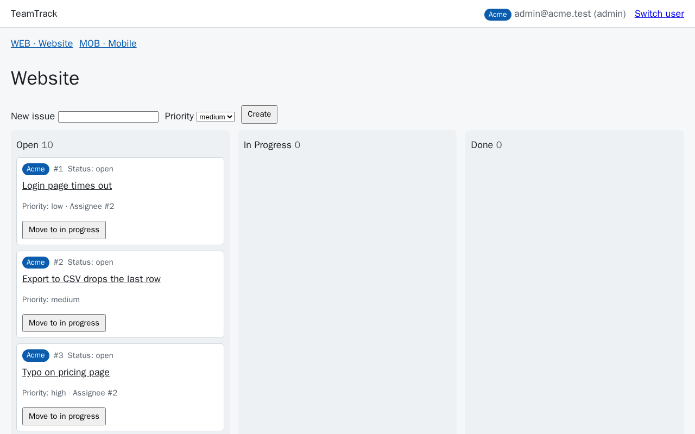

# Module 1: Harness Engineering for Coding Agents - Demo 3: what real runs looked like

This folder holds the output and the screenshots of the three real `make demo-3
FEATURE=version-checks` A/Bs the course ran on 2026-10-18 with the class settings (run ids on the
[evidence page](../../../docs/evidence/s3.md#s3-demo-capture)). Nothing here is staged
or edited, except where a line says it was cut. Use it to check that your run looks roughly like
these, or to follow the demo without running it. When and how each file was captured is in the
[evidence page](../../../docs/evidence/s3.md#s3-demo-capture).

> **Terms on this page**
>
> - **Bare arm**: An agent run with the ticket and the repository, and no harness.
> - **Harness arm**: The same run with the harness turned on.
> - **Primary verdict**: The referee's answer to the one question the section asks.
> - **Out-of-scope file**: A file in the shipped diff that matches none of the allowed paths.
> - **Block**: A patch the scope layer refuses before anything is written; the agent sees `BLOCKED`.

## Terminal output

| File | What it holds |
|---|---|
| `terminal.txt` | Demo run 1: the command, both record lines, the cost line, start and end |

The start and end lines (with the wall time) are the capture script's. The running cost
totals are cut from `terminal.txt` where it shows `...`.

## Screenshots

Screens 1 to 5 come from demo run 1. The two extra screen 3 captures
come from demo runs 2 and 3. All were taken after the runs ended, from `make console`, which serves
recorded runs.

> Your output will differ: run times, ids, and the agent's wording change on every run.

*Screen 1: both arms FAIL the version checks feature's own measure (bare 68 hidden tests and 4 mutants, harness 62 and 0); primary verdicts at 04:49 and 06:10.*

*Screen 2: only own-org cards on both boards; the bare arm detects the two-tab edit conflict, the harness arm's tab B gets an error.*

*Screen 3: `app/services/errors.py` changed by the bare arm, blocked for the harness arm; `diff_scope` 1 new and 0 new.*

*Demo run 2: the same file changed by the bare arm and blocked for the harness arm.*

*Demo run 3: the bare arm stopped early and stayed in the allowed paths; the harness arm tried no out-of-scope edit. `diff_scope` 0 and 0.*

*Screen 4: one dot per run on each feature's own measure; the test runs before class.*

*Screen 5: the bare arm's first wrong turn is its edit of the shared file (turn 1.15); the harness arm's is the refused patch (turn 1.14).*

## Board frames

The referee captures these itself while it scores each arm (demo run 1).

*The bare arm's board: the Acme user sees only Acme cards.*

*The harness arm's board: the same view.*

*Bare arm: tab B's stale save gets HTTP 409 and the conflict page.*

*Harness arm: tab B's save gets HTTP 500, from a bug in the arm's own board code.*

The 500 is a result, not a capture problem. The harness arm added the `version` form field to `create_issue` instead of `edit_issue`, so every board save fails inside `edit_issue`. Its API tests passed because only the board form uses that route.
