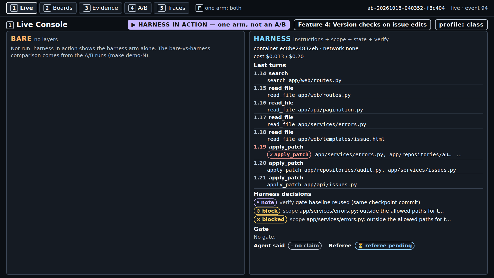
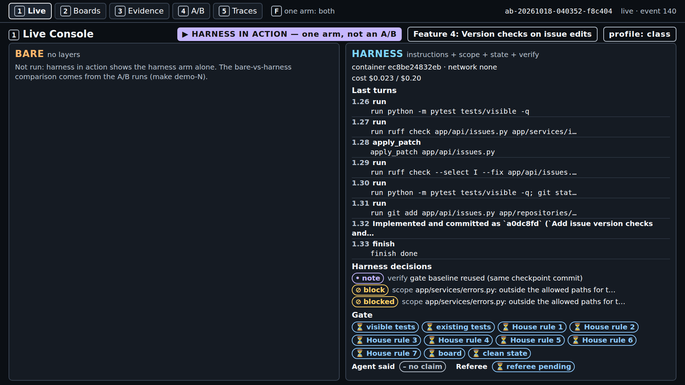
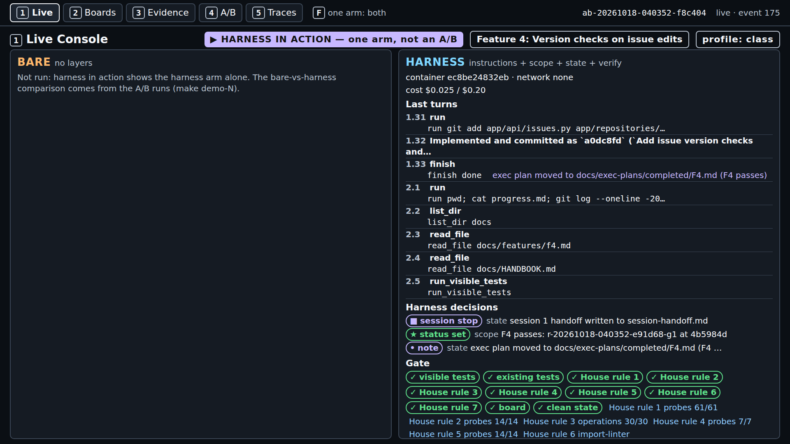
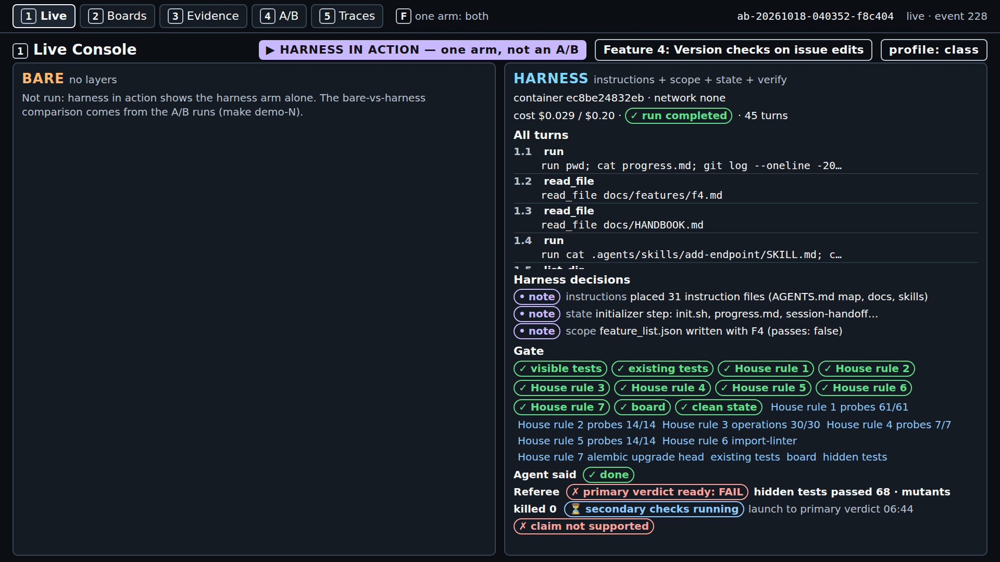
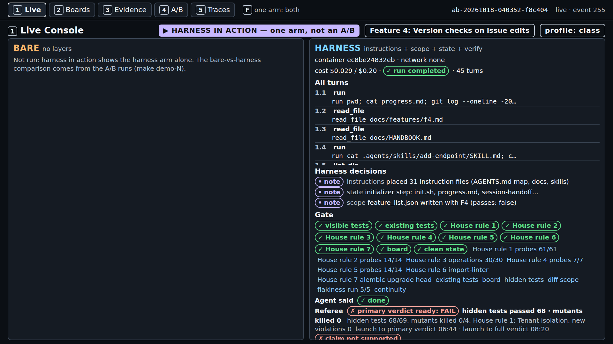
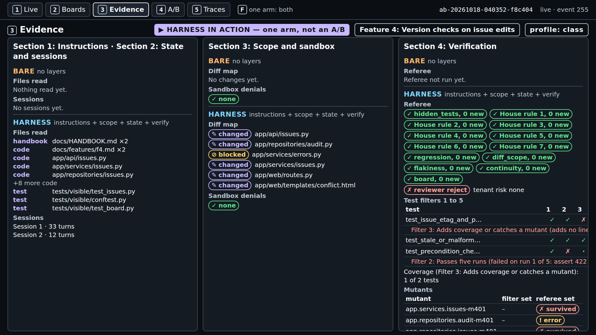
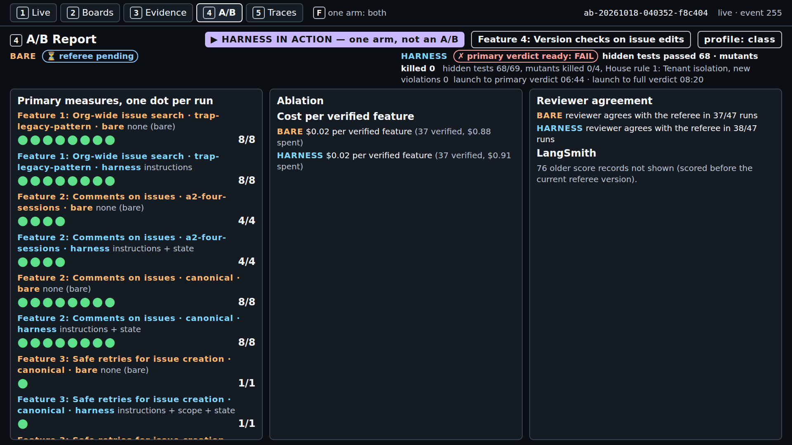
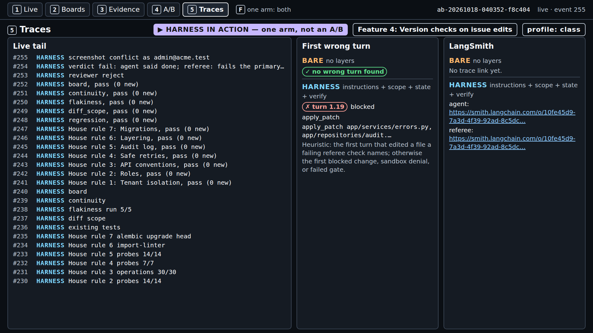

# Module 1: Harness Engineering for Coding Agents - Demo 4 expected output

This folder holds the output and the screenshots of one real `make show-4` run, run on 2026-10-18
with the class settings (run id on the
[evidence page](../../../docs/evidence/s4.md#s4-show-4-capture)). Nothing here is
staged or edited, except where a line says it was cut. Use it to check that your run looks roughly
like this one, or to follow the demo without running it. When and how it was captured is in the
[evidence page](../../../docs/evidence/s4.md#s4-show-4-capture).

> **Terms on this page**
>
> - **Verify gate**: The checks that run in the agent's container when it claims done; a failure sends the claim back.
> - **Test filters**: Five checks a test from the test phase must pass to be kept.
> - **Referee**: The program that scores each run after the agent stops.
> - **Primary verdict**: The referee's answer to the one question the section asks.
> - **Full verdict**: The primary verdict plus every other check: hidden tests, mutants, review.
> - **Referee mutants**: Planted faults the agent never sees; the referee counts how many the shipped tests catch.

## Terminal output

| File | What it holds |
|---|---|
| `terminal.txt` | The command, the record line, the cost line, the start and end lines |

The start and end lines (with the wall time) are the capture script's. The running cost
totals are cut from `terminal.txt` where it shows `...`.

## Screenshots

The screenshots were taken after the run, from `make console`, which serves recorded runs. The
minute screens show the console fed with the run's log up to that point of the console clock.

> Your output will differ: run times, ids, and the agent's wording change on every run.

*Minute 1: turn 1.19 tries to patch `app/services/errors.py`, outside the allowed files, and is blocked.*

*Minute 2.5: `finish done` at turn 1.33. Every gate pill is pending; the referee has not started.*

*Minute 3: all eleven items pass, the scope layer sets `passes`, and session 2, the test phase, begins.*

*Minute 7: the referee's primary verdict is FAIL while the secondary checks still run.*

*The end: 45 turns, hidden tests 68/69, mutants killed 0/4, primary verdict at 06:44, full at 08:20.*

*Screen 2: tab B's stale save gets HTTP 409, so the board stops the lost update.*

*Screen 3: of three filtered tests, one kept after five filters; one stopped at Filter 3: Adds coverage or catches a mutant, one at Filter 2: Passes five runs.*

*Screen 4: the test runs before class, one dot per run. This run's verdict is at the top, not a dot.*

*Screen 5: the first wrong turn is the blocked write at turn 1.19; LangSmith links for agent and referee.*
