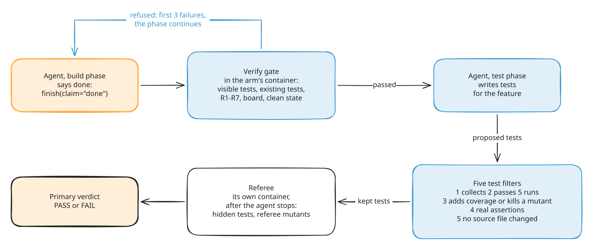
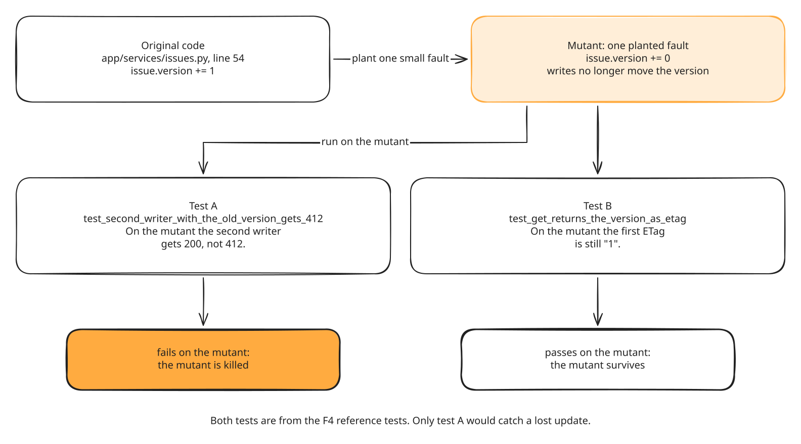
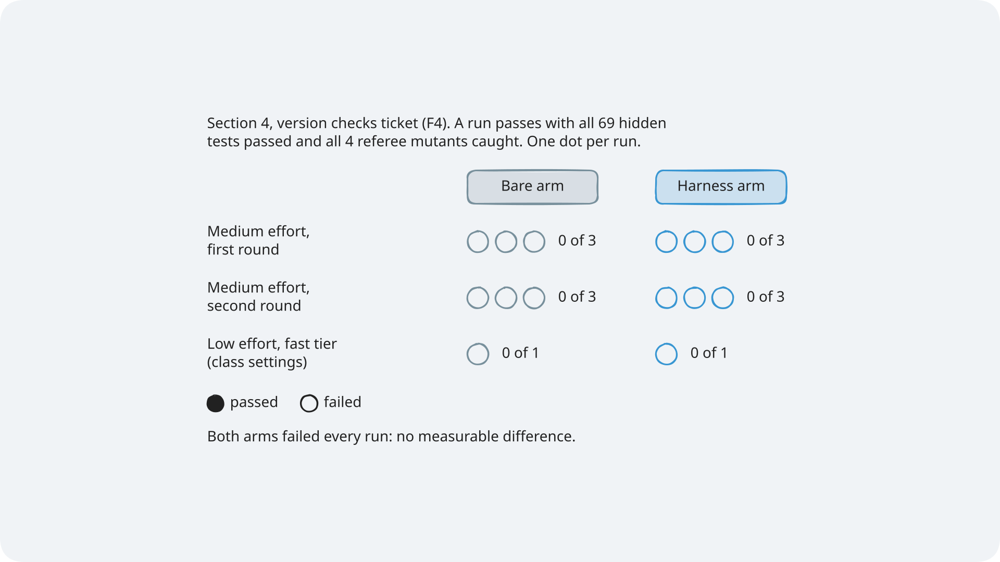

# Module 1: Harness Engineering for Coding Agents - Section 4 diagrams

The diagrams for Section 4, the verification layer. Each one has an `.excalidraw` source, a `.png`
at 2x for slides, and an `.svg` with the font embedded for pages. Colours, step frames, editing,
and licences are explained once, in [the course diagrams guide](../../docs/diagrams/README.md). The
F4 ticket diagram, `optimistic-concurrency`, is in that folder too, because Section 3 uses it as
well.

> **Terms on this page**
>
> - **Done claim**: The agent's call `finish(claim="done")`, which says the phase's work is complete.
> - **Verify gate**: The checks that run in the agent's container when it claims done; a failure sends the claim back.
> - **Test filters**: Five checks a test from the test phase must pass to be kept.
> - **Mutant**: A copy of the code with one small planted fault; a test that fails on it catches it.
> - **Referee mutants**: Planted faults the agent never sees; the referee counts how many the shipped tests catch.

## The diagrams

### The verification pipeline

*The agent's claim starts the checks; it never ends them.*

- **What it teaches**: the four checks, in the order they run, and who owns each one.
- **Slide topic**: from done claim to verdict.
- **Files**: `verification-pipeline`, with step frames `verification-pipeline-step-1` to
  `verification-pipeline-step-6`.
- **Source**: `platform/src/shipharness/harness/verify/gate.py` and the five filters in
  `section-4-verification/concepts.md`.

### Mutation testing

*Test B passes on the broken code, so it would not catch a lost update; test A would.*

- **What it teaches**: what "a test catches a mutant" means, on a real F4 referee mutant.
- **Slide topic**: tests that prove something.
- **Files**: `mutation-testing`.
- **Source**: the F4 referee mutants in `platform/teamtrack/mutants/features/f4.jsonl` and the
  tests in `platform/teamtrack/reference/f4/f4.patch`.

### Section 4 results

*Both arms failed all 7 runs: no measurable difference on this task with this model.*

- **What it teaches**: a hard ticket on which no arm passed the primary measure.
- **Slide topic**: what we measured in Section 4.
- **Files**: `results-s4`.
- **Source**: [the Section 4 evidence](../../docs/evidence/s4.md).
