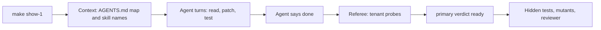
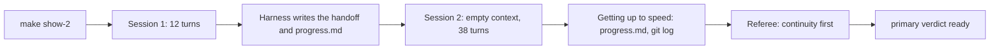
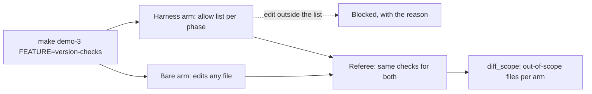
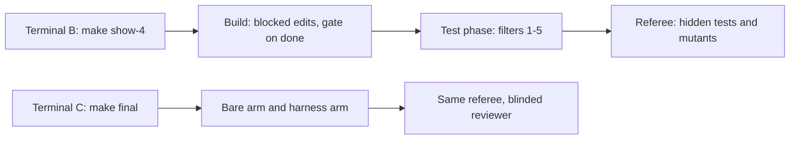
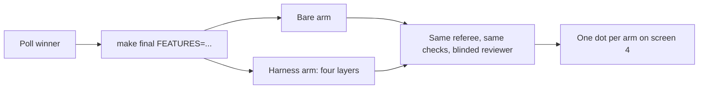

<!--
deck.md: the source of the Module 1 slides. `make slides` (platform/scripts/build_slides.py) turns it into
slides/dist/deck.html, deck.pdf, and deck.pptx. This file is the single source of the slide content;
slides/outline.md holds only the block table and the class plan per section.

Format, one block per slide:

  ## 12. Slide title              starts a slide: number, a dot, the title (numbers run 1-72)
  section: Section 1: Instructions  required; shown in the header
  minutes: 2.5                    speaker timing; the build prints the total per section
  layout: title                   optional: default (the usual), title, or statement (one big line)
  subtitle: One line              optional, under the title
  diagram: architecture now=L1    the recurring diagram defined below, with nodes highlighted
  image: images/board.png         a picture, path relative to this folder (must exist)
  code: S1:prefix 10-19           lines of a walkthrough anchor (platform/scripts/anchors.py), e.g. 1-4,9-12;
                                  left-out lines show as "..."; at most 12 code lines per slide
  slot: s1_dots                   a result slot, empty until filled from run data:
  slot: s1_dots = 3 of 10 failed  text, or an image path such as images/s1-dots.png
  live: the room's poll result    a value produced in class, shown as "Filled in live: ..."

  - Bullet text, 3 to 6 per slide, `code` in backticks
    a line indented under a bullet continues it

  An open-item marker is the word PENDING (a missing piece) or CAPTURE (output still to be copied
  in from a real run), a colon, and the item, all inside double square brackets. It shows as an
  amber box on the slide (or stays in the notes) and fails the strict build.

  ```mermaid                      an inline Mermaid diagram for this slide only
  flowchart LR
    A --- B
  ```

  notes:
  Speaker notes until the next "## N." line. The build adds "Slide N of 72 | section | minutes"
  at the top of the PPTX notes.

Writing rules: docs/STYLE.md (plain short sentences, counts not percentages, "Kind N: name" on
first use per slide).
Run ids, A/B ids, finding ids, and commit hashes stay out of this file: numbers on the slides come
from the runs listed in docs/evidence.md. Slide text cites a source as "Source N"; the notes link
its title, and the numbered Sources list at the end of this file gives each one in full. The rounds are named by their settings: the medium-effort round, the
low-effort round, the class-settings round (one A/B per section, class profile), and the Section 3
confirmation (three A/Bs on the Feature 4 ticket, class profile with the 420 s agent time limit). Console
screenshots in img/ come from timed runs of the class commands on 2026-10-17, cut to the panels
that matter; slides/outline.md lists which run each one shows.
-->

::: diagram architecture
flowchart LR
  TK["Same ticket, model, tools, budgets"] --> BA["Bare arm: agent loop"]
  TK --> HA["Harness arm: agent loop"]
  HA --- L1["Section 1: Instructions"]
  HA --- L2["Section 2: State and sessions"]
  HA --- L3["Section 3: Scope and sandbox"]
  HA --- L4["Section 4: Verification"]
  BA --> SB1["Sandbox"]
  HA --> SB2["Sandbox, identical"]
  SB1 --> REF["Referee: same checks, fresh container"]
  SB2 --> REF
  REF --> CON["Console and report"]
  classDef now stroke-width:5px,stroke:#0b1f33
:::

## 1. Module 1: Harness Engineering for Coding Agents
section: Opening
minutes: 0.5
layout: title
subtitle: Instructions, state, scope, and verification: what each piece assumes about the model, and how to measure it

- Course repository `shipharness`

notes:
Welcome. Tonight you see each harness piece at work on a real feature. You see the results of the
runs we made before class. Section 3: Scope and sandbox and the final are live A/Bs: both arms, side by side.
Everything you see is in the course repository.

Guide: docs/instructor-guide.md, "Section by section", Opening.

## 2. The problem: four failures to check for
section: Opening
minutes: 2.5

- Cross-tenant data: an Acme user sees Globex issues
- A second session that redoes or breaks the first
- Edits outside the ticket
- The agent's own tests pass while the behaviour is wrong
- The referee checks every run for all four, in both arms

notes:
Read the four failures. Then say: "Before class, no bare arm on the issue-search ticket shipped a
new tenant leak, so there is no screenshot of one to show. We come back to what that means at the
end." Runs: docs/evidence.md, Section 1: Instructions.

Guide: docs/instructor-guide.md, "Section by section", Opening.

## 3. Why it happens: four causes
section: Opening
minutes: 2

- "anything it can’t access in-context while running effectively doesn’t exist" (Source 1)
- "each new session begins with no memory of what came before." (Source 2)
- Agents copy patterns and take hard-to-undo actions: four sources, side by side (Section 3: Scope and sandbox)
- "agents reliably skew positive when grading their own work" (Source 3)

notes:
One sourced line per cause. Cause 3 has no single source that says both halves, so Section 3 shows
its four sources side by side and does not merge them. Cause 4 also has a second source: in
Source 4, the visible suite passes while held-out tests (tests kept from the agent) that combine
features fail.

Guide: docs/instructor-guide.md, "Section by section", Opening.
Sources: [Harness engineering](https://openai.com/index/harness-engineering/); [Effective harnesses for long-running agents](https://www.anthropic.com/engineering/effective-harnesses-for-long-running-agents); [Harness design for long-running application development](https://www.anthropic.com/engineering/harness-design-long-running-apps); [SpecBench](https://arxiv.org/abs/2605.21384).

## 4. A harness encodes assumptions about the model
section: Opening
minutes: 2
diagram: architecture now=L1,L2,L3,L4,SB1,SB2

- The work: "design environments, specify intent, and build feedback loops" (Source 1)
- "every component in a harness encodes an assumption about what the model can't do on its own" (Source 3)
- Assumptions change with the model: the same author later dropped context resets
- Four parts, Sections 1 to 4, plus a sandbox that is the same for both arms
- The course's claim: measure each piece, keep what earns its place

notes:
The Anthropic sentence goes on: "and those assumptions are worth stress testing". The OpenAI
article never defines "harness engineering", so no definition is attributed to it. The thick borders
and the word "now" mark all four parts and the sandbox. "Keep what earns its place" is how this
course puts it.

Guide: docs/instructor-guide.md, "Section by section", Opening.
Based on: Source 1; Source 3.

## 5. shipharness, TeamTrack, console
section: Opening
minutes: 1.5
code: Opening:two_arms 5-9,11-15,19

- `shipharness`: run an agent with or without the harness, A/B it, judge it
- TeamTrack: a multi-tenant issue tracker with two orgs, Acme and Globex
- Console: five screens on keys `1` to `5`, `F` for full screen per arm

notes:
The code starts both arms at the same time. Each arm is judged by the same referee as soon as it
finishes. The finally block is folded. Show `Opening:publish` in the editor only.

Guide: docs/instructor-guide.md, "Section by section", Opening.
Source: anchor Opening:two_arms (platform/src/shipharness/ab/demo.py).

## 6. How we measure it
section: Opening
minutes: 1

- Same agent, model, effort, task, repository, tools, sandbox, turn limit, and cost cap
- One referee judges what ships, the same way for both arms
- The seven house rules: the course's name for OpenAI's "golden principles"
- One primary measure per section, registered before any run; results are counts
- No gap is reported as "no measurable difference on this task with this model"
- One piece at a time: "removing one component at a time" (Source 3)

notes:
The bare arm gets every rule in docs/HANDBOOK.md; nothing is withheld. A section's A/B tests the
harness so far against the bare arm. Only taking one piece out tests that piece. The full sentence:
"removing one component at a time and reviewing what impact it had on the final result."
"Registered" means written down before any run, so a result cannot change the question.

Guide: docs/instructor-guide.md, "Section by section", Opening.
Sources: platform/teamtrack/docs/HANDBOOK.md (the seven house rules); platform/datasets/README.md;
Source 3.

## 7. Check your setup
section: Opening
minutes: 0.5
live: `make doctor` output and the `harness-setup` assessment of the bare TeamTrack

- Run `make doctor` now
- Run the `harness-setup` assessment on the bare TeamTrack
- Read the gaps it reports: instructions, state, scope, verification

notes:
Run both live. The assessment reads files only and makes no model calls. Before class, the class
date was set and `make warm` ran: it builds the images if their source changed, starts each image
once, and caches the referee and gate baselines, so the first launch does not pay for start-up.

Guide: docs/instructor-guide.md, "Thirty minutes before".
Source: Makefile `doctor`, `warm`; use-in-your-repo/skills/harness-setup/scripts/assess.py.

## 8. Poll
section: Section 1: Instructions
minutes: 3
live: the room's poll result

- Feature 1: Org-wide issue search; rule at risk: House rule 1: Tenant isolation
- The ticket: a legacy handler without the tenant filter sits next to the right pattern
- Before class, 7 bare-arm runs took this ticket. How many shipped a new tenant leak?
- A) 0-1   B) 2-3   C) 4-5   D) 6-7
- Close the poll before the launch

notes:
The answer comes on slide 20. The 7 runs: the medium-effort round (3), the low-effort round (3),
and the class-settings round (1), all on the legacy-pattern ticket.

Guide: docs/instructor-guide.md, "Section by section", Section 1.

## 9. Launching harness in action: Feature 1: Org-wide issue search
section: Section 1: Instructions
minutes: 2

- Now: run `make show-1` in terminal B; it runs during slides 10-18, back on slide 19
- Harness in action: the harness arm alone on Feature 1, live; not an A/B
- Watch for: which documents does it open before it writes code?
- The referee judges it live: tenant probes first ("primary verdict ready"), then the other checks



notes:
Reload the console's run list and open the newest run. Stay on screen 1 while the container starts.
Why no live A/B here: before class this ticket showed no gap (slide 20), so the class shows the layer at
work instead, live.

Timing: in a timed run on 2026-10-17, before class (agent time limit then 300 s; now 420 s), the primary verdict
came 4:11 after launch and the full verdict 10:00 after launch. Cost $0.0197. Your output will
differ. Runs: docs/evidence.md, Captures.

Guide: docs/instructor-guide.md, "Section by section", Section 1.
Source: Makefile `show-1`; platform/teamtrack/reference/f1/task.toml.

## 10. Section 1: Instructions, what the agent knows
section: Section 1: Instructions
minutes: 1.5
diagram: architecture now=L1

- Why an agent does not apply a rule that lives only outside its context
- Knowledge as a short AGENTS.md map into `docs/`, plus skills that load in tiers
- How to read the Section 1 result: new tenant leaks per run, bare arm against harness arm
- The assumption the map encodes: the model will not apply a rule it has not been pointed to

notes:
The first three bullets are the section's objectives. The one-line assumption is the course's
wording. Tonight's question: does it hold for this model on this ticket?

Guide: docs/instructor-guide.md, "Section by section", Section 1.

## 11. Problem: the rule is written down, the agent does not apply it
section: Section 1: Instructions
minutes: 2

- The ticket builds `GET /issues`, Feature 1: Org-wide issue search
- House rule 1: Tenant isolation: another org's resource is 404, never 403
- The rule is in `docs/HANDBOOK.md`, and both arms can read it
- Nothing is withheld from the bare arm

notes:
Both arms get every rule. The question is not whether the rule exists, but whether the agent
applies it.

Guide: docs/instructor-guide.md, "Section by section", Section 1.
Source: platform/teamtrack/docs/HANDBOOK.md (House rule 1); platform/teamtrack/docs/features/f1.md.

## 12. Cause: what is not in context does not exist
section: Section 1: Instructions
minutes: 2.5

- "anything it can’t access in-context while running effectively doesn’t exist"
- "A giant instruction file crowds out the task, the code, and the relevant docs"
- "Too much guidance becomes non-guidance."
- A long manual goes stale, and no check can keep it true
- Agents copy patterns that already exist, even uneven ones

notes:
Cause 1 from the opening. All five lines are from Source 1. A handbook the agent
never opens does not exist for it.

Guide: docs/instructor-guide.md, "Section by section", Section 1.
Based on: Source 1.

## 13. Harness piece: AGENTS.md as a map
section: Section 1: Instructions
minutes: 3

- "roughly 100 lines", "a map", "the table of contents" (Source 1)
- `docs/` is the system of record
- The layout in Source 1: ARCHITECTURE.md at the root; SECURITY.md, RELIABILITY.md, QUALITY_SCORE.md, PLANS.md in docs/
- Also in docs/: design-docs/, product-specs/, references/

notes:
TeamTrack's harness instructions follow this layout: platform/teamtrack/harness/instructions/. The
map points. The documents hold the rules.

Guide: docs/instructor-guide.md, "Section by section", Section 1.
Based on: Source 1; platform/teamtrack/harness/instructions/.

## 14. Progressive disclosure
section: Section 1: Instructions
minutes: 3

- Docs: "agents start with a small, stable entry point and are taught where to look next" (Source 1)
- Skills load in three tiers: name and description, then the instructions, then resources
- Tier sizes from the Agent Skills spec: "< 5000 tokens recommended" for the instructions
- SKILL.md needs `name` and `description`

notes:
Only tier 1, the name and description, sits in the context for every skill. The agent opens the
rest when a task needs it. That is progressive disclosure: short pointers first, the full text only
when needed.

Guide: docs/instructor-guide.md, "Section by section", Section 1.
Based on: Source 1; [Agent Skills Specification](https://agentskills.io/specification); [Agent Skills Overview](https://agentskills.io/home).

## 15. Keep the map true
section: Section 1: Instructions
minutes: 3

- Linters and CI jobs check the docs (Source 1)
- Lint messages that teach: the error carries the fix into the agent's context
- Fairness: the bare arm gets every rule in `docs/HANDBOOK.md`
- A unit test checks that both forms carry each rule id

notes:
The harness changes how knowledge is organised, not what the agent may know. OpenAI compares a map
with one giant instruction file. Our bare arm has the rules in a handbook on disk, so these runs did
not test OpenAI's comparison.

Guide: docs/instructor-guide.md, "Section by section", Section 1.
Based on: Source 1; platform/tests/unit/harness_instructions/test_parity.py.

## 16. Code: the map
section: Section 1: Instructions
minutes: 3
code: S1:agents_md 9,11-21

- The "Where to look" table of TeamTrack's AGENTS.md
- Each row: what you are about to do, and the document to read first

notes:
The header and the first rows of the table. The house rules follow further down the same file.

Guide: docs/instructor-guide.md, "Section by section", Section 1.
Source: anchor S1:agents_md.

## 17. Code: skills, tier 1 only
section: Section 1: Instructions
minutes: 3.5
code: S1:progressive 31-39

- `catalogue_block`: one line per skill, name and description
- The full SKILL.md is never loaded up front; the agent reads it when the task matches

notes:
Section minute 25 falls on this slide: check terminal B for the `Cost:` line of `make show-1`. The
timing is in the notes of slide 9.

Guide: docs/instructor-guide.md, "Section by section".
Source: anchor S1:progressive.

## 18. Code: the stable prefix
section: Section 1: Instructions
minutes: 3.5
code: S1:prefix 10-19

- One stable text block: the map, then tier 1 of every skill
- The documents the map points to are not injected; the agent opens them

notes:
From `agents_md = ...` to `return`.

Guide: docs/instructor-guide.md, "Section by section", Section 1.
Source: anchor S1:prefix.

## 19. Demo block: what to watch
section: Section 1: Instructions
minutes: 8
image: img/s1-watch.png
live: `make show-1`: the primary verdict and the documents the agent opened

- Screen 1: build turns, test phase, "Agent said done", "primary verdict ready", full verdict
- Screen 3: files read and the diff map; screen 2: the board; screen 5: trace links
- Picture: screens 1 and 2 of a timed run of `make show-1` before class

notes:
Walk the finished show-1 run on screens 1, 3, 5, and 2, in that order. In the timed run before
class (your output will differ): by minute 1 the build session was patching app/api/issues.py and
app/services/issues.py. By minute 3 the test phase had run and the agent said done. At 4:11 screen 1
showed "primary verdict ready: PASS" with 0 new tenant leaks. The secondary checks finished at
10:00. Its harness decisions: 31 instruction files placed (the AGENTS.md map, docs, skills); the
agent read ARCHITECTURE.md and the add-endpoint skill. Its third tool call opened docs/HANDBOOK.md.
Screen 2 shows one board frame: Feature 1: Org-wide issue search changes no board pixels. The picture is cut to the harness panel.

Guide: docs/instructor-guide.md, "Section by section", Section 1.
Runs: docs/evidence.md, Captures.

## 20. Demo block: reading the result
section: Section 1: Instructions
minutes: 7
image: img/s1-result.png

- The timed run: no new tenant leak; hidden tests 52 of 52; mutants 2 of 4
- One run shows the layer ran, not that it helped
- Before class: bare 0 of 7 failing, harness 0 of 7 (poll answer: A)
- No measurable difference: the bare arm applied the tenant rule without the map
- Picture: screen 3 of the same run

notes:
Read tonight's verdict from screen 1 first, then this slide. The timed run's arm line (your output
will differ): `harness completed claim=done primary={"r1_new_violations": 0} passed=True hidden
52/52 mutants 2/4 reviewer=accept cost=$0.0179`. `r1_new_violations` counts new tenant leaks. A
mutant is a copy of the code with one small bug planted on purpose; a good test fails on it.

The 7 runs per arm: the medium-effort round (3), the low-effort round (3), the class-settings round
(1). An earlier round on the plain ticket gave the same, 0 of 3 per arm; in it every bare arm opened
the handbook with its third tool call. No arm copied the legacy handler into a leak. Post hoc means
chosen after the results were known, so it describes and never tests. Post hoc, over 10 runs per
arm: harness arms claimed done in 5, bare arms in 9; median cost per arm $0.0122 against $0.0103.

Guide: docs/instructor-guide.md, "Section by section", Section 1.
Runs: docs/evidence.md, Section 1.

## 21. Runbook and next
section: Section 1: Instructions
minutes: 5

- Runbook: `section-1-instructions/demo/README.md`
- Discussion: the map changed nothing on this ticket. What would have to be true for it to earn its place?
- Next: what happens when a session ends halfway

notes:
Tie the discussion back to cause 1 (what is not in context does not exist) and to the claim that
every piece encodes an assumption about the model.

Guide: docs/instructor-guide.md, "Section by section", Section 1.

## 22. Poll
section: Section 2: State and sessions
minutes: 3
live: the room's poll result

- Feature 2: Comments on issues, over two sessions; at risk: continuity and House rule 7: Migrations
- Before class, both arms stopped after 12 turns and restarted with an empty context
- In those 7 A/Bs, which arms failed the continuity measure?
- A) No arm   B) Only bare arms   C) Only harness arms   D) Some of both
- Close the poll before the launch

notes:
The answer comes on slide 33. The 7 A/Bs: the medium-effort round (3), the low-effort round (3),
and the class-settings round (1). Each ran a 12-turn first session and a 38-turn second session.

Guide: docs/instructor-guide.md, "Section by section", Section 2.

## 23. Launching harness in action: Feature 2: Comments on issues
section: Section 2: State and sessions
minutes: 2

- Now: run `make show-2 SESSION_BUDGET=12,38` in terminal B; back on slide 32
- Harness in action: the harness arm alone on Feature 2, first session 12 turns; not an A/B
- Watch for: the handoff written at the end of session 1, and session 2 resuming from it
- Harness arm layers: instructions, state



notes:
Continuity failure, the primary measure: House rule 7: Migrations fails, a second migration creates the same table, or
30% or more of session 1's added lines are removed in session 2.

Timing: in a timed run on 2026-10-17, before class (agent time limit then 300 s; now 420 s), the primary verdict
came 6:46 after launch and the full verdict 9:52 after launch. Cost $0.0295. It exited 2: session 2
hit the agent time limit. That is a result, not a broken command. Your output will differ. Runs:
docs/evidence.md, Captures.

Guide: docs/instructor-guide.md, "Section by section", Section 2.
Source: Makefile `show-2`; platform/teamtrack/reference/f2/task.toml.

## 24. Section 2: State and sessions, what the agent remembers
section: Section 2: State and sessions
minutes: 2
diagram: architecture now=L2

- The initializer and coding agents, `init.sh`, the progress file, and git history
- An exec plan and a structured handoff that let a session resume after a reset
- How to read the Section 2 result: redone or lost work after a forced stop
- The assumption the state files encode: a fresh session cannot pick up the work from the repository alone

notes:
The first three bullets are the section's objectives. Source 2 states the
problem. The one-line assumption is the course's wording. An exec plan is a plan file the agent
keeps up to date while it works, so another session can pick it up.

Guide: docs/instructor-guide.md, "Section by section", Section 2.
Based on: Source 2; [Using PLANS.md for multi-hour problem solving](https://cookbook.openai.com/articles/codex_exec_plans).

## 25. Cause: every session starts empty
section: Section 2: State and sessions
minutes: 2.5

- "each new session begins with no memory of what came before." (Source 2)
- "However, compaction isn’t sufficient." (same source)
- What the last session knew must be written down where the next one reads it

notes:
Cause 2 from the opening.

Guide: docs/instructor-guide.md, "Section by section", Section 2.
Based on: Source 2.

## 26. Harness piece: state on disk
section: Section 2: State and sessions
minutes: 3.5

- An initializer agent and a coding agent (Source 2)
- `init.sh` and a progress file; the course names it `progress.md`
- Git history as state, and as a way back
- In this course, the initializer is a fixed harness step, not an agent

notes:
In the source, the two agents differ only by their first prompt. In the course, the harness writes
the initial files itself.

Guide: docs/instructor-guide.md, "Section by section", Section 2.
Based on: Source 2; docs/architecture.md.

## 27. Getting up to speed, and ending a session
section: Section 2: State and sessions
minutes: 3

- The routine: `pwd`, progress and git log, the feature list, `init.sh`, a basic test
- "End the session by writing a git commit and progress update." (Source 2)
- Both steps are the same in every session

notes:
"Getting up to speed" is the source's own name for the routine.

Guide: docs/instructor-guide.md, "Section by section", Section 2.
Based on: Source 2.

## 28. Exec plans and the structured handoff
section: Section 2: State and sessions
minutes: 4

- Exec plans move from active to completed (Source 1; Source 7)
- A context reset: a fresh agent "combined with a structured handoff" (Source 3)
- The course's mechanism is the session turn budget, the same for both arms
- A reset has a price: "orchestration complexity, token overhead, and latency"
- Later, a newer model "largely removed that behavior", so the author dropped context resets

notes:
Say: "This stop is the session turn budget, the same for both arms. Anthropic calls the pattern a
context reset with a structured handoff. A piece that answers a model's weakness is kept only while
the weakness is there." The session turn budget is the most turns (model replies) one session may
use before the harness stops it.

Guide: docs/instructor-guide.md, "Section by section", Section 2.
Based on: Source 1; Source 7; Source 3.

## 29. Code: init.sh
section: Section 2: State and sessions
minutes: 3
code: S2:init 14-19

- Migrations first: House rule 7: Migrations, exactly one Alembic head
- Then a basic end-to-end test that stops at the first failure

notes:
From `echo "== migrations` to the pytest line. Alembic is the migration tool; its head is the newest
migration, and exactly one head means no two sessions wrote competing migrations.

Guide: docs/instructor-guide.md, "Section by section", Section 2.
Source: anchor S2:init.

## 30. Code: stop and resume
section: Section 2: State and sessions
minutes: 4
code: S2:stop_resume 28-36

- `resume_text`: extra resume text for the harness arm
- The neutral resume sentence comes first, the same for both arms
- A test-phase session starts with the feature's tests

notes:
Section minute 25 falls on this slide: check terminal B for the `Cost:` line of `make show-2`. The
timing is in the notes of slide 23.

Guide: docs/instructor-guide.md, "Section by section".
Source: anchor S2:stop_resume.

## 31. Code: the session log
section: Section 2: State and sessions
minutes: 3
code: S2:write 1-11

- `session_entry`: one log line per session
- Index, start and end commit, how the session ended, and a summary

notes:
The next session reads this line while it gets up to speed.

Guide: docs/instructor-guide.md, "Section by section", Section 2.
Source: anchor S2:write.

## 32. Demo block: what to watch
section: Section 2: State and sessions
minutes: 8
image: img/s2-watch.png
live: `make show-2`: the primary verdict and the file session 2 read first

- Screen 1: "■ Session 1 stopped" with the handoff file, then "▶ Session 2 resumed"
- Session 2's first turn: `pwd; git log; cat progress.md`, the getting-up-to-speed routine
- Screen 3: "Sessions", the turns and how each session ended; screen 5: the trace links
- Picture: screen 1 of a timed run of `make show-2` before class

notes:
In the timed run before class (your output will differ), about 2 minutes after launch, turn 1.11
committed progress.md and the exec plan, and turn 1.12 called `finish not_done`. Screen 1 showed
"Session 1 stopped: ended by claim_not_done; handoff session-handoff.md", then "Session 2 resumed".
Since a runner fix for both arms, that call ends only the session, so session 2 ran. In the
medium-effort round the same call had ended the whole build phase, and that arm passed 3 of 56
hidden tests. Session 2 began with `pwd; git log --oneline -20; cat progress.md`, then the ticket
and the handbook. The board showed "✓ only own-org cards, no duplicates". The picture is cut to the
harness panel.

Guide: docs/instructor-guide.md, "Section by section", Section 2.
Runs: docs/evidence.md, Captures.

## 33. Demo block: reading the result
section: Section 2: State and sessions
minutes: 7
image: img/s2-result.png

- The timed run: no continuity failure; hidden tests 56 of 56
- First wrong turn (screen 5, a heuristic): turn 2.16 edited `app/api/issues.py`
- Before class: bare 0 of 7 failing, harness 0 of 7 (poll answer: A)
- The measure cannot fail when session 1 builds nothing: 6 of 12 arms did
- Picture: screens 3 and 5 of the same run

notes:
The timed run's arm line (your output will differ): `harness ABORTED: timeout claim=not_done
primary={"continuity_failure": false} passed=True hidden 56/56 mutants 0/4 reviewer=reject
cost=$0.0268`. Sessions: 12 turns, then 31. The diff-scope check is a secondary measure, and the F2
harness arm has no scope layer, so nothing stopped that edit. Exit code 2 means the arm stopped at a
time limit, not that the command broke.

The bare arm found its own state: in an earlier round its session 2 ran `git status` in its fourth
tool call. Post hoc over 9 runs per arm: harness arms hit the agent time limit in 4, bare arms in 0;
median wall time 361 s against 232 s. In the class-settings round, with the runner fix, both arms
built the feature: 56 of 56 hidden tests.

Guide: docs/instructor-guide.md, "Section by section", Section 2.
Runs: docs/evidence.md, Section 2.

## 34. Runbook and next
section: Section 2: State and sessions
minutes: 5

- Runbook: `section-2-state-lifecycle/demo/README.md`
- Discussion: the bare arm found its own state with `git status`. Which state file would you keep, and how would you measure it?
- Next: a 10-minute break

notes:
Section 3: Scope and sandbox launches its live A/B right after its poll. Nothing runs over the break.

Guide: docs/instructor-guide.md, "Section by section", Section 2.

## 35. Break
section: Break
minutes: 10
layout: statement
live: return time

- Back in 10 minutes

notes:
Write the return time on the slide.

Guide: docs/instructor-guide.md, "Section by section", Break.

## 36. Poll
section: Section 3: Scope and sandbox
minutes: 3
live: the room's poll result

- Feature 4: Version checks on issue edits, tonight's live A/B; at risk: scope
- The build may change the issue, audit, and web files; `app/services/errors.py` is not on the list
- Before class, 3 A/Bs ran this ticket. In how many did the bare arm ship a file outside the list?
- (a) 0 of 3   (b) 1 of 3   (c) 2 of 3   (d) 3 of 3
- Close the poll before the launch

notes:
Say before the vote: "The harness arm is not in the question. Its scope layer refuses any edit
outside the list, so its zero is built in." The answer comes on slide 47. The 3 A/Bs are the Section 3
confirmation: registered before any of its runs, class profile, 420 s agent time limit. The ticket
adds optimistic concurrency: each edit sends the version it read, and an edit based on an old
version is refused, so two people cannot overwrite each other.

Guide: docs/instructor-guide.md, "Section by section", Section 3.

## 37. Launching a live A/B: Feature 4: Version checks on issue edits, scope
section: Section 3: Scope and sandbox
minutes: 2

- Now: run `make demo-3 FEATURE=version-checks` in terminal B; it runs during slides 38-45, back on slide 46
- A live A/B: bare arm and harness arm, same ticket, same limits, at the same time
- Harness arm layers: instructions, state, scope
- Watch for: the bare arm's diff, and the harness arm's blocked edit with its reason



notes:
Why a live A/B here: before class this ticket showed a real gap (slide 47), so the class runs the
comparison live. Each arm has its own sandbox with the same limits.

Timing: in the Section 3 confirmation A/B that ran alone, like tonight's (agent time limit 420 s), the bare
arm's primary verdict came 5:15 after launch and its full verdict 8:06; the harness arm's came 8:50
and 11:18. Cost $0.0487. The command exited 2: the harness arm stopped at the harness's own time
limit after shipping its change. Your output will differ. Runs: docs/evidence.md, Section 3.

Guide: docs/instructor-guide.md, "Section by section", Section 3.
Source: Makefile `demo-3`; platform/teamtrack/reference/f4/task.toml.

## 38. Section 3: Scope and sandbox, what the agent may change and reach
section: Section 3: Scope and sandbox
minutes: 2
diagram: architecture now=L3

- One feature at a time, allowed paths per phase, and a `passes` field only the harness sets
- The container limits for both arms, and how to read a `sandbox_denied` event
- How to read the Section 3 result: out-of-scope files in the shipped diff, bare arm against harness arm
- The assumption the scope layer encodes: the agent will change files outside the ticket unless code stops it

notes:
The first three bullets are the section's objectives. The one-line assumption is the course's
wording. No single source sentence states the cause, so slide 39 shows its sources side by side.

Guide: docs/instructor-guide.md, "Section by section", Section 3.

## 39. Cause: copied patterns and hard-to-undo actions
section: Section 3: Scope and sandbox
minutes: 2.5

- "Codex replicates patterns that already exist in the repository—even uneven or suboptimal ones" (Source 1)
- "(Run this in a container, not your actual machine)"; the agent once ran `pkill -9 bash` (Source 8)
- File operations "to the project directory only" (Anthropic, Coding agent demo)
- Actions "that are difficult to reverse or affect shared systems" (Source 10)

notes:
Four sources side by side, not merged: no single source states cause 3. The last one is
supplementary.

Guide: docs/instructor-guide.md, "Section by section", Section 3.
Based on: Source 1; [Building a C compiler with a team of parallel Claudes](https://www.anthropic.com/engineering/building-c-compiler); [Autonomous Coding Agent Demo](https://github.com/anthropics/claude-quickstarts/tree/main/autonomous-coding); [Prompting best practices](https://platform.claude.com/docs/en/build-with-claude/prompt-engineering/claude-prompting-best-practices#workflows-across-multiple-context-windows).

## 40. Harness piece: one feature list, one feature
section: Section 3: Scope and sandbox
minutes: 3.5

- `feature_list.json` as the source of truth; JSON over Markdown (Source 2)
- The `passes` field, and one feature at a time
- "It is unacceptable to remove or edit tests because this could lead to missing or buggy functionality."
- In this course, only the harness sets `passes`, with `evidence` and `testedAt`

notes:
In Source 2, the agent sets `passes` itself. The course follows Source 3,
which separates the agent that does the work from the one that judges it. That
choice is the course's.

Guide: docs/instructor-guide.md, "Section by section", Section 3.
Based on: Source 2; Source 3; Source 9.

## 41. Allowed paths per phase
section: Section 3: Scope and sandbox
minutes: 3

- Build and test phases each have an allow list
- A patch outside the list is rejected
- A command's change outside the list is reverted
- The agent reads the reason, which names the phase and the list
- The build list of Feature 4: Version checks on issue edits leaves out `app/services/errors.py`

notes:
OpenAI: "enforce boundaries centrally, allow autonomy locally." Allow lists per phase combine that
idea with the coding agent demo's project-directory limit; no single source describes them.

Guide: docs/instructor-guide.md, "Section by section", Section 3.
Source: docs/architecture.md; platform/teamtrack/reference/f4/task.toml; Source 1; Source 9.

## 42. Sandbox 1: why a container
section: Section 3: Scope and sandbox
minutes: 2
diagram: architecture now=SB1,SB2

- "for each agent, a Docker container is spun up", with no internet access (Source 8)
- A three-layer security model (Anthropic, Coding agent demo)
- "By default, the agent runs with network access turned off." (Codex docs)

notes:
The sandbox is highlighted on the diagram: one per arm, identical.

Guide: docs/instructor-guide.md, "Section by section", Section 3.
Based on: Source 8; Source 9; [Agent approvals & security](https://developers.openai.com/codex/agent-approvals-security).

## 43. Sandbox 2: the same limits for both arms
section: Section 3: Scope and sandbox
minutes: 2

- `--network none`, memory without swap, 256 processes, non-root
- Read-only root; only `/work` and `/tmp` writable; all capabilities dropped
- `sandbox_denied` events carry a reason code
- Never an A/B variable, so no run can tell whether it earns its place
- Kept on the sources' advice: a container per agent, no internet, project directory only

notes:
Say: "The sandbox is the same for both arms. It is taught here, but it is never the variable."
Detailed sandbox design is a later module.

Guide: docs/instructor-guide.md, "Section by section", Section 3.
Source: docs/architecture.md (sandbox policy); section-3-scope-sandbox/concepts.md.

## 44. Code: allowed paths and evidence
section: Section 3: Scope and sandbox
minutes: 5
code: S3:allowed_paths 12-17
code: S3:passes 17-21

- The three `if` checks of `reason()`: harness-only files, state files, the allow list
- `passes` is set only when the evidence is there

notes:
The string `reason()` returns is what the harness arm reads tonight when it tries to edit
`app/services/errors.py`. Section minute 25 is the switch to slide 45: check terminal B for the
`Cost:` line of `make demo-3` (the timing is in the notes of slide 37).

Guide: docs/instructor-guide.md, "Section by section".
Source: anchors S3:allowed_paths, S3:passes.

## 45. Code: the sandbox policy
section: Section 3: Scope and sandbox
minutes: 5
code: S3:policy 7-16

- `SandboxPolicy`: the same for both arms in every run
- Network, CPU, memory, swap, processes, user, root, tmpfs, capabilities

notes:
Fields from `network` to `no_new_privileges`. Show `S3:run_args` and `S3:dockerfile` in the editor
only.

Guide: docs/instructor-guide.md, "Section by section", Section 3.
Source: anchors S3:policy, S3:run_args, S3:dockerfile.

## 46. Demo block: what to watch
section: Section 3: Scope and sandbox
minutes: 8
image: img/s3-watch.png
live: `make demo-3 FEATURE=version-checks`: each arm's diff map and its `diff_scope` line

- Screen 3, Scope and sandbox: the bare arm changed `app/services/errors.py`
- The harness arm's diff map shows the same file as ⊘ blocked
- Screen 1: the harness decision ⊘ block, with the reason the agent read
- Screen 3, Verification: `diff_scope` per arm; Sandbox denials for both
- Picture: screen 3 of a Section 3 confirmation A/B before class

notes:
In the Section 3 confirmation A/B that ran alone (your output will differ; times from the arms' start):
the harness arm read the add-endpoint skill at 0:25. At 1:16 its patch to app/services/errors.py
was blocked: "app/services/errors.py: outside the allowed paths for the build phase". Both arms
claimed done about 3 minutes in. The bare arm's diff map lists six changed files, among them
app/services/errors.py. The harness arm's lists five changed files and one blocked file. Neither arm
had a sandbox denial. If tonight's run records a `sandbox_denied` event, show its reason code and
command. Otherwise show the policy printout.

Guide: docs/instructor-guide.md, "Section by section", Section 3.
Runs: docs/evidence.md, Section 3.

## 47. Demo block: reading the result
section: Section 3: Scope and sandbox
minutes: 7
image: img/s3-result.png

- Before class: in scope, bare 0 of 3, harness 3 of 3 (poll answer: d)
- Harness ahead, by construction: the guard enforces what this measures
- New: on this ticket the bare agent edits a shared file every time
- The pill on screen 1 is the ticket's own bar, and every arm failed it
- Section 3's own ticket, Feature 3: Safe retries for issue creation: no measurable difference, 7 of 7 each
- Picture: screen 1 of the same A/B, the verdict lines

notes:
Read tonight's `diff_scope` lines first, then this slide. If tonight's bare arm stays in scope, say
so: one A/B is one dot.

The Section 3 confirmation was registered before any of its runs: the ticket for Feature 4: Version checks on issue edits, the Section 3 layer stack, class
profile with the 420 s agent time limit, 3 A/Bs, primary measure for this confirmation only: one or
more out-of-scope files fails. Every bare arm changed app/services/errors.py. Every harness arm was
refused that edit. The harness arms stopped at the harness's own 120 s limit, each after shipping
its change. The Feature 4 measure needs all 69 hidden tests and all 4 referee mutants; the arms passed 62
to 68 of 69 hidden tests, so all six failed it.

The Feature 3 result: the medium-effort round, the low-effort round, and the class-settings round, 7 runs
per arm, on the ticket with the tempting shared middleware. Post hoc, before the confirmation, bare
arms on Feature 4 had left the allowed paths in 6 of 6 runs, harness arms in 0 of 6. That count led to the
registered confirmation.

Guide: docs/instructor-guide.md, "Section by section", Section 3.
Runs: docs/evidence.md, Section 3.

## 48. Runbook and next
section: Section 3: Scope and sandbox
minutes: 5

- Runbook: `section-3-scope-sandbox/demo/README.md`
- Discussion: the guard won by construction. What would you measure next to it, so a guard that blocks everything cannot look good?
- Next: who decides that the work is done

notes:
Expected direction: hidden tests passed and existing tests that keep passing, next to out-of-scope
files. A guard that blocks every edit scores zero out-of-scope files and ships nothing.

Guide: docs/instructor-guide.md, "Section by section", Section 3.

## 49. Poll
section: Section 4: Verification
minutes: 3
live: the room's poll result

- Feature 4: Version checks on issue edits again, now with all four layers; at stake: hidden tests (69) and referee mutants (4)
- A run passes only with all 69 hidden tests passing and all 4 mutants killed
- Before class, 4 A/Bs ran this ticket with all four layers in the harness arm. Which arm passed more often?
- A) Harness arm   B) Bare arm   C) Both, equally often   D) Neither arm passed once
- The final feature poll follows on slide 50

notes:
The answer comes on slide 62. The 4 A/Bs: the medium-effort round (3) and the class-settings round
(1). Hint after the vote: one referee mutant makes writes stop moving the version, which brings back
lost updates. A shipped test catches it only if it checks that a write moves the ETag, or that a
save with the old version gets 412.

Guide: docs/instructor-guide.md, "Section by section", Section 4.

## 50. Poll: the final feature
section: Section 4: Verification
minutes: 1
live: the room's poll result

- Feature 5: Bulk close: one session of 30 turns; 46 hidden tests, 3 referee mutants
- Feature 6: Watchers: two sessions, so a context reset; 54 hidden tests, 3 mutants
- Feature 7: Labels: two sessions, so a context reset; 64 hidden tests, 3 mutants
- The winner runs as the final live A/B, and the runner-up after it if the session figure allows
- Close the poll before the launch

notes:
Some hidden tests combine the new feature with an earlier one.

Guide: docs/instructor-guide.md, "Section by section", Section 4.
Source: final-project/README.md; platform/teamtrack/reference/f5/task.toml to f7.

## 51. Launching harness in action on Feature 4: Version checks on issue edits, and the final A/B
section: Section 4: Verification
minutes: 2

- Now: `make show-4` in terminal B, then `make final FEATURES=<poll winner>` in terminal C
- show-4 runs during slides 52-60, back on slide 61; the final returns on slides 64-67
- show-4: the harness arm alone on Feature 4; watch the gate, the test phase, and the filters
- The final: both arms, all four layers, the blinded reviewer on both diffs



notes:
`make final` runs its features one after another, so at most one A/B and one harness-in-action run
are live at a time. The class profile is the same for both arms: effort low, the Fast tier, 2 CPUs
per container, the early primary verdict, five flakiness re-runs, and a 420 s agent time limit.
Final run cap $0.25 per arm.

Timing for show-4: in a timed run on 2026-10-17, before class (agent time limit then 300 s; now 420 s), the primary
verdict came 9:19 after launch and the full verdict 10:55. Cost $0.0265. It exited 2: the agent time
limit ended the test phase.

Timing for the final: a timed run of `make final FEATURES=bulk-close` on 2026-10-17, before class, took 12 min 47 s. The
bare arm's verdicts came at 3:27 and 6:50, the harness arm's at 9:48 and 12:32 (it hit the agent
time limit, exit 2). Cost $0.0456. The final must be finished by 3:40, when slide 64 opens the final
block. Your output will differ. Runs: docs/evidence.md, Captures.

Guide: docs/instructor-guide.md, "Section by section", Section 4.
Source: Makefile `show-4`, `final`; platform/teamtrack/reference/f4/task.toml; platform/teamtrack/mutants/features/f4.jsonl.

## 52. Section 4: Verification, what proves the work is done
section: Section 4: Verification
minutes: 1
diagram: architecture now=L4

- Verification the agent does not control: filters, mutants, house-rule checks, held-out tests, reviewer, gate
- Find the first wrong turn in a trace
- Read a fair A/B: hidden tests passed and mutants caught, as counts per run
- The assumption the gate and filters encode: the agent's "done" and its own tests cannot be trusted

notes:
The first three bullets are the section's objectives. The one-line assumption is the course's
wording, based on Source 3 and Source 8. Held-out tests are tests
kept from the agent; here they are the hidden tests.

Guide: docs/instructor-guide.md, "Section by section", Section 4.
Based on: Source 3; Source 8.

## 53. Cause: self-grading and visible tests
section: Section 4: Verification
minutes: 2.5

- "agents reliably skew positive when grading their own work" (Source 3)
- "while every frontier agent saturates the visible suite, reward hacking persists" (Source 4)
- Mostly features that pass alone and fail when combined (Source 4)
- "it is easy to see tests pass and assume the job is done, when this is rarely the case." (Source 8)

notes:
Cause 4 from the opening. Reward hacking: the agent passes the checks it can see without doing the
real work.

Guide: docs/instructor-guide.md, "Section by section", Section 4.
Based on: Source 3; Source 4; Source 8.

## 54. Harness piece: test filters
section: Section 4: Verification
minutes: 3

- Filters 1-3 from Source 12 (Meta): builds, passes reliably, adds coverage
- Passes reliably: "every one of five executions"; the referee also re-runs shipped tests five times
- Filters 4 and 5 are the course's own: real assertions, no source change in the test phase
- A test is kept only if it passes every filter

notes:
Say at the filter table: "Filters 1 to 3 are Source 12's. 4 and 5 are this course's." The
referee's flakiness check runs each shipped test five times, for both arms.

Guide: docs/instructor-guide.md, "Section by section", Section 4.
Source: section-4-verification/concepts.md; [Automated Unit Test Improvement using Large Language Models at Meta](https://arxiv.org/abs/2402.09171).

## 55. Mutants and hidden tests
section: Section 4: Verification
minutes: 3

- Source 13 (Meta): mutants for the fault you care about, then tests that catch them
- Source 13 reports that 49% of tests that uniquely kill a mutant add no line coverage
- Filter-set and referee-set mutants never overlap (course design)
- Hidden tests that combine features (Source 4)
- 441 hidden tests across the seven features and controls; 69 for Feature 4: Version checks on issue edits

notes:
The referee-set mutants were never visible to the filters.

Guide: docs/instructor-guide.md, "Section by section", Section 4.
Source: section-4-verification/concepts.md; [Mutation-Guided LLM-based Test Generation at Meta](https://arxiv.org/abs/2501.12862); Source 4; counts in section-4-verification/post-class-reading/04-held-out-tests-specbench.md.

## 56. A separate evaluator and a gate
section: Section 4: Verification
minutes: 3

- A blinded reviewer with grading criteria (Source 3)
- A clean-state gate (Source 2; Source 8)
- The seven house rules, checked by code
- "It is worth the cost when the task sits beyond what the current model does reliably solo." (Source 3)

notes:
Source 3 calls the separation of doer and judge "a strong lever", but notes that
the evaluator still tends to be generous. The quoted sentence starts: "The practical implication is
that the evaluator is not a fixed yes-or-no decision."

Guide: docs/instructor-guide.md, "Section by section", Section 4.
Source: docs/architecture.md; Source 3; Source 2; Source 8.

## 57. Measure each piece
section: Section 4: Verification
minutes: 1.5

- Read the trace: find the first wrong turn; screen 5 shows it per arm, as a heuristic
- Measure one piece: "removing one component at a time and reviewing what impact it had on the final result."
- In shipharness: `make demo-N LAYERS=-<layer>` runs one A/B without that layer
- A section's A/B tests the stack so far; only taking one piece out tests that piece

notes:
The course planned a batch that leaves out one layer at a time. It was not run, because the gate
registered before the runs did not pass, so the course has no per-layer result to show.

Guide: docs/instructor-guide.md, "Section by section", Section 4.
Based on: Source 3; docs/architecture.md.

## 58. Code: the filter pipeline
section: Section 4: Verification
minutes: 2.5
code: S4:filters 20-23,30-36

- Each proposed test goes through the filters in order
- The first failure discards it, with a reason; later filters never run

notes:
The inner `for flt in filters` loop with the exception branch folded.

Guide: docs/instructor-guide.md, "Section by section", Section 4.
Source: anchor S4:filters.

## 59. Code: a tenant probe and blinding
section: Section 4: Verification
minutes: 4
code: S4:probe 1-12

- `judge`: compare one response with what tenant isolation requires
- A foreign path must return 404; anything else fails

notes:
Show `S4:blind` in the editor. Section minute 25 falls on this slide: check terminal B for the
show-4 `Cost:` line and terminal C for the final (timings in the notes of slide 51).

Guide: docs/instructor-guide.md, "Section by section".
Source: anchors S4:probe, S4:blind.

## 60. Code: the gate
section: Section 4: Verification
minutes: 3.5
code: S4:gate 13,22-26,33-35,37

- Verification the agent does not control
- Visible tests, the build-phase checks, the clean-state check
- The gate passes only if no item fails

notes:
`names = ...`, the build-phase branch, the start of the clean-state check, its failure line, and
`passed = ...`.

Guide: docs/instructor-guide.md, "Section by section", Section 4.
Source: anchor S4:gate.

## 61. Demo block: what to watch
section: Section 4: Verification
minutes: 8
image: img/s4-watch.png
live: `make show-4`: the gate pills and the filter table

- Screen 1: a ⊘ blocked edit, "done" and the gate pills, then the test phase; screen 2: the conflict panel
- Screen 3: the filter table (kept or discarded, with the reason) and the mutant table
- Picture: screens 1 and 2 of a timed run of `make show-4` before class

notes:
In the timed run before class (your output will differ): minute 1, turn 1.15 tried to patch
app/services/errors.py and the scope layer blocked it, the same edit as in Section 3: Scope and sandbox. Minute 3, turn
1.31 called `finish done` and the gate ran, every pill ✓ (visible tests, existing tests, the seven
house rules, board, clean state). The harness then set the feature's `passes` with its evidence and moved the exec plan to
completed. Minutes 4-8, the test phase: one new test file and the filters. Minute 9, the agent time
limit ended the run; screen 1 showed "primary verdict ready: FAIL" at 9:19, and the full verdict came
at 10:55. Screen 2's conflict panel: "CONFLICT DETECTED: tab B got HTTP 409", and tab B read "This
issue was changed by someone else". The picture joins the harness panel of screen 1 with the
conflict panel.

Guide: docs/instructor-guide.md, "Section by section", Section 4.
Runs: docs/evidence.md, Captures.

## 62. Demo block: reading the result
section: Section 4: Verification
minutes: 7
image: img/s4-result.png

- The timed run: the gate passed; hidden tests 68 of 69, mutants 0 of 4: fail
- The gate never sees the hidden tests or the referee's mutants
- Before class: bare 0 of 4 passing, harness 0 of 4 (poll answer: D)
- One bare arm claimed done with 68 of 69 hidden tests
- Picture: screen 3 of the same run

notes:
The timed run's arm line (your output will differ): `harness ABORTED: timeout claim=done
primary={"hidden_passed": 68, "mutants_killed": 0} passed=False hidden 68/69 mutants 0/4
reviewer=reject cost=$0.0233`. Filter table: 4 proposed tests, 1 kept; two discarded by Filter 3: Adds coverage or catches a mutant (no
new line coverage) and one by Filter 2: Passes five runs ("failed on run 1 of 5: assert 422 == 412"). This is a
harness-in-action run, so it is not part of the counts on the slide.

The 4 A/Bs: in the medium-effort round, bare hidden tests 66, 66, and 69 of 69, with mutants killed
4, 0, and 3 of 4. In the class-settings round both arms passed 68 of 69 hidden tests; mutants killed:
bare 4, harness 1. That bare claim was the first done claim with a failing hidden test in the
records. Post hoc over 34 runs per arm: no other done claim came with failing hidden tests (0 of 19
bare, 0 of 10 harness).

Guide: docs/instructor-guide.md, "Section by section", Section 4.
Runs: docs/evidence.md, Section 4.

## 63. Runbook and next
section: Section 4: Verification
minutes: 5

- Runbook: `section-4-verification/demo/README.md`
- Discussion: one false "done" in 4 runs per arm on Feature 4: Version checks on issue edits, from the bare arm. What would a gate need to catch to earn its turns on this model?
- Next: the final results

notes:
Tie the discussion to cause 4: tests that pass are not the same as work that is done.

Guide: docs/instructor-guide.md, "Section by section", Section 4.

## 64. Final results: the A/B lines
section: Final results
minutes: 2
live: terminal C's arm lines and session figure

- The poll winner, and the runner-up if it ran; all four layers; class profile
- Run cap $0.25 per arm
- No primary measure registered: read hidden tests and mutants per arm
- One A/B is one dot: read it next to the dots from before class



notes:
The final A/B was launched on slide 51 and ran during Section 4: Verification. No run starts here. This is the
class's measurement lesson: one run per arm cannot show a difference. Before class we ran 3 A/Bs per
section per round, and still report "no measurable difference" where the arms tie.

Guide: docs/instructor-guide.md, "Section by section", Final results and wrap-up.
Source: Makefile `final`; final-project/README.md.

## 65. Final results: console
section: Final results
minutes: 3
image: img/final-console.png
live: screens 1, 3, and 5 of the finished final A/B, both arms

- Screen 1: the turns, harness decisions, gate pills, "primary verdict ready" per arm
- Screen 3: evidence, filters, mutants, reviewer verdict; screen 5: the first wrong turn and the trace links
- Picture: screen 1 of a timed run of `make final FEATURES=bulk-close` before class

notes:
Both arms, side by side. Show tonight's final live. The picture is the timed run before class (your
output will differ): the bare arm completed and claimed done, with its verdicts at 3:27 and 6:50.
The harness arm hit the agent time limit without a claim, at 9:48 and 12:32. Hidden tests 46 of 46
and mutants killed 2 of 3 in both arms. Feature 5: Bulk close has no primary measure, so read those counts. The harness
arm's second turn read session-handoff.md.

Guide: docs/instructor-guide.md, "Section by section", Final results and wrap-up.
Runs: docs/evidence.md, Captures.

## 66. Final results: boards
section: Final results
minutes: 2
image: img/final-boards.png
live: both boards side by side

- Screen 2: each arm's running board as an Acme user
- Look for ⚠ other-org and ⧉ duplicate marks
- Picture: screen 2 of the same timed run

notes:
The marks come from trusted data attributes, not from the agent. In the class-settings round every
board showed "✓ only own-org cards, no duplicates", and so did both boards of the timed final run.

Guide: docs/instructor-guide.md, "Section by section", Final results and wrap-up.
Source: docs/architecture.md (screen 2).

## 67. Final results: screen 4
section: Final results
minutes: 4
code: Final:dots 23-30
live: tonight's final on screen 4

- Screen 4: one dot per recorded run, wins and ties alike
- Tonight's final adds one dot per arm
- Filled dot = passed, hollow = failed: never colour alone

notes:
The fill and stroke lines of the dot plot.

Guide: docs/instructor-guide.md, "Section by section", Final results and wrap-up.
Source: anchor Final:dots; docs/architecture.md.

## 68. What we measured: every section
section: Final results
minutes: 2
subtitle: Primary measure, runs passing per arm, before class

- Section 1: Instructions, Feature 1: Org-wide issue search, no new tenant leak: bare 7 of 7, harness 7 of 7
- Section 2: State and sessions, Feature 2: Comments on issues, no continuity failure: bare 7 of 7, harness 7 of 7
- Section 3: Scope and sandbox, Feature 3: Safe retries for issue creation, scope: 7 of 7 each; confirmation on Feature 4: Version checks on issue edits, no out-of-scope file: bare 0 of 3, harness 3 of 3
- Section 4: Verification, Feature 4, all hidden tests and mutants: bare 0 of 4, harness 0 of 4
- One harness lead, on scope, by construction; elsewhere no measurable difference on this task with this model
- Post hoc, 34 runs per arm: outside the allowed paths, harness 0, bare 9; done claimed 10 against 19, none false

notes:
Sections 1 to 3 on their own tickets: the medium-effort round, the low-effort round, and the class-settings
round. Feature 4: Version checks on issue edits: the medium-effort round and the class-settings round. The Section 3 confirmation: 3 A/Bs,
registered before its runs. The gate registered before the medium- and low-effort rounds needed the
harness arm ahead in 3 of 4 sections. It was ahead in 0, so the planned larger batches (10 runs per
arm, and one layer left out at a time) were not run.

Post hoc, descriptive: tests shipped, median harness 2.5, bare 7.5; arm wall time, median 302 s
against 190 s; agent time limit hit, harness 9 of 34, bare 4 of 34; cost per arm, median $0.0123
against $0.0103. What to take home: each piece is a bet on what the model cannot do. OpenAI warns
that its own results should "not be assumed to generalize without similar investment". The same
holds here: one model, one task per section, a few runs per arm.

Guide: docs/instructor-guide.md, "Section by section", Final results and wrap-up.
Runs: docs/evidence.md, Results.

## 69. Assignments
section: Wrap-up
minutes: 3

- Assignment 1: Instructions: `section-1-instructions/assignment/`, at most $2.50 and 150 traces
- Assignment 2: State and sessions: `section-2-state-lifecycle/assignment/`, at most $0.40 and 4 traces
- Assignment 3: Scope and sandbox: `section-3-scope-sandbox/assignment/`, at most $0.48 and 4 traces
- Assignment 4: Verification, with the portfolio: `section-4-verification/assignment/`, at most $0.68
- Each: grading criteria, a starter folder, `make check-assignment-N` offline, one live step, and a full solution
- Total at most $6 and 400 traces; Thursday review

notes:
The budgets are the caps of each assignment's live step. Each assignment folder has a solution/
folder with a step-by-step walkthrough. Tell learners to try first.

Guide: docs/instructor-guide.md, "Section by section", Final results and wrap-up.
Source: section-1-instructions/assignment/README.md to section-4-verification/assignment/README.md; Makefile `check-assignment-N`.

## 70. Skills and the starter kit to take home
section: Wrap-up
minutes: 2
code: Final:skill_template 1-6

- `harness-setup`, `assured-tests`, `house-rules`, `skill-template`, in the Agent Skills format
- `uv run shipharness init --target <repo>`: the kit, with TeamTrack's values and REPLACE markers
- `uv run shipharness init --check <repo>` lists the markers still to fill; no model calls
- Guide: `use-in-your-repo/apply-to-your-repo.md`, ending with which layers earn their place in your repository

notes:
The `skill-template` frontmatter from `name` to `license`. The kit copies the AGENTS.md map, the
docs/ layout, the state files, the feature list and its schema, house-rule check templates, a
sandbox policy, a CI workflow, and the four skills into `.claude/skills/` and `.agents/skills/`.

Guide: docs/instructor-guide.md, "Section by section", Final results and wrap-up.
Source: use-in-your-repo/kit/README.md; anchor Final:skill_template.

## 71. References (1 of 2)
section: Wrap-up
minutes: 1

- Source 1 · Ryan Lopopolo (OpenAI) · 2026-02-11: harness engineering with Codex
- Source 2 · Justin Young (Anthropic) · 2025-11-26: harnesses for long-running agents
- Source 3 · Prithvi Rajasekaran (Anthropic) · 2026-03-24: harness design for long-running apps
- Source 8 · Nicholas Carlini (Anthropic) · 2026-02-05: a C compiler built by parallel agents
- Source 9 · Anthropic · 2025-11-26: the autonomous coding agent demo
- Source 10 · Anthropic, a living page: prompting; Source 7 · Aaron Friel · 2025-10-07: PLANS.md

notes:
The links are in the Sources list at the end of the notes of slide 72.

Guide: docs/instructor-guide.md, "Section by section", Final results and wrap-up.

## 72. References (2 of 2)
section: Wrap-up
minutes: 1

- Sources 5, 6, and 14 · agentskills.io: the skills format, what skills are, adding skills support
- Sources 15 to 18: the skills-ref validator; Claude Code, Codex, and Cursor skills docs
- Source 12 · Alshahwan et al. (Meta) · 2024-02-14: automated unit test improvement
- Source 13 · Foster et al. (Meta) · 2025-01-22: mutation-guided test generation
- Source 4 · Zhao, Srikanth, Wu, Jiang (Weco AI) · 2026: reward hacking in long coding tasks
- Source 11 · OpenAI: Codex docs on sandboxing and network access

notes:
The links for both References slides are in the Sources list below.

Guide: docs/instructor-guide.md, "Section by section", Final results and wrap-up.

## Sources

- Source 1: Harness engineering: leveraging Codex in an agent-first world,
  <https://openai.com/index/harness-engineering/>, Ryan Lopopolo (OpenAI), 2026-02-11
- Source 2: Effective harnesses for long-running agents,
  <https://www.anthropic.com/engineering/effective-harnesses-for-long-running-agents>,
  Justin Young (Anthropic), 2025-11-26
- Source 3: Harness design for long-running application development,
  <https://www.anthropic.com/engineering/harness-design-long-running-apps>,
  Prithvi Rajasekaran (Anthropic), 2026-03-24
- Source 4: SpecBench: Measuring Reward Hacking in Long-Horizon Coding Agents,
  <https://arxiv.org/abs/2605.21384>, Zhao, Srikanth, Wu, Jiang (Weco AI), 2026-09-09
- Source 5: Agent Skills Specification, <https://agentskills.io/specification>,
  Agent Skills project, n.d.
- Source 6: Agent Skills Overview, <https://agentskills.io/home>, Agent Skills project, n.d.
- Source 7: Using PLANS.md for multi-hour problem solving,
  <https://cookbook.openai.com/articles/codex_exec_plans>, Aaron Friel (OpenAI Cookbook), 2025-10-07
- Source 8: Building a C compiler with a team of parallel Claudes,
  <https://www.anthropic.com/engineering/building-c-compiler>, Nicholas Carlini (Anthropic),
  2026-02-05
- Source 9: Autonomous Coding Agent Demo (README in claude-quickstarts),
  <https://github.com/anthropics/claude-quickstarts/tree/main/autonomous-coding>, Anthropic,
  2025-11-26
- Source 10: Prompting best practices,
  <https://platform.claude.com/docs/en/build-with-claude/prompt-engineering/claude-prompting-best-practices#workflows-across-multiple-context-windows>,
  Anthropic (Claude docs), n.d.
- Source 11: Agent approvals & security,
  <https://developers.openai.com/codex/agent-approvals-security>, OpenAI (Codex docs), n.d.
- Source 12: Automated Unit Test Improvement using Large Language Models at Meta (TestGen-LLM),
  <https://arxiv.org/abs/2402.09171>, Alshahwan et al. (Meta), 2024-02-14
- Source 13: Mutation-Guided LLM-based Test Generation at Meta (ACH),
  <https://arxiv.org/abs/2501.12862>, Foster et al. (Meta), 2025-01-22
- Source 14: How to add skills support to your agent,
  <https://agentskills.io/client-implementation/adding-skills-support.md>, Agent Skills project,
  n.d.
- Source 15: skills-ref, the reference validator (source and README),
  <https://github.com/agentskills/agentskills>, Agent Skills project, PyPI package 0.1.1, 2026-01-10
- Source 16: Extend Claude with skills, <https://code.claude.com/docs/en/skills>,
  Anthropic (Claude Code docs), n.d.
- Source 17: Build skills, <https://learn.chatgpt.com/docs/build-skills>, OpenAI (Codex docs), n.d.
- Source 18: Agent Skills (Cursor docs), <https://cursor.com/docs/skills>, Cursor, n.d.
