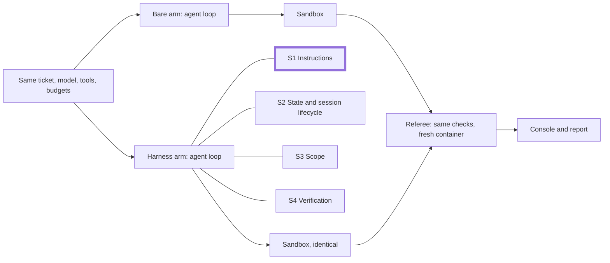

# Slide outline: Module 1 (72 slides)

Outline for `slides/module1.md` (Marp), which milestone M10 builds from the finished repository after
M9. Each row gives the block, slide number, title, one line of content, the source (walkthrough anchor,
repository file, or document section), and the speaker-note timing in minutes. The timings add up to
the 240-minute schedule and its block lengths (course design) and match the instructor's
stage-by-stage plan in [../docs/instructor-guide.md](../docs/instructor-guide.md) (the "run sheet" in the
Source column). Within each section S1 to S4 the slides follow the approved class order (course
design): the poll opens the section, the next slide
is the cue to launch the live A/B (`make demo-N`), the concept and code slides run while the A/B
proceeds in the background, and the demo-block slides walk through the finished A/B. S4 opens with
two polls (the S4 poll, then the final feature poll), and its launch slide cues both `make demo-4`
and `make final`; the final block's slides walk through the finished final A/B.

Status: M11 draft.

Rules for M10 (brief §7, shared writing rules):
- Every section's concept slides run problem → cause → harness piece.
- Code comes from walkthrough anchors (`uv run python scripts/anchors.py extract <id>`), at most 12
  lines per slide, large font; the "Code" column names the lines to keep.
- No placeholder numbers. Experiment results come from the results recorded after M6 and M8; slots that
  need them are listed under "Result slots" with a `[[PENDING]]` marker. Values produced during class
  are marked "filled in live".
- Speaker notes on every slide carry the timing below and point to the run sheet section.
- Citations as in [REFERENCES.md](../REFERENCES.md) (source id and finding id); quotes verbatim and at most 30 words.
- A1 numbers, if any slide uses them, carry A1's own caveat that its results may not generalize
  (F-a-143) next to them.

| Block | Slides | Minutes |
|---|---|---|
| Opening | 1-7 (7) | 10 |
| S1 Instructions | 8-21 (poll and launch 2, concepts and code 9, demo block and discussion 3) | 50 |
| S2 State and session lifecycle | 22-34 (poll and launch 2, concepts and code 8, demo block and discussion 3) | 50 |
| Break | 35 (1) | 10 |
| S3 Scope and sandbox | 36-48 (poll and launch 2, concepts and code 8, two on the sandbox; demo block and discussion 3) | 50 |
| S4 Verification | 49-63 (S4 poll, final feature poll, and launch 3; concepts and code 9; demo block and discussion 3) | 50 |
| Final results | 64-67 (4) | 13 |
| Wrap-up | 68-72 (5) | 7 |
| **Total** | **72** | **240** |

---

## Recurring architecture diagram

One small Mermaid diagram, repeated with the current part highlighted. The highlight is a thicker
border plus the word "now" in the node label, never colour alone (course readability rule for the console: a symbol and a label on every status).
Source: the architecture diagram in [../docs/architecture.md](../docs/architecture.md) §1, simplified. M10 decides how to render it in Marp (for example one pre-rendered
SVG per highlight).

| Slide | Highlighted node(s) |
|---|---|
| 4 | L1, L2, L3, L4, SB1, SB2 (the four parts plus the sandbox) |
| 10 | L1 |
| 24 | L2 |
| 38 | L3 |
| 42 | SB1, SB2 |
| 52 | L4 |
| 64 | L1 to L4 (the final ran all four layers) |

---

## Opening (slides 1-7, 10 minutes)

| # | Title | Content | Source | Min |
|---|---|---|---|---|
| 1 | Harness Engineering for Coding Agents | Subtitle: "Instructions, state, scope, and verification that make agent-written code safe to merge" | `README.md` title and first paragraph | 0.5 |
| 2 | The problem: four real failures | Cross-tenant data, a second session that redoes or breaks work, edits outside the ticket, own tests pass while behaviour is wrong; one shown on the board: a recorded bare-arm F1 screenshot with ⚠ other-org marks, labelled "recorded before class" with its run id (result slot) | `README.md` §1; fallbacks.md | 2.5 |
| 3 | Why it happens: four causes | One cited line per cause: A1 F-a-05; A2 F-a-08; cause 3 citations side by side (A1 F-a-20; A4 F-a-18, F-a-19; A5 F-a-86; A6 F-a-21 supplementary); A3 F-a-15 with B13 F-b-45, F-b-50 | `README.md` §2; [REFERENCES.md](../REFERENCES.md) | 2 |
| 4 | The solution: a harness | "the environment around the agent"; A1: "design environments, specify intent, and build feedback loops" (F-a-02; no definition attributed to A1); four parts and the sandbox; diagram with all parts highlighted | `README.md` §3; [REFERENCES.md](../REFERENCES.md) | 2 |
| 5 | shipharness, TeamTrack, console | The CLI commands; TeamTrack: multi-tenant issue tracker, orgs Acme and Globex, 25 API operations and 142 visible tests at the base; five console screens and keys 1-5, F; code: `Opening:two_arms`, the two `ThreadPoolExecutor` blocks with the `finally` block folded (11 lines) | `README.md` §5, §9, §11; TeamTrack size as counted at M3 (OpenAPI operations, visible tests); anchor `Opening:two_arms` (`Opening:publish` shown in the editor only) | 1.5 |
| 6 | How we prove it | Same agent, model, effort, task, repository, tools, sandbox, turn limit, cost cap; one deterministic referee; house rules R1-R7 (course label for A1's "golden principles", F-a-99); datasets: 60 tasks in six groups, 40 test-generation targets; one pre-registered primary measure per section | `README.md` §4, §10 (primary measures); `teamtrack/docs/HANDBOOK.md` (R1-R7); [../datasets/README.md](../datasets/README.md) | 1 |
| 7 | Check your setup | `make doctor` and the `harness-setup` assessment on the bare TeamTrack, run live (output filled in live) | Makefile `doctor`; `skills/harness-setup/scripts/assess.py` | 0.5 |

## S1 Instructions (slides 8-21, 50 minutes)

| # | Title | Content | Source | Min |
|---|---|---|---|---|
| 8 | Poll | Feature F1 (org-wide issue search) and rule at risk R1 in one line; the S1 question and options (room result filled in live); close the poll before the launch | `submodules/01-instructions/demo/README.md` §4 | 3 |
| 9 | Launching the live A/B: F1 org-wide issue search | Cue: run `make demo-1` in terminal B now; it runs in the background during slides 10-18 and the room sees it again on slide 19. Rule at risk R1; the legacy-pattern trap; harness arm layers: instructions; primary measure: new R1 violations ≥ 1 fails the run; control glance: C1 (result slot) | `README.md` §10 (layers, primary measure); `teamtrack/reference/f1/task.toml`; `teamtrack/docs/features/c1.md`; run sheet S1 | 2 |
| 10 | S1: what the agent knows | Diagram with S1 highlighted; the section's three objectives; the problem the A/B is testing right now: a legacy handler without the tenant filter next to the right pattern | S1 learning objectives (course design); `README.md` §10 (legacy `GET /v1/issues`) | 1.5 |
| 11 | Problem: the rule is written down, the agent does not apply it | F1 builds `GET /issues`; R1 says another org's resource is 404; the rule is in `docs/HANDBOOK.md`, which both arms can read | `teamtrack/docs/HANDBOOK.md` (R1); `README.md` §4 (both arms get every rule); `teamtrack/docs/features/f1.md` | 2 |
| 12 | Cause: what is not in context does not exist | A1 F-a-05 (quote); "A giant instruction file crowds out the task, the code, and the relevant docs" and "Too much guidance becomes non-guidance." (A1, F-a-23 to F-a-26); agents copy existing patterns (A1, F-a-20) | A1 in [REFERENCES.md](../REFERENCES.md) | 2.5 |
| 13 | Harness piece: AGENTS.md as a map | "roughly 100 lines", "a map", "the table of contents" (A1, F-a-22, F-a-27, F-a-28); docs/ as the system of record (F-a-29, F-a-30); A1's layout: ARCHITECTURE.md at the root, SECURITY.md, RELIABILITY.md, QUALITY_SCORE.md, PLANS.md, design-docs/, product-specs/, references/ in docs/ (F-a-30, F-a-31) | A1 in [REFERENCES.md](../REFERENCES.md); `teamtrack/harness/instructions/` | 3 |
| 14 | Progressive disclosure | Docs: "agents start with a small, stable entry point and are taught where to look next" (A1, F-a-36); skills: three tiers, "Metadata (~100 tokens)", "Instructions (< 5000 tokens recommended)", "Resources (as needed)" (B1, B2; F-b-05, F-b-06); SKILL.md needs `name` and `description` (F-b-01 to F-b-04) | A1, B1, B2 in [REFERENCES.md](../REFERENCES.md) | 3 |
| 15 | Keep the map true | Docs checked mechanically (A1, F-a-37); lint messages that teach (A1, F-a-97); fairness: the bare arm gets every rule in `docs/HANDBOOK.md`, and a unit test checks both forms carry each rule id | A1 in [REFERENCES.md](../REFERENCES.md); `README.md` §4 | 3 |
| 16 | Code: the map | `S1:agents_md`: the "Where to look" table header and its first rows (12 lines) | anchor `S1:agents_md` | 3 |
| 17 | Code: skills, tier 1 only | `S1:progressive`: `catalogue_block` (9 lines); speaker note: section minute 25 falls on this slide, check terminal B for the `Cost:` line | anchor `S1:progressive`; run sheet "Check at section minute 25" | 3.5 |
| 18 | Code: the stable prefix | `S1:prefix`: from `agents_md = ...` to `return` (10 lines) | anchor `S1:prefix` | 3.5 |
| 19 | Demo block: what the console shows | The finished A/B. Screen 1: harness decisions and "Agent said" vs "Referee"; screen 2: ⚠ other-org cards; screen 3: files read by category (reads of the documents the map points to), R1 new violations | `README.md` §11; run sheet S1 | 8 |
| 20 | Demo block: results | The A/B verdicts; tonight's two dots (filled in live) next to the experiment dots (result slot); swap test verdict (filled in live) | M8 experiment results (`make report`); `make swap-1` | 7 |
| 21 | Runbook and next | Link `submodules/01-instructions/demo/README.md`; discussion question; transition: what happens when a session ends halfway | [../docs/instructor-guide.md](../docs/instructor-guide.md) (schedule) | 5 |

## S2 State and session lifecycle (slides 22-34, 50 minutes)

| # | Title | Content | Source | Min |
|---|---|---|---|---|
| 22 | Poll | Feature F2 (comments, two sessions) and what is at risk (continuity, R7) in one line; the S2 question and options (room result filled in live); close the poll before the launch | `submodules/02-state-lifecycle/demo/README.md` §4 | 3 |
| 23 | Launching the live A/B: F2 comments | Cue: run `make demo-2` in terminal B now; it runs in the background during slides 24-31 and the room sees it again on slide 32. Two sessions, budgets 20 and 30; same wrap-up turns and resume sentence for both arms; harness arm layers: instructions, state; primary measure: continuity failure; control glance: C2 (result slot) | `README.md` §10 (layers, primary measure); `teamtrack/reference/f2/task.toml`; run sheet S2 | 2 |
| 24 | S2: what the agent remembers | Diagram with S2 highlighted; objectives; the problem the A/B is testing right now: a second session that does not know what the first did | S2 learning objectives (course design); `README.md` §1 | 2 |
| 25 | Cause: every session starts empty | "each new session begins with no memory of what came before." (A2, F-a-08); "However, compaction isn’t sufficient." (A2, F-a-54, F-a-55) | A2 in [REFERENCES.md](../REFERENCES.md) | 2.5 |
| 26 | Harness piece: state on disk | Initializer agent and coding agent (A2, F-a-49, F-a-52); init.sh (F-a-50), progress file (F-a-50, F-a-53; the course names it `progress.md`), git history (F-a-53, F-a-57); course design: the initializer is a deterministic harness step | A2 in [REFERENCES.md](../REFERENCES.md); `docs/architecture.md` §5 | 3.5 |
| 27 | Getting up to speed, and ending a session | A2's routine: pwd, progress and git log, feature list, init.sh, a basic test (F-a-58 to F-a-62); "End the session by writing a git commit and progress update." (F-a-63) | A2 in [REFERENCES.md](../REFERENCES.md) | 3 |
| 28 | Exec plans and the structured handoff | Exec plans active → completed (A1, A7; F-a-34, F-a-35, F-a-45 to F-a-48); A3's context reset with a structured handoff (F-a-65 to F-a-69); the course mechanism is the session turn budget; resets are a dated, model-dependent choice in A3, not a standing rule | A1, A3, A7 in [REFERENCES.md](../REFERENCES.md) | 4 |
| 29 | Code: init.sh | `S2:init`: from `echo "== migrations` to the pytest line (6 lines) | anchor `S2:init` | 3 |
| 30 | Code: stop and resume | `S2:stop_resume`: `resume_text` (8 lines); speaker note: section minute 25 falls on this slide, check terminal B for the `Cost:` line | anchor `S2:stop_resume`; run sheet "Check at section minute 25" | 4 |
| 31 | Code: the session log | `S2:write`: `session_entry` (10 lines) | anchor `S2:write` | 3 |
| 32 | Demo block: what the console shows | The finished A/B. Screen 1: the last turns, session stop and resume markers if still listed; screen 3: sessions with redone work, state files read; screen 2: each arm's board; screen 5: first wrong turn and the trace link | `README.md` §11; run sheet S2 | 8 |
| 33 | Demo block: results | The A/B verdicts; tonight's dots (filled in live) next to the experiment dots (result slot); swap test verdict (filled in live); layer effect from the ablation bars (result slot) | M8 experiment results (`make report`); `make swap-2` | 7 |
| 34 | Runbook and next | Link `submodules/02-state-lifecycle/demo/README.md`; discussion question; transition to the break | [../docs/instructor-guide.md](../docs/instructor-guide.md) (schedule) | 5 |

## Break (slide 35, 10 minutes)

| # | Title | Content | Source | Min |
|---|---|---|---|---|
| 35 | Break | Return time (filled in live) | [../docs/instructor-guide.md](../docs/instructor-guide.md) (schedule) | 10 |

## S3 Scope and sandbox (slides 36-48, 50 minutes)

| # | Title | Content | Source | Min |
|---|---|---|---|---|
| 36 | Poll | Feature F3 (idempotency keys) and what is at risk (scope) in one line; the S3 question and options (room result filled in live); close the poll before the launch | `submodules/03-scope-sandbox/demo/README.md` §4 | 3 |
| 37 | Launching the live A/B: F3 idempotency keys | Cue: run `make demo-3` in terminal B now; it runs in the background during slides 38-45 and the room sees it again on slide 46. Build then test phase; allow lists from the task; tempting shared middleware off-limits; harness arm layers: instructions, state, scope; primary measure: out-of-scope file or test-phase source edit; zero for the harness arm by construction, so watch the secondary measures; control glance: C3 (result slot) | `README.md` §10 (primary measure); `docs/architecture.md` §2 (rules for both arms); `teamtrack/reference/f3/task.toml`; run sheet S3 | 2 |
| 38 | S3: what the agent may change and reach | Diagram with S3 highlighted; objectives; the problem the A/B is testing right now: edits outside the ticket, source edits during the test phase | S3 learning objectives (course design); `README.md` §1 | 2 |
| 39 | Cause: copied patterns and hard-to-undo actions | Four citations side by side, not merged (no single source states cause 3): A1 F-a-20; A4 F-a-18, F-a-19; A5 F-a-86; A6 F-a-21 (supplementary) | `README.md` §2 (cause 3); [REFERENCES.md](../REFERENCES.md) | 2.5 |
| 40 | Harness piece: one feature list, one feature | `feature_list.json` as the source of truth, JSON over Markdown (A2, A5; F-a-78, F-a-81, F-a-85); the `passes` field (F-a-79, F-a-82); "It is unacceptable to remove or edit tests because this could lead to missing or buggy functionality." (F-a-80); one feature at a time (F-a-83); course design: only the harness sets `passes`, with `evidence` and `testedAt` (A2 F-a-108, A3 F-a-110) | A2, A3, A5 in [REFERENCES.md](../REFERENCES.md) | 3.5 |
| 41 | Allowed paths per phase | Build and test allow lists; a patch outside the list is rejected, a command's change outside it is reverted, the agent reads the reason; composite citation: A5 F-a-86, F-a-87; A1 F-a-92, F-a-98; A2 F-a-57 | `docs/architecture.md` §5; A1, A2, A5 in [REFERENCES.md](../REFERENCES.md) | 3 |
| 42 | Sandbox 1: why a container | A4: "for each agent, a Docker container is spun up" and no internet access (F-a-88, F-a-90); A5's three-layer security model (F-a-86, F-a-87); Codex modes and "By default, the agent runs with network access turned off." (D21-D23); diagram with the sandbox highlighted | A4, A5 in [REFERENCES.md](../REFERENCES.md) | 2 |
| 43 | Sandbox 2: the same limits for both arms | `--network none`, memory without swap, 256 processes, non-root, read-only root, `/work` and `/tmp` writable, all capabilities dropped (D24-D30); `sandbox_denied` and its reason codes; never an A/B variable; detailed sandbox design is Module 2 | `docs/architecture.md` §2 (sandbox policy); `submodules/03-scope-sandbox/concepts.md` (`sandbox_denied`) | 2 |
| 44 | Code: allowed paths and evidence | Two excerpts: the three `if` checks of `reason()` in `S3:allowed_paths` (6 lines) and `S3:passes` from `if evidence is None:` to `feature.update(...)` (5 lines); speaker note: section minute 25 is the switch to slide 45, check terminal B for the `Cost:` line | anchors `S3:allowed_paths`, `S3:passes`; run sheet "Check at section minute 25" | 5 |
| 45 | Code: the sandbox policy | `S3:policy` fields from `network` to `no_new_privileges` (10 lines); `S3:run_args` and `S3:dockerfile` in the editor only | anchors `S3:policy`, `S3:run_args`, `S3:dockerfile` | 5 |
| 46 | Demo block: what the console shows | The finished A/B. Screen 1: blocked or reverted decisions with reasons, gate line; screen 2: does each arm's app still serve the board; screen 3: diff map and sandbox denials | `README.md` §11; run sheet S3 | 8 |
| 47 | Demo block: results and the sandbox moment | Tonight's `sandbox_denied` events (filled in live), or the policy printout and the experiment denial log (result slot); the A/B verdicts; tonight's dots (filled in live) next to the experiment dots (result slot); swap test verdict (filled in live) | run sheet S3 (sandbox moment); M8 experiment results (`make report`); `make swap-3` | 7 |
| 48 | Runbook and next | Link `submodules/03-scope-sandbox/demo/README.md`; discussion question; transition: who decides that the work is done | [../docs/instructor-guide.md](../docs/instructor-guide.md) (schedule) | 5 |

## S4 Verification (slides 49-63, 50 minutes)

| # | Title | Content | Source | Min |
|---|---|---|---|---|
| 49 | Poll | Feature F4 (optimistic concurrency) and the two counts at stake (hidden tests, mutants) in one line; the S4 question and options (room result filled in live); the final feature poll follows on slide 50 | `submodules/04-verification/demo/README.md` §4 | 3 |
| 50 | Poll: the final feature | F5 bulk close, F6 watchers, F7 labels, with what each stresses (room result filled in live); the winner runs, and the runner-up after it if the session figure allows (run sheet S4); close the poll before the launch | `submodules/04-verification/demo/README.md` (final feature poll); `final-project/README.md` §2 | 1 |
| 51 | Launching two live A/Bs: F4 and the final | Cue: run `make demo-4` in terminal B now, then `make final FEATURES=<poll winner(s)>` in terminal C; demo-4 runs in the background during slides 52-60 and the room sees it again on slide 61; the final returns on slides 64-67. `make final` runs its features one after another, so at most two A/Bs run at a time. F4: ETag, If-Match, issue history; co-primary counts: hidden tests passed of 69, referee mutants killed of 4; harness arm layers: all four (both A/Bs); blinded reviewer on both diffs; final run cap $0.25 per arm; control glance: C4 (result slot) | `README.md` §10 (layers, counts), §13 (caps); Makefile `final`; `teamtrack/reference/f4/task.toml`; `teamtrack/mutants/features/f4.jsonl`; run sheet S4 | 2 |
| 52 | S4: what proves the work is done | Diagram with S4 highlighted; objectives; the problem the A/B is testing right now: the agent's tests pass while behaviour is wrong | S4 learning objectives (course design); `README.md` §1 | 1 |
| 53 | Cause: self-grading and visible tests | "agents reliably skew positive when grading their own work" (A3, F-a-15); B13 F-b-45 and the compositional finding F-b-50; "it is easy to see tests pass and assume the job is done, when this is rarely the case." (A4, F-a-17) | A3, A4, B13 in [REFERENCES.md](../REFERENCES.md) | 2.5 |
| 54 | Harness piece: test filters | Filters 1-3 from TestGen-LLM (B11, F-b-16 to F-b-22), with its evaluation funnel over 86 test classes (F-b-23); filters 4 and 5 are course filters | `submodules/04-verification/concepts.md` §3.3; B11 in [REFERENCES.md](../REFERENCES.md) | 3 |
| 55 | Mutants and hidden tests | ACH: mutants for the fault of concern, hardening (B12, F-b-29, F-b-32); 49% of tests that uniquely kill a mutant add no line coverage (F-b-40); filter-set and referee-set mutants never overlap (course design); hidden tests that compose features (B13, B14; F-b-42 to F-b-44); 441 hidden tests across F1-F7 and controls, 69 for F4 | `submodules/04-verification/concepts.md` §3.4; B12, B13, B14 in [REFERENCES.md](../REFERENCES.md); counts in `submodules/04-verification/post-class-reading/04-held-out-tests-specbench.md` | 3 |
| 56 | A separate evaluator and a gate | Blinded reviewer with grading criteria (A3, F-a-110 to F-a-112); clean-state gate (A2, F-a-84; A4, F-a-127); house rules R1-R7 (course label) | `docs/architecture.md` §5, §6; A2, A3, A4 in [REFERENCES.md](../REFERENCES.md) | 3 |
| 57 | Read the trace | First wrong turn (A3, F-a-126); leave one layer out to see what each part does (A3, F-a-125) | A3 in [REFERENCES.md](../REFERENCES.md); `docs/architecture.md` §5 (leave one layer out) | 1.5 |
| 58 | Code: the filter pipeline | `S4:filters`: the inner `for flt in filters` loop with the exception branch folded (at most 12 lines) | anchor `S4:filters` | 2.5 |
| 59 | Code: a tenant probe and blinding | `S4:probe` `judge` up to the second `failed = ...` (12 lines); `S4:blind` in the editor; speaker note: section minute 25 falls on this slide, check terminal B for the demo-4 `Cost:` line and terminal C for the final | anchors `S4:probe`, `S4:blind`; run sheet "Check at section minute 25" | 4 |
| 60 | Code: the gate | `S4:gate`: `names = ...`, the build-phase branch, the clean-state check, and `passed = ...` (at most 12 lines) | anchor `S4:gate` | 3.5 |
| 61 | Demo block: what the console shows | The finished demo-4 A/B. Screen 1: the harness arm's last gate pills ✓ or ✗ and gate feedback; screen 2: two-tab edit conflict; screen 3: filter table with discard reasons, mutant table, referee counters, reviewer verdict | `README.md` §11; run sheet S4 | 8 |
| 62 | Demo block: results | The A/B and reviewer verdicts; tonight's two counts per arm (filled in live) next to the experiment dots (result slot); reviewer agreement with the referee (result slot); swap test verdict (filled in live) | M8 experiment results (`make report`); `make swap-4` | 7 |
| 63 | Runbook and next | Link `submodules/04-verification/demo/README.md`; discussion question; transition to the final results | [../docs/instructor-guide.md](../docs/instructor-guide.md) (schedule) | 5 |

## Final results (slides 64-67, 13 minutes)

The final A/B was launched on slide 51 and ran during S4; these slides walk through its finished
results. No run starts here.

| # | Title | Content | Source | Min |
|---|---|---|---|---|
| 64 | Final results: the A/B lines | The poll winner (and runner-up, if it ran); all four layers; run cap $0.25 per arm; terminal C's arm lines and session figure (filled in live); no pre-registered primary measure, so read hidden tests and mutants per arm; diagram with all layers highlighted | Makefile `final`; `README.md` §10, §13; `final-project/README.md` §5.1 | 2 |
| 65 | Final results: console | Screens 1, 3, and 5 of the finished final A/B, both arms (filled in live) | `README.md` §11; `final-project/README.md` §4 | 4 |
| 66 | Final results: boards | Both boards side by side (filled in live) | `README.md` §11 (screen 2) | 2 |
| 67 | Final results: screen 4, report, and LangSmith comparison | Screen 4 with tonight's final next to the experiment results; `make report` output; the LangSmith comparison view; code: `Final:dots`, the fill and stroke lines (8 lines); experiment results (result slot); tonight's final (filled in live) | anchor `Final:dots`; `docs/architecture.md` §10 | 5 |

## Wrap-up (slides 68-72, 7 minutes)

| # | Title | Content | Source | Min |
|---|---|---|---|---|
| 68 | Assignments (1 of 2) | A1 Instructions and A2 State and session lifecycle: task, folder, budget (A1 ≤ $2.50 / 150 traces; A2 ≤ $1.50 / 60) | learner budget (course design); `submodules/01-instructions/assignment/README.md`, `submodules/02-state-lifecycle/assignment/README.md` | 1.5 |
| 69 | Assignments (2 of 2) | A3 Scope and sandbox and A4 Verification and portfolio (A3 ≤ $0.25 / 30; A4 ≤ $1.75 / 120); total ≤ $6 and ≤ 400 traces; Thursday review | learner budget (course design); `submodules/03-scope-sandbox/assignment/README.md`, `submodules/04-verification/assignment/README.md` | 1.5 |
| 70 | Skills and templates to take home | `harness-setup`, `assured-tests`, `house-rules`, `skill-template`; code: `Final:skill_template` frontmatter from `name` to `license` (6 lines); install into `.claude/skills/` and `.agents/skills/` | B1 in [REFERENCES.md](../REFERENCES.md); `README.md` §14; anchor `Final:skill_template` | 2 |
| 71 | References (1 of 2) | Teaching sources A1-A7 with title, author, and date | [REFERENCES.md](../REFERENCES.md) | 1 |
| 72 | References (2 of 2) | B1-B14; note that B15 (Spec-Bench, speculative decoding) is unrelated and not cited | [REFERENCES.md](../REFERENCES.md) | 1 |

---

## Poll, launch, and demo-block slides per section (5 each, S4 6)

| Position | Content | S1 | S2 | S3 | S4 |
|---|---|---|---|---|---|
| 1, opens the section | Poll question, with the feature and the rule at risk in one line | 8 | 22 | 36 | 49 |
| 1b, S4 only | Final feature poll | | | | 50 |
| 2, right after the poll | Launching the live A/B: feature, rule at risk, `make demo-N`, control glance (S4: also `make final`) | 9 | 23 | 37 | 51 |
| 3, demo block | Screen order and what to watch on the finished A/B | 19 | 32 | 46 | 61 |
| 4, demo block | Results: A/B verdicts, tonight vs experiment dots, swap test | 20 | 33 | 47 | 62 |
| 5 | Link to `submodules/0N-…/demo/README.md`, discussion, transition | 21 | 34 | 48 | 63 |

The concept and code slides sit between positions 2 and 3; the A/B runs in the background while
they are shown.

---

## Result slots

Every number or result on a slide that needs real output. M10 fills each from the results recorded
after the milestone named in the marker; nothing is estimated.

Slide 2:

[[PENDING: board screenshot of a recorded bare-arm F1 run with other-org marks, and its run id | source: M6 pilot | how: make demo-1 on the class host; PNG under .shipharness/runs/<ab id>/screenshots/bare/]]

Slides 9, 23, 37, 51 (control glance):

[[PENDING: C1, C2, C3, C4 control results per arm | source: M8 batch 4 | how: make experiments, full dataset; make report]]

Slide 20:

[[PENDING: S1 experiment dots, runs failing out of 10 per arm | source: M8 batch 1 | how: make experiments batch 1; make report]]

Slide 33:

[[PENDING: S2 experiment dots, continuity failures out of 10 per arm | source: M8 batch 1 | how: make experiments batch 1; make report]]

[[PENDING: ablation bars, runs passing per leave-one-layer-out configuration | source: M8 ablation | how: make experiments batch 2; make report]]

Slide 47:

[[PENDING: sandbox_denied events from the experiment runs (command, reason code, arm) | source: M8 batch 1 | how: grep -h '"type":"sandbox_denied"' .shipharness/runs/*/events.jsonl]]

[[PENDING: S3 experiment dots, runs failing out of 10 per arm, with hidden tests and existing tests as secondary | source: M8 batch 1 | how: make experiments batch 1; make report]]

Slide 62:

[[PENDING: S4 experiment dots, hidden tests passed of 69 and referee mutants killed of 4 per run per arm | source: M8 batch 1 | how: make experiments batch 1; make report]]

[[PENDING: reviewer agreement with the referee per arm | source: M8 batch 1 | how: make report; screen 4 reviewer agreement]]

Slide 67:

[[PENDING: experiment report and LangSmith comparison link | source: M8 batch 1 | how: make report; comparison_url in exports/experiments/]]

Speaker notes for slides 9, 23, 37, 51 (launch) and 17, 30, 44, 59 (the check at section minute 25):
the A/B must be finished by section minute 25. In pilot run 2 (12 A/Bs, sections F1-F4, two A/Bs
running in parallel on the class host, before the approved referee speed-ups) every A/B finished
within 923 s (15.4 min); median 641 s (10.7 min), minimum 485 s (8.1 min) (course pilot,
run 2, 2026-10-16). Measured in the course pilot, run 3, 2026-10-16 (12 A/Bs, F1-F4 with the pilot's task
variants, effort medium, two A/Bs in parallel on the class host): wall time per A/B min 384 s, median
512 s, max 620 s; run 4, effort low, 2026-10-16 to 2026-10-17 (9 A/Bs, F1-F3, two in parallel): min
309 s, median 414 s, max 565 s. Neither run timed one A/B on its own or `make demo-4` with
`make final` in parallel. The class-host time per section, one A/B at a time in S1 to S3 and two in
S4:

[[PENDING: wall time of make demo-1 to demo-3 on the class host, one A/B at a time, and of make demo-4 with make final running in parallel | source: M6 pilot | how: time make demo-N on the class host (pilot run 3), demo-4 with make final FEATURES=F5 started one minute later]]

Speaker notes for slides 51 and 59 (the final A/B, launched on slide 51, must be finished by 3:40,
when slide 64 opens the final block; with two features `make final` runs them one after another):

[[PENDING: wall time of one make final feature on the class host while S4 runs (make demo-4 in parallel) | source: M6 pilot | how: time make final FEATURES=F5 (and F6, F7) on the class host, started one minute after make demo-4]]

## Filled in live

Slides 7 (doctor and assessment output), 8, 22, 36, 49, 50 (room poll results), 20, 33, 47, 62
(tonight's dots, swap test verdict, and for 47 tonight's sandbox denials), 35 (return time), 64,
65, 66, 67 (the final run). M10 marks each slot on the slide with the words "filled in live".
