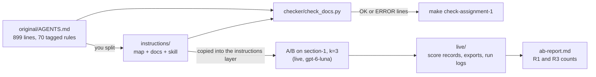

# Assignment A1: from a 900-line instruction file to a map, docs, and a skill

Section S1 Instructions. Expected effort: 3 to 6 hours for a strong engineer, plus the A/B run time
(see "Cost and trace budget"). Source ids (A1, B1, F-a-NN, F-b-NN) refer to the course research register,
`RESEARCH.md`.

## Objective

Take a TeamTrack variant whose only instructions are one 900-line `AGENTS.md`, and restructure that
knowledge into what section S1 taught: a short `AGENTS.md` map, a structured `docs/` folder, and one
Agent Skill. Then prove mechanically that nothing was lost (a link and rule-coverage checker you
write), and measure the effect on agents with an A/B on the `section-1` dataset subset (k=3),
reporting R1 and R3 results. The A/B is the assignment's required live step: you run it once with
the course model, through the real `shipharness` runner and sandbox, and submit its score records
as evidence.

## Problem statement

The TeamTrack team kept everything in one file:
[`starter/original/AGENTS.md`](starter/original/AGENTS.md), 899 lines. It has every house rule
(R1 to R7) and every team convention, each tagged with an id such as `R1.2` or `CV-07`, mixed with
history, incident notes, a review checklist, questions and answers, and four retired rules that must
no longer be applied. Agents read all of it at the start of every task. Its own meeting notes
(section 17) say what goes wrong: the part an agent needs is one or two sections, people skim it,
and reviews cite rules retired a year ago.

Your job is the split the team never finished, plus the check the meeting notes asked for: a script
that fails when a link breaks or when a tagged rule from the original is missing from the new
documents.

## Background

Read the section S1 material first. The ideas this assignment exercises, with their sources:

- Why not one big file. A1 reports: "Context is a scarce resource. A giant instruction file crowds
  out the task, the code, and the relevant docs" (A1, F-a-23); "Too much guidance becomes
  non-guidance. When everything is “important,” nothing is." (A1, F-a-24); "It rots instantly. A
  monolithic manual turns into a graveyard of stale rules." (A1, F-a-25).
- The map. "A short AGENTS.md (roughly 100 lines) is injected into context and serves primarily as a
  map, with pointers to deeper sources of truth elsewhere." (A1, F-a-28). A1 calls it "the table of
  contents" (F-a-27) and sums it up as "give Codex a map, not a 1,000-page instruction manual."
  (F-a-22).
- The docs. "The repository’s knowledge base lives in a structured docs/ directory treated as the
  system of record." (A1, F-a-29). The file names (`ARCHITECTURE.md` at the root; `SECURITY.md`,
  `RELIABILITY.md`, `QUALITY_SCORE.md`, `PLANS.md`, `design-docs/`, `product-specs/` under `docs/`)
  come from A1's layout figure (F-a-30), as the instructions layer places them (DESIGN §6.2).
- Progressive disclosure: "agents start with a small, stable entry point and are taught where to look
  next" (A1, F-a-36). For skills, B1 states the same idea: "The `name` and `description` fields are
  loaded at startup for all skills" (B1, F-b-05), and the body loads only when the skill is used.
- Mechanical checks. A1 notes that "A single blob doesn’t lend itself to mechanical checks
  (coverage, freshness, ownership, cross-links), so drift is inevitable." (F-a-26) and that
  "Dedicated linters and CI jobs validate that the knowledge base is up to date, cross-linked, and
  structured correctly." (F-a-37). Your checker is a small version of that. A1 also writes lint
  messages "to inject remediation instructions into agent context" (F-a-97): make your error lines
  say what to fix.
- Why the A/B can show an effect at all: "From the agent’s point of view, anything it can’t access
  in-context while running effectively doesn’t exist." (A1, F-a-05), and agents copy what is nearby:
  "Codex replicates patterns that already exist in the repository—even uneven or suboptimal ones."
  (A1, F-a-20). The legacy `GET /v1/issues` handler is that trap.
- "House rules" is the course's label for what A1 calls "golden principles" (F-a-99) and invariants
  enforced "with custom lints" (F-a-96); see RESEARCH G-9.

A1 describes one team's experience on one product and says its results "should not be assumed to
generalize without similar investment—at least, not yet." (F-a-143). Your A/B is a small test of the
structure on TeamTrack, not a replication of A1.

Course design, not source claims: the rule tags, the overlap measure, the "no new facts" rule, and
the grading criteria below were designed for this course.

## What to build

1. **A restructured instructions tree** in `instructions/`: `AGENTS.md` (the map), `ARCHITECTURE.md`,
   and the `docs/` files listed under "Expected project structure". Every active tagged rule from the
   original is defined exactly once, in the document where an agent would look for it.
2. **One skill** in `instructions/.agents/skills/<name>/`, built from `skills/skill-template`, that
   passes `uv run shipharness skills validate`.
3. **A docs checker**, `checker/check_docs.py`, that reports broken links and rule-coverage problems,
   with your own tests next to it.
4. **An A/B report**, `ab-report.md`: the instructions layer with your tree against the bare arm on
   `section-1`, k=3, with R1 and R3 counts per arm.
5. **The live evidence** of that A/B in `live/`: the command and its output, the two experiment
   exports, the ScoreRecord of every run, and the harness arm's run logs, collected by
   `live_evidence.py`.



## Concepts tested

- AGENTS.md as a map of roughly 100 lines, not a manual (A1, F-a-22, F-a-27, F-a-28).
- `docs/` as the system of record, in A1's layout (F-a-29, F-a-30, F-a-32, F-a-33).
- Progressive disclosure for docs (F-a-36) and for skills (B1, F-b-05, F-b-06, F-b-07).
- Skill format: for `name`, "Must match the parent directory name" (B1, F-b-02); the description
  "Should describe both what the skill does and when to use it" (B1, F-b-03).
- Docs checked mechanically, with messages an agent can act on (F-a-37, F-a-97).
- Reading an A/B as counts of failing runs per arm, with the pre-registered S1 measure (DESIGN §8.2,
  §8.3), with every number traceable to a score record.

## Prerequisites

- The repository set up: `make setup` (or `uv sync --frozen`). Python 3.12 and uv.
- Section S1 of the class, and the walkthrough anchors `S1:agents_md`, `S1:progressive`, and
  `S1:prefix` (`uv run python scripts/anchors.py extract S1:agents_md`).
- For the A/B only (task 6): a container runtime (`make doctor` passes), the two API keys in `.env`
  (`setup/PRE-CLASS.md`), the datasets in your LangSmith account (`make datasets`), and the
  checkpoint tags (`git fetch --tags`). Everything else needs no keys and no Docker.

## Expected input and output

Input:

- `starter/original/AGENTS.md`: the 899-line file. Read-only: the grader pins its SHA-256 and grades
  rule coverage only against the unchanged file.
- `teamtrack/`: the product. Your tree is copied over the TeamTrack workspace root, so a link in your
  tree may point to a TeamTrack file (for example `docs/features/f1.md`) as if both were one folder.

Output (all inside your work folder, by default `assignment/starter/`):

- `instructions/`: the tree.
- `checker/check_docs.py` plus at least one test file of your own.
- `ab-report.md`: the filled report.
- `live/`: the live evidence of your A/B (see "The live run evidence").

## Detailed requirements

### The tree

- R-T1. The files under "Expected project structure" exist. `AGENTS.md` has at most 120 lines and at
  least 30 ("roughly 100 lines", A1, F-a-28).
- R-T2. `AGENTS.md` defines no rule. It points to where each rule lives and may mention ids (`R1`,
  `R4.3`) as references.
- R-T3. Every active tagged rule of the original is defined exactly once in the tree, as `[ID]`
  followed by its statement. The statement keeps at least half of the original statement's content
  words (see "Overlap"). Reword freely within that limit.
- R-T4. Retired rules (tagged and marked "(retired ...)") are not defined anywhere. You may mention
  them as history (for example "R3.8 was retired").
- R-T5. Every `.md` and `.txt` file in the tree can be reached from `AGENTS.md` by following Markdown
  links or path-like code spans, in any number of steps.
- R-T6. No tree file has the same relative path as a TeamTrack file (for example
  `docs/HANDBOOK.md` or `docs/features/f1.md`): the layer would overwrite it, and the bare arm reads
  `docs/HANDBOOK.md`.
- R-T7. No new facts. Every inline code span in the tree either appears in the original (ignoring
  case, backticks, and runs of whitespace) or is a path that exists in the tree or in `teamtrack/`.
  The harness may change how knowledge is organised, never add facts the bare arm cannot read
  (DESIGN §6.1). This is what keeps your A/B fair.
- R-T8. Your checker exits 0 on your tree.

### The skill

- R-S1. Exactly one folder in `instructions/.agents/skills/`, copied from `skills/skill-template`
  and renamed; `name` equals the folder name and is not `skill-template` (B1, F-b-02).
- R-S2. `uv run shipharness skills validate instructions/.agents/skills` reports no errors and no
  warnings (500 lines, references one level deep and present; B1, F-b-06, F-b-07).
- R-S3. The description says what the skill does and contains "Use when" (B1, F-b-03;
  `skills/skill-template/README.md`).
- R-S4. The body keeps the template's sections `## When to use`, `## Steps`, and
  `## Checks before you finish`, and no `<Placeholder>` text is left.
- R-S5. `AGENTS.md` points to `.agents/skills/<name>/SKILL.md`, and the steps cite the rule tags they
  serve. Pick a task agents get wrong on TeamTrack; the section-1 tasks add an org-wide list.

### The checker

Command:

```
uv run python <work>/checker/check_docs.py --original <file> --tree <dir> [--product <dir>]
```

`--product` defaults to `teamtrack`. Keep the function names and signatures in the starter file:
the visible tests import them, and the grader also runs the file as a command.

Output: one line per problem, `ERROR <kind> <key> [<detail>]`, then one summary line: `OK: <files>
files, <links> links, <rules> rules covered` with exit 0, or `FAILED: <n> problems` with exit 1. A
missing `--original` or `--tree` path prints `ERROR usage --<name> not found: <path>` and exits 2.
Paths in output are relative to the tree, with `/`. Line numbers start at 1.

Which text is scanned: every `*.md` file under the tree, in sorted order of its tree-relative path
(plain string sort). Lines inside fenced code blocks (opened and closed by a line starting with
```` ``` ```` or `~~~`) are ignored for links, paths, and rules. Inline code spans are ignored for
links and rule tags.

| Kind | Key | Detail | When |
|---|---|---|---|
| `broken-link` | `file:line` | the target as written | a Markdown link `[text](target)`, image ``, or reference definition `[label]: target` whose target is missing, leaves the tree, or starts with `/` |
| `broken-anchor` | `file:line` | the target as written | the file exists, is a `.md` file, and has no heading with that anchor |
| `broken-path` | `file:line` | the code span | a path-like code span that resolves nowhere |
| `missing-rule` | the id | none | an active rule of the original is not defined in the tree |
| `weak-rule` | the id | `file:line overlap=0.NN` | the first definition keeps less than half of the original's content words |
| `duplicate-rule` | the id | `file:line` | a second or later definition of an id (one line per extra definition) |
| `retired-rule` | the id | `file:line` | a retired rule is defined in the tree |
| `unknown-rule` | the id | `file:line` | a definition or reference of an id the original does not have |
| `rule-in-map` | the id | `file:line` | a definition in the tree's root `AGENTS.md` (it still counts as defined) |

Links:

- Targets with a scheme (`https:`, `mailto:`) are not checked. A target in `<...>` is taken without
  the brackets; otherwise the target ends at the first space (a title such as `"Security"` is
  dropped). `%20` and other escapes are decoded.
- A target resolves relative to the linking file's folder. The result must stay inside the tree.
  It exists if the path exists in the tree or, failing that, at the same relative path under
  `--product` (the workspace overlay). Directories count.
- An anchor (`#part`) is checked only when the target is a `.md` file; `#part` alone means the same
  file. Anchors follow GitHub: take the heading text, trim it, lowercase it, remove backticks and
  asterisks, remove every character that is not a letter, digit, space, hyphen, or underscore, and
  turn each space into a hyphen. A repeated heading gets `-1`, `-2`, ... in order.

Path-like code spans: an inline code span made only of letters, digits, `_`, `.`, `-` and `/`, not
starting with `/`, that contains a `/` or ends in `.md`, `.txt`, `.py`, `.toml`, `.ini`, `.json`,
`.sh`, `.html`, or `.css`. It exists if it resolves, as a whole or relative to the file's folder, in
the tree or under `--product`. A span ending in `/` must be a directory. Commands such as
`python -m pytest tests/visible -q` and endpoints such as `GET /v1/issues` are not paths.

Rules:

- An id is `R<1-9>.<n>` or `CV-<two digits>`. A definition is `[ID]` not followed by `(` or `[`
  (`[R2.1](docs/SECURITY.md)` is a link). Every other occurrence of an id, or of a family such as
  `R1`, is a reference.
- The statement of a definition is the text after the tag up to the next tag on the same line. When
  the tag is the last one on its line, the statement continues on the following lines until a blank
  line, a line that starts a list item (`-`, `*`, `+`, `1.`), a heading, a table row (`|`), a fence,
  or a line with another definition.
- A definition is retired when its statement starts with `(retired`.
- Unknown: a full id that the original does not define (active or retired), or a family `R<n>`
  without any `R<n>.x` in the original.

Overlap:

- Content words of a statement: remove ids, lowercase, split on every character outside `a-z`, `0-9`
  and `_`, then drop the words in the starter's `STOPWORDS` and words shorter than two characters.
- overlap = |words(original) ∩ words(new)| / |words(original)|, or 1.0 when the original has no
  content words. A first definition with overlap below 0.5 is `weak-rule`.

### The A/B report

`ab-report.md` keeps the template's six sections and has no `TODO` left:

- Setup: the exact command you ran (with `--split section-1`, `--k 3`, `--layers instructions`, and a
  `--batch` label), `Instructions tree commit: <sha>`, and `Runs per arm: <n>`.
- Results: an R1 row and an R3 row with `failing/runs` per arm (for example `3/24`), runs equal to
  "Runs per arm", no percentages (DESIGN §8.3, rule 5).
- Links: the two LangSmith experiment URLs.
- Cost and traces: `Cost: $<x>` at most 2.50 and `Traces: <n>` at most 150 (DESIGN §11.5).
- Reading the result: at least 60 words that discuss R1 and R3. Limits: at least 20 words.
- The command, "Runs per arm", the R1 and R3 counts, and the two links equal what the live evidence
  says (R-L5).

### The live run evidence

The A/B is the required live step. You run it once, live, with the course agent model
(`OPENAI_MODEL`, `gpt-6-luna`), through the real runner and the Docker sandbox, with the class caps
(`MAX_RUN_COST_USD` $0.20 per arm per run, `MAX_BATCH_COST_USD` $2.50 per command; `CONTRACTS.md`
§1). `live_evidence.py` copies what the run wrote into `live/` in your work folder:

| Path | What it is | Written by the run to |
|---|---|---|
| `live/output.txt` | first line `$ <the exact command>`, then everything the command printed, ending with its `Cost: $...` line | your terminal (task 6 saves it) |
| `live/experiments/<name>.json` | the two experiment exports, one per arm | `exports/experiments/` |
| `live/scores/<run_id>.json` | the ScoreRecord of every run listed in the exports (CONTRACTS §11, with `checkpoint_sha`) | `exports/scores/` |
| `live/runs/<run_id>/events.jsonl` | the run log of every harness-arm run (CONTRACTS §8) | `.shipharness/runs/` |

The self-check and the grader read these files only: they never re-run a model and need no keys.

- R-L1. Every file above is present and well formed: each score file validates as a ScoreRecord
  with every field present, each run log line validates as an event, the exports name one bare and
  one harness experiment, and `output.txt` has the command line and the cost line.
- R-L2. The run matches the command: `--split section-1`, `--k 3`, `--layers instructions`, a
  `--batch` label, no `--from-working-tree`; both exports carry that split, k, and batch; the output
  names both experiments; every run id in an export has its score file, with the export's arm and
  layers, a `checkpoint_sha` equal to the export's commit for that checkpoint, and a `section-1`
  task; each arm has 3 runs of each of the 8 tasks (24).
- R-L3. The runs used the class model and caps: `gpt-6-luna` in both exports and in every harness
  run log, `recorded` false everywhere, `sandboxed` true, no run above $0.20 (`cost_usd`) or review
  above $0.04, and the command's cost line at most $2.50 and naming `gpt-6-luna`.
- R-L4. The harness arm used your tree. When the instructions layer prepares a workspace, it writes
  a note to the run log, "placed N instruction files", with the list of files it copied from
  `teamtrack/harness/instructions/` (`InstructionsLayer.prepare_workspace` in
  `src/shipharness/harness/instructions/layer.py`). In every harness run log that list must equal
  the files of the `instructions/` tree you submit. Finish the tree before the A/B: adding or
  removing a tree file afterwards breaks the match, and re-running is not allowed.
- R-L5. `ab-report.md` agrees with the evidence (see "The A/B report").

## Constraints

- Write only inside your work folder. Do not edit `original/AGENTS.md`, `teamtrack/`, or `src/`
  (except for the temporary copy in task 6, on a throwaway branch).
- The self-check and the grader run with no keys and no Docker, and make no model calls. The A/B
  is graded from the report and the live evidence, checked as files, never by re-running models.
- The checker uses only the Python standard library.
- One A/B command, within the budget below. Do not re-run it until the bare arm "looks bad": every
  run is a dot, and dropping runs is forbidden (DESIGN §8.3).

## Step-by-step tasks

1. **Read the original.** List its sections and its 70 tags (66 active, 4 retired). Decide where
   each tag belongs: access (R1, R2) in `docs/SECURITY.md`, R3 in an API conventions design doc,
   R4, R5, R7 in `docs/RELIABILITY.md`, R6 in `ARCHITECTURE.md`, and so on. History and review notes
   are background, not rules.
2. **Write the checker first** (TODO(A1-3), TODO(A1-4) in `starter/checker/check_docs.py`). Make the
   visible tests pass, then add your own tests for the rest of the specification above. Running it
   on the starter tree now should print 66 `missing-rule` lines.
3. **Split the file** (TODO(A1-1)). Create the docs, move each tagged rule into exactly one of them,
   and run your checker after every document. Leave out the retired rules.
4. **Write the map**: roughly 100 lines, a "where to look" table, the house rules at a glance as
   references, the "do not copy" warning, commands, and a short "before you finish" list.
5. **Build the skill** (TODO(A1-2)): copy `skills/skill-template` into
   `instructions/.agents/skills/<name>/`, follow `skills/skill-template/README.md`, and validate it.
6. **Run the A/B live and collect the evidence** (needs keys and Docker; within the budget
   below). Finish the tree first: the evidence must match the tree you submit (R-L4).

   ```bash
   git switch -c a1-ab-run                          # throwaway branch: never merge it
   rm -rf teamtrack/harness/instructions
   cp -r submodules/01-instructions/assignment/starter/instructions teamtrack/harness/instructions
   git add teamtrack/harness/instructions && git commit -m "A1: my instructions tree for the A/B"
   git log -1 --format=%h                           # the "Instructions tree commit"
   CMD="uv run shipharness experiments --split section-1 --k 3 --layers instructions --batch a1-<name>"
   echo "\$ $CMD" > ~/a1-live-output.txt            # the exact command: first line of the evidence
   $CMD | tee -a ~/a1-live-output.txt               # the live run; its output ends with "Cost: $..."
   git switch -                                     # back to your work branch
   uv run python submodules/01-instructions/assignment/live_evidence.py --batch a1-<name> --output ~/a1-live-output.txt
   uv run python submodules/01-instructions/assignment/ab_summary.py --batch a1-<name> --exports submodules/01-instructions/assignment/starter/live
   ```

   The instructions layer reads its tree from `teamtrack/harness/instructions/` on the host, so the
   copy is what the harness arm gets; the bare arm reads `docs/HANDBOOK.md` as always. The course's
   own unit tests for that folder fail on the throwaway branch; that is expected. `exports/` and
   `.shipharness/` are not committed on the throwaway branch, so they are still there after
   `git switch -`. `live_evidence.py` copies the batch into `live/` (pass `--work <dir>` for
   another work folder) and prints the live checks; commit `live/` with your work.
7. **Write the report** from the `ab_summary.py` output into `ab-report.md`, then the reading and the
   limits.
8. **Run** `make check-assignment-1` until every line says PASS, then submit your work folder (your
   branch). The instructor grades it with the course's grader, which runs these checks plus hidden
   ones.

## Expected project structure

```
assignment/starter/                 your work folder (or a copy: pass A1_WORK=<dir> to make)
  original/AGENTS.md                the 899-line input (read-only)
  instructions/
    AGENTS.md                       the map, at most 120 lines
    ARCHITECTURE.md                 layering (R6), wiring, board, configuration
    docs/
      SECURITY.md                   R1, R2
      RELIABILITY.md                R4, R5, R7
      QUALITY_SCORE.md              grades, testing, the legacy API
      PLANS.md                      roadmap, scope
      design-docs/index.md          catalogue of design docs
      design-docs/<your docs>.md    for example API conventions (R3), history
      product-specs/index.md        product behaviour and pointers to docs/features/
      product-specs/<your docs>.md
    .agents/skills/<name>/
      SKILL.md                      built from skills/skill-template
      references/...                optional, one level deep
  checker/
    check_docs.py                   your checker
    test_check_docs.py              the visible tests (do not edit)
    test_<yours>.py                 your tests
  ab-report.md                      the filled report
  live/                             the live evidence (collected by live_evidence.py)
    output.txt                      the command line, its output, its cost line
    experiments/<name>.json         two experiment exports, bare and harness
    scores/<run_id>.json            one ScoreRecord per run (48)
    runs/<run_id>/events.jsonl      one run log per harness run (24)
```

The split shown is a suggestion beyond the required files; another split is fine if every rule has
one home an agent would find from the map.

## Setup

```bash
make setup                         # uv sync, container images if a runtime is present, .env
uv run python submodules/01-instructions/assignment/check.py   # see what fails on the starter
```

On Windows, run everything inside WSL2 (DESIGN §9). Work on your own branch; commit the work folder.

## How to run

| What | Command |
|---|---|
| your checker | `uv run python submodules/01-instructions/assignment/starter/checker/check_docs.py --original submodules/01-instructions/assignment/starter/original/AGENTS.md --tree submodules/01-instructions/assignment/starter/instructions` |
| the skill validator | `uv run shipharness skills validate submodules/01-instructions/assignment/starter/instructions/.agents/skills` |
| the self-check | `make check-assignment-1` (another folder: `make check-assignment-1 A1_WORK=<dir>`) |
| collect the live evidence | `uv run python submodules/01-instructions/assignment/live_evidence.py --batch a1-<name> --output ~/a1-live-output.txt` |
| the A/B summary | `uv run python submodules/01-instructions/assignment/ab_summary.py --batch a1-<name> --exports submodules/01-instructions/assignment/starter/live` |

Without make, the self-check is `uv run python submodules/01-instructions/assignment/check.py
--work <dir>`. The grader is not in your repository; the instructor runs it on your submission.

## How to test

```bash
uv run python -m pytest -q -p no:cacheprovider submodules/01-instructions/assignment/starter/checker
```

runs the visible tests and yours. The grader also runs an unchanged copy of the visible tests against
your `check_docs.py`, your checker on the reference tree and on that tree with injected faults, and
eleven hidden cases that follow the specification above.

## Expected behaviour

- On the starter, the self-check prints one FAIL line per unmet requirement, each with what to fix,
  and exits 1.
- On a finished work folder, every self-check line is PASS (the five `live-*` lines included), the
  checker prints `OK: ...` on your tree, and the grader prints each criterion with its points and
  `Score: <n>/100`.

## Example inputs and outputs

A tree file `docs/SECURITY.md` with these lines (line 2 has a link to a file that does not exist):

```
- [R1.1] Every query on customer data filters by the caller's `org_id`.
See [the old notes](OLD.md).
- [R1.2] Unrelated words entirely.
```

checked against the original as the only file of a tree, prints (reference checker, captured
2026-10-16; the 64 `missing-rule` lines are shortened to one):

```
ERROR broken-link docs/SECURITY.md:2 OLD.md
ERROR weak-rule R1.1 docs/SECURITY.md:1 overlap=0.41
ERROR weak-rule R1.2 docs/SECURITY.md:3 overlap=0.00
ERROR missing-rule CV-22
FAILED: 67 problems
```

R1.1 is weak although its first sentence is copied word for word: the original's statement goes on
("Repositories take `org_id` as an explicit argument and filter on it; ..."), and the copy keeps 41%
of its content words.

The self-check on the unchanged starter (captured 2026-10-16, shortened):

```
A1 self-check: submodules/01-instructions/assignment/starter
FAIL layout: missing ARCHITECTURE.md, docs/SECURITY.md, docs/RELIABILITY.md, ...
FAIL map-length: AGENTS.md still holds the starter TODO stub
...
FAIL checker-tests: pytest submodules/01-instructions/assignment/starter/checker: 12 failed, 3 passed in 0.45s
FAIL checker-clean: make the checker tests pass first: a checker that finds nothing proves nothing
...
FAIL live-files: live evidence missing or malformed: no live/ folder in the work folder; collect it with live_evidence.py (README, task 6)
...
self-check: 0 of 24 checks pass
```

## Grading criteria (100 points)

"Visible" items are checked by `make check-assignment-1`; "hidden" items only by the grader. Items
marked "scaled" earn their points in proportion to the share of active rules you covered, so an empty
tree earns nothing for having no duplicates. Criterion F is the live step: its checks read the
files in `live/` and never re-run a model; the other criteria stay graded from files that give the
same score on every run.

| Criterion | Item | Points | Checked |
|---|---|---|---|
| **A Map and layout (15)** | required files present (proportional) | 5 | visible |
| | `AGENTS.md` between 30 and 120 lines, no stub left | 3 | visible |
| | every doc reachable from the map (proportional; needs half the layout) | 4 | visible |
| | no TeamTrack file overwritten (needs half the layout) | 3 | visible |
| **B Rule coverage (25)** | original unchanged (scaled) | 2 | hidden |
| | active rules defined with overlap at least 0.5 (proportional) | 12 | hidden |
| | no duplicate definitions (scaled) | 2 | hidden |
| | no retired rule defined (scaled) | 2 | hidden |
| | no unknown ids (scaled) | 2 | hidden |
| | no definition in `AGENTS.md` (scaled) | 2 | hidden |
| | no new facts: 1 point off per unknown code span (scaled) | 3 | visible |
| **C Skill (12)** | validator: no errors, no warnings, exactly one skill | 4 | visible |
| | name equals the folder (not `skill-template`); "Use when" in the description | 2 | visible |
| | template sections kept, no placeholders | 2 | visible |
| | linked from `AGENTS.md` | 2 | visible |
| | steps cite rule tags | 2 | visible |
| **D Docs checker (26)** | the unchanged visible tests pass (proportional) | 6 | hidden |
| | your own tests pass | 2 | visible |
| | exits 0 on your tree (needs your tests passing) | 2 | visible |
| | on the reference tree: no false alarms (3, needs one fault found) and finds 3 injected faults (1 each) | 6 | hidden |
| | eleven hidden cases (proportional; the no-problem cases count once a problem case passes) | 10 | hidden |
| **E A/B report (10)** | six sections, no TODO | 2 | visible |
| | exact command (1); tree commit and runs per arm (1) | 2 | visible |
| | R1 and R3 rows as counts matching runs per arm (1 each) | 2 | visible |
| | two LangSmith experiment links | 1 | visible |
| | cost and traces within budget | 1 | visible |
| | reading (60 words, R1 and R3) and limits (20 words), 1 each | 2 | visible |
| **F Live run evidence (12)** | R-L1: `live/` present and well formed. Missing or malformed evidence scores 0 on every F item | 3 | visible |
| | R-L2: consistent with the command (four parts: command flags, exports, records, 24 runs per arm; proportional) | 3 | visible |
| | R-L3: class model and caps (five parts: model, recorded, sandbox, run cap, command cap and cost line; proportional) | 2 | visible |
| | R-L4: every harness run log placed your submitted tree | 2 | visible |
| | R-L5: report values equal the evidence (five parts: command, runs, R1, R3, links; proportional) | 2 | visible |

## Common mistakes

- Pasting the whole original into `docs/` with a short map on top. Coverage passes, but the map no
  longer says where anything is, `rule-in-map` and `duplicate-rule` appear the moment two copies
  exist, and the retired rules come along (`retired-rule`).
- Carrying the retired rules over. They are tagged so that you can find them and leave them out.
- Rewriting rules until they say something else. The overlap check is a floor; a rule that drops
  "404" or "never 403" has changed meaning even if it reads well.
- Adding helpful facts that are not in the original (a new convention, a function name you remember
  from another project). The bare arm cannot read them, so the A/B stops being fair (R-T7).
- Links written relative to the repository root inside `docs/` (`[x](docs/RELIABILITY.md)` from
  `docs/SECURITY.md` points to `docs/docs/RELIABILITY.md`). Markdown links are relative to the file.
- Putting `docs/HANDBOOK.md` or a copy of `docs/features/` into the tree: the layer would overwrite
  the product's files.
- Leaving the skill as `skill-template`, or with a description that never says when to use it.
- Reporting percentages, or re-running the A/B to get a nicer result.
- Running the A/B with the course's own tree still in `teamtrack/harness/instructions/`, or adding
  a document to your tree after the run: `live-tree` fails because the placed files are not yours.
- Typing the report's numbers by hand. `live-report` compares them with the score records; copy
  them from `ab_summary.py --exports <work>/live`.
- Committing only `ab-report.md`. Without `live/`, criterion F scores 0.

## Cost and trace budget

| Step | OpenAI | LangSmith traces |
|---|---|---|
| Self-check, grader, checker, validator, `ab_summary.py`, `live_evidence.py` | $0 (no model calls) | 0 |
| `make datasets` (upload, once) | $0 | 0 |
| The A/B (the live step): 8 tasks x 2 arms x k=3 = 48 runs | at most $2.50 for A1 (DESIGN §11.5); the command stops cleanly at `MAX_BATCH_COST_USD` ($2.50, `CONTRACTS.md` §1) | 2 per run (DESIGN §12): 96, within A1's 150 |

The learner budget for all four assignments is at most $6 of OpenAI usage and 400 LangSmith traces
(DESIGN §11.5). Measured values for this command:

[[PENDING: measured cost per run and total cost of the A1 A/B on section-1, k=3 | source: M6 pilot | how: make pilot, then uv run shipharness experiments --split section-1 --k 3 --layers instructions --batch a1-reference]]

[[PENDING: wall time of the A1 A/B command | source: M8 batch 1 | how: time uv run shipharness experiments --split section-1 --k 3 --layers instructions --batch a1-reference]]

DESIGN §11.5 plans a fallback: if M6 measures more than $0.05 per run, the assignment subset drops to
4 tasks. If that happens, the course publishes the replacement command here.

[[PENDING: whether the M6 per-run cost triggers the 4-task fallback, and the replacement command | source: M6 pilot | how: make pilot]]
