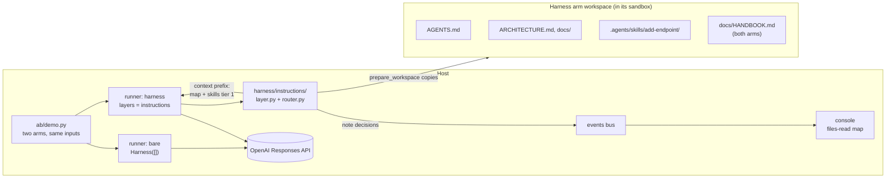
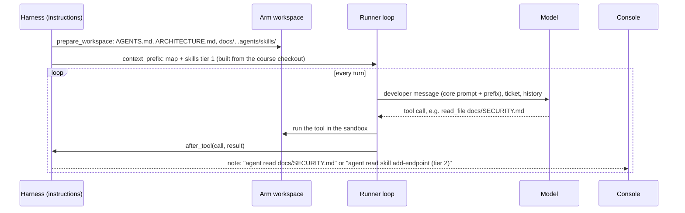

# S1 Instructions: what the agent knows

Reading time: about 15 minutes.

This section follows one order: the problem the bare arm shows, the cause (cited), the harness piece,
how `shipharness` implements it, and what the A/B measures. Source IDs (A1, B1, ...) and finding IDs
(F-a-NN, F-b-NN) are listed in [REFERENCES.md](../../REFERENCES.md), which is generated when the
course is released. Code excerpts come from the walkthrough anchors `S1:agents_md`, `S1:progressive`,
and `S1:prefix`; print one with `uv run python scripts/anchors.py extract S1:prefix`.

A note on labels. "S1", "layer", "trap", "blinded reviewer", and the house rules R1-R7 are course
labels, not source terms. "House rules" is the course's name for what A1 calls "golden principles":
"we started encoding what we call “golden principles” directly into the repository and built a
recurring cleanup process." (A1, F-a-99).

---

## 1. The problem seen in the bare run

The S1 demo task is F1, org-wide issue search. `GET /issues` lists every live issue of the caller's
org across its projects, with filters and cursor pagination (`teamtrack/docs/features/f1.md`). Both
arms start from checkpoint `m1-s1-start` and get the same ticket, which ends with: "The full spec
is in docs/features/f1.md. Follow the house rules in docs/HANDBOOK.md and add tests."
(`datasets/teamtrack-features-v1.jsonl`, example `F1-canonical`).

TeamTrack already has an endpoint that looks like most of the answer: the legacy `GET /v1/issues`
(`teamtrack/app/api/legacy_v1.py`) returns issues with offset pagination and no org filter. Its query
sits in the file the agent must edit for F1, a few lines below `list_for_project`, the tenant-scoped
query it should copy:

```python
# teamtrack/app/repositories/issues.py (lines 53-55): the legacy trap
def list_all_legacy(session: Session, offset: int, limit: int) -> list[Issue]:
    """LEGACY (used only by /v1/issues). Not tenant-scoped: do not use or copy this function."""
    return list(session.scalars(select(Issue).order_by(Issue.id).offset(offset).limit(limit)))
```

The legacy handler is a task-design choice of the course, present for both arms. It is there because
A1 reports that "Codex replicates patterns that already exist in the repository—even uneven or
suboptimal ones." (A1, F-a-20).

What the failure looks like: an arm that starts from the legacy query, or forgets the org check on one
filter, ships a `GET /issues` that answers an Acme user with Globex data. The referee's R1 check calls
every endpoint as Acme with Globex IDs and expects 404 (`src/shipharness/checks/r1_tenant.py`). The
existing `/v1/issues` leak is part of the checkpoint baseline; only new violations count.

The bare arm is not missing the rule. It is in the "Legacy /v1 API" section of `docs/HANDBOOK.md`
(line 136 of 150) and in two docstrings inside the legacy code itself. The handbook is the only place
that states it before the agent reaches that code, and only if the agent opens the handbook.

### What the pilot showed on the canonical ticket

The failure did not happen in pilot run 2. Measured in the course pilot, run 2, 2026-10-16: all six F1
arms (three bare, three harness, ticket `F1-canonical`) passed the primary measure with 0 new R1
violations and 52 of 52 hidden tests (run ids in [demo/README.md](demo/README.md) section 7). Every
bare arm opened `docs/HANDBOOK.md` with its third tool call, because the ticket names it, and
`read_file` returns up to 400 lines (`src/shipharness/runner/tools.py`), so the whole handbook was in
context before any code was read. No arm opened `app/api/legacy_v1.py`.

So the canonical ticket hands the bare arm the pointer the map would give it. The course's
pre-registered next step for a section with no gap is its trap variant: `F1-trap` names
`app/api/legacy_v1.py` as the place where "a lot of the query code exists" and does not mention the
handbook (`datasets/teamtrack-features-v1.jsonl`). Pilot run 3 runs it; the class ticket follows
the course's decision after that run.

[[PENDING: F1-trap result of pilot run 3 per arm (runs failing of 3 on r1_new_violations>=1) and one bare-arm R1 finding if any (endpoint, probe, status), with run ids | source: M6 pilot | how: course pilot (build repository)]]

---

## 2. The cause

### 2.1 What is not in context does not exist for the agent

A1 states the core point: "From the agent’s point of view, anything it can’t access in-context while
running effectively doesn’t exist." (A1, F-a-05). That covers knowledge the agent cannot find: "If it
isn’t discoverable to the agent, it’s illegible in the same way it would be unknown to a new hire
joining three months later." (A1, F-a-07).

In the bare arm the tenant rule is in the repository; whether it is in context when the agent writes
`GET /issues` depends on what it read first.

### 2.2 Agents copy the patterns they find

The second part of the cause is the trap: the agent "replicates patterns that already exist in the
repository" (A1, F-a-20). Code the agent opens is in context by definition, so a legacy handler that
already lists all issues competes with a rule the agent may never have loaded.

The course's cause 3 (agents copy existing patterns and can take actions that are hard to undo) has
no single sentence in the sources. Its support, side by side: A4's container warning (F-a-18) and its
`pkill` incident (F-a-19), A1's pattern copying (F-a-20), and A5's security model (F-a-86). S1 uses
only F-a-20, for the trap; the rest belongs to S3.

### 2.3 One big instruction file is not the fix

A simple response would be to paste every rule into the prompt. A1 explains why a single large
instruction file fails: "Context is a scarce resource. A giant instruction file crowds out the task,
the code, and the relevant docs" (A1, F-a-23); "Too much guidance becomes non-guidance." (A1,
F-a-24). It also goes stale (F-a-25) and cannot be checked mechanically (F-a-26).

---

## 3. The harness piece

### 3.1 AGENTS.md as a map

"give Codex a map, not a 1,000-page instruction manual." (A1, F-a-22). "So instead of treating
AGENTS.md as the encyclopedia, we treat it as the table of contents." (A1, F-a-27). The file is short
and always present: "A short AGENTS.md (roughly 100 lines) is injected into context and serves
primarily as a map, with pointers to deeper sources of truth elsewhere." (A1, F-a-28).

### 3.2 docs/ as the system of record

The map points into "a structured docs/ directory treated as the system of record." (A1, F-a-29).
A1's layout figure (F-a-30) puts `AGENTS.md` and `ARCHITECTURE.md` at the repository root and the
other documents inside `docs/`. TeamTrack's harness docs follow that layout, and each house rule has
one home:

| File in the harness arm's workspace | Holds |
|---|---|
| `AGENTS.md` (94 lines) | The map: "Where to look" table, house rules R1-R7 at a glance, "Do not copy" note on `/v1/issues` |
| `ARCHITECTURE.md` | Layers `api → services → repositories → db`, R6 |
| `docs/SECURITY.md` | R1 tenant isolation, R2 roles |
| `docs/design-docs/api-conventions.md` | R3 list and error envelopes, status codes |
| `docs/RELIABILITY.md` | R4 idempotent creates, R5 audit, R7 migrations |
| `docs/QUALITY_SCORE.md` | Testing, known gaps, the legacy endpoint |
| `docs/product-specs/`, `docs/references/` | Feature specs; Alembic and import-linter notes |
| `.agents/skills/add-endpoint/` | One Agent Skill: the steps for adding an endpoint |

The state layer (S2) adds `docs/exec-plans/` and the progress files; S1 does not place them.

### 3.3 Progressive disclosure, for docs and for skills

"This enables progressive disclosure: agents start with a small, stable entry point and are taught
where to look next, rather than being overwhelmed up front." (A1, F-a-36).

The Agent Skills specification defines the same idea for skills, in three tiers (B1, F-b-05):

| Tier | What loads | When | Size guidance (B1) |
|---|---|---|---|
| 1 Metadata | `name` and `description` from the frontmatter | At startup, for every skill | "~100 tokens" |
| 2 Instructions | The full `SKILL.md` body | When the skill is activated | "< 5000 tokens recommended" |
| 3 Resources | Files in `scripts/`, `references/`, `assets/` | "only when required" | Small files |

B2 calls the three stages Discovery, Activation, and Execution (B2, F-b-05). A skill's `name` "Must
match the parent directory name" (B1, F-b-02), and its `description` "Should describe both what the
skill does and when to use it" (B1, F-b-03). The description is the only text the agent has when it
decides whether to open the skill. TeamTrack's skill begins:

```yaml
# teamtrack/harness/instructions/.agents/skills/add-endpoint/SKILL.md (lines 1-4)
---
name: add-endpoint
description: Add or change a TeamTrack HTTP endpoint so it follows house rules R1-R7 (tenant scoping, roles, list and error envelopes, idempotent creates, one audit row per write, layering, migrations) and ships with tests. Use when a ticket adds a route, changes a route's behaviour, or adds a field that needs a schema change.
---
```

Its step 0, "Start from the right example", names `/v1/issues` as the wrong one and
`app/api/projects.py` as the right one. Tier 3 is `references/tests.md`, one level deep (B1, F-b-07).

### 3.4 The context prefix (course mechanism)

A1's "injected into context" (F-a-28) needs a concrete place. In `shipharness` it is the context
prefix: one stable block sent as the developer message of every session, holding the core system
prompt (the same for both arms), the map, and the skills catalogue (tier 1). No source names this
block. It is built from the course checkout, not the arm's workspace, so an agent that edits its own
`AGENTS.md` does not change what it is told (`src/shipharness/harness/instructions/router.py`).

### 3.5 Docs that are checked

"Dedicated linters and CI jobs validate that the knowledge base is up to date, cross-linked, and
structured correctly." (A1, F-a-37). Its lint messages also teach: "we write the error messages to
inject remediation instructions into agent context." (A1, F-a-97). Assignment A1 asks you to build
such a checker (broken links and rule coverage) for a restructured instruction set.

---

## 4. How shipharness implements it

### 4.1 Where the layer sits



The layer talks to the runner only through three hooks (`src/shipharness/harness/base.py`):

| Hook | What the instructions layer does | File |
|---|---|---|
| `prepare_workspace` | Copies `teamtrack/harness/instructions/` into the workspace; never touches `docs/HANDBOOK.md` | `src/shipharness/harness/instructions/layer.py` |
| `context_prefix` | Returns one block from `build_prefix`: the map, then the skills catalogue | `src/shipharness/harness/instructions/router.py` |
| `after_tool` | On a `read_file` of a placed doc or skill file, emits a `note` decision once; skill reads carry their tier | `src/shipharness/harness/instructions/layer.py` |

The layer never blocks a tool call and never calls the model; it enforces nothing. Enforcement is S3
and S4.

### 4.2 The prefix (anchor `S1:prefix`)

```python
# src/shipharness/harness/instructions/router.py (lines 29-47)
def build_prefix(source: Path) -> str:
    """One stable text block: the map, then tier 1 of every skill (name + description).

    A1: "A short AGENTS.md (roughly 100 lines) is injected into context and serves primarily as a
    map, with pointers to deeper sources of truth elsewhere." The documents the map points to are
    not injected; the agent reads them with read_file when its task needs them. Skills follow the
    same progressive disclosure (B1): only the catalogue line is here, never a SKILL.md body.
    """
    source = Path(source)
    agents_md = strip_markers((source / MAP_FILE).read_text(encoding="utf-8")).strip()
    blocks = [
        "Repository map (AGENTS.md at the workspace root). It points to the documents to read "
        "before you change code; open them with read_file when your task needs them.",
        agents_md,
    ]
    catalogue = SkillsLoader(source / SKILLS_DIR, workspace_prefix=SKILLS_DIR).catalogue_block()
    if catalogue:
        blocks.append(catalogue)
    return "\n\n".join(blocks)
```

The runner sends the core system prompt plus this block as each session's developer message
(`base_items` in `src/shipharness/runner/loop.py`); the bare arm gets the core prompt alone.

### 4.3 Progressive disclosure (anchor `S1:progressive`)

`SkillsLoader.catalogue_block` (`src/shipharness/runner/skills_loader.py`) reads only each skill's
frontmatter and writes one line per skill. Tiers 2 and 3 are never pre-loaded: the agent opens them
with `read_file`, and `skill_for_path` reports the tier a read touched, which drives the files-read map
on console screen 3.

### 4.4 The map itself (anchor `S1:agents_md`)

The anchor covers lines 1-38 of 94 in `teamtrack/harness/instructions/AGENTS.md`: the opening, the
"Where to look" table (its endpoint row points to the skill), and the house rules at a glance (R1:
"another org's resource is 404, never 403"). Below it are the "Do not copy" note on `GET /v1/issues`,
the commands, and the "Before you finish" checklist. All 94 lines are in the prefix.

### 4.5 The layer's flow in one run



### 4.6 What the bare arm gets

Course rule: the harness may reorganise knowledge, never add facts the bare arm cannot read. Every rule
in the harness docs also appears in `docs/HANDBOOK.md`, which both arms have, and a unit test checks
this (`tests/unit/harness_instructions/test_parity.py`). Both arms get the same ticket, model, effort,
tools, turn budget, cost cap, and sandbox. In demo-1 the harness arm runs the instructions layer alone
(`section_layers` in `src/shipharness/ab/demo.py`).

---

## 5. What the A/B measures

### 5.1 Primary measure (pre-registered)

The course registered one primary measure for S1 before any run: for F1, a run fails if it ships at
least one new R1 violation. The dataset carries it as `primary_measure: r1_new_violations>=1` on every
F1 task (`REGISTERED_PRIMARY` in `src/shipharness/datasets/features_checks.py`). Results are runs
failing out of k, per arm, one dot per run, never a percentage (a course rule). "New" means relative
to the checkpoint baseline.

### 5.2 Secondary measures (reported, not primary)

From each arm's score record (`ScoreRecord` in `src/shipharness/ab/score.py`):

| Field | Why it matters for S1 |
|---|---|
| `r1_leaks` | Violations whose 2xx body contains Globex data: the worst kind of R1 failure |
| `r3_new_failures` | API conventions (list and error envelopes, status codes) |
| `hidden_passed` / `hidden_total` | Did the feature work? `F1-canonical` lists 52 hidden test ids |
| `regression_passed` / `regression_total` | Existing tests keep passing |
| `reviewer_verdict` | The blinded reviewer (course design after A3's separate evaluator, F-a-110): a separate model judges each diff with every arm-identifying trace removed (`src/shipharness/reviewer/blind.py`) |
| `cost_usd`, `turns_total`, `wall_s` | What each arm spent |

The files-read map on console screen 3 is not a score; it only shows what each arm opened with
`read_file`.

### 5.3 Checks on the comparison itself

- Swap test (`make swap-1`): each arm's diff is judged again under the other arm's label, with no
  model calls; every judged measure must come out the same (`src/shipharness/ab/recorded.py`).
- Layer switch (`make demo-1 LAYERS=-instructions`): both arms run bare, so any gap is run-to-run
  variation.
- Ablation: A3 describes "removing one component at a time and reviewing what impact it had on the
  final result." (A3, F-a-125). The course's ablation batch removes `instructions` from the full stack.

### 5.4 Results

A live result is always shown next to the other dots.

| Run | Arm | Runs failing the primary measure | New R1 violations per run | Hidden tests per run | Agent time (s) |
|---|---|---|---|---|---|
| Pilot run 2, 2026-10-16, F1 canonical, k=3 | bare | 0 of 3 | 0, 0, 0 | 52 of 52 each | 171-193 |
| | harness | 0 of 3 | 0, 0, 0 | 52 of 52 each | 127-177 |
| Live console check, 2026-10-16, A/B `ab-20261016-210339-909651`, F1 canonical | bare | 0 of 1 | 0 | 52 of 52 | 198.7 |
| | harness | 0 of 1 | 0 | 52 of 52 | 133.1 |

Both ran gpt-6-luna at effort medium; run ids and reviewer verdicts are in
[demo/README.md](demo/README.md) section 7. No gap on this ticket. Three runs per arm is a pilot, not
an experiment; the batch 1 dots (k=10) are the result the class reports.

[[PENDING: S1 dots for F1 canonical, runs failing out of k per arm (r1_new_violations>=1), with run ids | source: M8 batch 1 | how: uv run shipharness report]]

[[PENDING: secondary counts for F1 canonical per arm (r1_leaks, r3_new_failures, hidden passed of 52) | source: M8 batch 1 | how: uv run shipharness report]]

[[PENDING: ablation result for the leave-out-instructions configuration (all minus instructions) on the 12 ablation tasks | source: M8 ablation | how: uv run shipharness report]]

### 5.5 What this A/B cannot tell you

- The A/B compares the same knowledge in two forms (a map in the prefix against a handbook on disk).
  It does not test whether rules help at all.
- The ticket matters as much as the harness. A ticket that points to the handbook puts the rules in
  the bare arm's context too (section 1).
- One feature, one model, one effort setting. The reworded and alternate-checkpoint F1 tasks in the
  `section-1` subset test whether a result depends on one wording or one repository state.

---

## Check your understanding

1. The bare arm has `docs/HANDBOOK.md` with the same rules. Which A1 sentence explains why the rule can
   still be missing when the query is written?
2. Why does `build_prefix` read from the course checkout and not from the arm's workspace?
3. A skill's description says only "Endpoint helper." Which tier of progressive disclosure fails, and
   what would the agent miss?
4. In pilot run 2 the bare arm passed F1 three times out of three. What in the canonical ticket made
   that likely, and what does the trap variant change?

## Sources

A1, A3, A4, A5, B1, and B2, all accessed 2026-10-16. Titles, links, and every finding ID cited here
are in [REFERENCES.md](../../REFERENCES.md).
