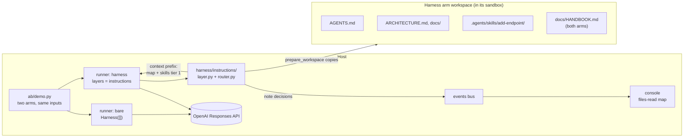
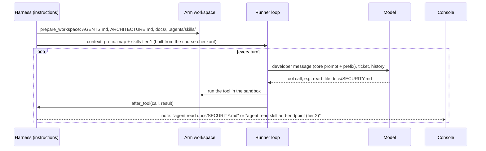

# S1 Instructions: what the agent knows

Reading time: about 15 minutes.

This section follows one order: the problem the bare arm shows, the cause (cited), the harness piece,
how `shipharness` implements it, and what the A/B measures. Source IDs (A1, B1, ...) and finding IDs
(F-a-NN, F-b-NN) point to [RESEARCH.md](../../RESEARCH.md). Code excerpts come from the walkthrough
anchors `S1:agents_md`, `S1:progressive`, and `S1:prefix`; print any of them with
`uv run python scripts/anchors.py extract S1:prefix`.

---

## 1. The problem seen in the bare run

The S1 demo task is F1, org-wide issue search. `GET /issues` lists every live issue of the caller's
org across its projects, with filters and cursor pagination (`teamtrack/docs/features/f1.md`). Both
arms start from checkpoint `m1-s1-start` and get the same ticket text, which ends with: "The full spec
is in docs/features/f1.md. Follow the house rules in docs/HANDBOOK.md and add tests."
(`datasets/teamtrack-features-v1.jsonl`, example `F1-canonical`).

TeamTrack already has an endpoint that looks like most of the answer. `GET /v1/issues` returns
issues with offset pagination, and it is not filtered by org (DESIGN §4.3):

```python
# teamtrack/app/api/legacy_v1.py (lines 21-28)
@router.get("/issues", response_model=list[IssueOut], deprecated=True)
def list_issues_v1(
    offset: int = Query(default=0, ge=0),
    limit: int = Query(default=50, ge=1, le=500),
    actor: Actor = Depends(current_actor),
    db: Session = Depends(get_db),
) -> list[IssueOut]:
    return [IssueOut.model_validate(row) for row in legacy.list_issues(db, offset, limit)]
```

The query behind it sits in the same file the agent must edit for F1, a few lines below the
tenant-scoped query it should copy:

```python
# teamtrack/app/repositories/issues.py (lines 19-26): the pattern to copy
def list_for_project(
    session: Session, org_id: int, project_id: int, after: int | None, limit: int
) -> tuple[list[Issue], int | None]:
    base = select(Issue).where(
        Issue.org_id == org_id, Issue.project_id == project_id, Issue.deleted_at.is_(None)
    )
    stmt = page(base, Issue.id, after, limit)
    return split_page(list(session.scalars(stmt)), limit, lambda i: i.id)

# teamtrack/app/repositories/issues.py (lines 53-55): the legacy trap
def list_all_legacy(session: Session, offset: int, limit: int) -> list[Issue]:
    """LEGACY (used only by /v1/issues). Not tenant-scoped: do not use or copy this function."""
    return list(session.scalars(select(Issue).order_by(Issue.id).offset(offset).limit(limit)))
```

The legacy handler is a task-design technique the course allows for both arms (DESIGN §8.3), placed
there because A1 reports that "Codex replicates patterns that already exist in the repository—even
uneven or suboptimal ones." (A1, F-a-20; RESEARCH §3.1 lists this as the basis for the trap).

What the failure looks like: an arm that starts from the legacy query, or that forgets the org check on
one filter, ships a `GET /issues` that answers an Acme user with Globex data. The referee's R1 check
calls every endpoint and method as Acme with Globex IDs and expects 404. Any other status is a
violation, and a 2xx whose body contains Globex data also counts as a leak (DESIGN §5). The `/v1/issues` leak is
part of the checkpoint baseline, so it counts against neither arm. Only new violations count.

[[PENDING: one bare-arm R1 finding for F1 (endpoint, probe, status) from the run log, with run id | source: M6 pilot | how: make demo-1]]

The bare arm is not missing the rule. The rule is on disk in three places: the "Legacy /v1 API" section
near the end of `docs/HANDBOOK.md` (line 136 of 150), the module docstring of `app/api/legacy_v1.py`,
and the docstring of `list_all_legacy` above. Two of the three sit in the legacy code itself, next to
the pattern. The handbook is the only place that states the rule before the agent reaches that code,
and the agent reads it only if it opens the handbook and reads that far. The rule for the filters
(another org's `project_id` or `assignee_id` is 404) is in the feature spec, and the general R1 rule is
in the handbook's "R1 Tenant isolation" section (line 53); both are only on disk. The cause below is about that gap.

---

## 2. The cause

### 2.1 What is not in context does not exist for the agent

A1 states the core point for this section: "From the agent’s point of view, anything it can’t access
in-context while running effectively doesn’t exist." (A1, F-a-05). It applies to knowledge outside the
repository ("Knowledge that lives in Google Docs, chat threads, or people’s heads are not accessible to
the system.", A1, F-a-06) and to knowledge the agent cannot find: "If it isn’t discoverable to the
agent, it’s illegible in the same way it would be unknown to a new hire joining three months later."
(A1, F-a-07).

In the bare arm the tenant rule is in the repository, so it passes the first test. Whether it is in
context when the agent writes `GET /issues` depends on what the agent chose to read first.

### 2.2 Agents copy the patterns they find

The second part of the cause is the trap itself: the agent "replicates patterns that already exist in
the repository" (A1, F-a-20). Code the agent opens is in context by definition. A legacy handler that
already lists all issues is the closest match to the ticket, so it competes with a rule the agent may
never have loaded. RESEARCH G-1 notes that F-a-20 is partial support for course cause 3 (copied
patterns and actions that are hard to undo); S1 uses it only for the trap.

### 2.3 One big instruction file is not the fix

A simple response would be to paste every rule into the prompt. A1 rejects that and explains why a
single large instruction file fails:

- "Context is a scarce resource. A giant instruction file crowds out the task, the code, and the
  relevant docs" (A1, F-a-23).
- "Too much guidance becomes non-guidance. When everything is “important,” nothing is." (A1, F-a-24)
- "It rots instantly. A monolithic manual turns into a graveyard of stale rules." (A1, F-a-25)
- "A single blob doesn’t lend itself to mechanical checks (coverage, freshness, ownership,
  cross-links), so drift is inevitable." (A1, F-a-26)

A1's summary of the alternative: "organizing and exposing the right information so the agent can
reason over it, rather than overwhelming it with ad-hoc instructions." (A1, F-a-41).

A2 makes the same structural move for a different kind of knowledge. Its coding agent does not have
to discover where the state lives; the prompt tells each session where to look first: "Read the git
logs and progress files to get up to speed on what was recently worked on." (A2, F-a-59). S2 builds on
that routine.

---

## 3. The harness piece

### 3.1 AGENTS.md as a map

A1 states the design goal in one line: "give Codex a map, not a 1,000-page instruction manual." (A1, F-a-22).
"So instead of treating AGENTS.md as the encyclopedia, we treat it as the table of contents." (A1,
F-a-27). The file is short and always present: "A short AGENTS.md (roughly 100 lines) is injected into
context and serves primarily as a map, with pointers to deeper sources of truth elsewhere." (A1,
F-a-28). The course calls it a map or table of contents, the source's wording (RESEARCH §4.1).

### 3.2 docs/ as the system of record

The map points into "a structured docs/ directory treated as the system of record." (A1, F-a-29).
A1's layout figure puts `AGENTS.md` and `ARCHITECTURE.md` at the repository root and `SECURITY.md`,
`RELIABILITY.md`, `QUALITY_SCORE.md`, `PLANS.md`, `design-docs/`, `product-specs/`, `exec-plans/`, and
`references/*-llms.txt` inside `docs/` (A1, F-a-30; RESEARCH §5 correction 2). A1 describes some of
these files: "Architecture documentation provides a top-level map of domains and package layering."
(A1, F-a-32); "A quality document grades each product domain and architectural layer, tracking gaps
over time." (A1, F-a-33). A1 gives file names only for the `references/*-llms.txt` files and does not
explain them (RESEARCH §3.1).

TeamTrack's harness docs follow that layout. Each house rule has one home:

| File in the harness arm's workspace | Holds |
|---|---|
| `AGENTS.md` (94 lines) | The map: "Where to look" table, house rules R1-R7 at a glance, "Do not copy" note on `/v1/issues` |
| `ARCHITECTURE.md` | Layers `api → services → repositories → db`, R6 |
| `docs/SECURITY.md` | R1 tenant isolation, R2 roles |
| `docs/design-docs/api-conventions.md` | R3 list and error envelopes, status codes |
| `docs/RELIABILITY.md` | R4 idempotent creates, R5 audit, R7 migrations |
| `docs/QUALITY_SCORE.md` | Testing, known gaps, the legacy endpoint |
| `docs/product-specs/`, `docs/references/` | Feature specs; Alembic and import-linter notes |
| `.agents/skills/add-endpoint/` | One Agent Skill: the steps for adding an endpoint |

The state layer (S2) adds `docs/exec-plans/` and the progress files; S1 does not place them.

### 3.3 Progressive disclosure, for docs and for skills

The map is the entry point, and the agent loads the rest when its task needs it: "This enables
progressive disclosure: agents start with a small, stable entry point and are taught where to look
next, rather than being overwhelmed up front." (A1, F-a-36).

The Agent Skills specification defines the same idea for skills, in three tiers (B1, F-b-05):

| Tier | What loads | When | Size guidance (B1) |
|---|---|---|---|
| 1 Metadata | `name` and `description` from the frontmatter | At startup, for every skill | "~100 tokens" |
| 2 Instructions | The full `SKILL.md` body | When the skill is activated | "< 5000 tokens recommended" |
| 3 Resources | Files in `scripts/`, `references/`, `assets/` | "only when required" | Small files |

B2 names the three stages Discovery, Activation, and Execution (B2; RESEARCH §1.1). A skill is a
folder with a `SKILL.md` whose YAML frontmatter has a required `name` (it "Must match the parent directory name",
B1, F-b-02) and a required `description` that "Should describe both what the skill does and when to
use it" (B1, F-b-03). The spec also says "Keep your main `SKILL.md` under 500 lines. Move detailed
reference material to separate files." (B1, F-b-06).

The description is what makes tier 1 work: it is the only text the agent has when it decides whether
to open the skill. TeamTrack's skill begins:

```yaml
# teamtrack/harness/instructions/.agents/skills/add-endpoint/SKILL.md (lines 1-4)
---
name: add-endpoint
description: Add or change a TeamTrack HTTP endpoint so it follows house rules R1-R7 (tenant scoping, roles, list and error envelopes, idempotent creates, one audit row per write, layering, migrations) and ships with tests. Use when a ticket adds a route, changes a route's behaviour, or adds a field that needs a schema change.
---
```

Its step 0 is "Start from the right example", which names `/v1/issues` as the wrong one and
`app/api/projects.py` as the right one. Tier 3 is `references/tests.md`, one level deep, as B1
recommends (B1, F-b-07).

### 3.4 The context prefix (course mechanism)

A1's phrase "injected into context" (F-a-28) needs a concrete place. In `shipharness` it is the
context prefix: one stable text block sent as the developer message at the start of every session's
model input. It holds the core system prompt (the same for both arms), then the map, then the skills
catalogue (tier 1). No source names this block; it is the
course's implementation of A1's "injected into context" and B1's tier 1, and it is described here
plainly, not as a source concept (RESEARCH §3 status key).

Two build decisions follow from it:

- The prefix is built once per run from the course checkout, not from the arm's workspace. If the agent
  edits its own copy of `AGENTS.md`, the prefix does not change (docstring of
  `src/shipharness/harness/instructions/router.py`).
- A stable prefix also suits prompt caching on the OpenAI Responses API, where the whole rendered
  prefix must match for a cache hit (RESEARCH §4.2, C4). This is a technical reference for cost, not a
  teaching source.

### 3.5 Docs that are checked

A1 does not trust the knowledge base to stay correct by itself: "Dedicated linters and CI jobs validate
that the knowledge base is up to date, cross-linked, and structured correctly." (A1, F-a-37). Its lint
messages also teach: "we write the error messages to inject remediation instructions into agent
context." (A1, F-a-97). Assignment A1 asks you to build such a checker (broken links and rule
coverage) for a restructured instruction set.

---

## 4. How shipharness implements it

### 4.1 Where the layer sits



The layer talks to the runner only through the hook interface (CONTRACTS §5). It uses three hooks:

| Hook | What the instructions layer does | File |
|---|---|---|
| `prepare_workspace` | Copies `teamtrack/harness/instructions/` into the workspace: `AGENTS.md` and `ARCHITECTURE.md` at the root, `docs/`, `.agents/skills/`. Never touches `docs/HANDBOOK.md` | `src/shipharness/harness/instructions/layer.py` |
| `context_prefix` | Returns one block from `build_prefix`: the map, then the skills catalogue | `src/shipharness/harness/instructions/router.py` |
| `after_tool` | On a successful `read_file` of a placed doc or skill file, records it once and emits a `note` decision; skill reads carry their tier (2 or 3) | `src/shipharness/harness/instructions/layer.py` |

The layer never blocks a tool call and never calls the model. It changes what the agent has in
context and where the rest lives on disk; it enforces nothing. Enforcement is S3 and S4.

### 4.2 The prefix (anchor `S1:prefix`)

```python
# src/shipharness/harness/instructions/router.py (lines 29-47)
def build_prefix(source: Path) -> str:
    """One stable text block: the map, then tier 1 of every skill (name + description).

    A1: "A short AGENTS.md (roughly 100 lines) is injected into context and serves primarily as a
    map, with pointers to deeper sources of truth elsewhere." The documents the map points to are
    not injected; the agent reads them with read_file when its task needs them. Skills follow the
    same progressive disclosure (B1): only the catalogue line is here, never a SKILL.md body.
    """
    source = Path(source)
    agents_md = strip_markers((source / MAP_FILE).read_text(encoding="utf-8")).strip()
    blocks = [
        "Repository map (AGENTS.md at the workspace root). It points to the documents to read "
        "before you change code; open them with read_file when your task needs them.",
        agents_md,
    ]
    catalogue = SkillsLoader(source / SKILLS_DIR, workspace_prefix=SKILLS_DIR).catalogue_block()
    if catalogue:
        blocks.append(catalogue)
    return "\n\n".join(blocks)
```

The runner joins this block after the core system prompt and sends the result as the developer
message that opens each session's input (`base_items` in `src/shipharness/runner/loop.py`). The bare arm's developer message is the
core system prompt alone.

### 4.3 Progressive disclosure (anchor `S1:progressive`)

`SkillsLoader` reads only the frontmatter of each `SKILL.md` and writes one catalogue line per skill:

```python
# src/shipharness/runner/skills_loader.py (lines 80-88)
    def catalogue_block(self) -> str:
        skills = self.catalogue()
        if not skills:
            return ""
        rows = [f"- {s.name}: {s.description} (read {s.path}/SKILL.md to use it)" for s in skills]
        return (
            "Available skills (load a skill's SKILL.md only when the task needs it):\n"
            + "\n".join(rows)
        )
```

Tiers 2 and 3 are never pre-loaded. The agent opens them with `read_file`, and `skill_for_path` tells
the layer which tier a read touched (`SKILL.md` is tier 2; any other file in the skill folder is tier
3). Those `note` decisions drive the files-read map on console screen 3.

### 4.4 The map itself (anchor `S1:agents_md`)

The anchor covers the core of the map, lines 1-38 of 94 in
`teamtrack/harness/instructions/AGENTS.md`: the opening, the "Where to look" table, and the house
rules at a glance. Two lines that matter for F1:

```markdown
<!-- teamtrack/harness/instructions/AGENTS.md (lines 14 and 31) -->
| add or change an endpoint | `.agents/skills/add-endpoint/SKILL.md` (step by step) |
- R1 Tenant isolation: another org's resource is 404, never 403. See `docs/SECURITY.md`.
```

The rest of the file (outside the anchor) holds the "Do not copy" note on `GET /v1/issues`, the
commands, the layout, and the checklist under "Before you finish". All 94 lines are in the prefix.

### 4.5 The layer's flow in one run



### 4.6 What the bare arm gets

The harness may change how knowledge is organised and delivered; it may not add facts the bare arm
cannot read (DESIGN §6.1). Every rule in the harness docs (R1-R7 and the conventions) also appears in
`docs/HANDBOOK.md`, which both arms have on disk, and a unit test checks this
(`tests/unit/harness_instructions/test_parity.py`). Both arms also get the same ticket, model, reasoning
effort, tools, turn budget, cost cap, and sandbox. The bare arm has no injected map and no skill
catalogue (DESIGN §6.2). That is the only difference in demo-1, whose harness arm runs the
instructions layer alone (DESIGN §6.6).

---

## 5. What the A/B measures

### 5.1 Primary measure (pre-registered)

DESIGN §8.2 registered one primary measure for S1 before any run: for F1, a run fails if it ships at
least one new R1 violation. The dataset carries the same rule as `primary_measure: r1_new_violations>=1`
on every F1 task (`src/shipharness/datasets/features_checks.py`, `REGISTERED_PRIMARY`). The result is
reported as runs failing out of k, per arm, one dot per run, never as a percentage (DESIGN §8.3 rule
5). "New" means relative to the checkpoint baseline, so the existing `/v1/issues` leak does not count.

### 5.2 Secondary measures (reported, not primary)

From the score record each arm gets (CONTRACTS §11):

| Field | Why it matters for S1 |
|---|---|
| `r1_leaks` | Violations whose 2xx body contains Globex data: the worst kind of R1 failure |
| `r3_new_failures` | API conventions (list and error envelopes, status codes); objective 3 of S1 |
| `r2_new_violations`, `r4_duplicates`, `r5_audit_missing`, `r6_ok`, `r7_ok` | The other house rules, all named in the map |
| `hidden_passed` / `hidden_total` | Did the feature work? The `F1-canonical` row lists 52 hidden test ids |
| `regression_passed` / `regression_total` | Existing tests keep passing |
| `reviewer_verdict` | The blinded reviewer runs in `make demo-1` too (the `ab` command's default) |
| `cost_usd`, `turns_total`, `wall_s` | What each arm spent |

The files-read map on console screen 3 is not a score. It shows which documents and skills each arm
opened with `read_file`, which helps explain a result but proves nothing by itself. Reads through
`run` (for example `cat`) are not counted (docstring of `layer.py`).

### 5.3 Checks on the comparison itself

- Swap test (`make swap-1`): each arm's shipped diff is judged again under the other arm's label, with
  no model calls. Every judged measure must come out the same, which shows that the result belongs to
  the code, not to the label (`src/shipharness/ab/recorded.py`).
- Layer switch (`make demo-1 LAYERS=-instructions`): removing the only layer of the demo-1 stack leaves
  the harness arm with no layers (`section_layers` in `src/shipharness/ab/demo.py`), so both arms run
  bare. Any gap between them is run-to-run variation, not the harness.
- Ablation (M8): A3 describes "removing one component at a time and reviewing what impact it had on
  the final result." (A3, F-a-125). The ablation batch removes `instructions` from the full stack
  (DESIGN §10.4).

### 5.4 Results

Live runs differ from run to run, so every live result is shown next to the experiment dots, never
alone (DESIGN §16, AS-8).

[[PENDING: S1 dots for F1 canonical, runs failing out of k per arm (r1_new_violations>=1), with run ids | source: M8 batch 1 | how: make report]]

[[PENDING: secondary counts for F1 canonical per arm (r1_leaks, r3_new_failures, hidden passed of 52) | source: M8 batch 1 | how: make report]]

[[PENDING: ablation result for the leave-out-instructions configuration (all minus instructions) on the 12 ablation tasks of DESIGN §10.4 | source: M8 ablation | how: make report]]

### 5.5 What this A/B cannot tell you

- The harness arm's map names the trap ("Do not copy"), and so does the handbook. The A/B compares the
  same knowledge in two forms: a short map in the prefix with focused docs and a skill, against a
  handbook on disk. It does not test whether rules help at all.
- The instructions layer advises; it does not enforce. A harness-arm run can still ship an R1
  violation, and the referee would count it.
- One feature, one model, one effort setting. The reworded and alternate-checkpoint F1 tasks in the
  `section-1` subset exist to test whether the result depends on one wording or one repository state
  (DESIGN §10.1).

---

## Check your understanding

1. The bare arm has `docs/HANDBOOK.md` with the same rules. Which A1 sentence explains why the rule can
   still be missing when the query is written?
2. Why does `build_prefix` read from the course checkout and not from the arm's workspace?
3. A skill's description says only "Endpoint helper." Which tier of progressive disclosure fails, and
   what would the agent miss?

## Sources

- A1: Ryan Lopopolo, OpenAI, "Harness engineering: leveraging Codex in an agent-first world",
  2026-02-11. Findings F-a-05, F-a-06, F-a-07, F-a-20, F-a-22 to F-a-30, F-a-32, F-a-33, F-a-36,
  F-a-37, F-a-41, F-a-97.
- A2: Justin Young, Anthropic, "Effective harnesses for long-running agents", 2025-11-26. F-a-59.
- A3: Prithvi Rajasekaran, Anthropic, "Harness design for long-running application development",
  2026-03-24. F-a-125.
- B1: Agent Skills Specification, agentskills.io/specification. F-b-02, F-b-03, F-b-05, F-b-06, F-b-07.
- B2: What are skills?, agentskills.io/what-are-skills (stage names, RESEARCH §1.1).
- C4: OpenAI prompt caching guide (technical reference, RESEARCH §4.2).

All accessed 2026-10-16 (RESEARCH.md).
