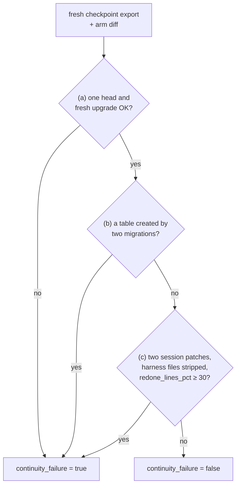

# S2 State and session lifecycle: what the agent remembers

Reading time: about 15 minutes. Source ids (A1-A7) and finding ids (F-a-NN) point to
[REFERENCES.md](../../REFERENCES.md). The section name S2, the word "layer", and the R-numbered house
rules are course labels; the ideas inside them use the sources' own words.

---

## 1. The problem

The S2 task is F2, comments on issues
([teamtrack/docs/features/f2.md](../../teamtrack/docs/features/f2.md)): three endpoints, a new
`comments` table "in exactly one new Alembic migration whose `down_revision` is the current head",
seed comments, and a comments panel on the board's issue page. The ticket ends with "This task runs
over two sessions."

The task file ([teamtrack/reference/f2/task.toml](../../teamtrack/reference/f2/task.toml)) sets
`session_budget = [20, 30]`: if the agent has not called `finish` by turn 20, the session stops and a
30-turn session starts with an empty context (a course mechanism, section 2.3). Files and git history
survive; nothing the agent read or decided survives unless it wrote it down.

The failure the course looks for: the second session does not know what the first one did, and
redoes or breaks it. On F2 the referee can check this in three ways:

- **Two migration heads, or a migration that does not upgrade.** Session 2 writes a migration from
  the old head, not knowing one exists, and Alembic has two heads. House rule R7 requires
  exactly one head and a clean `alembic upgrade head` on an empty database. "House rules" is the
  course's label for what A1 calls "golden principles", encoded "directly into the repository"
  (A1, F-a-99).
- **A second migration that creates the same table**, next to session 1's.
- **Redone work.** Session 2 throws away a large share of what session 1 wrote and writes it again.

Both arms get the same rule: the bare arm reads it in `docs/HANDBOOK.md` ("Never create a second
migration for a change that already has one"), so this is not a knowledge gap. The question is
whether the agent still knows, after the stop, what it already did.

### What the pilot saw on this task

In the course pilot, run 2 (2026-10-16; gpt-6-luna, effort medium, three A/Bs of F2 canonical), the
bare arm did not show this failure: it passed the continuity measure in 3 of 3 runs. In
`ab-20261016-181736-08a9c4` the bare arm wrote the model, repository, service, and
`migrations/versions/0002_comments.py` in session 1 without committing them. Its fourth tool call in
session 2 looked at the working tree (captured on 2026-10-16, run `r-20261016-181736-a05ddb`, the
`tool_call` event's target and the start of its result, cut; your output will differ):

```text
git status --short && git log -3 --oneline && find app -type f | sort && ls migrations/versions
exit=0
 M app/api/issues.py
 M app/api/schemas.py
 M app/db/models.py
?? app/repositories/comments.py
?? app/services/comments.py
?? migrations/versions/0002_comments.py
```

It then read the migration and carried on. A6, writing about Claude models, says: "Claude's latest
models are extremely effective at discovering state from the local filesystem." (A6, F-a-76; A6 is a
living page, accessed 2026-10-16). The pilot model is not a Claude model, so read this as one
observation that fits A6, not a test of it. It also fits A3's point that resets are model-dependent
(A3, F-a-69).

The harness arm failed the measure in all three runs, but only because of a measurement bug
(section 6). The next pilot step for F2 is a 12-turn first session, so session 1 stops earlier.

[[PENDING: one bare-arm F2 run with the 12-turn first session (--session-budget 12,38): session timeline (screen 3), migration heads line from the referee, redone_lines_pct, run id | source: M6 pilot | how: course pilot (build repository)]]

---

## 2. Why it happens

### 2.1 Each session starts with no memory

A2 states the core problem of long-running agents: "each new session begins with no memory of what
came before." (A2, F-a-08). A4 reports the same from a different setup: "each agent is dropped into
a fresh container with no context and will spend significant time orienting itself, especially on
large projects." (A4, F-a-10)

Without help, A2's agent ended sessions "leaving the next session to start with a feature
half-implemented and undocumented. The agent would then have to guess at what had happened"
(A2, F-a-12). F2's duplicate migration is that guess going wrong; and even an agent that guesses
right spends turns finding out (F-a-10).

### 2.2 Compaction is not the fix

Keeping the old context alive in compressed form does not solve it: "However, compaction isn’t
sufficient." (A2, F-a-54). A3 adds: "While compaction preserves continuity, it doesn't give the agent
a clean slate, which means context anxiety can still persist." (A3, F-a-66).

### 2.3 The context reset, and how the course produces one

A3 names the alternative: "Context resets—clearing the context window entirely and starting a fresh
agent, combined with a structured handoff that carries the previous agent's state and the next steps"
(A3, F-a-65). A2 does not use the term; the course takes it from A3.

The course needs the reset at a known point, in both arms, every run. The mechanism is the **session
turn budget**, a course mechanism, not a source term: each session has a fixed number of turns, the
first one smaller than the feature, the same for both arms. `shipharness ab --session-budget 12,38`
changes it for one A/B.

Two cautions from A3 itself. Resets are not free: "This solves the core issue, but adds orchestration
complexity, token overhead, and latency to each harness run." (A3, F-a-68). And they are
model-dependent: "Opus 4.5 largely removed that behavior on its own, so I was able to drop context
resets from this harness entirely." (A3, F-a-69). The course uses the stop to make the problem
visible, and teaches the part that holds for any model: if a session can end before the work is
done, the next one must be able to pick up from files.

---

## 3. The harness piece

The fix is state that survives the session, written where the next session will look. A3 kept two
lessons from earlier harnesses: "decomposing the build into tractable chunks, and using structured
artifacts to hand off context between sessions." (A3, F-a-71). The pieces:

| Piece | What it holds | Source |
|---|---|---|
| Initializer agent | Sets up the files below before the first coding session | "an initializer agent that sets up the environment on the first run" (A2, F-a-49) |
| `init.sh` | How to set up and check the app | "run through a basic end-to-end test before implementing a new feature." (A2, F-a-61) |
| Progress file | A log of what each session did | "a claude-progress.txt file that keeps a log of what agents have done" (A2, F-a-50). The course calls it `progress.md` |
| Git history | The changes, with messages | "the claude-progress.txt file alongside the git history." (A2, F-a-53) |
| Execution plan | The plan, its progress, the decisions | "execution plans with progress and decision logs that are checked into the repository." (A1, F-a-34) |
| Structured handoff | The previous session's state and the next steps | A3's context reset, quoted above (A3, F-a-65) |

A7, the recipe A1 links as "execution plans", sets the bar for a plan: "it should always be possible
to restart from _only_ the ExecPlan and no other work." (A7, F-a-47; A7 is archived, accessed
2026-10-16). It requires a `Progress` section, `Surprises & Discoveries`, a `Decision Log`, and
`Outcomes & Retrospective` (A7, F-a-48).

The lifecycle around these files has two routines from A2:

- **Getting up to speed** (A2's heading). At the start of a session: "Read the git logs and progress
  files to get up to speed on what was recently worked on." (A2, F-a-59), then run `init.sh` and a
  basic test, because if the app is already broken, starting a new feature "would likely make the
  problem worse." (A2, F-a-62).
- **Session end.** "End the session by writing a git commit and progress update." (A2, F-a-63).

A2's initializer is a model session that differs from the coding agent only in its first prompt
(A2, F-a-52). The course writes the initial files with deterministic harness code instead, because for
one ticket they are fixed by the ticket text (course design). The state layer never calls the model;
it writes files into the workspace and text into the prompt through the runner's layer hooks
(`BaseLayer` in `src/shipharness/harness/base.py`).

---

## 4. How shipharness implements it

All code is in `src/shipharness/harness/state/`; the layer class is `StateLayer` in `layer.py`. The
three walkthrough anchors are `S2:init`, `S2:stop_resume`, and `S2:write`
(`uv run python scripts/anchors.py extract S2:init`).

### 4.1 Initializer step (before session 1)

`StateLayer.prepare_workspace` renders four templates from `assets/` and commits them as
`harness: initializer step for F2`: `init.sh`, `progress.md`, `session-handoff.md`, and
`docs/exec-plans/active/F2.md` (`templates.py`, `initial_files`). From demo-3 on, the scope layer adds
`feature_list.json`; in demo-2 it is not there.

`progress.md` has six sections, in this order: `# Progress`, `## Current feature`, `## Done`,
`## In progress`, `## Next`, and `## Session log`. The agent edits the four middle sections; the
harness appends one entry per session to the session log.

The `init.sh` the agent gets (anchor `S2:init`, `src/shipharness/harness/state/assets/init.sh`,
lines 9-21):

```bash
set -euo pipefail
cd "$(dirname "$0")"

# A scratch database outside the repository, so setup leaves no files to commit.
export TEAMTRACK_DATABASE_URL="sqlite:////tmp/teamtrack-dev.db"
export TEAMTRACK_SEED=true

echo "== migrations (house rule R7: exactly one head)"
python -m alembic heads
python -m alembic upgrade head

echo "== basic end-to-end test: issues, stop at the first failure (full suite: run_visible_tests)"
python -m pytest tests/visible/test_issues.py -x -q --no-header -p no:cacheprovider
```

It prints the migration heads first, so session 2 sees session 1's migration before writing
anything. The basic test is one file, not the whole visible suite: in pilot run 1 the full suite ran
twice at every session start, about 44 s for `init.sh` and 36 s for `run_visible_tests` (measured in
the course pilot, run 1, 2026-10-16, before the measurement fixes).

The exec plan template (`assets/exec-plan.md`) has A7's sections plus `Purpose` and `Validation`.

### 4.2 Getting up to speed (every session)

`lifecycle.getting_up_to_speed` (`src/shipharness/harness/state/lifecycle.py`), in the harness
arm's stable context prefix, follows A2's list (F-a-58 to F-a-62): `pwd`; `progress.md` and the git
log; the handoff and the exec plan; the handoff's "Notes from the agent" before any other document;
`bash init.sh`; the handoff's visible-test line. It ends: "Spend the session on the ticket: update
progress.md, the exec plan, and the handoff only when the harness asks you to wrap up." The
notes-first rule and the late bookkeeping answer what pilot run 2 showed (section 6).

### 4.3 Wrap-up and the stop (end of session 1)

With three turns left (`wrapup_turns`), the runner sends both arms "This session is ending soon.
Turns left in this session: 3." (`runner/prompts.py`). Only the harness arm's message continues
(`lifecycle.wrapup_text`): update `progress.md`, the exec plan, and the handoff notes, including "the
house rules and file locations from the documents you read that matter for this ticket"; then commit.

When the session ends, the harness writes its own part of the handoff, whatever the agent did
(anchor `S2:stop_resume`, `src/shipharness/harness/state/lifecycle.py`, lines 96-120, cut):

```python
def session_stop(
    ctx: LayerContext, result: SessionResult, files_changed: list[str], claim: str, timeout_s: int
) -> tuple[list[HarnessDecision], str]:
    """Write the machine part of the handoff and the progress log entry, then commit them."""
    ws: Path = ctx.workspace
    summary, tests = machine_summary(ctx, result, files_changed, timeout_s)
    template = (ASSETS / HANDOFF).read_text(encoding="utf-8")
    write_file(ws, HANDOFF, handoff.merge(read_text(ws, HANDOFF), template, summary).encode())
    log = read_text(ws, PROGRESS) or (ASSETS / PROGRESS).read_text(encoding="utf-8")
    entry = progress.session_entry(result, len(files_changed), tests, claim)
    write_file(ws, PROGRESS, progress.append_session_entry(log, entry).encode())
    commit_paths(
        ctx.sandbox,
        [HANDOFF, PROGRESS],
        f"harness: session {result.index} handoff for {ctx.spec.feature_id}",
    )
    ...
```

The machine summary (`handoff.py`, `MachineSummary.render`) lists the commits, files changed,
visible-test status (the harness runs the full suite here), last five commits, open TODO markers,
migration heads read from `migrations/versions/*.py` as text, and the documents read so far. With
more than one head it adds "house rule R7 needs exactly one". The harness rewrites only "Machine
summary", never the agent's notes. Writing it even when the agent writes nothing is course design.

The progress log line (anchor `S2:write`, `progress.session_entry`) records the session index, start
and end commit, how the session ended, turns, files changed, and visible tests;
`append_session_entry` adds it under `## Session log` and restores the heading if the agent removed
it.

### 4.4 Resume and plan completion

Both arms' session 2 gets the same ticket and the sentence "A previous session worked on this ticket
and was stopped." (`runner/prompts.py`). The harness arm's resume text (`lifecycle.resume_text`) adds
the Getting up to speed steps and the first 3,000 characters of the machine summary.
`StateLayer.on_phase_end` moves the plan to `docs/exec-plans/completed/` only after the scope layer
sets `passes`, so in demo-2 it stays in `active/`.

```mermaid
sequenceDiagram
  participant H as state layer
  participant P1 as session 1
  participant Repo as workspace + git
  participant P2 as session 2
  H->>Repo: initializer step: init.sh, progress.md,<br/>session-handoff.md, exec plan; commit
  P1->>Repo: Getting up to speed, then code and commits<br/>(no bookkeeping yet)
  H->>P1: wrap-up at 3 turns left
  P1->>Repo: progress, exec plan, handoff notes<br/>(rules and files that matter), commit
  Note over P1: turn budget used, session_stop
  H->>Repo: machine summary + session log entry; commit
  Note over P2: empty context, session_resume
  H->>P2: neutral resume sentence + handoff summary
  P2->>Repo: reads handoff notes first, progress.md, git log,<br/>runs init.sh (sees migration heads)
  P2->>Repo: continues the feature
```

*The state layer's flow across one stop (canonical budget 20 then 30 turns; the pilot's lever: 12
then 38). The bare arm has the same two sessions, wrap-up turns, and resume sentence, with none of
the files.*

---

## 5. What the A/B measures

The S2 primary measure, `continuity_failure`, was registered before any run (course design). A run
fails if any of these holds (`src/shipharness/checks/continuity.py`):

- (a) R7 fails: migration heads are not exactly one, or a fresh `alembic upgrade head` fails;
- (b) a second migration creates a table that another migration already creates;
- (c) 30% or more of the lines added in session 1 are removed in session 2 (`REDONE_THRESHOLD_PCT`).

Results are runs failing out of k, per arm, one dot per run; the components are secondary. The score
record (`src/shipharness/ab/score.py`) also carries `redone_lines_pct`: the share of session 1's added
lines that session 2 removes, per file and line text (`None` with fewer than two session patches).

Session patches are written on the host after the run (`ab/demo.py`, `session_patches`) from each
session's start and end working-tree snapshots, so an arm that never commits is measured like one that
does. The referee strips the harness's files from them (`ab/referee.py`, `_product_sessions`) and runs
the check in its own container on a fresh export with the arm's diff applied.



*The referee's decision for one run. The same code judges both arms; the arm label is never an input.*

Read the result with these limits in mind:

- The runner starts a second build session only when the first ends by its turn budget
  (`runner/loop.py`). An arm that calls `finish` in session 1, even on its last turn, has one build
  session and no stop. Parts (a) and (b) still apply; part (c) then compares the build session with
  the test phase's session, which also starts with an empty context.
- A bare arm that passes S2 on a given model is a result about that model, effort, and budget, not
  evidence that state files are never needed (A3, F-a-69).

---

## 6. What the pilot found

The course pilot ran each section's A/B three times before the class. F2 in run 2 (measured in the
course pilot, run 2, 2026-10-16; A/Bs `ab-20261016-181736-08a9c4`, `ab-20261016-184318-636e90`,
`ab-20261016-190548-ae9abe`):

| Arm | Primary passed | Agent time limit hit | Agent time (s) | Harness time (s) |
|---|---|---|---|---|
| bare | 3/3 | 0/3 | 215-242 | 0 |
| harness | 0/3 | 1/3 | 265-303 | 54-64 |

**A measurement bug.** The continuity check read the raw session patches, which included the
harness's own files. In every F2 harness arm, session 1 added only `progress.md`,
`session-handoff.md`, and the exec plan, and session 2 rewrote them; part (c) scored that as session 2
removing 50-84% of session 1's lines. The fix strips the harness's files from the session patches
before the check. It is labelled "bug fix, applies to both arms" (the bare arm has no such files), and
the primary measure is unchanged.

**Turn cost.** In the run 2 logs every harness session re-read 3 to 7 instruction documents and
about 15 product files and updated its state files mid-session; the F2 harness arms made 0 to 1
product patches in 50 build turns. That is A4's orienting cost (F-a-10), caused by the harness. The
change that followed (harness arm only): agent notes before any document, state files only in the
wrap-up, the rules that matter recorded there, and the documents already read listed (sections 4.2
and 4.3).

The lesson for your own harness: state files cost turns, and an A/B can show that cost. A3 says the
same of resets ("token overhead, and latency", F-a-68).

**The next run.** With the bug fixed, run 2's bare arms still passed, so F2 had no gap. The lever
registered for pilot run 3 is a tighter session turn budget: F2 canonical with a 12-turn first session
and 38 turns after it, the same 50 in total, for both arms (`--session-budget 12,38`). The class task
follows the pilot's decision after run 3.

[[PENDING: pilot run 3 F2 rows (12-turn first session): continuity_failure per arm out of k=3, components, redone_lines_pct, and the class task decision | source: M6 pilot | how: course pilot (build repository)]]

[[PENDING: S2 primary measure, continuity_failure runs out of k=10 per arm, with components (a), (b), (c) and redone_lines_pct per run, and run ids | source: M8 batch 1 | how: uv run shipharness experiments --split section-2 --k 10 --reviewer --batch batch-1, then uv run shipharness report]]

[[PENDING: ablation result for leaving the state layer out on the S2 tasks | source: M8 ablation | how: uv run shipharness experiments --split section-2 --k 2 --layers=-state --batch ablation, then uv run shipharness report]]

---

## Further reading

The [post-class reading](post-class-reading/README.md) goes deeper: the sources side by side, the
templates against A7 and A3, and the continuity check line by line. The
[session notes](session-notes.md) summarise the class.
