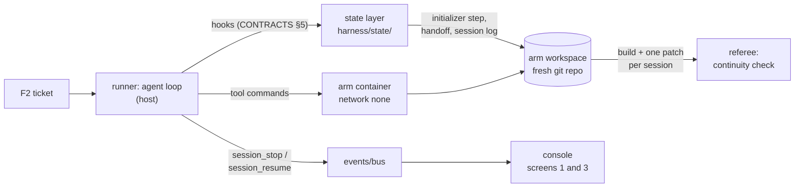
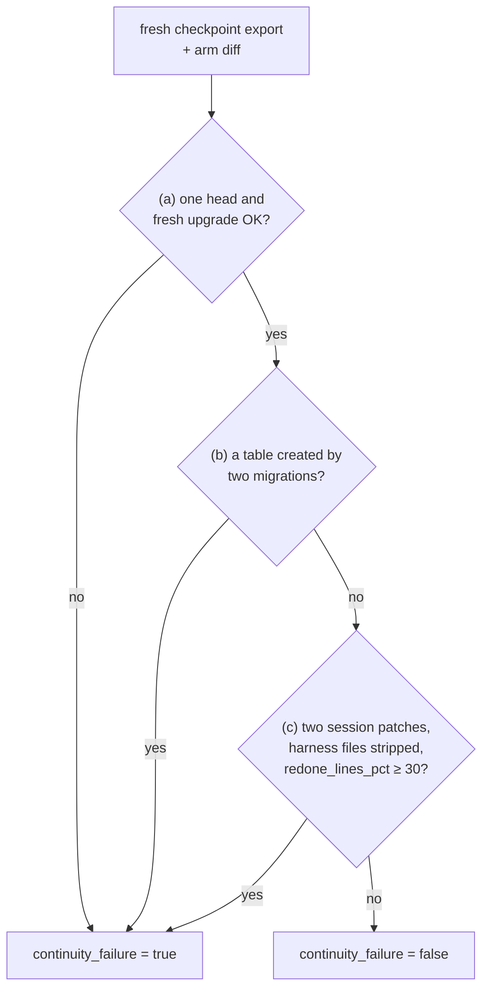

# S2 State and session lifecycle: what the agent remembers

Reading time: about 15 minutes. Source ids (A1-A7) and finding ids (F-a-NN) point to
[RESEARCH.md](../../RESEARCH.md) and [research/notes/R-a.md](../../research/notes/R-a.md). The section
title is a course label (RESEARCH §4.1); the ideas inside it use the sources' own words.

Order: the problem, its cause, the harness piece, how `shipharness` implements it, what the A/B
measures, and what the pilot found when it measured it.

---

## 1. The problem

The S2 task is F2, comments on issues ([teamtrack/docs/features/f2.md](../../teamtrack/docs/features/f2.md)):
three endpoints, a new `comments` table "in exactly one new Alembic migration whose `down_revision` is
the current head", seed comments, and a comments panel on the board's issue page. The ticket ends
with "This task runs over two sessions."

The task file ([teamtrack/reference/f2/task.toml](../../teamtrack/reference/f2/task.toml)) sets
`session_budget = [20, 30]`: the build phase gets a first session of 20 turns and a second of 30. If
the agent has not called `finish` by turn 20, the session stops. The second session starts with an
empty context. The files on disk and the git history survive; nothing the agent read or decided
survives unless it wrote it down.

The course storyline names the failure: "a second session does not know what the first session did,
and redoes or breaks it" (DESIGN §1). On F2 this shows up in three ways the referee can check
(DESIGN §8.2):

- **Two migration heads, or a migration that does not upgrade.** Session 2 does not know a migration
  exists, writes another one from the old head, and Alembic now has two heads. House rule R7 requires
  exactly one head and a clean `alembic upgrade head` on an empty database (DESIGN §5).
- **A second migration that creates the same table.** Session 2 writes its own `create_table("comments")`
  next to session 1's.
- **Redone work.** Session 2 throws away a large share of what session 1 wrote and writes it again.

Both arms get the same rule in their docs: the bare arm reads it in `docs/HANDBOOK.md` ("Never create
a second migration for a change that already has one"), so this is not a knowledge gap (DESIGN §6.1).
The question is whether the agent still knows, after the stop, what it already did.

### What the pilot saw on this task

In pilot run 2 (gpt-6-luna, effort medium, three A/Bs of F2 canonical), the bare arm did not show
this failure: it passed the continuity measure in 3 of 3 runs (VERIFICATION.md, M6 pilot run 2). The
event log shows how. In `ab-20261016-181736-08a9c4` the bare arm wrote the model, repository,
service, and `migrations/versions/0002_comments.py` in session 1 without committing them. Its fourth
tool call in session 2 was a look at the working tree (captured on 2026-10-16, run
`r-20261016-181736-a05ddb`, the `tool_call` event's target and the start of its result, cut; your
output will differ):

```text
git status --short && git log -3 --oneline && find app -type f | sort && ls migrations/versions
exit=0
 M app/api/issues.py
 M app/api/schemas.py
 M app/db/models.py
?? app/repositories/comments.py
?? app/services/comments.py
?? migrations/versions/0002_comments.py
```

It then read `migrations/versions/0002_comments.py` and carried on with the API, the board, the
seed, and tests. A6, writing about Claude models, says the same thing happens there: "Claude's latest
models are extremely effective at discovering state from the local filesystem." (A6, F-a-76; A6 is
supplementary, RESEARCH G-3). The pilot model is not a Claude model, so read this as one observation
that fits A6, not as a test of it. It also fits A3's caution that resets are model-dependent
(A3, F-a-69, section 2.3).

The harness arm failed the measure in all three runs, but only because of a measurement bug; it also
spent most of its turns re-reading documents and keeping its state files up to date. Both were the
course's own problems, not the agent forgetting (section 6). The pilot's next step for F2 is a tighter session turn
budget: a 12-turn first session, so session 1 stops earlier in the feature (DESIGN §10.4).

[[PENDING: one bare-arm F2 run with the 12-turn first session (--session-budget 12,38): session timeline (screen 3), migration heads line from the referee, redone_lines_pct, run id | source: M6 pilot | how: uv run shipharness ab --section demo-2 --feature F2 --session-budget 12,38 --purpose pilot]]

---

## 2. Why it happens

### 2.1 Each session starts with no memory

A2 states the core problem of long-running agents: "each new session begins with no memory of what
came before." (A2, F-a-08). A2 compares it to "a software project staffed by engineers working in
shifts, where each new engineer arrives with no memory of what happened on the previous shift."
(A2, F-a-09; A2's analogy). A4 reports the same from a different setup: "each agent is dropped into a
fresh container with no context and will spend significant time orienting itself, especially on large
projects." (A4, F-a-10)

A2 lists what goes wrong without help. The agent tried "to do too much at once—essentially to attempt
to one-shot the app." (A2, F-a-11), which ended with "leaving the next session to start with a feature
half-implemented and undocumented. The agent would then have to guess at what had happened"
(A2, F-a-12). F2's duplicate migration is that guess going wrong.

A4's phrase "spend significant time orienting itself" (F-a-10) names the other cost: even an agent
that guesses right spends turns finding out. The pilot measured that cost in the harness arm too
(section 6).

### 2.2 Compaction is not the fix

Keeping the old context alive in compressed form does not solve it: "However, compaction isn’t
sufficient." (A2, F-a-54), because compaction "doesn’t always pass perfectly clear instructions to the
next agent." (A2, F-a-55). A3 adds that "While compaction preserves continuity, it doesn't give the
agent a clean slate, which means context anxiety can still persist." (A3, F-a-66). Context anxiety is
A3's term for models that "begin wrapping up work prematurely as they approach what they believe is
their context limit" (A3, F-a-67).

### 2.3 The context reset, and how the course produces one

A3 names the alternative: "Context resets—clearing the context window entirely and starting a fresh
agent, combined with a structured handoff that carries the previous agent's state and the next steps"
(A3, F-a-65). A2 does not use the term "context reset" (research/notes/R-a.md, "Corrections to the
brief", item 8); the course takes it from A3.

The course needs a reset to happen at a known point, in both arms, every run. The mechanism is the
**session turn budget**: each session has a fixed number of turns, and the first session's budget is
smaller than the feature. This is a course mechanism, not a source term (RESEARCH G-5), and it is one
of the allowed task-design techniques because both arms get the same budget (DESIGN §8.3). What
happens at the stop is A3's context reset: the context is cleared and a fresh session starts. The
budget can be changed per A/B without touching the dataset: `shipharness ab --session-budget 12,38`
gives the 12-turn first session the pilot pre-registered for run 3 (DESIGN §10.4).

Two cautions from A3 itself. Resets are not free: "This solves the core issue, but adds orchestration
complexity, token overhead, and latency to each harness run." (A3, F-a-68). And they are
model-dependent: "Opus 4.5 largely removed that behavior on its own, so I was able to drop context
resets from this harness entirely." (A3, F-a-69). The course does not teach resets as a standing rule
(RESEARCH §5, correction 4). It uses the stop to make the problem visible, and teaches the part that
holds whatever the model: if a session can end before the work is done, the next one must be able to
pick up from files.

---

## 3. The harness piece

The fix is state that survives the session, written where the next session will look. A3 summarises
the two lessons it kept from earlier harnesses: "decomposing the build into tractable chunks, and
using structured artifacts to hand off context between sessions." (A3, F-a-71). The pieces:

| Piece | What it holds | Source |
|---|---|---|
| Initializer agent | Sets up the files below before the first coding session | "an initializer agent that sets up the environment on the first run, and a coding agent that is tasked with making incremental progress in every session" (A2, F-a-49) |
| `init.sh` | How to set up and check the app, so no session spends turns working it out | "ask the initializer agent to write an init.sh script that can run the development server, and then run through a basic end-to-end test before implementing a new feature." (A2, F-a-61) |
| Progress file | A log of what each session did | A2's initializer writes "a claude-progress.txt file that keeps a log of what agents have done" (A2, F-a-50). The course calls it `progress.md` |
| Git history | The changes themselves, with messages | State is "accomplished with the claude-progress.txt file alongside the git history." (A2, F-a-53); git also lets the model "revert bad code changes and recover working states of the code base." (A2, F-a-57) |
| Execution plan | The plan, its progress, and the decisions taken | "complex work is captured in execution plans with progress and decision logs that are checked into the repository." (A1, F-a-34); "Active plans, completed plans, and known technical debt are all versioned and co-located" (A1, F-a-35) |
| Structured handoff | The previous session's state and the next steps | A3's context reset, quoted above (A3, F-a-65) |

A7, the recipe A1 links as "execution plans", sets the bar for a plan: "it should always be possible
to restart from _only_ the ExecPlan and no other work." (A7, F-a-47; A7 is archived, RESEARCH G-3).
It requires living sections: "ExecPlans must contain and maintain a `Progress` section, a `Surprises &
Discoveries` section, a `Decision Log`, and an `Outcomes & Retrospective` section." (A7, F-a-48).

The lifecycle around these files has two routines from A2:

- **Getting up to speed** (A2's heading). At the start of a session: "Read the git logs and progress
  files to get up to speed on what was recently worked on." (A2, F-a-59), then run `init.sh` and a basic
  test, because if the app is already broken and the agent starts a new feature, "it would likely make
  the problem worse." (A2, F-a-62).
- **Session end.** "End the session by writing a git commit and progress update." (A2, F-a-63).

A2's initializer is a model session. A2 is explicit that this is a prompt difference, not a different
system: "We refer to these as separate agents in this context only because they have different initial
user prompts." (A2, F-a-52). The course goes one step further and writes the initial files with
deterministic harness code, because for one ticket they are fixed by the ticket text (course design,
DESIGN §6.3 and §15 D-11).



*Where the state layer sits. It never calls the model; it writes files into the workspace and text
into the prompt through the runner's hooks.*

---

## 4. How shipharness implements it

All code is in `src/shipharness/harness/state/`. The layer class is `StateLayer` in `layer.py`; the
three walkthrough anchors are `S2:init`, `S2:stop_resume`, and `S2:write`
(`uv run python scripts/anchors.py extract S2:init`).

### 4.1 Initializer step (before session 1)

`StateLayer.prepare_workspace` renders four templates from `assets/` and commits them as
`harness: initializer step for F2`: `init.sh`, `progress.md`, `session-handoff.md`, and
`docs/exec-plans/active/F2.md` (`templates.py`, `initial_files`). With the scope layer on (from demo-3),
the scope layer adds `feature_list.json`; in demo-2 it is not there.

The `init.sh` the agent gets (anchor `S2:init`, `src/shipharness/harness/state/assets/init.sh`,
lines 9-21):

```bash
set -euo pipefail
cd "$(dirname "$0")"

# A scratch database outside the repository, so setup leaves no files to commit.
export TEAMTRACK_DATABASE_URL="sqlite:////tmp/teamtrack-dev.db"
export TEAMTRACK_SEED=true

echo "== migrations (house rule R7: exactly one head)"
python -m alembic heads
python -m alembic upgrade head

echo "== basic end-to-end test: issues, stop at the first failure (full suite: run_visible_tests)"
python -m pytest tests/visible/test_issues.py -x -q --no-header -p no:cacheprovider
```

The first thing it prints in a resumed session is the list of migration heads. If session 1 already
wrote the comments migration, session 2 sees it before writing anything. The basic test is one
end-to-end test file, not the whole visible suite: in pilot run 1 the full suite ran twice at every
session start, about 44 s for `init.sh` and 36 s for `run_visible_tests` of agent time (VERIFICATION.md,
M6 pilot, change 8).

The exec plan template (`assets/exec-plan.md`) has the A7 sections: Purpose (with the ticket's steps),
Progress, Surprises & Discoveries, Decision Log, Outcomes & Retrospective, and Validation
(CONTRACTS §15.4).

### 4.2 Getting up to speed (every session)

`lifecycle.getting_up_to_speed` is a block in the harness arm's stable context prefix
(`src/shipharness/harness/state/lifecycle.py`, lines 21-53, shown without the `scope` branch):

```python
    steps = [
        "Run `pwd` to see the directory you are working in. You can only edit files in this "
        "directory.",
        "Read progress.md and the git log (`git log --oneline -20`) to see what was recently "
        "worked on.",
        f"Read session-handoff.md (the structured handoff from the last session) and the exec "
        f"plan {exec_plan_path(spec.feature_id)}.",
        'Read the "Notes from the agent" in session-handoff.md before any other document: '
        "earlier sessions wrote down the house rules and files that matter for this ticket. Open a "
        "document from the AGENTS.md map only for a detail the notes do not cover (in the first "
        "session, only the documents for the parts you will change).",
    ]
    ...
    steps += [
        "Run `bash init.sh` to set up the database and run a basic end-to-end test.",
        'Read the "Visible tests" line in session-handoff.md: the harness ran the full visible '
        "suite when the last session ended. If it lists failures, fix them before you start new "
        "work. In the first session there is no such line yet: run the visible tests once with "
        "run_visible_tests.",
    ]
```

The block ends: "Spend the session on the ticket: update progress.md, the exec plan, and the handoff
only when the harness asks you to wrap up." The steps follow A2's list (F-a-58 to F-a-62). Two parts
are the course's answer to what pilot run 2 showed (section 6): the agent's own notes come before any
document, and the bookkeeping waits for the wrap-up (VERIFICATION.md, M6 pilot, change 9).

### 4.3 Wrap-up and the stop (end of session 1)

When three turns are left (`wrapup_turns`, `config/settings.py`), the runner sends both arms "This
session is ending soon. Turns left in this session: 3." (`runner/prompts.py`). The harness arm's
message continues with `lifecycle.wrapup_text`: update `progress.md`; update the exec plan's Progress
and Decision Log; write notes in `session-handoff.md`, including "the house rules and file locations
from the documents you read that matter for this ticket, so the next session does not need to read
them again"; and commit. The bare arm gets only the first sentence. Both arms get the same number of
turns (DESIGN §6.3).

When the session ends, the harness writes its own part of the handoff, whether or not the agent did
anything (anchor `S2:stop_resume`, `src/shipharness/harness/state/lifecycle.py`, lines 96-120):

```python
def session_stop(
    ctx: LayerContext, result: SessionResult, files_changed: list[str], claim: str, timeout_s: int
) -> tuple[list[HarnessDecision], str]:
    """Write the machine part of the handoff and the progress log entry, then commit them."""
    ws: Path = ctx.workspace
    summary, tests = machine_summary(ctx, result, files_changed, timeout_s)
    template = (ASSETS / HANDOFF).read_text(encoding="utf-8")
    write_file(ws, HANDOFF, handoff.merge(read_text(ws, HANDOFF), template, summary).encode())
    log = read_text(ws, PROGRESS) or (ASSETS / PROGRESS).read_text(encoding="utf-8")
    entry = progress.session_entry(result, len(files_changed), tests, claim)
    write_file(ws, PROGRESS, progress.append_session_entry(log, entry).encode())
    commit_paths(
        ctx.sandbox,
        [HANDOFF, PROGRESS],
        f"harness: session {result.index} handoff for {ctx.spec.feature_id}",
    )
    ctx.state["state.handoff_path"] = HANDOFF
    stop = HarnessDecision(
        kind="session_stop",
        layer="state",
        message=f"session {result.index} handoff written to {HANDOFF}",
        paths=[HANDOFF, PROGRESS],
        data={"session_index": result.index, "files_changed": len(files_changed)},
    )
    return [stop], summary
```

The machine summary (`handoff.py`, `MachineSummary.render`) lists the start and end commits, the files
changed in the session, the visible-test status (the harness runs the full visible suite here), the
last five commits, open TODO markers in changed files, the migration heads read from
`migrations/versions/*.py` as text, and the harness documents the agent has read so far. When there is
more than one head it adds "house rule R7 needs exactly one". The agent's own notes stay under "Notes
from the agent"; the harness only rewrites "Machine summary". Writing a machine part even when the
agent writes nothing is course design (DESIGN §6.3).

The progress log line (anchor `S2:write`, `src/shipharness/harness/state/progress.py`, lines 12-22):

```python
def session_entry(
    result: SessionResult, files_changed: int, tests: str, claim_summary: str = ""
) -> str:
    """One log line: index, start/end commit, how the session ended, and a summary."""
    entry = (
        f"- Session {result.index} ({result.phase}): start {result.start_sha[:7] or 'none'}, "
        f"end {result.end_sha[:7] or 'none'}, ended by {result.ended_by} after "
        f"{result.turns} turns. {files_changed} files changed; visible tests {tests}."
    )
    summary = " ".join(mask_keys(claim_summary).split())[:200]
    return entry + (f' Agent summary: "{summary}"' if summary else "")
```

The agent edits every section of `progress.md` except "Session log"; the harness appends one entry
there per session and restores the heading if the agent removed it (`append_session_entry`).

### 4.4 Resume (start of session 2)

The new session gets the same developer message, the same ticket, and the neutral resume sentence
both arms receive: "A previous session worked on this ticket and was stopped." (`runner/prompts.py`).
The harness arm's resume text (`lifecycle.resume_text`) adds: start with the Getting up to speed
steps, the handoff is in `session-handoff.md`, followed by the first 3,000 characters of the machine
summary.

### 4.5 Exec plan completion

`StateLayer.on_phase_end` moves the plan from `docs/exec-plans/active/` to `completed/` and commits
it, but only after the scope layer has set `passes` (`scope.passes_set`). In demo-2 the scope layer is
off, so the plan stays in `active/`; the move first happens in demo-3.

```mermaid
sequenceDiagram
  participant H as state layer
  participant P1 as session 1
  participant Repo as workspace + git
  participant P2 as session 2
  H->>Repo: initializer step: init.sh, progress.md,<br/>session-handoff.md, exec plan; commit
  P1->>Repo: Getting up to speed, then code and commits<br/>(no bookkeeping yet)
  H->>P1: wrap-up at 3 turns left
  P1->>Repo: progress, exec plan, handoff notes<br/>(rules and files that matter), commit
  Note over P1: turn budget used, session_stop
  H->>Repo: machine summary + session log entry; commit
  Note over P2: empty context, session_resume
  H->>P2: neutral resume sentence + handoff summary
  P2->>Repo: reads handoff notes first, progress.md, git log,<br/>runs init.sh (sees migration heads)
  P2->>Repo: continues the feature
```

*The state layer's flow across one forced stop (canonical budget: 20 then 30 turns; run 3 lever: 12
then 38). The bare arm has the same two sessions, the same wrap-up turns, and the same resume
sentence, with none of the files.*

---

## 5. What the A/B measures

The S2 primary measure was registered before any run (DESIGN §8.2, CONTRACTS §22): `continuity_failure`.
A run fails if any of these holds (`src/shipharness/checks/continuity.py`):

- (a) R7 fails: migration heads are not exactly one, or a fresh `alembic upgrade head` fails;
- (b) a second migration creates a table that another migration already creates;
- (c) 30% or more of the lines added in session 1 are removed in session 2 (`REDONE_THRESHOLD_PCT`).

Results are reported as runs failing out of k, per arm, one dot per run; the three components are
secondary (DESIGN §8.2). Two numbers go with it:

- `redone_lines_pct`: the share of session 1's added lines that session 2 removes, counted per file
  and per line text, ignoring blank lines. It is `None` when a run has fewer than two session patches.
  It is a field of the score record (CONTRACTS §11).
- `sessions`: a metric of the continuity check result, the number of `session_stop` events the run
  log holds for that run id (an A/B writes both arms into one log, so the check counts only the scored
  run's events; CONTRACTS §22).

Session patches are written on the host after the run (`ab/demo.py`, `session_patches`): the change
between each session's start and end working-tree snapshots, so an arm that never commits is measured
like one that does (VERIFICATION.md, M6 pilot, change 2). Before the check, the referee strips the
harness artifacts (`progress.md`, `session-handoff.md`, the exec plan) from those patches, as it
already did for the shipped diff (`ab/referee.py`, `_product_sessions`; change 7). The referee runs
the check in its own container on a fresh export with the arm's diff applied, never in the arm's
container (DESIGN §8.1).



*The referee's decision for one run. The same code judges both arms; the arm label is never an input.*

Read the result with these limits in mind:

- If an arm calls `finish` before its first session's budget is used, its build phase has one session
  and no stop. Parts (a) and (b) still apply. Part (c) compares the first two session patches of the
  run, so in that case the second patch is the test phase's session (every phase starts a new session
  with an empty context, `runner/loop.py`).
- A3 dropped resets for a later model (F-a-69). A bare arm that passes S2 on a given model is a
  result about that model at that effort and that budget, not evidence that state files are never
  needed.

---

## 6. What the pilot found

The M6 pilot ran the A/B before the class, k=3 per section (VERIFICATION.md, M6 pilot). Run 2's F2 rows
(VERIFICATION.md, M6 pilot run 2):

| Arm | Primary passed | Agent time limit hit | Agent time (s) | Harness time (s) |
|---|---|---|---|---|
| bare | 3/3 | 0/3 | 215-242 | 0 |
| harness | 0/3 | 1/3 | 265-303 | 54-64 |

The harness arm failed the measure only because of a measurement bug. A second finding, turn cost,
explains why it built so little. Neither is the forgetting this section is about.

**A measurement bug.** The continuity check read the raw session patches, which included the
harness's own files. In every F2 harness arm, session 1 added only `progress.md`,
`session-handoff.md`, and the exec plan, and session 2 rewrote them; part (c) scored that as session 2
removing 50-84% of session 1's lines (VERIFICATION.md, M6 pilot run 2, "Why it failed"). The fix,
change 7, strips harness artifacts from the session patches before the check. It is labelled "bug fix,
applies to both arms", and the primary measure is unchanged.

**Turn cost.** "Every session repeated the getting-up-to-speed steps, re-read 3 to 7 instruction
documents and about 15 product files, and updated progress.md and the exec plan mid-session. F2
harness arms made 0 to 1 product patches in 50 build turns." (VERIFICATION.md, M6 pilot run 2). This is
A4's "spend significant time orienting itself" (F-a-10) caused by the harness itself. Change 9 is a
harness change, harness arm only: the session start reads the handoff's agent notes before any
document, progress.md, the exec plan, and the handoff are updated only in the wrap-up turns, the
wrap-up asks the agent to record the rules that matter, and the handoff lists the documents already
read (section 4.2 and 4.3).

The lesson for your own harness: state files have a cost in turns, and an A/B can show that cost.
A3 says the same of resets ("token overhead, and latency", F-a-68).

**The next run.** With the bug fixed, run 2's bare arms still passed, so F2 had no gap. The
pre-registered lever for run 3 is a tighter session turn budget: `F2-canonical` with a 12-turn first
session and 38 turns after it, the same 50 in total, for both arms (`shipharness ab --session-budget
12,38`; DESIGN §10.4; VERIFICATION.md, overnight run 2026-10-17). Which task the class uses follows
the pilot decision recorded in VERIFICATION.md.

[[PENDING: pilot run 3 F2 rows (12-turn first session): continuity_failure per arm out of k=3, components, redone_lines_pct, and the class task decision | source: M6 pilot | how: scripts/pilot.py --budgets F2=12/38 (pilot run 3); VERIFICATION.md]]

[[PENDING: S2 primary measure, continuity_failure runs out of k=10 per arm, with components (a), (b), (c) and redone_lines_pct per run, and run ids | source: M8 batch 1 | how: make experiments BATCH=1 && make report]]

[[PENDING: ablation result for leaving the state layer out (LAYERS=-state) on the S2 tasks | source: M8 ablation | how: make experiments BATCH=2 && make report]]

---

## Further reading

The [post-class reading](post-class-reading/README.md) has the sources side by side, the exec-plan and
handoff templates against A7 and A3, and the continuity check line by line, including the pilot's
measurement bug. The [session notes](session-notes.md) summarise the class and the questions it
raised.
