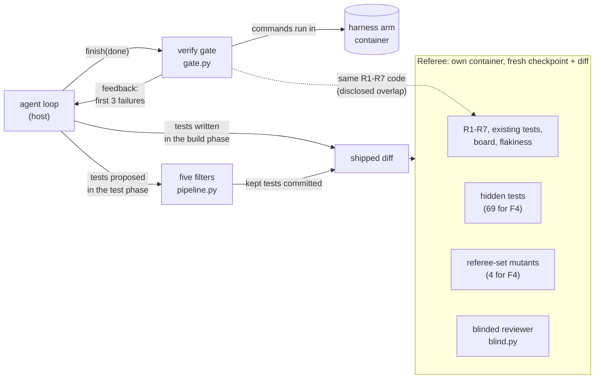

# S4 Verification: what proves the work is done

Reading time: about 15 minutes.

"S4 Verification" is a course label. The ideas inside it come from published sources, cited by
source ID and finding ID, for example (A3, F-a-110); every ID resolves in
[REFERENCES.md](../../REFERENCES.md). Quotes are verbatim and short.

Order: the problem in the bare run, its cause, the harness piece, how `shipharness` builds it, what
the A/B measures, and what the course pilot measured.

---

## 1. The problem in the bare run

### The task: F4, optimistic concurrency and issue history

Both arms start from checkpoint `m1-s4-start` with the same F4 ticket (spec:
`teamtrack/docs/features/f4.md`; allowed paths: `teamtrack/reference/f4/task.toml`).
`GET /issues/{issue_id}` returns `ETag: "<version>"`; writes accept an **optional**
`If-Match: "<version>"` header, and a stale or malformed value gives 412 and changes nothing;
`GET /issues/{issue_id}/history` lists the audit entries, oldest first; a stale save on the board
gets a 409 page instead of overwriting.

### Why F4 is hard to check from the inside

The header is optional, so a request without `If-Match` changes the issue exactly as before. Every
existing test keeps passing whether concurrency works or not, and so does a happy-path request. The
bug shows only when two writers race on one issue. With previews on, the console shows that race:
tab A saves, then tab B saves from its stale form (`capture_conflict` in
`src/shipharness/console/board_capture.py`). If B wins, the board shows **✗ LOST UPDATE**; a 409,
412, or 428 shows **✓ CONFLICT DETECTED**.

### What the bare arm does at the end

The bare arm runs with `--layers none`. When it calls `finish(claim="done")`, nothing checks the
claim and the phase ends on the agent's word (course design). The referee then judges the shipped
diff in its own container against two counts the agent never saw: the 69 hidden tests in
`teamtrack/tests/hidden/f4/` and the four referee-set mutants in
`teamtrack/mutants/features/f4.jsonl`.

### What the pilot showed on F4

Measured in the course pilot, run 2, 2026-10-16: three F4 A/Bs, both arms on gpt-6-luna at effort
medium. Both arms failed the primary measure in all three A/Bs (counts from the six score records):

| Count per A/B (A/Bs 1, 2, 3 of pilot run 2) | Bare arm | Harness arm |
|---|---|---|
| Hidden tests passed, of 69 | 69, 66, 69 | 69, 61, 69 |
| Referee mutants killed, of 4 | 3, 4, 3 | 0, 0, 2 |
| Tests shipped | 30, 33, 8 | 0, 0, 3 |

The A/Bs are ab-20261016-182828-c81fc0, ab-20261016-185422-8a8c2a, and ab-20261016-191626-6100f6.

- **The bare arm** killed most referee mutants but missed something every time: A/B 2 failed 3
  hidden tests, and A/Bs 1 and 3 each left one mutant alive (in A/B 1, the lost-update mutant
  `app.services.issues-m401`). The measure needs all 69 and all 4.
- **The harness arm** shipped 0, 0, and 3 tests, none of them from the 12-turn test phase, and killed
  0, 0, and 2 mutants. Turns ran out: every session repeated A2's "Getting up to speed" steps (A2,
  F-a-58 to F-a-62) and re-read 3 to 7 instruction documents and about 15 product files.
- **No arm called `finish(claim="done")`.** Every arm used its 40 build turns, so its claim was
  `none` and the verify gate never ran.

---

## 2. Why it happens

Cause 4 of the module storyline: the agent judges its own work, and its visible tests miss what
held-out tests catch.

### The agent grades its own work too kindly

- "agents reliably skew positive when grading their own work." (A3, F-a-15)
- "When asked to evaluate work they've produced, agents tend to respond by confidently praising the
  work—even when, to a human observer, the quality is obviously mediocre." (A3, F-a-14)
- "For autonomous systems, it is easy to see tests pass and assume the job is done, when this is
  rarely the case." (A4, F-a-17)

A2's single agent was told to "Self-verify all features." (A2, F-a-108); the separate evaluator as a
working design comes from A3.

### Visible tests miss what held-out tests catch

SpecBench splits each task into "visible validation tests that exercise specified features in
isolation, and (iii) held-out tests that compose those same features to simulate real-world usage."
(B13, F-b-42). Its headline: "while every frontier agent saturates the visible suite, reward
hacking persists, with smaller models exhibiting larger gaps on holdout suites." (B13, F-b-45). The
common failure is composition, not cheating (B13, F-b-50), and better visible tests alone do not
close the gap (B13, F-b-51).

F4 has this shape: the ETag, the If-Match check, and the edit form each work alone; the lost update
appears only when two people edit one issue, and two hidden test files combine F4 with earlier
features (`test_f4_with_f1.py`, `test_f4_with_f3.py`). In pilot run 2 the bare arm's own tests
passed while a referee mutant or a few hidden tests still failed.

---

## 3. The harness piece

Verification the agent does not control. Six parts; the last column says whether the source states
the idea directly or the course composes it.

| Part | What it does | Source | Status |
|---|---|---|---|
| Verify gate on `finish(done)` | Runs checks in the arm's container before a "done" claim is accepted | A2 clean state (F-a-84), A4 (F-a-127); decision moved to the harness per A3 (F-a-110) | Composite; course design |
| House-rule checks R1-R7 | Probe every endpoint for the documented rules | A1 "golden principles" (F-a-99), custom lints (F-a-96) | Composite; "house rules" is a course label |
| Clean state | Work committed, ruff clean on changed files, one migration head, no debug output | A2 (F-a-84) | Direct |
| Five test filters | Keep a test proposed in the test phase only if it passes all five | B11 (F-b-17 to F-b-20); B12 (F-b-29, F-b-32) | Direct for 1-3; 4 and 5 are course filters |
| Targeted mutants, disjoint sets | Hand-written faults on risky lines, split into a filter set and a referee set | B12 (F-b-29, F-b-33) | Direct concept; the split is course design |
| Blinded reviewer | A separate model reviews both diffs against grading criteria, without the arm label | A3 (F-a-110 to F-a-114, F-a-119) | Direct for the evaluator; "blinded" is A/B machinery |

### 3.1 The verify gate on `finish(done)`

A2 defines the target: "By “clean state” we mean the kind of code that would be appropriate for
merging to a main branch" (A2, F-a-84). A4 says why the check must be strict: "it’s important that
the task verifier is nearly perfect, otherwise Claude will solve the wrong problem." (A4, F-a-127).

When the harness arm calls `finish(claim="done")` in the build phase, the gate runs in the arm's
container: visible tests, existing tests ("existing tests keep passing", internal key `regression`;
A4, F-a-129), R1-R7, a board smoke check, and clean state. In the test phase it runs the visible
tests and clean state only. A failure goes back to the agent as the `finish` result: a one-line
summary, the first three failure lines, and "Fix these, commit your work, and call finish again."
(`_feedback` in `src/shipharness/harness/verify/gate.py`), following A4's advice to put the reason
on the same line as the error (A4, F-a-132) and keep the context small (A4, F-a-131).

Only after the gate passes does the scope layer set `passes: true` (course design, explained in S3,
after A3, F-a-110).

### 3.2 House-rule checks R1-R7

"House rules" is the course label for what A1 calls "golden principles" encoded "directly into the
repository" (A1, F-a-99) and taste invariants enforced "with custom lints" (A1, F-a-96). Both arms
can read the rules in `docs/HANDBOOK.md`. The checks in `src/shipharness/checks/` cover R1
tenant isolation (foreign IDs get 404), R2 roles, R3 conventions, R4 idempotent creates, R5 one audit
row per write, R6 layering, and R7 migrations, each counting **new** violations against the
checkpoint baseline (`mark_baseline` in `src/shipharness/checks/base.py`).

### 3.3 Five test filters

TestGen-LLM keeps generated tests by "applying a series of progressively demanding semantic
filters" (B11, F-b-16), plus a later dedup filter (B11, F-b-26). The course runs five, cheapest
first:

| # | Filter | Source |
|---|---|---|
| 1 | Imports and runs (pytest collects it, no errors) | B11: "fully buildable" (F-b-17) |
| 2 | Passes 5 consecutive runs | B11: "a test that does not pass on every one of five executions is deemed flaky." (F-b-19) |
| 3 | Adds line coverage over the existing suite, or kills a filter-set mutant no existing test kills | B11: "Any test that does not improve coverage is also discarded." (F-b-20); B12 hardening (F-b-32) |
| 4 | Real assertions, no mocking of the unit under test (AST check) | Course filter |
| 5 | No source file changed during the test phase | Course filter, composite of B11 "no regression, by construction" (F-b-22) and A2 "It is unacceptable to remove or edit tests" (F-a-80) |

No source states filters 4 and 5. They guard against a test that asserts nothing or mocks away the
code it claims to test, and a test phase that "fixes" the source until the new test passes.

The filters judge only the tests proposed in the test phase
(`src/shipharness/harness/verify/testphase.py`); tests written in the build phase ship without them.
Every discard carries a reason: in A/B 3 of pilot run 2 the harness arm's one test-phase test stopped
at filter 2 with `failed on run 1 of 5: assert None is not None` (captured on 2026-10-16, run
ab-20261016-191626-6100f6, `test_filter_result` event; your output will differ). In `make demo-4`
and `make show-4` the test-phase context has no mutant list and no target module, so filter 3
decides by coverage and filter 4 checks assertions only.

### 3.4 Targeted mutants with disjoint sets

ACH writes mutants that are "both relevant to the issue of concern and also currently not caught
(unkilled) by any existing test case" (B12, F-b-29). Mutation is a different signal from coverage:
"a large proportion (49%) of test cases that uniquely additionally kill a mutant, do not also add
line coverage." (B12, F-b-40).

shipharness uses hand-written mutants applied one at a time (course design: mutmut cannot target
chosen lines), split per file into a **filter set** (visible to filter 3) and a **referee set** (held
out) that never share a mutation (`overlaps` in `src/shipharness/filters/mutant_sets.py`). F4's four
referee mutants (`teamtrack/mutants/features/f4.jsonl`) target the risky lines:
`app.services.issues-m401` turns `issue.version += 1` into `+= 0`, so "stale If-Match values still
match (lost update)". A kill counts only with shipped tests that pass on the arm's unmutated build
(`_passing_unmutated` in `src/shipharness/ab/referee.py`), so a broken test cannot "kill" anything.

### 3.5 The blinded reviewer with grading criteria

A3: "tuning a standalone evaluator to be skeptical turns out to be far more tractable than making a
generator critical of its own work" (A3, F-a-111), but "the evaluator is still an LLM that is
inclined to be generous towards LLM-generated outputs." (A3, F-a-112). So the reviewer's verdict is
a secondary measure; the deterministic referee decides the primary counts.

A3 grades against "grading criteria" (A3, F-a-114) with a hard threshold each (A3, F-a-119). The
course reviewer takes its criteria from the harness's `docs/SECURITY.md` and `ARCHITECTURE.md`
(`src/shipharness/reviewer/criteria.py`), the same for both arms. "Blinded" is A/B design, not a
source term: the reviewer sees the ticket and a diff with every arm-identifying trace removed, and
runs on both final diffs, never inside the gate (course design).

---

## 4. How shipharness implements it

### Where the layer sits



### The flow of a "done" claim

```mermaid
sequenceDiagram
  participant Ag as agent
  participant V as verify layer
  participant Box as arm container
  participant Sc as scope layer
  Ag->>V: finish(claim="done")
  V->>Box: visible tests, existing tests, R1-R7, board, clean state
  Box-->>V: GateResult (pills ⏳ then ✓/✗)
  alt any item fails
    V-->>Ag: Gate summary (n of m items failed) + first 3 failure lines
    Ag->>Ag: fix, commit, finish again (turn budget)
  else all pass
    V-->>Sc: gate_pass
    Sc->>Sc: passes=true with evidence and testedAt
  end
```

### Code to open (walkthrough anchors)

`uv run python scripts/anchors.py extract <id>` prints each anchor.

| Anchor | File and lines | What to point at |
|---|---|---|
| `S4:filters` | `src/shipharness/filters/pipeline.py:34-74` | A test stops at its first failing filter; every result has a reason |
| `S4:probe` | `src/shipharness/checks/r1_tenant.py:65-104` | 404 expected for a foreign id; a 2xx with Globex data is a leak |
| `S4:blind` | `src/shipharness/reviewer/blind.py:15-39` | Harness artifacts, commit metadata, workspace paths, run ids removed |
| `S4:gate` | `src/shipharness/harness/verify/gate.py:143-188` | Pending pills first; items in the arm container; feedback only on failure |

The gate's check list, `GATE_CHECKS` (`gate.py`, lines 33-43), names R1-R7, `regression`, and
`board`: no hidden tests and no mutants.

---

## 5. What the A/B measures

### Co-primary counts (pre-registered)

For F4, two counts per run, each shown as one dot per run per arm:

1. **Hidden tests passed**, of 69 (`hidden_passed` of `hidden_total`). The hidden tests are
   "never shown to the agent" (B13, F-b-43) and live only in the referee container.
2. **Referee-set mutants killed by the shipped tests**, of 4 (`mutants_killed` of `mutants_total`).

Results are counts, never percentages. A run passes the primary only when every hidden test passes
and every referee mutant is killed (`evaluate_primary` in `src/shipharness/ab/score.py`). Secondary
measures come from the same `ScoreRecord`: existing tests, new R1-R7 violations, board check,
shipped and flaky tests, reviewer verdict and `reviewer_agrees`, "agent said" versus the referee,
cost, turns, and wall time.

### Disclosed overlap and fairness checks

The verify gate runs the same R1-R7 checks as the referee, so a better R1-R7 result for the harness
arm is partly expected by construction. The co-primary counts do not overlap: hidden tests and
referee-set mutants are not in `GATE_CHECKS`, not in the arm's exported repository, and share no
mutation with the filter set. Two fairness checks: the **swap test** (`make swap-4 AB=<id>`, no
model calls) judges a recorded A/B's diffs again under the other arm's label, and every judged
measure must come out identical; the **layer switch** (`make demo-4 LAYERS=-verify`, a new A/B)
removes the verify layer, A3's leave-one-out idea (A3, F-a-125).

Section 6 gives the pilot results and what they say about the gate and the filters.

---

## 6. What the gate and filters assume, and what the pilot measured

A3: "every component in a harness encodes an assumption about what the model can't do on its own,
and those assumptions are worth stress testing" (A3, F-a-124). The verification layer's assumption,
in the course's words: the agent's "done" and its own tests cannot be trusted. Its basis is cause 4
(A3, F-a-15; A4, F-a-17; B13, F-b-45).

### 6.1 Changes before run 3

After run 2 the course changed the harness arm only: state files are updated only in the wrap-up
turns, and a test-phase session opens with "write the tests for the feature first"
(`TEST_PHASE_FIRST` in `src/shipharness/harness/state/lifecycle.py`; course wording).

### 6.2 Run 3: the primary measure

Measured in the course pilot, run 3, 2026-10-16 (F4 canonical, effort medium): both arms failed the
primary measure in 3 of 3 A/Bs.

| Count per A/B (A/Bs 1, 2, 3 of pilot run 3) | Bare arm | Harness arm |
|---|---|---|
| Hidden tests passed, of 69 | 66, 66, 69 | 27, 69, 69 |
| Referee mutants killed, of 4 | 4, 0, 3 | 0, 0, 0 |
| Tests shipped (score records) | 23, 0, 5 | 0, 0, 0 |

Values in A/B order: ab-20261016-212252-aa1644, ab-20261016-214151-ca9841,
ab-20261016-220010-c5b4bf. In the first, the harness arm also built a broken change (3 new R1
violations). Run 4 (effort low) ran F1-F3 only. No measurable difference on this task with this model (course pilot, run 3).

### 6.3 The class-profile round

Measured in the course's class-profile round, 2026-10-17 (one F4 A/B, ab-20261017-090903-926c02;
effort low, OpenAI Fast tier, 2 CPUs per container): both arms failed again, and both missed the same
hidden test, `test_invalid_body_with_a_stale_version_is_412`.

| One A/B | Bare arm | Harness arm |
|---|---|---|
| Hidden tests passed, of 69 | 68 | 68 |
| Referee mutants killed, of 4 | 4 | 1 |
| Tests shipped | 16 | 4 |
| Claim at the end of the build | `done` after 30 turns | `not_done` after 34 turns |

The bare arm's claim ended "Verified the complete visible suite (191 passing)"; the referee failed it.
The harness arm's test phase proposed 6 tests and the filters kept 4; the agent time limit ended
the phase after 9 turns. Its gate did not run: a `not_done` claim skips it. One A/B is one dot, so
F4 stays at no measurable difference on this task with this model.

### 6.4 What the results say about the pieces

These points use measures chosen after the results: post hoc and descriptive.

- **Few false claims.** Over runs 2-4 and the console check (34 runs per arm, all sections), no
  done claim came with failing hidden tests; the class-round bare F4 claim did.
- **They ran out of time.** Over runs 2 and 3, each arm hit the agent time limit in 4 of 6 F4 runs;
  in run 3 it ended two harness test phases after 7 and 6 turns.
- **The harness arm shipped fewer tests.** On F4 a median of 0 against 15.5; over all sections, 2.5
  against 7.5. The five filters cannot keep a test that is never proposed.

A3 finds its evaluator worth the cost "when the task sits beyond what the current model does
reliably solo." (A3, F-a-123). Here a "done" that the referee contradicts came up only in bare
arms (the class-round claim, and ab-20261016-220010-c5b4bf: 69 of 69 hidden tests, one mutant
alive), and the harness arm never reached its gate on F4. The planned 10-run experiment batch and the leave-one-out
ablation were not run: the pilot did not pass its pre-registered decision rule. In class: `make
show-4`, live ([demo runbook](demo/README.md)).

After class: [session-notes.md](session-notes.md). Further reading:
[post-class-reading/](post-class-reading/README.md).
