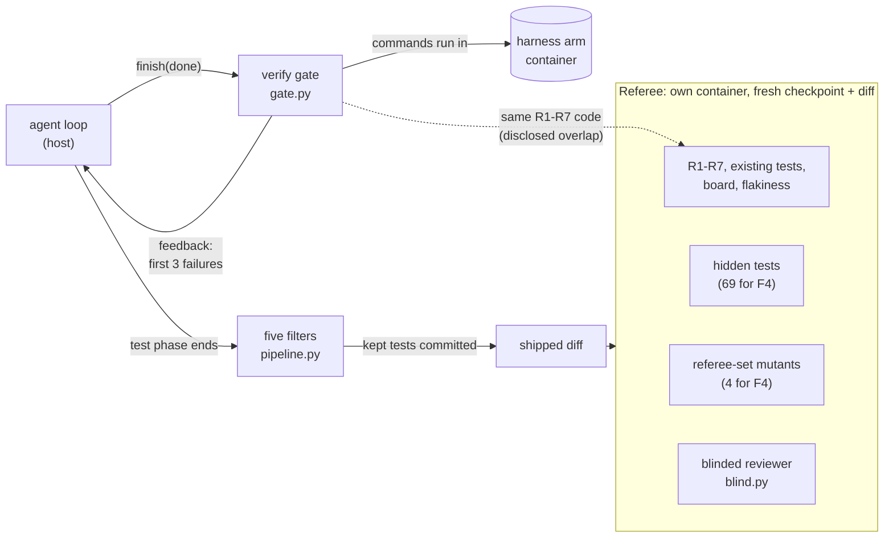

# S4 Verification: what proves the work is done

Reading time: about 15 minutes.

"S4 Verification" is a course label (RESEARCH §4.1). The ideas inside it come from the sources in
[RESEARCH.md](../../RESEARCH.md), cited by source ID and finding ID, for example (A3, F-a-110).
Quotes are copied from RESEARCH.md and `research/notes/`.

The order follows every section of the module: the problem in the bare run, its cause, the harness
piece, how `shipharness` builds it, and what the A/B measures.

---

## 1. The problem in the bare run

### The task: F4, optimistic concurrency and issue history

The S4 demo task is F4 (spec: `teamtrack/docs/features/f4.md`; ticket and allowed paths:
`teamtrack/reference/f4/task.toml`). Both arms start from checkpoint `m1-s4-start` and get the
same ticket:

- `GET /issues/{issue_id}` returns `ETag: "<version>"`.
- `PATCH /issues/{issue_id}`, `POST .../assign`, and `POST .../transition` accept an **optional**
  `If-Match: "<version>"` header. Without it, the write works as before. A stale or malformed value
  gives 412 `precondition_failed` and changes nothing. Every successful write returns the new ETag.
- Checks run in the order 401, 403, 404, 412, 422. A refused write adds no audit row.
- `GET /issues/{issue_id}/history` lists the issue's audit entries, oldest first.
- On the board, the edit form sends the version it was loaded with. A stale save gets a 409 page
  instead of overwriting.

### Why F4 is hard to check from the inside

The header is optional, so a request without `If-Match` changes the issue exactly as it did before
the feature (f4.md). Every existing test therefore keeps passing whether concurrency works or not,
and a quick happy-path request against the API also passes. The bug only shows when two writers
race on the same issue.

The console shows that race on the board. At the end of every F4 run, the preview container opens
the same issue in two tabs: tab A saves, then tab B saves from its stale form
(`capture_conflict` in `src/shipharness/console/board_capture.py`). If B's save is accepted and A's
edit is gone, the board shows **✗ LOST UPDATE**. A 409, 412, or 428 response shows
**✓ CONFLICT DETECTED**.

### What the bare arm does at the end

The bare arm runs with `--layers none`. When it calls `finish(claim="done")`, nothing checks the
claim, and the phase ends on the agent's word (DESIGN §6.5). The referee then judges the shipped
diff in its own container against two counts the agent never saw: the 69 hidden tests for F4 and
the four referee-set mutants in `teamtrack/mutants/features/f4.jsonl` (counts in VERIFICATION.md,
M5). Screen 1 puts "Agent said" next to "Referee", so the class sees whether the claim holds up.

### What the pilot showed on F4

Pilot run 2 (2026-10-16) ran F4 three times, both arms on gpt-6-luna at effort medium. Both arms
failed the primary measure in all three runs, for different reasons (VERIFICATION.md, M6 pilot
run 2; tests shipped from the score records in `exports/scores/<run_id>.json`):

| Count per run (runs 1, 2, 3) | Bare arm | Harness arm |
|---|---|---|
| Hidden tests passed, of 69 | 69, 66, 69 | 69, 61, 69 |
| Referee mutants killed, of 4 | 3, 4, 3 | 0, 0, 2 |
| Tests shipped | 30, 33, 8 | 0, 0, 3 |

- **The bare arm** wrote tests that killed most referee mutants, but every run missed something:
  run 2 failed 3 hidden tests, and runs 1 and 3 each left one referee mutant alive. In run 1 the
  survivor was the lost-update mutant `app.services.issues-m401`. The measure needs all 69 and all
  4, so a near miss is a fail.
- **The harness arm** shipped almost no tests: 0, 0, and 3 in the 12-turn test phase, so it killed
  0, 0, and 2 mutants. The pilot logs show why: every session repeated the getting-up-to-speed
  steps, re-read 3 to 7 instruction documents and about 15 product files, and updated state files
  mid-session (VERIFICATION.md, M6 pilot run 2, "Harness arm turn use").
- **No arm called `finish(claim="done")`.** Every arm used up its 40 build turns, so its claim was
  `none` and the verify gate never ran (VERIFICATION.md: "no arm claimed done, so no gate ran").
- The two-tab board check was not part of the pilot: pilot A/Bs run with `--no-preview`
  (VERIFICATION.md, M6 command), so the conflict panel first appears in class.

The referee's verdicts for run 1, two lines of `events.jsonl` cut to their key fields ("..." marks
a cut; captured on 2026-10-16, run ab-20261016-182828-c81fc0; your output will differ):

```text
{... "arm":"harness","seq":404, ... "type":"verdict", ... "summary":"agent said none; referee: fails the primary measure; hidden tests 69/69, mutants killed 0/4, R1 new 0"} ...
{... "arm":"bare","seq":436, ... "type":"verdict", ... "summary":"agent said none; referee: fails the primary measure; hidden tests 69/69, mutants killed 3/4, R1 new 0"} ...
```

What changed after run 2 is in section 5 under "Results".

---

## 2. Why it happens

This is cause 4 of the module storyline (DESIGN §1): the agent judges its own work, and its visible
tests miss what held-out tests catch.

### The agent grades its own work too kindly

- "agents reliably skew positive when grading their own work." (A3, F-a-15)
- "When asked to evaluate work they've produced, agents tend to respond by confidently praising the
  work—even when, to a human observer, the quality is obviously mediocre." (A3, F-a-14)
- A2 reports "Claude’s tendency to mark a feature as complete without proper testing." (A2,
  F-a-16) and a later session that would "see that progress had been made, and declare the job
  done." (A2, F-a-13)
- Testing at the wrong level misses the bug: the agent would "even do testing with unit tests or
  curl commands against a development server, but would fail recognize that the feature didn’t work
  end-to-end." (A2, F-a-104)
- "For autonomous systems, it is easy to see tests pass and assume the job is done, when this is
  rarely the case." (A4, F-a-17)

A2's harness has a single agent that is told to "Self-verify all features. Only mark features as
“passing” after careful testing." (A2, F-a-108). A2 lists separate testing and QA agents as future
work (F-a-109). The separate evaluator comes from A3, not A2 (RESEARCH correction 3).

### Visible tests miss what held-out tests catch

SpecBench splits each task into "visible validation tests that exercise specified features in
isolation, and (iii) held-out tests that compose those same features to simulate real-world usage."
(B13, F-b-42). Its headline: "while every frontier agent saturates the visible suite, reward
hacking persists, with smaller models exhibiting larger gaps on holdout suites." (B13, F-b-45). The
common failure is not cheating: "deliberate exploits are rare, while compositional failures account
for a much larger fraction of reward hacking behavior" (B13, F-b-50).

F4 has this shape. The ETag, the If-Match check, and the edit form each work in isolation; the lost
update appears only when they are composed into two people editing one issue. Two of F4's hidden
test files also combine F4 with earlier features (`test_f4_with_f1.py`, `test_f4_with_f3.py`,
listed in `task.toml`).

SpecBench also warns that better visible tests alone do not close the gap: "These findings suggest
that reward hacking cannot be eliminated by improving the test suite alone" (B13, F-b-51). That is
why the harness piece below has a separate judge as well as better tests.

### How the pilot fits this cause

In pilot run 2 no F4 agent reached a "done" claim, so the cause did not show as an unsupported
claim. It showed as shipped work that nothing inside the arm had judged: the bare arm's own tests
passed while a referee mutant or a few hidden tests still failed, and the separate reviewer
rejected all six F4 arms (`reviewer_verdict` in the six score records). Held-out checks caught what
the arm's own checks did not, which is SpecBench's point (B13, F-b-45).

---

## 3. The harness piece

Verification the agent does not control. Five parts; each cites its source and says whether the
source states the idea directly or the course composes it (RESEARCH §3.4 status key).

| Part | What it does | Source | Status |
|---|---|---|---|
| Verify gate on `finish(done)` | Runs checks in the arm's container before a "done" claim is accepted | A2 clean state (F-a-84) plus A4 "task verifier is nearly perfect" (F-a-127); decision moved from agent to harness per A3 (F-a-110) | Composite; course design (G-6) |
| House-rule checks R1-R7 | Probes every endpoint for tenant isolation, roles, conventions, idempotency, audit, layering, migrations | A1 "golden principles" (F-a-99) and "taste invariants" enforced with custom lints (F-a-96) | Composite; "house rules" is a course label (G-9) |
| Clean state | Work committed, ruff clean on changed files, one migration head, no debug output | A2 (F-a-84) | Direct |
| Five test filters | Keep a proposed test only if it passes all five | B11 filters 1-3 (F-b-17 to F-b-20); B12 for the mutant branch of filter 3 (F-b-29, F-b-32); filters 4 and 5 are course filters | Direct for 1-3; course filters for 4-5 (G-7) |
| Targeted mutants, disjoint sets | Hand-written faults on risky lines, split into a filter set and a referee set | B12 issue-specific mutants (F-b-29, F-b-33) | Direct concept; the split is course design (DESIGN D-4) |
| Blinded reviewer with grading criteria | A separate model reviews both arms' diffs without knowing which arm wrote them | A3 separate evaluator (F-a-110 to F-a-112), grading criteria (F-a-113, F-a-114, F-a-119) | Direct for the separate evaluator; "blinded" is A/B machinery, not a source term |

### 3.1 The verify gate on `finish(done)`

A2 defines the target: "By “clean state” we mean the kind of code that would be appropriate for
merging to a main branch" (A2, F-a-84). A4 explains why the check must be strict: "it’s important
that the task verifier is nearly perfect, otherwise Claude will solve the wrong problem." (A4,
F-a-127).

When the harness arm calls `finish(claim="done")` in the build phase, the gate runs in the arm's own
container: visible tests; existing tests (the checkpoint's visible suite, reported as "existing
tests keep passing", internal key `regression`; A4 "new commits can’t break existing code",
F-a-129; B11 F-b-22); R1-R7; a board smoke check; and the clean-state check. In the test phase the
gate runs the visible tests and the clean-state check only. A failure goes back to the agent as the
`finish` result, and the agent keeps working within its turn budget.

The feedback follows A4's advice on output written for the model: "if there are errors, Claude
should write ERROR and put the reason on the same line so grep will find it." (A4, F-a-132). The
gate sends a one-line summary, the first three failure lines, and "Fix these, commit your work, and
call finish again." (`_feedback` in `src/shipharness/harness/verify/gate.py`), which keeps the
context small (A4 "Context window pollution", F-a-131).

Course design (G-6): A2 lets the agent set `passes` after "careful testing" (F-a-108). In
shipharness the agent cannot: the scope layer sets `passes: true` only after the gate passes, citing
A3's "Separating the agent doing the work from the agent judging it proves to be a strong lever to
address this issue." (A3, F-a-110).

### 3.2 House-rule checks R1-R7

"House rules" is the course label for what A1 calls "golden principles" encoded "directly into the
repository" (A1, F-a-99) and taste invariants enforced "with custom lints" (A1, F-a-96). Both arms
can read the rules in `docs/HANDBOOK.md`; the harness arm also gets them through its map.

| Rule | Check (DESIGN §5) |
|---|---|
| R1 Tenant isolation | Every endpoint and method as Acme with Globex IDs: expect 404 |
| R2 Roles | Every write as viewer: expect 403 |
| R3 Conventions | Schemathesis with a fixed seed, plus list and error envelope assertions |
| R4 Idempotent creates | Duplicate POST with the same `Idempotency-Key` creates one record |
| R5 Audit | Every write adds exactly one audit row |
| R6 Layering | import-linter: `api` never imports `db` |
| R7 Migrations | One head; upgrade from an empty database works |

Each check reports **new** violations against the checkpoint baseline, so the documented legacy
`/v1/issues` leak does not count against either arm unless an arm makes it worse (DESIGN §5).

### 3.3 Five test filters

TestGen-LLM keeps generated tests by "applying a series of progressively demanding semantic filters"
(B11, F-b-16). It has three filters (builds; passes, including the five-execution flakiness check;
adds line coverage) plus a later dedup filter (RESEARCH correction 6). "5 runs" is TestGen-LLM's
number, not ACH's. The course runs five filters, cheapest first (DESIGN §7):

| # | Filter | Source |
|---|---|---|
| 1 | Imports and runs (pytest collects it, no errors) | B11: "fully buildable" (F-b-17) |
| 2 | Passes 5 consecutive runs | B11: "a test that does not pass on every one of five executions is deemed flaky." (F-b-19) |
| 3 | Adds line coverage over the existing suite, or kills a filter-set mutant no existing test kills | B11: "Any test that does not improve coverage is also discarded." (F-b-20); B12 hardening (F-b-32) |
| 4 | Real assertions, no mocking of the unit under test (AST check) | Course filter (G-7) |
| 5 | No source file changed during the test phase | Course filter, composite of B11 "no regression, by construction" (F-b-22) and A2 "It is unacceptable to remove or edit tests" (F-a-80) (G-7) |

Filters 4 and 5 have no direct source sentence (RESEARCH G-7). They guard against two ways a
generated test can pass without proving anything: a test that asserts nothing or mocks away the code
it claims to test, and a test phase that "fixes" the source until the new test passes.

Every discard carries a reason, and the console shows it. In pilot run 2 the only test a harness
arm proposed in an F4 test phase stopped at filter 2, with the reason `failed on run 1 of 5: assert
None is not None` (captured on 2026-10-16, run ab-20261016-191626-6100f6, `test_filter_result`
event; your output will differ). Two limits of the current build: in
`make demo-4` the test-phase context is built without a mutant list
(`filters_pipeline` in `src/shipharness/harness/verify/testphase.py`), so filter 3 keeps a TeamTrack
test through its coverage branch; and no single target module is set, so filter 4 checks assertions
but not mocking. `shipharness testgen --target <id>` passes the target's module and its filter-set
mutants (`src/shipharness/testgen/run.py`), so both branches run there.

### 3.4 Targeted mutants with disjoint sets

ACH writes mutants that are "both relevant to the issue of concern and also currently not caught
(unkilled) by any existing test case" (B12, F-b-29), and keeps tests that catch "faults that no
existing test can catch" (B12, F-b-32). Mutation is a different signal from coverage: "a large
proportion (49%) of test cases that uniquely additionally kill a mutant, do not also add line
coverage." (B12, F-b-40).

shipharness uses hand-written mutant records applied one at a time by a small targeted runner
(mutmut cannot target chosen lines; RESEARCH §4.7). Each mutant file is split into a **filter set**
(visible to filter 3) and a **referee set** (held out). The two never share a mutation (DESIGN D-4,
§8.3 rule 7), checked by `overlaps` in `src/shipharness/filters/mutant_sets.py`. Without the split,
a test written to kill a filter mutant also kills its referee twin, and the harness arm would be
judged by its own filter.

The F4 file shows the risky lines the referee targets (`teamtrack/mutants/features/f4.jsonl`):

| Mutant | Set | Change | Rationale (from the record) |
|---|---|---|---|
| `app.services.issues-m401` | referee | `issue.version += 1` becomes `+= 0` | writes do not move the version, so stale If-Match values still match (lost update) |
| `app.repositories.audit-m401` | referee | `entity_id=0` in new audit rows | audit rows lose the entity id, so issue history is empty |
| `app.repositories.issues-m401` | referee | the `deleted_at` filter is dropped | a deleted issue answers 428/412 instead of 404 |
| `app.services.context-m401` | referee | `can_write` returns `True` | viewers reach the precondition check instead of 403 |
| `app.repositories.common-m401` | filter | lists ordered by id descending | lists, including issue history, come newest first |
| `app.api.pagination-m401` | filter | `next_cursor=None` | lists never offer a next page |

The referee counts a kill only with shipped tests that pass on the arm's unmutated build (CONTRACTS
§21), so a broken test cannot "kill" anything.

### 3.5 The blinded reviewer with grading criteria

A3 gives the reason for a separate evaluator: "tuning a standalone evaluator to be skeptical turns
out to be far more tractable than making a generator critical of its own work" (A3, F-a-111). It
also gives the limit: "the evaluator is still an LLM that is inclined to be generous towards
LLM-generated outputs." (A3, F-a-112). So the reviewer's verdict is a secondary measure, and the
deterministic referee decides the primary counts.

A3 makes quality gradable with "grading criteria" (A3, F-a-114); "Each criterion had a hard
threshold" (A3, F-a-119). The course reviewer gets its grading criteria from `docs/SECURITY.md` and
`ARCHITECTURE.md` of the harness instructions (`src/shipharness/reviewer/criteria.py`), the same
bytes for both arms. Its structured output lists findings before the verdict (CONTRACTS §12).

"Blinded" is A/B design, not a source term: the reviewer receives the ticket and a diff with every
arm-identifying trace removed, and never the arm label (DESIGN §8.3 rule 3). It runs on both arms'
final diffs as referee output, not inside the gate, so the harness arm never gets reviewer feedback
the bare arm cannot get (DESIGN D-9).

---

## 4. How shipharness implements it

### Where the layer sits



### The flow of a "done" claim

```mermaid
sequenceDiagram
  participant Ag as agent
  participant V as verify layer
  participant Box as arm container
  participant Sc as scope layer
  Ag->>V: finish(claim="done")
  V->>Box: visible tests, existing tests, R1-R7, board, clean state
  Box-->>V: GateResult (pills ⏳ then ✓/✗)
  alt any item fails
    V-->>Ag: Gate summary (n of m items failed) + first 3 failure lines
    Ag->>Ag: fix, commit, finish again (turn budget)
  else all pass
    V-->>Sc: gate_pass
    Sc->>Sc: passes=true with evidence and testedAt
  end
```

### Code to open (walkthrough anchors)

`uv run python scripts/anchors.py extract <id>` prints each anchor.

| Anchor | File and lines | What to point at |
|---|---|---|
| `S4:filters` | `src/shipharness/filters/pipeline.py:34-74` | Each test stops at its first failing filter; every result is published with a reason |
| `S4:probe` | `src/shipharness/checks/r1_tenant.py:65-104` | One R1 probe: 404 expected for a foreign id; a 2xx with Globex data is a leak |
| `S4:blind` | `src/shipharness/reviewer/blind.py:15-39` | Harness artifacts, commit metadata, workspace paths, and run ids removed |
| `S4:gate` | `src/shipharness/harness/verify/gate.py:133-172` | Pending pills first; items in the arm container; feedback only on failure |

The gate's check list has no hidden tests and no mutants. From
`src/shipharness/harness/verify/gate.py`, lines 31-41:

```python
GATE_CHECKS: tuple[str, ...] = (
    "r1_tenant",
    "r2_roles",
    "r3_conventions",
    "r4_idempotency",
    "r5_audit",
    "r6_layering",
    "r7_migrations",
    "regression",
    "board",
)
```

The core of `run_gate` (same file, lines 153-166):

```python
    visible, lines = _visible_tests(sandbox, f"{root}/build", cfg.limit(cfg.timeout_s))
    items = [visible]
    if phase == "build":
        check_items, check_lines = _check_items(sandbox, cfg, root, on_progress)
        items += sorted(check_items, key=_order)
        lines += check_lines
    clean = clean_state_check(sandbox, base_sha, cfg.limit(120))
    items.append(clean)
    if clean.status == "fail":
        lines.append(f"FAIL clean state: {clean.detail}")
    sandbox.exec(f"rm -rf {root}", cfg.limit(60))
    passed = not any(i.status == "fail" for i in items)
    feedback = "" if passed else _feedback(gate_id, items, lines)
    result = GateResult(gate_id=gate_id, items=items, passed=passed, feedback=feedback)
```

The filter loop (`src/shipharness/filters/pipeline.py`, lines 54-70):

```python
        for flt in filters:
            try:
                result = flt.evaluate(cand, ctx)
            except Exception as exc:  # noqa: BLE001 - a crashing filter discards, with a reason
                result = FilterResult(
                    test_id=cand.test_id,
                    filter=flt.number,
                    passed=False,
                    reason=f"filter error: {type(exc).__name__}: {exc}"[:500],
                )
            if not result.reason:
                result = result.model_copy(update={"reason": f"filter {flt.number}: no reason"})
            results.append(result)
            if bus is not None:
                bus.publish("test_filter_result", result, run_id=run_id, arm=arm)
            if not result.passed:
                break  # discarded: later (more expensive) filters never run
```

The R1 judgement (`src/shipharness/checks/r1_tenant.py`, lines 68-79):

```python
    status, body = response.status_code, json_body(response)
    ok = 200 <= status < 300
    leaked = ok and (
        t.adapter.is_foreign(body, other)
        or (probe.kind == "anonymous" and t.adapter.is_foreign(body, home))
    )
    if probe.kind in ("foreign_path",) or probe.kind.startswith("foreign_param:"):
        failed = status != 404
    else:  # no_path, foreign_body, anonymous: success itself is the failure (no_path: only leaks)
        failed = leaked if probe.kind == "no_path" else ok
    if not failed:
        return None
```

The blinding steps (`src/shipharness/reviewer/blind.py`, lines 27-36):

```python
    text = diff.decode("utf-8", errors="replace") if isinstance(diff, bytes) else diff
    text = strip_harness_artifacts(text)
    lines = text.splitlines()
    first = next((i for i, line in enumerate(lines) if line.startswith("diff --git ")), None)
    if first is None:
        return ""
    kept = [line for line in lines[first:] if not _INDEX.match(line)]
    body = "\n".join(kept) + "\n"
    body = _WORKSPACE.sub("<workspace>", body)
    return _IDS.sub("<id>", body)
```

---

## 5. What the A/B measures

### Co-primary counts (pre-registered, DESIGN §8.2)

For F4 there are two co-primary counts per run, each shown as one dot per run per arm:

1. **Hidden tests passed**, of 69 (`hidden_passed` of `hidden_total`). The hidden tests are
   "never shown to the agent" (B13, F-b-43) and live only in the referee container.
2. **Referee-set mutants killed by the shipped tests**, of 4 (`mutants_killed` of `mutants_total`).

Results are counts ("9/10"), never percentages (DESIGN §8.3 rule 5). A run passes the primary only
when every hidden test passes and every referee mutant is killed (`evaluate_primary` in
`src/shipharness/ab/score.py`); the report also shows each count as a dot.

### Secondary measures

From the score record (CONTRACTS §11): existing tests keep passing (`regression_passed` of
`regression_total`), new R1-R7 violations, board check, shipped tests, flaky tests (shipped tests
re-run 10 times), reviewer verdict and whether it agrees with the referee (`reviewer_agrees`),
"agent said" versus the referee, cost, turns, and wall time.

### Disclosed overlap (DESIGN §8.3 rule 8)

The verify gate runs the same R1-R7 checks as the referee. These are documented house rules both
arms can read, so a better R1-R7 result for the harness arm in demo-4 is partly expected by
construction. The co-primary measures are different: hidden tests and referee-set mutants are never
available to the gate or the agent. They are not in `GATE_CHECKS`, they are not in the arm's
exported repository (DESIGN §8.3 rule 6), and the referee set shares no mutation with the filter set
(rule 7). Demos 1 to 3 do not include the verify layer (DESIGN §6.6).

### Fairness checks shown in class

- **Swap test** (`make swap-4`): each arm's diff is judged again under the other arm's label. The
  referee never reads the label, so every judged measure must come out identical.
- **Layer switch** (`make demo-4 LAYERS=-verify`): the same demo with the verify layer removed, the
  leave-one-out idea from A3: "removing one component at a time and reviewing what impact it had on
  the final result." (A3, F-a-125).

### Results

Pilot run 2: both F4 arms failed the primary measure in 3 of 3 runs (table in section 1;
VERIFICATION.md, M6 pilot run 2). The changes logged before run 3 that touch F4:

| # | Change | Label (VERIFICATION.md) | Effect on F4 |
|---|---|---|---|
| 9 | Turn cost: the handoff's agent notes come before any document, state files are updated only in the wrap-up turns, and a test-phase session starts with the feature's tests | harness change, harness arm only | Targets the harness arm's 0, 0, 3 shipped tests. The test-phase session now opens with "write the tests for the feature first" (`TEST_PHASE_FIRST` in `src/shipharness/harness/state/lifecycle.py`) |
| 10 | Each arm is judged as soon as its run ends | measurement change, both arms, no outcome change | Shorter wait for the verdict; the same counts |
| 11 | The unmutated-pass step before referee mutants runs all shipped tests in one pytest process | measurement change, both arms, no outcome change | Checked on 181 shipped tests from 17 run 2 arms: every test had the same pass or fail outcome alone and in the batch |

Changes 10 and 11 change how fast the referee works, not what it measures. Change 9 is the
treatment: only the harness arm gets it. The prompt text is course design, not a source sentence.

[[PENDING: F4 results of pilot run 3 (hidden x/69 and referee mutants y/4 per run, bare vs harness, k=3) with run ids | source: M6 pilot | how: scripts/pilot.py run 3; VERIFICATION.md, M6 pilot run 3]]

[[PENDING: S4 co-primary dots from batch 1 (hidden x/69 and referee mutants y/4 per run, bare vs harness, k=10) with run ids | source: M8 batch 1 | how: make experiments BATCH=1, then make report]]

[[PENDING: S4 secondary measures from batch 1 (existing tests, R1-R7 new violations, flaky tests, reviewer agreement) | source: M8 batch 1 | how: make report]]

[[PENDING: effect of removing the verify layer (leave-one-out) on F4 tasks | source: M8 ablation | how: make experiments BATCH=2, then make report]]

---

## Open gaps carried into this section

- Filters 4 and 5 are course filters with composite citations; no source states them (RESEARCH
  G-7).
- "House rules" is a course label for A1's golden principles and taste invariants (G-9).
- "Blinded" is A/B design; the source idea is A3's separate evaluator, which A3 itself says is
  still generous to model-written output (F-a-112).
- `evidence`, `testedAt`, and "only the harness sets `passes`" extend A2's design (G-6).

After class: [session-notes.md](session-notes.md). Further reading:
[post-class-reading/](post-class-reading/README.md).
